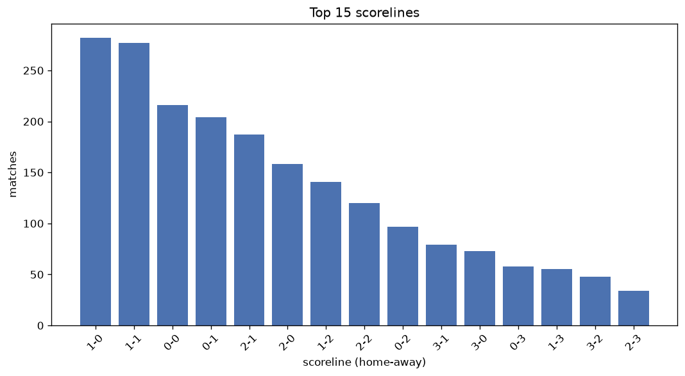
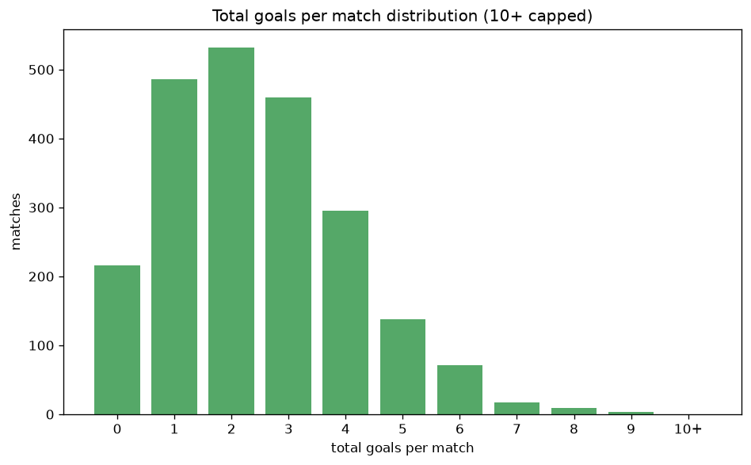

# Scoreline Analysis
- Report: `scoreline_analysis`
- Generated: 2026-10-29T02:00:02+00:00
- Script: `backend/scripts/analyze_scorelines.py` v1.0.0
- League: Ligue 2 (France)
- Scope: league `france2`

## 1. Scoreline frequency
- Matches analysed: **2226** across **7** seasons.
- Distinct scorelines seen: **40**.

| scoreline | count | pct |
|---|---|---|
| 1-0 | 282 | 12.7% |
| 1-1 | 277 | 12.4% |
| 0-0 | 216 | 9.7% |
| 0-1 | 204 | 9.2% |
| 2-1 | 187 | 8.4% |
| 2-0 | 158 | 7.1% |
| 1-2 | 141 | 6.3% |
| 2-2 | 120 | 5.4% |
| 0-2 | 97 | 4.4% |
| 3-1 | 79 | 3.5% |
| 3-0 | 73 | 3.3% |
| 0-3 | 58 | 2.6% |
| 1-3 | 55 | 2.5% |
| 3-2 | 48 | 2.2% |
| 2-3 | 34 | 1.5% |
| 4-0 | 33 | 1.5% |
| 3-3 | 26 | 1.2% |
| 4-1 | 24 | 1.1% |
| 1-4 | 23 | 1.0% |
| 4-2 | 15 | 0.7% |

## 2. Scoreline frequency per season

### 2020-2021
| scoreline | count | pct |
|---|---|---|
| 1-1 | 62 | 16.3% |
| 1-0 | 55 | 14.5% |
| 0-0 | 37 | 9.7% |
| 0-1 | 28 | 7.4% |
| 2-1 | 26 | 6.8% |

### 2021-2022
| scoreline | count | pct |
|---|---|---|
| 1-1 | 50 | 13.2% |
| 1-0 | 48 | 12.6% |
| 0-0 | 38 | 10.0% |
| 2-1 | 36 | 9.5% |
| 0-1 | 36 | 9.5% |

### 2022-2023
| scoreline | count | pct |
|---|---|---|
| 1-0 | 53 | 13.9% |
| 1-1 | 45 | 11.8% |
| 2-1 | 36 | 9.5% |
| 0-0 | 36 | 9.5% |
| 0-1 | 35 | 9.2% |

### 2023-2024
| scoreline | count | pct |
|---|---|---|
| 0-0 | 45 | 11.8% |
| 0-1 | 39 | 10.3% |
| 1-0 | 36 | 9.5% |
| 2-0 | 35 | 9.2% |
| 1-1 | 34 | 8.9% |

### 2024-2025
| scoreline | count | pct |
|---|---|---|
| 1-0 | 39 | 12.7% |
| 1-1 | 34 | 11.1% |
| 0-1 | 31 | 10.1% |
| 2-1 | 24 | 7.8% |
| 2-0 | 24 | 7.8% |

### 2025-2026
| scoreline | count | pct |
|---|---|---|
| 1-0 | 42 | 13.5% |
| 1-1 | 38 | 12.3% |
| 0-0 | 33 | 10.6% |
| 2-1 | 26 | 8.4% |
| 0-1 | 26 | 8.4% |

### 2026-2027
| scoreline | count | pct |
|---|---|---|
| 1-1 | 14 | 15.6% |
| 0-1 | 9 | 10.0% |
| 1-0 | 9 | 10.0% |
| 0-0 | 8 | 8.9% |
| 1-2 | 8 | 8.9% |

## 3. Total-goal histogram
_10+ groups all matches with 10 or more total goals._

| total goals | matches | pct |
|---|---|---|
| 0 | 216 | 9.7% |
| 1 | 486 | 21.8% |
| 2 | 532 | 23.9% |
| 3 | 459 | 20.6% |
| 4 | 295 | 13.3% |
| 5 | 138 | 6.2% |
| 6 | 71 | 3.2% |
| 7 | 17 | 0.8% |
| 8 | 9 | 0.4% |
| 9 | 3 | 0.1% |
| 10+ | 0 | 0.0% |

## 4. Extreme scorelines
- Matches with 7+ total goals: **29**

| season | date | scoreline | total goals |
|---|---|---|---|
| 2020-2021 | 2020-11-07 | 4-5 | 9 |
| 2022-2023 | 2022-09-12 | 3-6 | 9 |
| 2022-2023 | 2023-04-01 | 4-5 | 9 |
| 2020-2021 | 2020-08-29 | 5-3 | 8 |
| 2020-2021 | 2021-05-08 | 3-5 | 8 |
| 2022-2023 | 2023-05-20 | 2-6 | 8 |
| 2023-2024 | 2023-10-07 | 5-3 | 8 |
| 2023-2024 | 2023-11-11 | 4-4 | 8 |
| 2025-2026 | 2025-09-27 | 6-2 | 8 |
| 2025-2026 | 2025-10-28 | 2-6 | 8 |
| 2025-2026 | 2026-04-27 | 2-6 | 8 |
| 2025-2026 | 2026-05-09 | 5-3 | 8 |
| 2020-2021 | 2020-11-07 | 3-4 | 7 |
| 2020-2021 | 2020-12-19 | 4-3 | 7 |
| 2020-2021 | 2021-05-15 | 4-3 | 7 |
| 2021-2022 | 2022-02-01 | 6-1 | 7 |
| 2022-2023 | 2023-05-06 | 3-4 | 7 |
| 2023-2024 | 2023-10-07 | 4-3 | 7 |
| 2023-2024 | 2023-11-11 | 5-2 | 7 |
| 2023-2024 | 2024-04-13 | 4-3 | 7 |
| 2024-2025 | 2024-08-30 | 3-4 | 7 |
| 2024-2025 | 2025-04-14 | 5-2 | 7 |
| 2025-2026 | 2025-09-20 | 5-2 | 7 |
| 2025-2026 | 2026-02-09 | 4-3 | 7 |
| 2025-2026 | 2026-02-21 | 4-3 | 7 |
| 2025-2026 | 2026-03-20 | 3-4 | 7 |
| 2025-2026 | 2026-04-11 | 4-3 | 7 |
| 2026-2027 | 2026-08-22 | 2-5 | 7 |
| 2026-2027 | 2026-09-18 | 3-4 | 7 |

## 5. Margin-of-victory distribution (decided matches)
- Decided matches: **1586** (draws: **640**)
- Average winning margin: **1.65**

| margin | matches | pct |
|---|---|---|
| 1 | 910 | 57.4% |
| 2 | 421 | 26.5% |
| 3+ | 255 | 16.1% |

## 6. Margin by outcome

### Home wins
- Matches: **934** | avg margin: **1.68** | max margin: **6**
| margin | matches | pct |
|---|---|---|
| 1 | 524 | 56.1% |
| 2 | 255 | 27.3% |
| 3+ | 155 | 16.6% |
- *Full match-by-match list available in `scoreline_analysis.json`.*

### Away wins
- Matches: **652** | avg margin: **1.6** | max margin: **6**
| margin | matches | pct |
|---|---|---|
| 1 | 386 | 59.2% |
| 2 | 166 | 25.5% |
| 3+ | 100 | 15.3% |
- *Full match-by-match list available in `scoreline_analysis.json`.*

## 7. Most common exact score by outcome type
| outcome | matches | most common score | count | pct |
|---|---|---|---|---|
| home | 934 | 1-0 | 282 | 30.2% |
| draw | 640 | 1-1 | 277 | 43.3% |
| away | 652 | 0-1 | 204 | 31.3% |

---
*All statistics are computed from PostgreSQL tables (read-only). Run with `python backend/scripts/analyze_scorelines.py` to regenerate.*

## Charts

