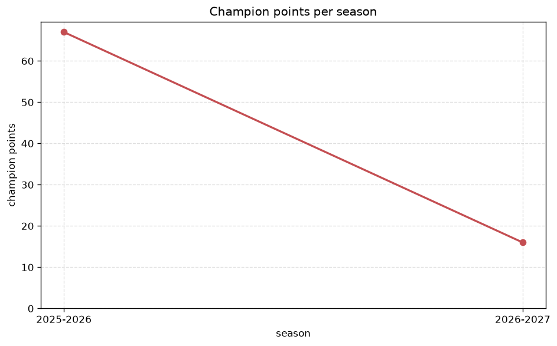
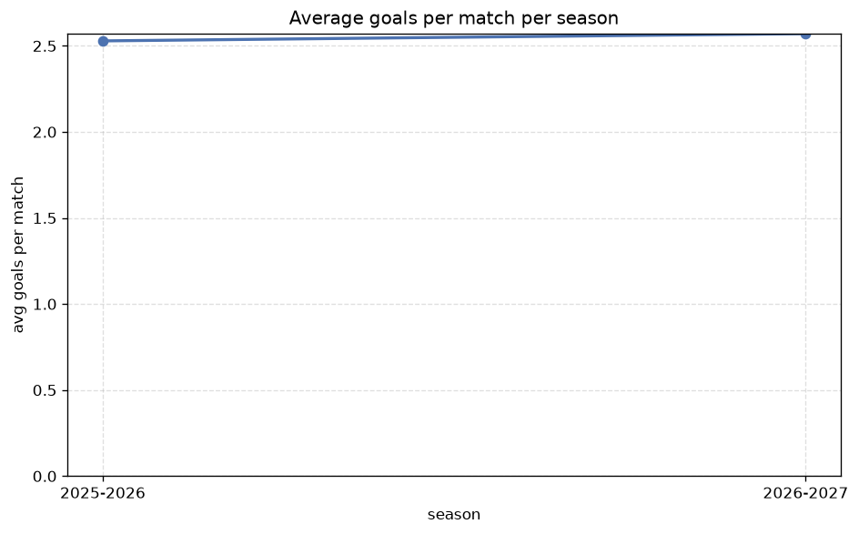

# Season Trends Analysis
- Report: `season_trends`
- Generated: 2026-10-30T03:51:38+00:00
- Script: `backend/scripts/analyze_seasons.py` v1.0.0
- League: Ligue 2 (France)
- Scope: league `france2`

## 1. Champions per season
| season | champion | pts | runner-up | margin |
|---|---|---|---|---|
| 2020-2021 | Troyes | 77 | Clermont | 5 pts |
| 2021-2022 | Toulouse | 79 | AC Ajaccio | 4 pts |
| 2022-2023 | Le Havre | 75 | Metz | 3 pts |
| 2023-2024 | Auxerre | 74 | Angers | 6 pts |
| 2024-2025 | Lorient | 71 | Paris FC | 2 pts |
| 2025-2026 | Troyes | 67 | Le Mans | 5 pts |
| 2026-2027 | St Etienne | 25 | Montpellier | 4 pts |

## 2. Title-race tightness
- Tight races (margin <= 3 pts): **2** of 7 seasons
- Tightest race: **2024-2025** - Lorient beat Paris FC by **2** pts

| season | margin | tight |
|---|---|---|
| 2020-2021 | 5 pts |  |
| 2021-2022 | 4 pts |  |
| 2022-2023 | 3 pts | yes |
| 2023-2024 | 6 pts |  |
| 2024-2025 | 2 pts | yes |
| 2025-2026 | 5 pts |  |
| 2026-2027 | 4 pts |  |

## 3. Points thresholds
_Position-specific points per season. Key: 1 = champion, 2 = runner-up, 4 = CL line, 6 = Europa, 15 = last safe, 18 = bottom._

| season | pos 1 | pos 2 | pos 4 | pos 6 | pos 15 | pos 18 |
|---|---|---|---|---|---|---|
| 2020-2021 | 77 | 72 | 65 | 62 | 43 | 41 |
| 2021-2022 | 79 | 75 | 70 | 58 | 44 | 40 |
| 2022-2023 | 75 | 72 | 60 | 56 | 46 | 42 |
| 2023-2024 | 74 | 68 | 60 | 58 | 46 | 38 |
| 2024-2025 | 71 | 69 | 56 | 51 | 38 | 22 |
| 2025-2026 | 67 | 62 | 60 | 56 | 36 | 24 |
| 2026-2027 | 25 | 21 | 18 | 17 | 8 | 6 |

## 4. Relegation battle
| season | safe pos | safe pts | drop pos | drop pts | gap |
|---|---|---|---|---|---|
| 2020-2021 | 15 | 43 | 16 | 41 | 2 pts |
| 2021-2022 | 15 | 44 | 16 | 44 | 0 pts |
| 2022-2023 | 15 | 46 | 16 | 45 | 1 pts |
| 2023-2024 | 15 | 46 | 16 | 46 | 0 pts |
| 2024-2025 | 15 | 38 | 16 | 33 | 5 pts |
| 2025-2026 | 15 | 36 | 16 | 36 | 0 pts |
| 2026-2027 | 15 | 8 | 16 | 8 | 0 pts |

## 5. League-level trends
| season | matches | total goals | avg goals | home win | draw | away win | goalless | avg pts/team |
|---|---|---|---|---|---|---|---|---|
| 2020-2021 | 380 | 910 | 2.395 | 41.8% | 33.4% | 24.7% | 9.7% | 50.65 |
| 2021-2022 | 380 | 868 | 2.284 | 41.3% | 27.9% | 30.8% | 10.0% | 51.7 |
| 2022-2023 | 380 | 916 | 2.411 | 43.9% | 27.1% | 28.9% | 9.5% | 51.85 |
| 2023-2024 | 380 | 933 | 2.455 | 40.3% | 28.7% | 31.1% | 11.8% | 51.55 |
| 2024-2025 | 306 | 789 | 2.578 | 48.7% | 23.5% | 27.8% | 6.2% | 44.53 |
| 2025-2026 | 310 | 784 | 2.529 | 37.7% | 30.6% | 31.6% | 10.6% | 43.79 |
| 2026-2027 | 90 | 241 | 2.678 | 35.6% | 31.1% | 33.3% | 8.9% | 13.44 |

## 6. View divergence
- Largest divergence: **2022-2023** (goals view, avg abs position diff = 6.400)

_Avg absolute position difference between classic view and alternative view per season._

| season | classic vs luck | classic vs goals |
|---|---|---|
| 2020-2021 | 3.300 | 6.100 |
| 2021-2022 | 2.400 | 4.900 |
| 2022-2023 | 3.300 | 6.400 |
| 2023-2024 | 3.300 | 6.400 |
| 2024-2025 | 3.263 | 5.158 |
| 2025-2026 | 3.474 | 4.737 |
| 2026-2027 | 1.444 | 6.333 |

---
*All statistics are computed from PostgreSQL tables (read-only). Run with `python backend/scripts/analyze_seasons.py` to regenerate.*

## Charts

