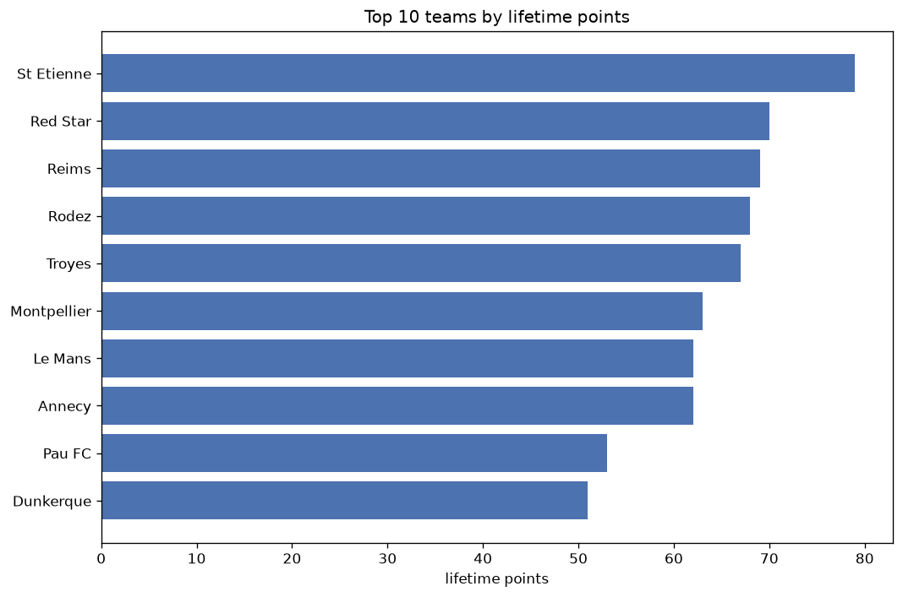
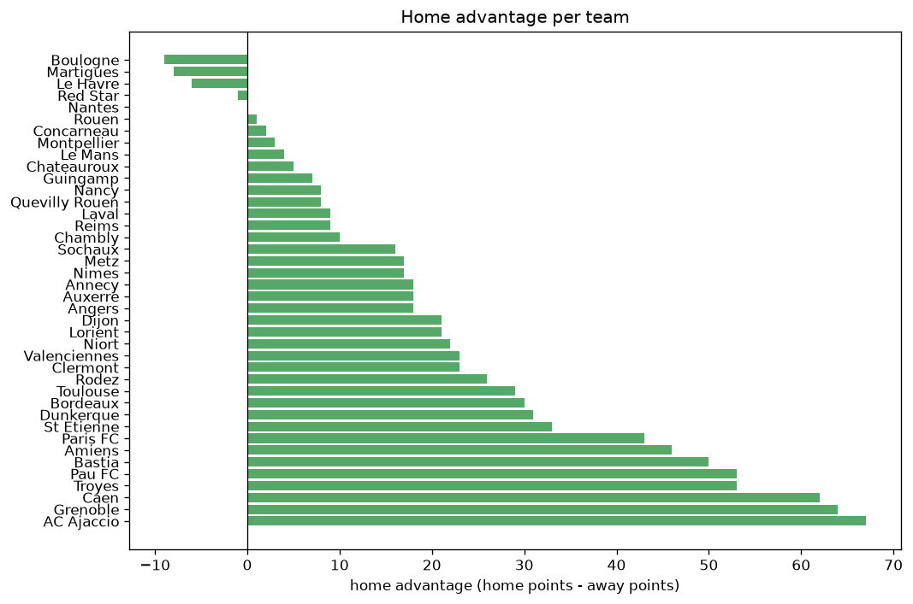

# Team Analysis
- Report: `teams_analysis`
- Generated: 2026-10-30T03:51:35+00:00
- Script: `backend/scripts/analyze_teams.py` v1.0.0
- League: Ligue 2 (France)
- Scope: league `france2`

- Teams: **40** | Seasons: **7** | Matches: **2226**

## 1. Team standings (lifetime)
| team | seasons | played | W | D | L | pts | GF | GA | GD | avg pts/season | best pos | worst pos | titles |
|---|---|---|---|---|---|---|---|---|---|---|---|---|---|
| Paris FC | 5 | 186 | 89 | 50 | 47 | 317 | 256 | 190 | 66 | 63.4 | 2 | 8 | 0 |
| Guingamp | 7 | 230 | 83 | 68 | 79 | 317 | 300 | 286 | 14 | 45.29 | 5 | 11 | 0 |
| Grenoble | 7 | 230 | 80 | 64 | 86 | 304 | 244 | 259 | -15 | 43.43 | 4 | 16 | 0 |
| Rodez | 7 | 232 | 73 | 83 | 76 | 302 | 291 | 299 | -8 | 43.14 | 3 | 17 | 0 |
| Pau FC | 7 | 230 | 77 | 64 | 89 | 295 | 283 | 332 | -49 | 42.14 | 5 | 14 | 0 |
| Amiens | 6 | 220 | 64 | 66 | 90 | 258 | 228 | 284 | -56 | 43.0 | 8 | 18 | 0 |
| Bastia | 5 | 182 | 57 | 63 | 62 | 234 | 200 | 205 | -5 | 46.8 | 4 | 17 | 0 |
| Caen | 5 | 186 | 60 | 50 | 76 | 230 | 219 | 237 | -18 | 46.0 | 5 | 18 | 0 |
| Troyes | 4 | 144 | 65 | 34 | 45 | 229 | 198 | 153 | 45 | 57.25 | 1 | 17 | 2 |
| Dunkerque | 6 | 192 | 61 | 46 | 85 | 229 | 212 | 253 | -41 | 38.17 | 4 | 19 | 0 |
| Auxerre | 3 | 114 | 58 | 36 | 20 | 210 | 197 | 118 | 79 | 70.0 | 1 | 6 | 1 |
| Annecy | 5 | 154 | 57 | 39 | 58 | 210 | 193 | 195 | -2 | 42.0 | 6 | 17 | 0 |
| St Etienne | 4 | 121 | 61 | 26 | 34 | 209 | 194 | 134 | 60 | 52.25 | 1 | 6 | 1 |
| AC Ajaccio | 4 | 148 | 57 | 38 | 53 | 209 | 138 | 150 | -12 | 52.25 | 2 | 15 | 0 |
| Laval | 5 | 156 | 51 | 40 | 65 | 193 | 173 | 209 | -36 | 38.6 | 7 | 18 | 0 |
| Sochaux | 4 | 124 | 48 | 38 | 38 | 182 | 154 | 124 | 30 | 45.5 | 5 | 12 | 0 |
| Le Havre | 3 | 114 | 44 | 40 | 30 | 172 | 122 | 108 | 14 | 57.33 | 1 | 12 | 1 |
| Valenciennes | 4 | 152 | 38 | 51 | 63 | 165 | 152 | 209 | -57 | 41.25 | 11 | 20 | 0 |
| Metz | 3 | 82 | 41 | 28 | 13 | 151 | 141 | 81 | 60 | 50.33 | 2 | 8 | 0 |
| Toulouse | 2 | 76 | 43 | 20 | 13 | 149 | 153 | 75 | 78 | 74.5 | 1 | 3 | 1 |
| Clermont | 4 | 116 | 37 | 38 | 41 | 149 | 138 | 129 | 9 | 37.25 | 2 | 17 | 0 |
| Nancy | 4 | 120 | 32 | 34 | 54 | 130 | 132 | 182 | -50 | 32.5 | 3 | 20 | 0 |
| Quevilly Rouen | 3 | 114 | 29 | 41 | 44 | 128 | 131 | 154 | -23 | 42.67 | 11 | 18 | 0 |
| Bordeaux | 3 | 76 | 34 | 18 | 24 | 120 | 101 | 80 | 21 | 40.0 | 3 | 19 | 0 |
| Niort | 3 | 114 | 28 | 32 | 54 | 116 | 108 | 167 | -59 | 38.67 | 13 | 20 | 0 |
| Red Star | 3 | 79 | 29 | 24 | 26 | 111 | 97 | 103 | -6 | 37.0 | 6 | 15 | 0 |
| Dijon | 3 | 86 | 26 | 23 | 37 | 101 | 103 | 114 | -11 | 33.67 | 9 | 18 | 0 |
| Nimes | 2 | 76 | 24 | 13 | 39 | 85 | 88 | 113 | -25 | 42.5 | 9 | 19 | 0 |
| Reims | 2 | 44 | 18 | 20 | 6 | 74 | 73 | 47 | 26 | 37.0 | 4 | 5 | 0 |
| Montpellier | 2 | 44 | 20 | 12 | 12 | 72 | 54 | 37 | 17 | 36.0 | 2 | 8 | 0 |
| Lorient | 1 | 34 | 22 | 5 | 7 | 71 | 68 | 31 | 37 | 71.0 | 1 | 1 | 1 |
| Angers | 1 | 38 | 20 | 8 | 10 | 68 | 56 | 42 | 14 | 68.0 | 2 | 2 | 0 |
| Le Mans | 1 | 34 | 16 | 14 | 4 | 62 | 50 | 31 | 19 | 62.0 | 2 | 2 | 0 |
| Boulogne | 2 | 44 | 10 | 16 | 18 | 46 | 41 | 56 | -15 | 23.0 | 13 | 15 | 0 |
| Concarneau | 1 | 38 | 10 | 8 | 20 | 38 | 39 | 57 | -18 | 38.0 | 19 | 19 | 0 |
| Chambly | 1 | 38 | 9 | 11 | 18 | 38 | 41 | 64 | -23 | 38.0 | 19 | 19 | 0 |
| Martigues | 1 | 34 | 9 | 5 | 20 | 32 | 29 | 56 | -27 | 32.0 | 17 | 17 | 0 |
| Chateauroux | 1 | 38 | 4 | 11 | 23 | 23 | 32 | 58 | -26 | 23.0 | 20 | 20 | 0 |
| Nantes | 1 | 10 | 2 | 2 | 6 | 8 | 11 | 17 | -6 | 8.0 | 15 | 15 | 0 |
| Rouen | 1 | 2 | 0 | 1 | 1 | 1 | 1 | 2 | -1 | 1.0 | 19 | 19 | 0 |

## 2. Home vs away split
| team | home P | H-W | H-D | H-L | H-pts | away P | A-W | A-D | A-L | A-pts | adv |
|---|---|---|---|---|---|---|---|---|---|---|---|
| AC Ajaccio | 74 | 40 | 18 | 16 | 138 | 74 | 17 | 20 | 37 | 71 | 67 |
| Grenoble | 114 | 48 | 40 | 26 | 184 | 116 | 32 | 24 | 60 | 120 | 64 |
| Caen | 93 | 40 | 26 | 27 | 146 | 93 | 20 | 24 | 49 | 84 | 62 |
| Pau FC | 116 | 48 | 30 | 38 | 174 | 114 | 29 | 34 | 51 | 121 | 53 |
| Troyes | 72 | 43 | 12 | 17 | 141 | 72 | 22 | 22 | 28 | 88 | 53 |
| Bastia | 91 | 36 | 34 | 21 | 142 | 91 | 21 | 29 | 41 | 92 | 50 |
| Amiens | 110 | 40 | 32 | 38 | 152 | 110 | 24 | 34 | 52 | 106 | 46 |
| Paris FC | 93 | 53 | 21 | 19 | 180 | 93 | 36 | 29 | 28 | 137 | 43 |
| St Etienne | 61 | 37 | 10 | 14 | 121 | 60 | 24 | 16 | 20 | 88 | 33 |
| Dunkerque | 97 | 34 | 28 | 35 | 130 | 95 | 27 | 18 | 50 | 99 | 31 |
| Bordeaux | 38 | 22 | 9 | 7 | 75 | 38 | 12 | 9 | 17 | 45 | 30 |
| Toulouse | 38 | 27 | 8 | 3 | 89 | 38 | 16 | 12 | 10 | 60 | 29 |
| Rodez | 115 | 40 | 44 | 31 | 164 | 117 | 33 | 39 | 45 | 138 | 26 |
| Valenciennes | 76 | 22 | 28 | 26 | 94 | 76 | 16 | 23 | 37 | 71 | 23 |
| Clermont | 59 | 21 | 23 | 15 | 86 | 57 | 16 | 15 | 26 | 63 | 23 |
| Niort | 57 | 18 | 15 | 24 | 69 | 57 | 10 | 17 | 30 | 47 | 22 |
| Dijon | 43 | 17 | 10 | 16 | 61 | 43 | 9 | 13 | 21 | 40 | 21 |
| Lorient | 17 | 15 | 1 | 1 | 46 | 17 | 7 | 4 | 6 | 25 | 21 |
| Annecy | 76 | 31 | 21 | 24 | 114 | 78 | 26 | 18 | 34 | 96 | 18 |
| Auxerre | 57 | 33 | 15 | 9 | 114 | 57 | 25 | 21 | 11 | 96 | 18 |
| Angers | 19 | 13 | 4 | 2 | 43 | 19 | 7 | 4 | 8 | 25 | 18 |
| Metz | 41 | 23 | 15 | 3 | 84 | 41 | 18 | 13 | 10 | 67 | 17 |
| Nimes | 38 | 15 | 6 | 17 | 51 | 38 | 9 | 7 | 22 | 34 | 17 |
| Sochaux | 62 | 27 | 18 | 17 | 99 | 62 | 21 | 20 | 21 | 83 | 16 |
| Chambly | 19 | 7 | 3 | 9 | 24 | 19 | 2 | 8 | 9 | 14 | 10 |
| Laval | 78 | 27 | 20 | 31 | 101 | 78 | 24 | 20 | 34 | 92 | 9 |
| Nancy | 60 | 18 | 15 | 27 | 69 | 60 | 14 | 19 | 27 | 61 | 8 |
| Quevilly Rouen | 57 | 15 | 23 | 19 | 68 | 57 | 14 | 18 | 25 | 60 | 8 |
| Reims | 22 | 11 | 8 | 3 | 41 | 22 | 7 | 12 | 3 | 33 | 8 |
| Guingamp | 115 | 42 | 36 | 37 | 162 | 115 | 41 | 32 | 42 | 155 | 7 |
| Montpellier | 22 | 11 | 6 | 5 | 39 | 22 | 9 | 6 | 7 | 33 | 6 |
| Chateauroux | 19 | 3 | 5 | 11 | 14 | 19 | 1 | 6 | 12 | 9 | 5 |
| Le Mans | 17 | 9 | 6 | 2 | 33 | 17 | 7 | 8 | 2 | 29 | 4 |
| Concarneau | 19 | 5 | 5 | 9 | 20 | 19 | 5 | 3 | 11 | 18 | 2 |
| Rouen | 1 | 0 | 1 | 0 | 1 | 1 | 0 | 0 | 1 | 0 | 1 |
| Nantes | 5 | 1 | 1 | 3 | 4 | 5 | 1 | 1 | 3 | 4 | 0 |
| Red Star | 39 | 14 | 13 | 12 | 55 | 40 | 15 | 11 | 14 | 56 | -1 |
| Le Havre | 57 | 21 | 20 | 16 | 83 | 57 | 23 | 20 | 14 | 89 | -6 |
| Boulogne | 22 | 4 | 7 | 11 | 19 | 22 | 6 | 9 | 7 | 27 | -8 |
| Martigues | 17 | 3 | 3 | 11 | 12 | 17 | 6 | 2 | 9 | 20 | -8 |

## 3. Top performers
### Best points per game (PPG)
| rank | team | PPG |
|---|---|---|
| 1 | Lorient | 2.09 |
| 2 | Toulouse | 1.96 |
| 3 | Auxerre | 1.84 |
| 4 | Metz | 1.84 |
| 5 | Le Mans | 1.82 |

### Most goals scored
| rank | team | goals |
|---|---|---|
| 1 | Guingamp | 300 |
| 2 | Rodez | 291 |
| 3 | Pau FC | 283 |
| 4 | Paris FC | 256 |
| 5 | Grenoble | 244 |

### Best goal difference
| rank | team | GD |
|---|---|---|
| 1 | Auxerre | 79 |
| 2 | Toulouse | 78 |
| 3 | Paris FC | 66 |
| 4 | St Etienne | 60 |
| 5 | Metz | 60 |

### Best defence (goals against per match, standings)
| rank | team | GA/match |
|---|---|---|
| 1 | Montpellier | 0.841 |
| 2 | Lorient | 0.912 |
| 3 | Le Mans | 0.912 |
| 4 | Le Havre | 0.947 |
| 5 | Toulouse | 0.987 |

## 4. Team consistency
- Teams present in all **7** seasons: **4**

Grenoble, Guingamp, Pau FC, Rodez

## 5. Head-to-head dominance
- Distinct fixtures: **540** (showing the 15 most frequent)

| fixture | meetings | home wins | draws | away wins | home pct | draw pct | away pct |
|---|---|---|---|---|---|---|---|
| Rodez vs Grenoble | 13 | 8 | 3 | 2 | 61.5% | 23.1% | 15.4% |
| Guingamp vs Pau FC | 13 | 6 | 1 | 6 | 46.2% | 7.7% | 46.2% |
| Rodez vs Pau FC | 13 | 5 | 5 | 3 | 38.5% | 38.5% | 23.1% |
| Grenoble vs Pau FC | 13 | 4 | 6 | 3 | 30.8% | 46.2% | 23.1% |
| Amiens vs Pau FC | 12 | 6 | 2 | 4 | 50.0% | 16.7% | 33.3% |
| Guingamp vs Amiens | 12 | 6 | 3 | 3 | 50.0% | 25.0% | 25.0% |
| Grenoble vs Amiens | 12 | 5 | 2 | 5 | 41.7% | 16.7% | 41.7% |
| Rodez vs Amiens | 12 | 4 | 4 | 4 | 33.3% | 33.3% | 33.3% |
| Grenoble vs Guingamp | 12 | 3 | 7 | 2 | 25.0% | 58.3% | 16.7% |
| Rodez vs Guingamp | 12 | 3 | 7 | 2 | 25.0% | 58.3% | 16.7% |
| Pau FC vs Dunkerque | 11 | 6 | 3 | 2 | 54.5% | 27.3% | 18.2% |
| Grenoble vs Dunkerque | 11 | 5 | 3 | 3 | 45.5% | 27.3% | 27.3% |
| Guingamp vs Caen | 10 | 6 | 1 | 3 | 60.0% | 10.0% | 30.0% |
| Paris FC vs Grenoble | 10 | 6 | 1 | 3 | 60.0% | 10.0% | 30.0% |
| Rodez vs Caen | 10 | 6 | 2 | 2 | 60.0% | 20.0% | 20.0% |

## 6. Position per season (classic view)
_Cells show final position; '-' when the team was absent from that season._

| team | 2020-2021 | 2021-2022 | 2022-2023 | 2023-2024 | 2024-2025 | 2025-2026 | 2026-2027 |
|---|---|---|---|---|---|---|---|
| Paris FC | 5 | 4 | 8 | 5 | 2 | - | - |
| Guingamp | 9 | 6 | 7 | 9 | 5 | 11 | 11 |
| Grenoble | 4 | 15 | 10 | 11 | 9 | 12 | 16 |
| Rodez | 15 | 17 | 14 | 4 | 14 | 3 | 14 |
| Pau FC | 14 | 10 | 12 | 10 | 13 | 9 | 5 |
| Amiens | 10 | 14 | 13 | 8 | 11 | 18 | - |
| Bastia | - | 12 | 4 | 13 | 8 | 17 | - |
| Caen | 17 | 7 | 5 | 6 | 18 | - | - |
| Troyes | 1 | - | - | 17 | 10 | 1 | - |
| Dunkerque | 16 | 19 | - | 16 | 4 | 10 | 10 |
| Auxerre | 6 | 3 | - | 1 | - | - | - |
| Annecy | - | - | 17 | 14 | 6 | 7 | 7 |
| St Etienne | - | - | 6 | 3 | - | 4 | 1 |
| AC Ajaccio | 13 | 2 | - | 15 | 12 | - | - |
| Laval | - | - | 15 | 7 | 7 | 16 | 18 |
| Sochaux | 7 | 5 | 9 | - | - | - | 12 |
| Le Havre | 12 | 8 | 1 | - | - | - | - |
| Valenciennes | 11 | 16 | 16 | 20 | - | - | - |
| Metz | - | - | 2 | - | 3 | - | 8 |
| Toulouse | 3 | 1 | - | - | - | - | - |
| Clermont | 2 | - | - | - | 16 | 13 | 17 |
| Nancy | 8 | 20 | - | - | - | 14 | 3 |
| Quevilly Rouen | - | 18 | 11 | 18 | - | - | - |
| Bordeaux | - | - | 3 | 12 | 19 | - | - |
| Niort | 18 | 13 | 20 | - | - | - | - |
| Red Star | - | - | - | - | 15 | 6 | 6 |
| Dijon | - | 11 | 18 | - | - | - | 9 |
| Nimes | - | 9 | 19 | - | - | - | - |
| Reims | - | - | - | - | - | 5 | 4 |
| Montpellier | - | - | - | - | - | 8 | 2 |
| Lorient | - | - | - | - | 1 | - | - |
| Angers | - | - | - | 2 | - | - | - |
| Le Mans | - | - | - | - | - | 2 | - |
| Boulogne | - | - | - | - | - | 15 | 13 |
| Concarneau | - | - | - | 19 | - | - | - |
| Chambly | 19 | - | - | - | - | - | - |
| Martigues | - | - | - | - | 17 | - | - |
| Chateauroux | 20 | - | - | - | - | - | - |
| Nantes | - | - | - | - | - | - | 15 |
| Rouen | - | - | - | - | - | 19 | - |

---
*All statistics are computed from PostgreSQL tables (read-only). Run with `python backend/scripts/analyze_teams.py` to regenerate.*

## Charts

