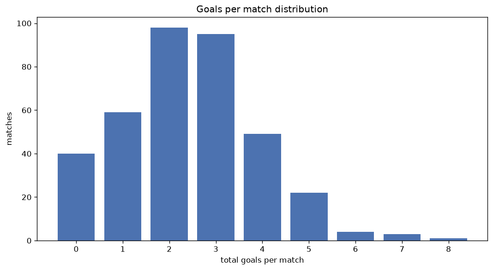
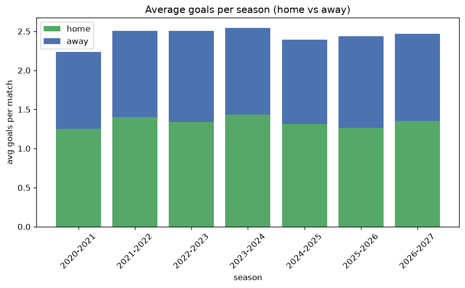

# Goal Analysis
- Report: `goals_analysis`
- Generated: 2026-10-27T01:48:24+00:00
- Script: `backend/scripts/analyze_goals.py` v1.0.0
- League: Ligue 3 (France)
- Scope: league `france3`

## 1. Goals per match distribution
| goals | matches | pct |
|---|---|---|
| 0 | 191 | 10.0% |
| 1 | 371 | 19.5% |
| 2 | 497 | 26.1% |
| 3 | 405 | 21.3% |
| 4 | 248 | 13.0% |
| 5 | 112 | 5.9% |
| 6 | 50 | 2.6% |
| 7 | 21 | 1.1% |
| 8 | 4 | 0.2% |
| 9 | 3 | 0.2% |

## 2. Goals per match per season
| season | matches | total goals | avg home | avg away | avg total |
|---|---|---|---|---|---|
| 2020-2021 | 306 | 684 | 1.255 | 0.98 | 2.235 |
| 2021-2022 | 306 | 766 | 1.402 | 1.101 | 2.503 |
| 2022-2023 | 306 | 766 | 1.337 | 1.167 | 2.503 |
| 2023-2024 | 306 | 779 | 1.431 | 1.114 | 2.546 |
| 2024-2025 | 272 | 651 | 1.312 | 1.081 | 2.393 |
| 2025-2026 | 303 | 738 | 1.267 | 1.168 | 2.436 |
| 2026-2027 | 103 | 254 | 1.35 | 1.117 | 2.466 |

## 3. Home vs away goal share
- Home goals: **2540** (54.8%)
- Away goals: **2098** (45.2%)
- Home/away ratio: **1.211**

| season | home goals | away goals | total | home pct | away pct |
|---|---|---|---|---|---|
| 2020-2021 | 384 | 300 | 684 | 56.1% | 43.9% |
| 2021-2022 | 429 | 337 | 766 | 56.0% | 44.0% |
| 2022-2023 | 409 | 357 | 766 | 53.4% | 46.6% |
| 2023-2024 | 438 | 341 | 779 | 56.2% | 43.8% |
| 2024-2025 | 357 | 294 | 651 | 54.8% | 45.2% |
| 2025-2026 | 384 | 354 | 738 | 52.0% | 48.0% |
| 2026-2027 | 139 | 115 | 254 | 54.7% | 45.3% |

## 4. BTTS (Both Teams To Score)
- Overall: **972** of `1902` (51.1%)

| season | matches | BTTS | pct |
|---|---|---|---|
| 2020-2021 | 306 | 151 | 49.3% |
| 2021-2022 | 306 | 150 | 49.0% |
| 2022-2023 | 306 | 163 | 53.3% |
| 2023-2024 | 306 | 161 | 52.6% |
| 2024-2025 | 272 | 134 | 49.3% |
| 2025-2026 | 303 | 162 | 53.5% |
| 2026-2027 | 103 | 51 | 49.5% |

## 5. Clean sheets
- Home clean sheets: **632** (33.2%)
- Away clean sheets: **489** (25.7%)
- Total clean sheets recorded: **1121**
- Matches with at least one clean sheet: **930** (48.9%)
- Both teams kept clean sheets (0-0): **191**

| season | matches | home CS | away CS | total CS | matches w/ CS |
|---|---|---|---|---|---|
| 2020-2021 | 306 | 112 | 88 | 200 | 155 (50.7%) |
| 2021-2022 | 306 | 106 | 78 | 184 | 156 (51.0%) |
| 2022-2023 | 306 | 93 | 76 | 169 | 143 (46.7%) |
| 2023-2024 | 306 | 97 | 70 | 167 | 145 (47.4%) |
| 2024-2025 | 272 | 99 | 67 | 166 | 138 (50.7%) |
| 2025-2026 | 303 | 94 | 79 | 173 | 141 (46.5%) |
| 2026-2027 | 103 | 31 | 31 | 62 | 52 (50.5%) |

## 6. Scoring intensity
- First-half goals: **2126** (46.0%)
- Second-half goals: **2494** (54.0%)
- Avg first-half goals per match: **1.121**
- Avg second-half goals per match: **1.315**
- Second-half-only scoring (HT 0-0, FT goals >= 1): **409** (21.5%)
- *6 match(es) excluded (no HT score recorded).*

| season | matches | 1st half | 2nd half | 1st half pct | 2nd half pct |
|---|---|---|---|---|---|
| 2020-2021 | 306 | 314 | 370 | 45.9% | 54.1% |
| 2021-2022 | 306 | 343 | 417 | 45.1% | 54.9% |
| 2022-2023 | 306 | 341 | 416 | 45.0% | 55.0% |
| 2023-2024 | 306 | 375 | 404 | 48.1% | 51.9% |
| 2024-2025 | 272 | 302 | 349 | 46.4% | 53.6% |
| 2025-2026 | 303 | 337 | 398 | 45.9% | 54.1% |
| 2026-2027 | 103 | 114 | 140 | 44.9% | 55.1% |

## 7. First-goal timing
- Matches with first-goal time recorded: `1705` of `1902` (89.6%)
- Goalless matches: `197`
- Min `1` | Max `97` | Mean `31.38` | Median (p50) `26`

| bucket | count | % of matches | % of scoring matches |
|---|---|---|---|
| 1-15 | 525 | 27.6% | 30.8% |
| 16-30 | 436 | 22.9% | 25.6% |
| 31-45 | 296 | 15.6% | 17.4% |
| 46-60 | 215 | 11.3% | 12.6% |
| 61-75 | 142 | 7.5% | 8.3% |
| 76-90 | 72 | 3.8% | 4.2% |
| 91-120 | 19 | 1.0% | 1.1% |

---
*All statistics are computed from PostgreSQL tables (read-only). Run with `python backend/scripts/analyze_goals.py` to regenerate.*

## Charts

