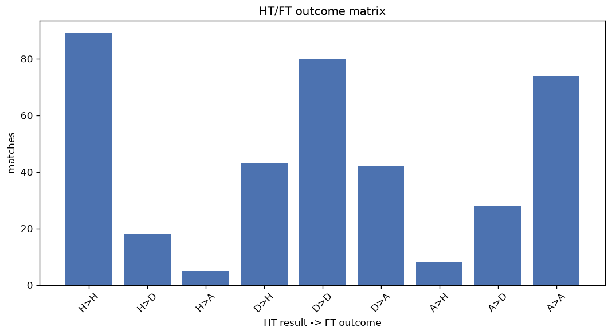
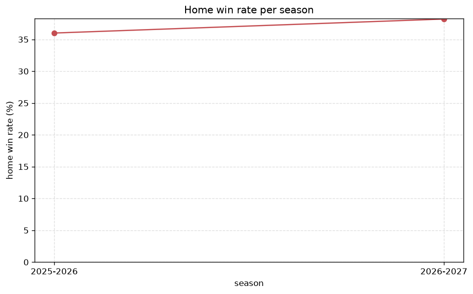

# Match Analysis
- Report: `matches_analysis`
- Generated: 2026-10-30T03:51:53+00:00
- Script: `backend/scripts/analyze_matches.py` v1.0.0
- League: Ligue 3 (France)
- Scope: league `france3`

## 1. Overall summary
| metric | value |
|---|---|
| Matches | 1902 |
| Home wins | 772 (40.6%) |
| Draws | 583 (30.7%) |
| Away wins | 547 (28.8%) |
| Total goals | 4638 |
| Average goals per match | 2.438 |
| Goalless matches | 191 (10.0%) |

## 2. Per-season breakdown
| season | matches | home wins | draws | away wins | total goals | avg goals | goalless |
|---|---|---|---|---|---|---|---|
| 2020-2021 | 306 | 118 (38.6%) | 111 (36.3%) | 77 (25.2%) | 684 | 2.235 | 45 (14.7%) |
| 2021-2022 | 306 | 135 (44.1%) | 80 (26.1%) | 91 (29.7%) | 766 | 2.503 | 28 (9.2%) |
| 2022-2023 | 306 | 118 (38.6%) | 96 (31.4%) | 92 (30.1%) | 766 | 2.503 | 26 (8.5%) |
| 2023-2024 | 306 | 138 (45.1%) | 81 (26.5%) | 87 (28.4%) | 779 | 2.546 | 22 (7.2%) |
| 2024-2025 | 272 | 111 (40.8%) | 86 (31.6%) | 75 (27.6%) | 651 | 2.393 | 28 (10.3%) |
| 2025-2026 | 303 | 109 (36.0%) | 100 (33.0%) | 94 (31.0%) | 738 | 2.436 | 32 (10.6%) |
| 2026-2027 | 103 | 43 (41.7%) | 29 (28.2%) | 31 (30.1%) | 254 | 2.466 | 10 (9.7%) |

## 3. HT/FT outcome matrix
| HT result \ FT result | Home | Draw | Away | total |
|---|---|---|---|---|
| HT home lead | 478 (77.6%) | 107 (17.4%) | 31 (5.0%) | 616 |
| HT draw | 250 (30.3%) | 384 (46.5%) | 192 (23.2%) | 826 |
| HT away lead | 42 (9.3%) | 92 (20.3%) | 320 (70.5%) | 454 |
- *6 match(es) excluded (no HT score recorded).*

## 4. Comeback matches
- Home comebacks (trailing at HT, won at FT): **42** (2.2%)
- Away comebacks (trailing at HT, won at FT): **31** (1.6%)

### Home comebacks
| season | home | away | HT | FT |
|---|---|---|---|---|
| 2020-2021 | Sete | Lyon - La Duchere | 0-1 | 3-1 |
| 2020-2021 | Boulogne | Stade Briochin | 0-1 | 2-1 |
| 2020-2021 | Red Star | Borgo | 0-1 | 2-1 |
| 2020-2021 | Le Mans | Annecy | 1-2 | 3-2 |
| 2021-2022 | Sete | Creteil | 0-1 | 3-1 |
| 2021-2022 | Laval | Le Mans | 0-1 | 2-1 |
| 2021-2022 | Chambly | Avranches | 1-2 | 4-2 |
| 2021-2022 | Sete | Red Star | 0-1 | 2-1 |
| 2021-2022 | Chateauroux | Orleans | 0-1 | 4-1 |
| 2021-2022 | Orleans | Boulogne | 0-1 | 2-1 |
| 2021-2022 | Red Star | Borgo | 1-2 | 5-2 |
| 2021-2022 | Villefranche | Cholet | 0-2 | 3-2 |
| 2021-2022 | Boulogne | Borgo | 0-1 | 2-1 |
| 2022-2023 | Avranches | Villefranche | 0-1 | 2-1 |
| 2022-2023 | Villefranche | Bourg en Bresse | 1-2 | 3-2 |
| 2022-2023 | Sedan | Orleans | 0-1 | 2-1 |
| 2022-2023 | Dunkerque | Villefranche | 0-2 | 3-2 |
| 2022-2023 | Avranches | Cholet | 0-1 | 2-1 |
| 2022-2023 | Martigues | Versailles | 2-3 | 4-3 |
| 2023-2024 | Villefranche | Cholet | 0-1 | 2-1 |
| 2023-2024 | Martigues | Versailles | 0-1 | 2-1 |
| 2023-2024 | Niort | Nancy | 0-1 | 2-1 |
| 2023-2024 | Nancy | Nimes | 0-1 | 3-1 |
| 2023-2024 | Cholet | Dijon | 0-1 | 2-1 |
| 2023-2024 | Chateauroux | Orleans | 0-1 | 2-1 |
| 2023-2024 | Nimes | Cholet | 0-1 | 2-1 |
| 2023-2024 | Chateauroux | GOAL FC | 0-1 | 3-2 |
| 2023-2024 | Red Star | Niort | 0-1 | 2-1 |
| 2024-2025 | Aubagne | Rouen | 0-1 | 2-1 |
| 2024-2025 | Nancy | Versailles | 0-2 | 3-2 |
| 2024-2025 | Sochaux | Rouen | 0-1 | 2-1 |
| 2024-2025 | Bourg en Bresse | Dijon | 0-1 | 2-1 |
| 2025-2026 | Chateauroux | Caen | 0-1 | 2-1 |
| 2025-2026 | Villefranche | Chateauroux | 0-1 | 2-1 |
| 2025-2026 | Versailles | Villefranche | 0-1 | 2-1 |
| 2025-2026 | Quevilly Rouen | Concarneau | 0-1 | 2-1 |
| 2025-2026 | Bourg en Bresse | Rouen | 0-1 | 3-1 |
| 2025-2026 | Orleans | Paris 13 Atl. | 0-1 | 2-1 |
| 2025-2026 | Dijon | Versailles | 0-1 | 3-1 |
| 2026-2027 | Thionville | Caen | 1-2 | 4-3 |
| 2026-2027 | La Roche | Aubagne | 0-1 | 3-1 |
| 2026-2027 | Caen | La Roche | 0-1 | 2-1 |

### Away comebacks
| season | home | away | HT | FT |
|---|---|---|---|---|
| 2020-2021 | Orleans | Bourg en Bresse | 1-0 | 1-3 |
| 2020-2021 | Boulogne | Bastia | 1-0 | 1-2 |
| 2020-2021 | Bourg en Bresse | Bastia | 1-0 | 1-3 |
| 2020-2021 | Orleans | Quevilly Rouen | 2-1 | 3-4 |
| 2020-2021 | Creteil | Sete | 1-0 | 1-2 |
| 2021-2022 | Laval | Orleans | 1-0 | 1-2 |
| 2021-2022 | Borgo | Cholet | 1-0 | 1-2 |
| 2021-2022 | Boulogne | Laval | 1-0 | 1-2 |
| 2021-2022 | Orleans | Villefranche | 1-0 | 1-2 |
| 2021-2022 | Borgo | Villefranche | 1-0 | 1-3 |
| 2021-2022 | Borgo | Avranches | 1-0 | 1-2 |
| 2021-2022 | Borgo | Sete | 1-0 | 1-2 |
| 2022-2023 | Nancy | Dunkerque | 1-0 | 1-2 |
| 2022-2023 | Concarneau | Nancy | 1-0 | 1-2 |
| 2022-2023 | Red Star | Le Puy-en-Velay | 2-1 | 2-3 |
| 2022-2023 | Villefranche | Orleans | 1-0 | 1-2 |
| 2022-2023 | Borgo | Stade Briochin | 1-0 | 2-3 |
| 2023-2024 | GOAL FC | Niort | 2-0 | 2-3 |
| 2023-2024 | Le Mans | Nancy | 1-0 | 1-3 |
| 2023-2024 | Epinal | Nancy | 1-0 | 1-2 |
| 2023-2024 | GOAL FC | Cholet | 2-1 | 3-4 |
| 2024-2025 | Nimes | Orleans | 1-0 | 1-2 |
| 2024-2025 | Orleans | Concarneau | 2-0 | 2-3 |
| 2024-2025 | Sochaux | Nancy | 1-0 | 2-3 |
| 2024-2025 | Chateauroux | Le Mans | 1-0 | 1-2 |
| 2024-2025 | Aubagne | Villefranche | 1-0 | 1-2 |
| 2025-2026 | Rouen | Chateauroux | 1-0 | 1-2 |
| 2025-2026 | Paris 13 Atl. | Versailles | 1-0 | 1-3 |
| 2025-2026 | Villefranche | Valenciennes | 2-1 | 2-3 |
| 2026-2027 | Valenciennes | Fleury-Merogis | 1-0 | 1-2 |
| 2026-2027 | Valenciennes | Fleury 91 | 1-0 | 1-2 |

## 5. HT lead conversion
| HT state | matches | converted to win | held as draw | collapsed to loss |
|---|---|---|---|---|
| Home lead | 616 | 478 (77.6%) | 107 (17.4%) | 31 (5.0%) |
| Away lead | 454 | 320 (70.5%) | 92 (20.3%) | 42 (9.3%) |

### Matches level at half-time
| FT result | count | pct |
|---|---|---|
| Home win | 250 | 30.3% |
| Draw | 384 | 46.5% |
| Away win | 192 | 23.2% |
- *6 match(es) excluded (no HT score recorded).*

## 6. First-goal timing
- Matches with a first-goal time recorded: `1705` of `1902` (89.6%)

Outcome distribution by first-goal timing bucket:
| bucket | matches | % of matches | home | draw | away |
|---|---|---|---|---|---|
| 1-15 | 525 | 27.6% | 233 (44.4%) | 131 (25.0%) | 161 (30.7%) |
| 16-30 | 436 | 22.9% | 195 (44.7%) | 102 (23.4%) | 139 (31.9%) |
| 31-45 | 296 | 15.6% | 138 (46.6%) | 60 (20.3%) | 98 (33.1%) |
| 46-60 | 215 | 11.3% | 94 (43.7%) | 50 (23.3%) | 71 (33.0%) |
| 61-75 | 142 | 7.5% | 62 (43.7%) | 39 (27.5%) | 41 (28.9%) |
| 76-90 | 72 | 3.8% | 36 (50.0%) | 10 (13.9%) | 26 (36.1%) |
| 91-120 | 19 | 1.0% | 12 (63.2%) | 0 (0.0%) | 7 (36.8%) |

## 7. Goalless matches
- Overall: **191** of `1902` (10.0%)

| season | matches | goalless | pct |
|---|---|---|---|
| 2020-2021 | 306 | 45 | 14.7% |
| 2021-2022 | 306 | 28 | 9.2% |
| 2022-2023 | 306 | 26 | 8.5% |
| 2023-2024 | 306 | 22 | 7.2% |
| 2024-2025 | 272 | 28 | 10.3% |
| 2025-2026 | 303 | 32 | 10.6% |
| 2026-2027 | 103 | 10 | 9.7% |

---
*All statistics are computed from PostgreSQL tables (read-only). Run with `python backend/scripts/analyze_matches.py` to regenerate.*

## Charts

