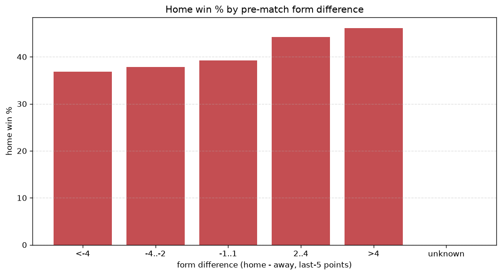
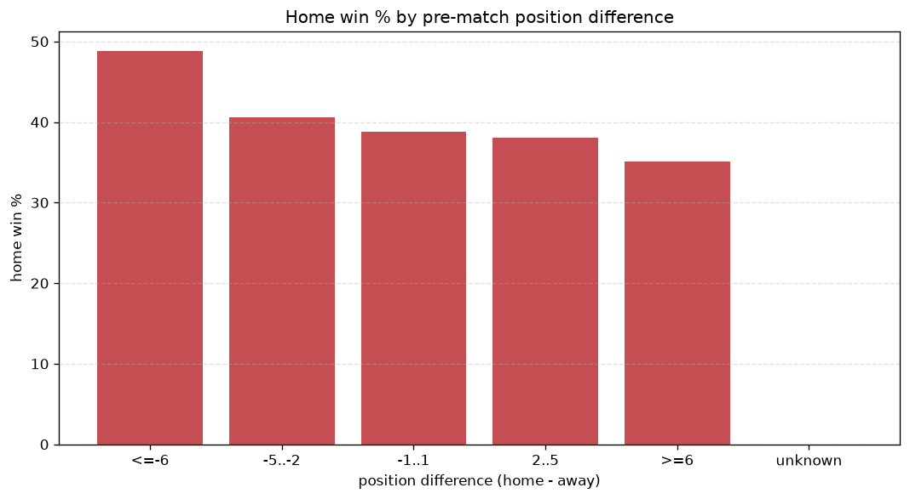

# Relationships Analysis
- Report: `relationships`
- Generated: 2026-10-26T01:32:55+00:00
- Script: `backend/scripts/analyze_relationships.py` v1.0.0
- League: Ligue 3 (France)
- Scope: league `france3`

- Matches analysed: **1799** (23 leakage-safe pre-match features).

## 1. Correlation matrix
_Pearson correlation of each pre-match feature with observed goals; sorted by |corr(total goals)|._

| feature | corr(home) | corr(away) | corr(total) |
|---|---|---|---|
| home_team_goals_conceded_last_5 | 0.010 | 0.087 | 0.065 |
| home_points_before_match | 0.057 | 0.025 | 0.058 |
| away_points_before_match | -0.011 | 0.097 | 0.058 |
| away_team_goals_scored_last_5 | 0.014 | 0.060 | 0.050 |
| away_team_points_last_5 | -0.003 | 0.075 | 0.049 |
| away_team_wins_last_5 | -0.005 | 0.074 | 0.046 |
| home_position_before_match | -0.037 | 0.084 | 0.030 |
| away_position_before_match | 0.080 | -0.046 | 0.026 |
| home_team_wins_last_5 | 0.028 | -0.062 | -0.022 |
| away_team_away_conceded_avg | 0.044 | -0.016 | 0.021 |
| home_team_points_last_5 | 0.026 | -0.055 | -0.018 |
| away_rest_days | 0.015 | 0.005 | 0.014 |
| home_team_home_win_rate | 0.035 | -0.023 | 0.010 |
| away_team_goals_conceded_last_5 | 0.043 | -0.034 | 0.009 |
| home_team_goals_scored_last_5 | 0.033 | -0.024 | 0.008 |
| rest_days_difference | -0.024 | 0.016 | -0.007 |
| home_team_home_conceded_avg | -0.033 | 0.028 | -0.005 |
| home_team_home_goals_avg | 0.018 | -0.024 | -0.003 |
| position_difference | -0.088 | 0.097 | 0.002 |
| home_rest_days | -0.005 | 0.003 | -0.002 |
| away_team_away_win_rate | -0.059 | 0.066 | 0.001 |
| away_team_away_goals_avg | -0.055 | 0.060 | 0.000 |
| points_difference | 0.103 | -0.110 | 0.000 |

## 2. Form vs outcome
_Home win/draw/away % per bucket of `home_team_points_last_5 - away_team_points_last_5`._

| bucket | matches | home | draw | away | home % | draw % | away % |
|---|---|---|---|---|---|---|---|
| <-4 | 231 | 85 | 71 | 75 | 36.8% | 30.7% | 32.5% |
| -4..-2 | 397 | 150 | 125 | 122 | 37.8% | 31.5% | 30.7% |
| -1..1 | 566 | 222 | 180 | 164 | 39.2% | 31.8% | 29.0% |
| 2..4 | 364 | 161 | 106 | 97 | 44.2% | 29.1% | 26.6% |
| >4 | 241 | 111 | 72 | 58 | 46.1% | 29.9% | 24.1% |
| unknown | 0 | 0 | 0 | 0 | - | - | - |

## 3. Position vs outcome
_Home win/draw/away % per bucket of `position_difference` (home position - away position; negative favours the home team)._

| bucket | matches | home | draw | away | home % | draw % | away % |
|---|---|---|---|---|---|---|---|
| <=-6 | 445 | 217 | 124 | 104 | 48.8% | 27.9% | 23.4% |
| -5..-2 | 320 | 130 | 110 | 80 | 40.6% | 34.4% | 25.0% |
| -1..1 | 242 | 94 | 77 | 71 | 38.8% | 31.8% | 29.3% |
| 2..5 | 331 | 126 | 104 | 101 | 38.1% | 31.4% | 30.5% |
| >=6 | 461 | 162 | 139 | 160 | 35.1% | 30.2% | 34.7% |
| unknown | 0 | 0 | 0 | 0 | - | - | - |

## 4. Rest advantage
_Home win/draw/away % per bucket of `rest_days_difference` (home rest - away rest). Matches with unknown rest are bucketed separately._

| bucket | matches | home | draw | away | home % | draw % | away % |
|---|---|---|---|---|---|---|---|
| <-1 | 249 | 115 | 73 | 61 | 46.2% | 29.3% | 24.5% |
| -1..0 | 55 | 23 | 14 | 18 | 41.8% | 25.5% | 32.7% |
| 0 | 1086 | 454 | 310 | 322 | 41.8% | 28.5% | 29.7% |
| 1..2 | 80 | 23 | 31 | 26 | 28.8% | 38.8% | 32.5% |
| >2 | 225 | 81 | 87 | 57 | 36.0% | 38.7% | 25.3% |
| unknown | 104 | 33 | 39 | 32 | 31.7% | 37.5% | 30.8% |
- *104 match(es) had unknown rest difference (missing rest data on at least one side).*

## 5. Home team quality
_Home win rate by `home_team_home_win_rate` tier (split at 0.5)._

- `< 0.5` tier: **39.0%** home win (442/1132)
- `>= 0.5` tier: **43.0%** home win (287/667)
- Home-win gap (>= split minus < split): **+4.0 pp**

| tier | label | matches | home | draw | away | home % |
|---|---|---|---|---|---|---|
| low | < 0.5 | 1132 | 442 | 353 | 337 | 39.0% |
| high | >= 0.5 | 667 | 287 | 201 | 179 | 43.0% |

## 6. Feature averages by result
_Mean feature value per outcome; `range` is home-minus-away spread of the group means._

| feature | home mean | draw mean | away mean | range |
|---|---|---|---|---|
| points_difference | 1.545 | -0.233 | -1.599 | 3.143 |
| away_points_before_match | 20.529 | 20.179 | 22.713 | 2.534 |
| position_difference | -1.084 | 0.278 | 1.304 | 2.388 |
| home_points_before_match | 22.074 | 19.946 | 21.114 | 2.128 |
| away_position_before_match | 10.340 | 9.774 | 9.060 | 1.280 |
| home_position_before_match | 9.257 | 10.052 | 10.364 | 1.108 |
| rest_days_difference | -0.322 | 0.270 | -0.012 | 0.592 |
| away_rest_days | 8.966 | 8.419 | 8.870 | 0.546 |
| away_team_goals_conceded_last_5 | 5.512 | 5.005 | 5.203 | 0.506 |
| home_team_goals_conceded_last_5 | 5.362 | 5.283 | 5.672 | 0.389 |
| home_team_points_last_5 | 6.198 | 5.874 | 5.828 | 0.370 |
| away_team_points_last_5 | 5.898 | 6.040 | 6.240 | 0.342 |
| away_team_goals_scored_last_5 | 5.340 | 5.222 | 5.531 | 0.309 |
| home_team_goals_scored_last_5 | 5.524 | 5.220 | 5.229 | 0.304 |
| home_team_wins_last_5 | 1.598 | 1.502 | 1.453 | 0.145 |
| away_team_wins_last_5 | 1.491 | 1.542 | 1.614 | 0.123 |
| home_rest_days | 8.707 | 8.827 | 8.826 | 0.120 |
| away_team_away_goals_avg | 0.908 | 0.947 | 1.000 | 0.092 |
| away_team_away_conceded_avg | 1.256 | 1.210 | 1.196 | 0.060 |
| home_team_home_conceded_avg | 0.953 | 0.955 | 0.993 | 0.040 |
| away_team_away_win_rate | 0.227 | 0.241 | 0.268 | 0.040 |
| home_team_home_goals_avg | 1.250 | 1.217 | 1.210 | 0.039 |
| home_team_home_win_rate | 0.388 | 0.357 | 0.367 | 0.030 |

---
*All features are leakage-safe pre-match values built by `ml.features.build_features.build_rows` from strictly prior matches. Run with `python backend/scripts/analyze_relationships.py` to regenerate.*

## Charts

