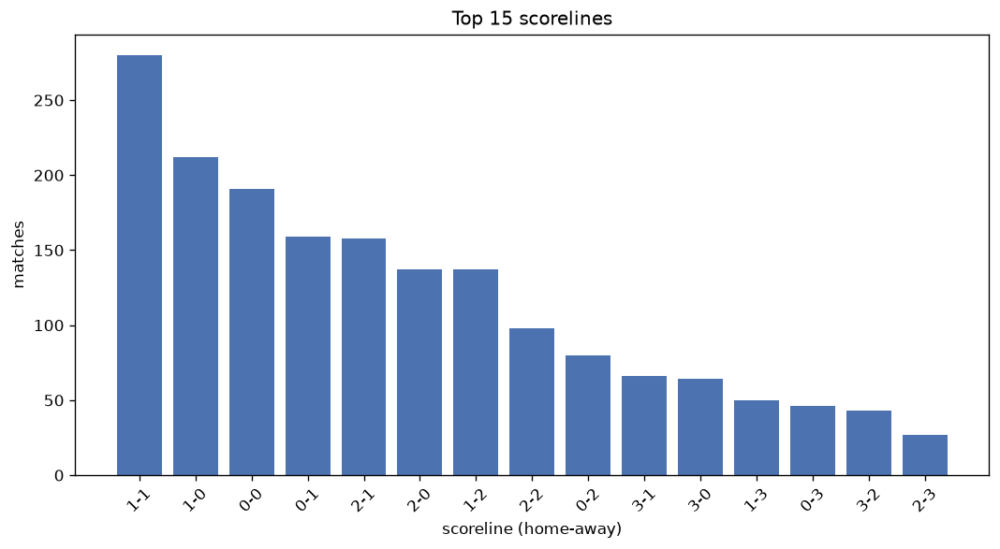
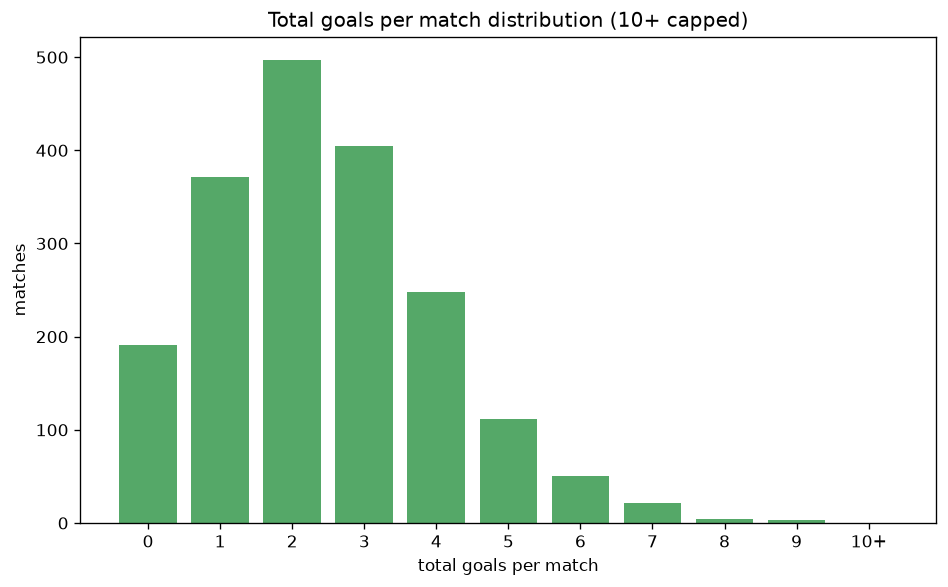

# Scoreline Analysis
- Report: `scoreline_analysis`
- Generated: 2026-10-26T01:32:53+00:00
- Script: `backend/scripts/analyze_scorelines.py` v1.0.0
- League: Ligue 3 (France)
- Scope: league `france3`

## 1. Scoreline frequency
- Matches analysed: **1902** across **7** seasons.
- Distinct scorelines seen: **40**.

| scoreline | count | pct |
|---|---|---|
| 1-1 | 280 | 14.7% |
| 1-0 | 212 | 11.1% |
| 0-0 | 191 | 10.0% |
| 0-1 | 159 | 8.4% |
| 2-1 | 158 | 8.3% |
| 2-0 | 137 | 7.2% |
| 1-2 | 137 | 7.2% |
| 2-2 | 98 | 5.2% |
| 0-2 | 80 | 4.2% |
| 3-1 | 66 | 3.5% |
| 3-0 | 64 | 3.4% |
| 1-3 | 50 | 2.6% |
| 0-3 | 46 | 2.4% |
| 3-2 | 43 | 2.3% |
| 2-3 | 27 | 1.4% |
| 4-0 | 25 | 1.3% |
| 4-1 | 25 | 1.3% |
| 4-2 | 18 | 0.9% |
| 3-3 | 13 | 0.7% |
| 1-4 | 13 | 0.7% |

## 2. Scoreline frequency per season

### 2020-2021
| scoreline | count | pct |
|---|---|---|
| 1-1 | 48 | 15.7% |
| 0-0 | 45 | 14.7% |
| 1-0 | 38 | 12.4% |
| 0-1 | 26 | 8.5% |
| 2-1 | 24 | 7.8% |

### 2021-2022
| scoreline | count | pct |
|---|---|---|
| 1-0 | 34 | 11.1% |
| 1-1 | 33 | 10.8% |
| 0-0 | 28 | 9.2% |
| 0-1 | 28 | 9.2% |
| 2-1 | 27 | 8.8% |

### 2022-2023
| scoreline | count | pct |
|---|---|---|
| 1-1 | 52 | 17.0% |
| 1-0 | 30 | 9.8% |
| 0-1 | 27 | 8.8% |
| 0-0 | 26 | 8.5% |
| 2-0 | 23 | 7.5% |

### 2023-2024
| scoreline | count | pct |
|---|---|---|
| 1-1 | 43 | 14.1% |
| 1-0 | 35 | 11.4% |
| 2-1 | 30 | 9.8% |
| 2-0 | 26 | 8.5% |
| 0-1 | 25 | 8.2% |

### 2024-2025
| scoreline | count | pct |
|---|---|---|
| 1-1 | 40 | 14.7% |
| 1-0 | 39 | 14.3% |
| 0-0 | 28 | 10.3% |
| 0-1 | 25 | 9.2% |
| 2-0 | 23 | 8.5% |

### 2025-2026
| scoreline | count | pct |
|---|---|---|
| 1-1 | 46 | 15.2% |
| 0-0 | 32 | 10.6% |
| 1-0 | 28 | 9.2% |
| 1-2 | 27 | 8.9% |
| 2-1 | 27 | 8.9% |

### 2026-2027
| scoreline | count | pct |
|---|---|---|
| 1-1 | 18 | 17.5% |
| 0-0 | 10 | 9.7% |
| 1-2 | 9 | 8.7% |
| 2-0 | 9 | 8.7% |
| 1-0 | 8 | 7.8% |

## 3. Total-goal histogram
_10+ groups all matches with 10 or more total goals._

| total goals | matches | pct |
|---|---|---|
| 0 | 191 | 10.0% |
| 1 | 371 | 19.5% |
| 2 | 497 | 26.1% |
| 3 | 405 | 21.3% |
| 4 | 248 | 13.0% |
| 5 | 112 | 5.9% |
| 6 | 50 | 2.6% |
| 7 | 21 | 1.1% |
| 8 | 4 | 0.2% |
| 9 | 3 | 0.2% |
| 10+ | 0 | 0.0% |

## 4. Extreme scorelines
- Matches with 7+ total goals: **28**

| season | date | scoreline | total goals |
|---|---|---|---|
| 2020-2021 | 2020-10-09 | 5-4 | 9 |
| 2023-2024 | 2024-04-26 | 3-6 | 9 |
| 2024-2025 | 2024-12-13 | 2-7 | 9 |
| 2020-2021 | 2020-08-24 | 3-5 | 8 |
| 2021-2022 | 2022-05-06 | 4-4 | 8 |
| 2024-2025 | 2025-04-25 | 6-2 | 8 |
| 2025-2026 | 2026-04-10 | 3-5 | 8 |
| 2020-2021 | 2020-10-05 | 6-1 | 7 |
| 2020-2021 | 2021-03-15 | 3-4 | 7 |
| 2021-2022 | 2021-09-10 | 1-6 | 7 |
| 2021-2022 | 2021-09-24 | 2-5 | 7 |
| 2021-2022 | 2021-10-26 | 3-4 | 7 |
| 2021-2022 | 2022-03-04 | 5-2 | 7 |
| 2021-2022 | 2022-04-29 | 2-5 | 7 |
| 2022-2023 | 2022-08-22 | 6-1 | 7 |
| 2022-2023 | 2022-11-25 | 3-4 | 7 |
| 2022-2023 | 2023-05-26 | 4-3 | 7 |
| 2023-2024 | 2023-08-25 | 5-2 | 7 |
| 2023-2024 | 2024-04-05 | 3-4 | 7 |
| 2023-2024 | 2024-04-05 | 3-4 | 7 |
| 2024-2025 | 2024-09-13 | 4-3 | 7 |
| 2024-2025 | 2025-02-28 | 4-3 | 7 |
| 2024-2025 | 2025-05-09 | 5-2 | 7 |
| 2024-2025 | 2025-05-09 | 3-4 | 7 |
| 2026-2027 | 2026-08-14 | 4-3 | 7 |
| 2026-2027 | 2026-09-05 | 6-1 | 7 |
| 2026-2027 | 2026-09-05 | 6-1 | 7 |
| 2026-2027 | 2026-09-05 | 6-1 | 7 |

## 5. Margin-of-victory distribution (decided matches)
- Decided matches: **1319** (draws: **583**)
- Average winning margin: **1.65**

| margin | matches | pct |
|---|---|---|
| 1 | 747 | 56.6% |
| 2 | 360 | 27.3% |
| 3+ | 212 | 16.1% |

## 6. Margin by outcome

### Home wins
- Matches: **772** | avg margin: **1.7** | max margin: **6**
| margin | matches | pct |
|---|---|---|
| 1 | 418 | 54.1% |
| 2 | 221 | 28.6% |
| 3+ | 133 | 17.2% |
- *Full match-by-match list available in `scoreline_analysis.json`.*

### Away wins
- Matches: **547** | avg margin: **1.59** | max margin: **6**
| margin | matches | pct |
|---|---|---|
| 1 | 329 | 60.1% |
| 2 | 139 | 25.4% |
| 3+ | 79 | 14.4% |
- *Full match-by-match list available in `scoreline_analysis.json`.*

## 7. Most common exact score by outcome type
| outcome | matches | most common score | count | pct |
|---|---|---|---|---|
| home | 772 | 1-0 | 212 | 27.5% |
| draw | 583 | 1-1 | 280 | 48.0% |
| away | 547 | 0-1 | 159 | 29.1% |

---
*All statistics are computed from PostgreSQL tables (read-only). Run with `python backend/scripts/analyze_scorelines.py` to regenerate.*

## Charts

