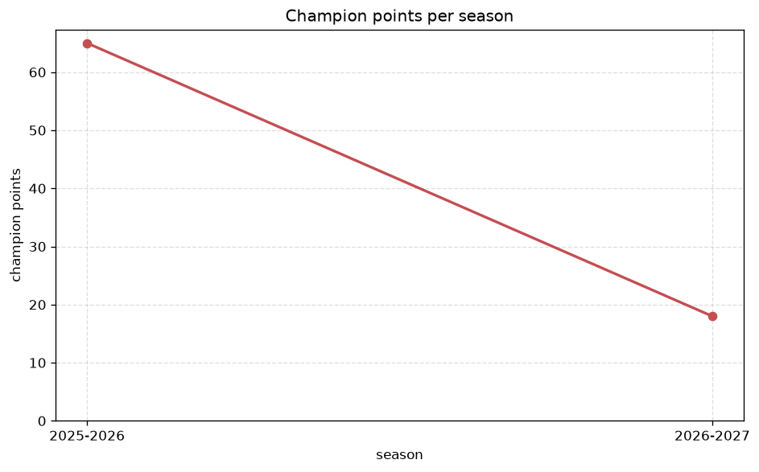
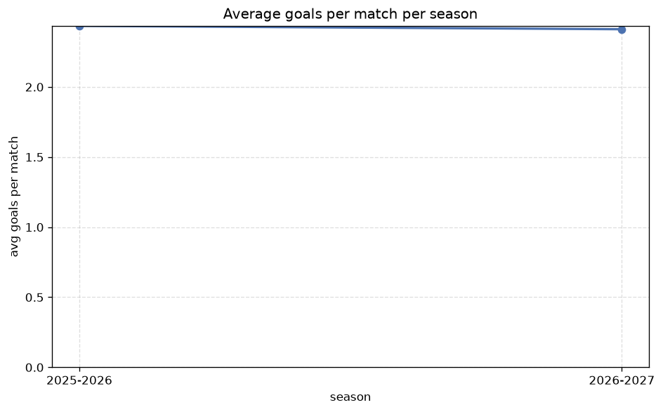

# Season Trends Analysis
- Report: `season_trends`
- Generated: 2026-10-30T03:51:59+00:00
- Script: `backend/scripts/analyze_seasons.py` v1.0.0
- League: Ligue 3 (France)
- Scope: league `france3`

## 1. Champions per season
| season | champion | pts | runner-up | margin |
|---|---|---|---|---|
| 2020-2021 | Bastia | 66 | Quevilly Rouen | 11 pts |
| 2021-2022 | Laval | 67 | Annecy | 1 pts |
| 2022-2023 | Concarneau | 63 | Dunkerque | 1 pts |
| 2023-2024 | Red Star | 65 | Martigues | 6 pts |
| 2024-2025 | Nancy | 65 | Le Mans | 7 pts |
| 2025-2026 | Dijon | 65 | Sochaux | 7 pts |
| 2026-2027 | La Roche | 21 | Amiens | 1 pts |

## 2. Title-race tightness
- Tight races (margin <= 3 pts): **3** of 7 seasons
- Tightest race: **2021-2022** - Laval beat Annecy by **1** pts

| season | margin | tight |
|---|---|---|
| 2020-2021 | 11 pts |  |
| 2021-2022 | 1 pts | yes |
| 2022-2023 | 1 pts | yes |
| 2023-2024 | 6 pts |  |
| 2024-2025 | 7 pts |  |
| 2025-2026 | 7 pts |  |
| 2026-2027 | 1 pts | yes |

## 3. Points thresholds
_Position-specific points per season. Key: 1 = champion, 2 = runner-up, 4 = CL line, 6 = Europa, 15 = last safe, 18 = bottom._

| season | pos 1 | pos 2 | pos 4 | pos 6 | pos 15 | pos 18 |
|---|---|---|---|---|---|---|
| 2020-2021 | 66 | 55 | 49 | 45 | 37 | 17 |
| 2021-2022 | 67 | 66 | 58 | 54 | 31 | 26 |
| 2022-2023 | 63 | 62 | 60 | 46 | 38 | 26 |
| 2023-2024 | 65 | 59 | 54 | 52 | 38 | 32 |
| 2024-2025 | 65 | 58 | 47 | 45 | 34 | - |
| 2025-2026 | 65 | 58 | 54 | 51 | 31 | 25 |
| 2026-2027 | 21 | 20 | 19 | 18 | 12 | 7 |

## 4. Relegation battle
| season | safe pos | safe pts | drop pos | drop pts | gap |
|---|---|---|---|---|---|
| 2020-2021 | 15 | 37 | 16 | 34 | 3 pts |
| 2021-2022 | 15 | 31 | 16 | 29 | 2 pts |
| 2022-2023 | 15 | 38 | 16 | 35 | 3 pts |
| 2023-2024 | 15 | 38 | 16 | 37 | 1 pts |
| 2024-2025 | 15 | 34 | 16 | 33 | 1 pts |
| 2025-2026 | 15 | 31 | 16 | 31 | 0 pts |
| 2026-2027 | 15 | 12 | 16 | 11 | 1 pts |

## 5. League-level trends
| season | matches | total goals | avg goals | home win | draw | away win | goalless | avg pts/team |
|---|---|---|---|---|---|---|---|---|
| 2020-2021 | 306 | 684 | 2.235 | 38.6% | 36.3% | 25.2% | 14.7% | 22.42 |
| 2021-2022 | 306 | 766 | 2.503 | 44.1% | 26.1% | 29.7% | 9.2% | 46.56 |
| 2022-2023 | 306 | 766 | 2.503 | 38.6% | 31.4% | 30.1% | 8.5% | 45.67 |
| 2023-2024 | 306 | 779 | 2.546 | 45.1% | 26.5% | 28.4% | 7.2% | 46.5 |
| 2024-2025 | 272 | 651 | 2.393 | 40.8% | 31.6% | 27.6% | 10.3% | 42.94 |
| 2025-2026 | 303 | 738 | 2.436 | 36.0% | 33.0% | 31.0% | 10.6% | 16.18 |
| 2026-2027 | 103 | 254 | 2.466 | 41.7% | 28.2% | 30.1% | 9.7% | 14.74 |

## 6. View divergence
- Largest divergence: **2025-2026** (goals view, avg abs position diff = 17.800)

_Avg absolute position difference between classic view and alternative view per season._

| season | classic vs luck | classic vs goals |
|---|---|---|
| 2020-2021 | 11.278 | 12.778 |
| 2021-2022 | 2.222 | 7.667 |
| 2022-2023 | 3.222 | 4.889 |
| 2023-2024 | 2.889 | 5.889 |
| 2024-2025 | 2.353 | 4.824 |
| 2025-2026 | 13.040 | 17.800 |
| 2026-2027 | 1.474 | 6.421 |

---
*All statistics are computed from PostgreSQL tables (read-only). Run with `python backend/scripts/analyze_seasons.py` to regenerate.*

## Charts

