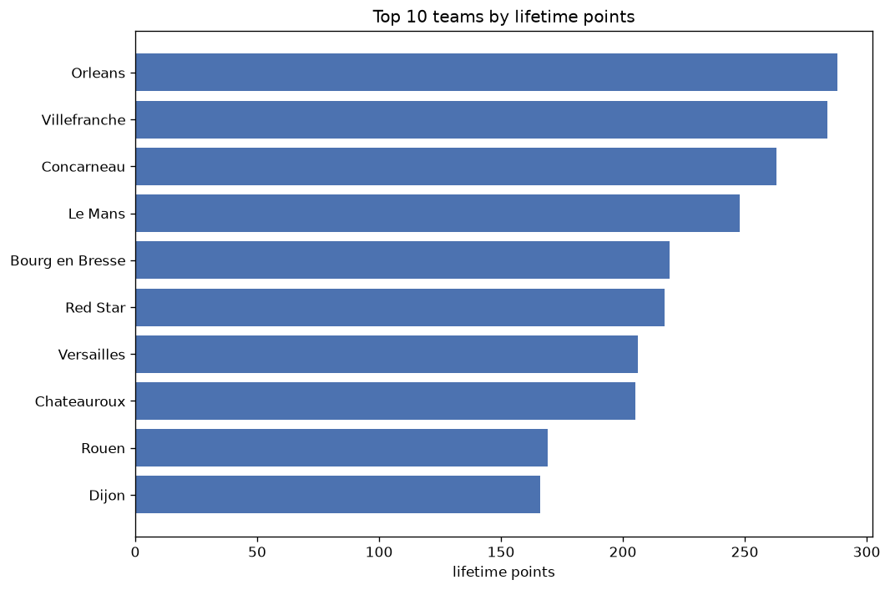
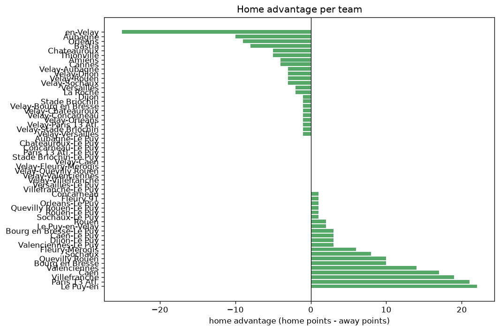

# Team Analysis
- Report: `teams_analysis`
- Generated: 2026-10-30T03:51:57+00:00
- Script: `backend/scripts/analyze_teams.py` v1.0.0
- League: Ligue 3 (France)
- Scope: league `france3`

- Teams: **95** | Seasons: **7** | Matches: **1902**

## 1. Team standings (lifetime)
| team | seasons | played | W | D | L | pts | GF | GA | GD | avg pts/season | best pos | worst pos | titles |
|---|---|---|---|---|---|---|---|---|---|---|---|---|---|
| Orleans | 7 | 211 | 73 | 69 | 69 | 288 | 254 | 247 | 7 | 41.14 | 6 | 13 | 0 |
| Villefranche | 7 | 211 | 74 | 62 | 75 | 284 | 244 | 256 | -12 | 40.57 | 3 | 18 | 0 |
| Concarneau | 6 | 175 | 67 | 62 | 46 | 263 | 237 | 191 | 46 | 43.83 | 1 | 9 | 1 |
| Le Mans | 5 | 167 | 65 | 53 | 49 | 248 | 225 | 190 | 35 | 49.6 | 2 | 12 | 0 |
| Bourg en Bresse | 6 | 175 | 55 | 54 | 66 | 219 | 181 | 202 | -21 | 36.5 | 5 | 19 | 0 |
| Red Star | 4 | 135 | 60 | 37 | 38 | 217 | 199 | 145 | 54 | 54.25 | 1 | 11 | 1 |
| Versailles | 5 | 143 | 55 | 41 | 47 | 206 | 184 | 168 | 16 | 41.2 | 5 | 13 | 0 |
| Chateauroux | 5 | 166 | 51 | 52 | 63 | 205 | 198 | 229 | -31 | 41.0 | 5 | 16 | 0 |
| Rouen | 4 | 108 | 44 | 37 | 27 | 169 | 144 | 113 | 31 | 42.25 | 3 | 10 | 0 |
| Dijon | 3 | 98 | 45 | 31 | 22 | 166 | 139 | 101 | 38 | 55.33 | 1 | 4 | 1 |
| Avranches | 4 | 135 | 48 | 22 | 65 | 166 | 154 | 205 | -51 | 41.5 | 7 | 15 | 0 |
| Cholet | 4 | 135 | 42 | 34 | 59 | 160 | 157 | 206 | -49 | 40.0 | 9 | 18 | 0 |
| Stade Briochin | 4 | 133 | 37 | 48 | 48 | 159 | 149 | 163 | -14 | 39.75 | 7 | 17 | 0 |
| Nancy | 3 | 100 | 44 | 26 | 30 | 158 | 142 | 116 | 26 | 52.67 | 1 | 13 | 1 |
| Sochaux | 3 | 98 | 36 | 36 | 26 | 144 | 131 | 100 | 31 | 48.0 | 2 | 12 | 0 |
| Quevilly Rouen | 4 | 108 | 38 | 30 | 40 | 144 | 123 | 132 | -9 | 36.0 | 2 | 13 | 0 |
| Boulogne | 3 | 99 | 28 | 36 | 35 | 120 | 101 | 118 | -17 | 40.0 | 3 | 17 | 0 |
| Martigues | 2 | 68 | 32 | 23 | 13 | 119 | 98 | 69 | 29 | 59.5 | 2 | 4 | 0 |
| Paris 13 Atl. | 4 | 109 | 24 | 42 | 43 | 114 | 96 | 131 | -35 | 28.5 | 9 | 17 | 0 |
| Laval | 2 | 67 | 30 | 18 | 19 | 108 | 82 | 62 | 20 | 54.0 | 1 | 12 | 1 |
| Annecy | 2 | 67 | 27 | 22 | 18 | 103 | 94 | 77 | 17 | 51.5 | 2 | 14 | 0 |
| Le Puy-en-Velay | 3 | 77 | 24 | 27 | 26 | 99 | 92 | 98 | -6 | 33.0 | 7 | 16 | 0 |
| Sedan | 2 | 68 | 25 | 21 | 22 | 96 | 78 | 84 | -6 | 48.0 | 8 | 8 | 0 |
| Aubagne | 3 | 76 | 25 | 18 | 33 | 93 | 89 | 97 | -8 | 31.0 | 6 | 16 | 0 |
| Valenciennes | 3 | 75 | 22 | 23 | 30 | 89 | 84 | 97 | -13 | 29.67 | 9 | 17 | 0 |
| Borgo | 3 | 101 | 19 | 32 | 50 | 89 | 107 | 167 | -60 | 29.67 | 15 | 18 | 0 |
| Sete | 2 | 67 | 20 | 19 | 28 | 79 | 66 | 74 | -8 | 39.5 | 9 | 14 | 0 |
| Bastia | 2 | 44 | 22 | 12 | 10 | 78 | 65 | 41 | 24 | 39.0 | 1 | 15 | 1 |
| Nimes | 2 | 66 | 17 | 21 | 28 | 72 | 60 | 84 | -24 | 36.0 | 11 | 17 | 0 |
| Fleury-Merogis | 2 | 41 | 18 | 12 | 11 | 66 | 65 | 41 | 24 | 33.0 | 4 | 14 | 0 |
| Dunkerque | 1 | 34 | 19 | 5 | 10 | 62 | 50 | 32 | 18 | 62.0 | 2 | 2 | 0 |
| Creteil | 2 | 67 | 14 | 18 | 35 | 60 | 64 | 106 | -42 | 30.0 | 16 | 18 | 0 |
| Niort | 1 | 34 | 17 | 7 | 10 | 58 | 58 | 42 | 16 | 58.0 | 3 | 3 | 0 |
| Caen | 2 | 42 | 14 | 16 | 12 | 58 | 58 | 47 | 11 | 29.0 | 6 | 8 | 0 |
| GOAL FC | 1 | 34 | 10 | 8 | 16 | 38 | 43 | 47 | -4 | 38.0 | 14 | 14 | 0 |
| Marignane GCB | 1 | 34 | 9 | 10 | 15 | 37 | 37 | 50 | -13 | 37.0 | 16 | 16 | 0 |
| Epinal | 1 | 34 | 9 | 6 | 19 | 33 | 39 | 51 | -12 | 33.0 | 17 | 17 | 0 |
| Chambly | 1 | 34 | 7 | 8 | 19 | 29 | 35 | 62 | -27 | 29.0 | 16 | 16 | 0 |
| en-Velay | 1 | 15 | 7 | 4 | 4 | 25 | 23 | 15 | 8 | 25.0 | 18 | 18 | 0 |
| Le Puy-en | 1 | 16 | 5 | 7 | 4 | 22 | 22 | 19 | 3 | 22.0 | 19 | 19 | 0 |
| La Roche | 1 | 10 | 6 | 3 | 1 | 21 | 16 | 10 | 6 | 21.0 | 1 | 1 | 1 |
| Amiens | 1 | 12 | 5 | 5 | 2 | 20 | 16 | 4 | 12 | 20.0 | 2 | 2 | 0 |
| Cannes | 1 | 12 | 4 | 7 | 1 | 19 | 16 | 7 | 9 | 19.0 | 4 | 4 | 0 |
| Lyon | 1 | 17 | 3 | 8 | 6 | 17 | 16 | 24 | -8 | 17.0 | 18 | 18 | 0 |
| Fleury 91 | 1 | 10 | 4 | 3 | 3 | 15 | 16 | 12 | 4 | 15.0 | 11 | 11 | 0 |
| Lyon - La Duchere | 1 | 17 | 2 | 8 | 7 | 14 | 17 | 28 | -11 | 14.0 | 19 | 19 | 0 |
| Thionville | 1 | 11 | 3 | 4 | 4 | 13 | 16 | 17 | -1 | 13.0 | 12 | 12 | 0 |
| La Duchere-Annecy | 1 | 1 | 1 | 0 | 0 | 3 | 3 | 0 | 3 | 3.0 | 20 | 20 | 0 |
| La Duchere-Quevilly Rouen | 1 | 1 | 1 | 0 | 0 | 3 | 3 | 0 | 3 | 3.0 | 21 | 21 | 0 |
| Velay-Rouen | 1 | 1 | 1 | 0 | 0 | 3 | 3 | 0 | 3 | 3.0 | 20 | 20 | 0 |
| Caen-Le Puy | 1 | 1 | 1 | 0 | 0 | 3 | 2 | 0 | 2 | 3.0 | 21 | 21 | 0 |
| Dijon-Le Puy | 1 | 1 | 1 | 0 | 0 | 3 | 2 | 0 | 2 | 3.0 | 22 | 22 | 0 |
| La Duchere-Le Mans | 1 | 1 | 1 | 0 | 0 | 3 | 3 | 1 | 2 | 3.0 | 22 | 22 | 0 |
| La Duchere-Orleans | 1 | 1 | 1 | 0 | 0 | 3 | 3 | 1 | 2 | 3.0 | 23 | 23 | 0 |
| Bourg en Bresse-Le Puy | 1 | 1 | 1 | 0 | 0 | 3 | 1 | 0 | 1 | 3.0 | 26 | 26 | 0 |
| La Duchere-Borgo | 1 | 1 | 1 | 0 | 0 | 3 | 2 | 1 | 1 | 3.0 | 25 | 25 | 0 |
| La Duchere-Concarneau | 1 | 1 | 1 | 0 | 0 | 3 | 2 | 1 | 1 | 3.0 | 24 | 24 | 0 |
| Valenciennes-Le Puy | 1 | 1 | 1 | 0 | 0 | 3 | 2 | 1 | 1 | 3.0 | 23 | 23 | 0 |
| Velay-Aubagne | 1 | 1 | 1 | 0 | 0 | 3 | 2 | 1 | 1 | 3.0 | 25 | 25 | 0 |
| Velay-Dijon | 1 | 1 | 1 | 0 | 0 | 3 | 2 | 1 | 1 | 3.0 | 24 | 24 | 0 |
| Velay-Sochaux | 1 | 1 | 1 | 0 | 0 | 3 | 1 | 0 | 1 | 3.0 | 27 | 27 | 0 |
| La Duchere-Avranches | 1 | 1 | 0 | 1 | 0 | 1 | 0 | 0 | 0 | 1.0 | 33 | 33 | 0 |
| La Duchere-Boulogne | 1 | 1 | 0 | 1 | 0 | 1 | 2 | 2 | 0 | 1.0 | 26 | 26 | 0 |
| La Duchere-Cholet | 1 | 1 | 0 | 1 | 0 | 1 | 0 | 0 | 0 | 1.0 | 30 | 30 | 0 |
| La Duchere-Creteil | 1 | 1 | 0 | 1 | 0 | 1 | 0 | 0 | 0 | 1.0 | 31 | 31 | 0 |
| La Duchere-Laval | 1 | 1 | 0 | 1 | 0 | 1 | 1 | 1 | 0 | 1.0 | 29 | 29 | 0 |
| La Duchere-Sete | 1 | 1 | 0 | 1 | 0 | 1 | 0 | 0 | 0 | 1.0 | 32 | 32 | 0 |
| La Duchere-Stade Briochin | 1 | 1 | 0 | 1 | 0 | 1 | 1 | 1 | 0 | 1.0 | 28 | 28 | 0 |
| La Duchere-Villefranche | 1 | 1 | 0 | 1 | 0 | 1 | 2 | 2 | 0 | 1.0 | 27 | 27 | 0 |
| Orleans-Le Puy | 1 | 1 | 0 | 1 | 0 | 1 | 1 | 1 | 0 | 1.0 | 33 | 33 | 0 |
| Quevilly Rouen-Le Puy | 1 | 1 | 0 | 1 | 0 | 1 | 0 | 0 | 0 | 1.0 | 38 | 38 | 0 |
| Rouen-Le Puy | 1 | 1 | 0 | 1 | 0 | 1 | 1 | 1 | 0 | 1.0 | 31 | 31 | 0 |
| Sochaux-Le Puy | 1 | 1 | 0 | 1 | 0 | 1 | 2 | 2 | 0 | 1.0 | 29 | 29 | 0 |
| Velay-Bourg en Bresse | 1 | 1 | 0 | 1 | 0 | 1 | 1 | 1 | 0 | 1.0 | 32 | 32 | 0 |
| Velay-Chateauroux | 1 | 1 | 0 | 1 | 0 | 1 | 2 | 2 | 0 | 1.0 | 30 | 30 | 0 |
| Velay-Concarneau | 1 | 1 | 0 | 1 | 0 | 1 | 1 | 1 | 0 | 1.0 | 34 | 34 | 0 |
| Velay-Orleans | 1 | 1 | 0 | 1 | 0 | 1 | 1 | 1 | 0 | 1.0 | 35 | 35 | 0 |
| Velay-Paris 13 Atl. | 1 | 1 | 0 | 1 | 0 | 1 | 1 | 1 | 0 | 1.0 | 36 | 36 | 0 |
| Velay-Stade Briochin | 1 | 1 | 0 | 1 | 0 | 1 | 1 | 1 | 0 | 1.0 | 37 | 37 | 0 |
| Velay-Versailles | 1 | 1 | 0 | 1 | 0 | 1 | 2 | 2 | 0 | 1.0 | 28 | 28 | 0 |
| La Duchere-Bourg en Bresse | 1 | 1 | 0 | 0 | 1 | 0 | 1 | 2 | -1 | 0.0 | 35 | 35 | 0 |
| La Duchere-Red Star | 1 | 1 | 0 | 0 | 1 | 0 | 1 | 2 | -1 | 0.0 | 34 | 34 | 0 |
| Paris 13 Atl.-Le Puy | 1 | 1 | 0 | 0 | 1 | 0 | 0 | 1 | -1 | 0.0 | 44 | 44 | 0 |
| Stade Briochin-Le Puy | 1 | 1 | 0 | 0 | 1 | 0 | 1 | 2 | -1 | 0.0 | 41 | 41 | 0 |
| Velay-Caen | 1 | 1 | 0 | 0 | 1 | 0 | 0 | 1 | -1 | 0.0 | 43 | 43 | 0 |
| Velay-Fleury-Merogis | 1 | 1 | 0 | 0 | 1 | 0 | 1 | 2 | -1 | 0.0 | 40 | 40 | 0 |
| Velay-Quevilly Rouen | 1 | 1 | 0 | 0 | 1 | 0 | 1 | 2 | -1 | 0.0 | 42 | 42 | 0 |
| Villefranche-Le Puy | 1 | 1 | 0 | 0 | 1 | 0 | 2 | 3 | -1 | 0.0 | 39 | 39 | 0 |
| Chateauroux-Le Puy | 1 | 1 | 0 | 0 | 1 | 0 | 0 | 2 | -2 | 0.0 | 45 | 45 | 0 |
| La Duchere-Bastia | 1 | 1 | 0 | 0 | 1 | 0 | 0 | 2 | -2 | 0.0 | 36 | 36 | 0 |
| Aubagne-Le Puy | 1 | 1 | 0 | 0 | 1 | 0 | 1 | 4 | -3 | 0.0 | 46 | 46 | 0 |
| Concarneau-Le Puy | 1 | 1 | 0 | 0 | 1 | 0 | 0 | 3 | -3 | 0.0 | 50 | 50 | 0 |
| Velay-Valenciennes | 1 | 1 | 0 | 0 | 1 | 0 | 0 | 3 | -3 | 0.0 | 47 | 47 | 0 |
| Velay-Villefranche | 1 | 1 | 0 | 0 | 1 | 0 | 0 | 3 | -3 | 0.0 | 49 | 49 | 0 |
| Versailles-Le Puy | 1 | 1 | 0 | 0 | 1 | 0 | 0 | 3 | -3 | 0.0 | 48 | 48 | 0 |

## 2. Home vs away split
| team | home P | H-W | H-D | H-L | H-pts | away P | A-W | A-D | A-L | A-pts | adv |
|---|---|---|---|---|---|---|---|---|---|---|---|
| Villefranche | 105 | 45 | 29 | 31 | 164 | 106 | 29 | 33 | 44 | 120 | 44 |
| Borgo | 51 | 16 | 18 | 17 | 66 | 50 | 3 | 14 | 33 | 23 | 43 |
| Paris 13 Atl. | 56 | 17 | 24 | 15 | 75 | 53 | 7 | 18 | 28 | 39 | 36 |
| Cholet | 68 | 26 | 19 | 23 | 97 | 67 | 16 | 15 | 36 | 63 | 34 |
| Concarneau | 89 | 39 | 31 | 19 | 148 | 86 | 28 | 31 | 27 | 115 | 33 |
| Creteil | 34 | 12 | 10 | 12 | 46 | 33 | 2 | 8 | 23 | 14 | 32 |
| Martigues | 34 | 22 | 9 | 3 | 75 | 34 | 10 | 14 | 10 | 44 | 31 |
| Le Mans | 84 | 36 | 30 | 18 | 138 | 83 | 29 | 23 | 31 | 110 | 28 |
| Avranches | 68 | 29 | 10 | 29 | 97 | 67 | 19 | 12 | 36 | 69 | 28 |
| Bourg en Bresse | 89 | 31 | 30 | 28 | 123 | 86 | 24 | 24 | 38 | 96 | 27 |
| Nimes | 33 | 12 | 12 | 9 | 48 | 33 | 5 | 9 | 19 | 24 | 24 |
| Rouen | 54 | 26 | 18 | 10 | 96 | 54 | 18 | 19 | 17 | 73 | 23 |
| Stade Briochin | 67 | 23 | 22 | 22 | 91 | 66 | 14 | 26 | 26 | 68 | 23 |
| Annecy | 34 | 17 | 12 | 5 | 63 | 33 | 10 | 10 | 13 | 40 | 23 |
| Le Puy-en | 16 | 5 | 7 | 4 | 22 | 0 | 0 | 0 | 0 | 0 | 22 |
| Red Star | 68 | 35 | 14 | 19 | 119 | 67 | 25 | 23 | 19 | 98 | 21 |
| Valenciennes | 38 | 15 | 10 | 13 | 55 | 37 | 7 | 13 | 17 | 34 | 21 |
| Quevilly Rouen | 55 | 22 | 16 | 17 | 82 | 53 | 16 | 14 | 23 | 62 | 20 |
| Caen | 22 | 10 | 9 | 3 | 39 | 20 | 4 | 7 | 9 | 19 | 20 |
| Chateauroux | 83 | 31 | 19 | 33 | 112 | 83 | 20 | 33 | 30 | 93 | 19 |
| Sete | 34 | 12 | 13 | 9 | 49 | 33 | 8 | 6 | 19 | 30 | 19 |
| Orleans | 104 | 40 | 33 | 31 | 153 | 107 | 33 | 36 | 38 | 135 | 18 |
| Dijon | 49 | 26 | 14 | 9 | 92 | 49 | 19 | 17 | 13 | 74 | 18 |
| Sochaux | 49 | 21 | 18 | 10 | 81 | 49 | 15 | 18 | 16 | 63 | 18 |
| Marignane GCB | 17 | 7 | 6 | 4 | 27 | 17 | 2 | 4 | 11 | 10 | 17 |
| Lyon | 17 | 3 | 8 | 6 | 17 | 0 | 0 | 0 | 0 | 0 | 17 |
| Nancy | 50 | 26 | 9 | 15 | 87 | 50 | 18 | 17 | 15 | 71 | 16 |
| Niort | 17 | 11 | 4 | 2 | 37 | 17 | 6 | 3 | 8 | 21 | 16 |
| Boulogne | 50 | 15 | 22 | 13 | 67 | 49 | 13 | 14 | 22 | 53 | 14 |
| GOAL FC | 17 | 7 | 4 | 6 | 25 | 17 | 3 | 4 | 10 | 13 | 12 |
| Sedan | 34 | 15 | 8 | 11 | 53 | 34 | 10 | 13 | 11 | 43 | 10 |
| Versailles | 71 | 28 | 23 | 20 | 107 | 72 | 27 | 18 | 27 | 99 | 8 |
| Chambly | 17 | 4 | 6 | 7 | 18 | 17 | 3 | 2 | 12 | 11 | 7 |
| Fleury-Merogis | 22 | 10 | 6 | 6 | 36 | 19 | 8 | 6 | 5 | 30 | 6 |
| Laval | 34 | 16 | 8 | 10 | 56 | 33 | 14 | 10 | 9 | 52 | 4 |
| Bourg en Bresse-Le Puy | 1 | 1 | 0 | 0 | 3 | 0 | 0 | 0 | 0 | 0 | 3 |
| Caen-Le Puy | 1 | 1 | 0 | 0 | 3 | 0 | 0 | 0 | 0 | 0 | 3 |
| Dijon-Le Puy | 1 | 1 | 0 | 0 | 3 | 0 | 0 | 0 | 0 | 0 | 3 |
| Valenciennes-Le Puy | 1 | 1 | 0 | 0 | 3 | 0 | 0 | 0 | 0 | 0 | 3 |
| Dunkerque | 17 | 10 | 2 | 5 | 32 | 17 | 9 | 3 | 5 | 30 | 2 |
| Le Puy-en-Velay | 38 | 11 | 17 | 10 | 50 | 39 | 13 | 10 | 16 | 49 | 1 |
| Epinal | 17 | 4 | 5 | 8 | 17 | 17 | 5 | 1 | 11 | 16 | 1 |
| La Roche | 5 | 3 | 2 | 0 | 11 | 5 | 3 | 1 | 1 | 10 | 1 |
| Fleury 91 | 6 | 2 | 2 | 2 | 8 | 4 | 2 | 1 | 1 | 7 | 1 |
| Orleans-Le Puy | 1 | 0 | 1 | 0 | 1 | 0 | 0 | 0 | 0 | 0 | 1 |
| Quevilly Rouen-Le Puy | 1 | 0 | 1 | 0 | 1 | 0 | 0 | 0 | 0 | 0 | 1 |
| Rouen-Le Puy | 1 | 0 | 1 | 0 | 1 | 0 | 0 | 0 | 0 | 0 | 1 |
| Sochaux-Le Puy | 1 | 0 | 1 | 0 | 1 | 0 | 0 | 0 | 0 | 0 | 1 |
| Aubagne-Le Puy | 1 | 0 | 0 | 1 | 0 | 0 | 0 | 0 | 0 | 0 | 0 |
| Chateauroux-Le Puy | 1 | 0 | 0 | 1 | 0 | 0 | 0 | 0 | 0 | 0 | 0 |
| Concarneau-Le Puy | 1 | 0 | 0 | 1 | 0 | 0 | 0 | 0 | 0 | 0 | 0 |
| La Duchere-Bastia | 0 | 0 | 0 | 0 | 0 | 1 | 0 | 0 | 1 | 0 | 0 |
| La Duchere-Bourg en Bresse | 0 | 0 | 0 | 0 | 0 | 1 | 0 | 0 | 1 | 0 | 0 |
| La Duchere-Red Star | 0 | 0 | 0 | 0 | 0 | 1 | 0 | 0 | 1 | 0 | 0 |
| Paris 13 Atl.-Le Puy | 1 | 0 | 0 | 1 | 0 | 0 | 0 | 0 | 0 | 0 | 0 |
| Stade Briochin-Le Puy | 1 | 0 | 0 | 1 | 0 | 0 | 0 | 0 | 0 | 0 | 0 |
| Velay-Caen | 0 | 0 | 0 | 0 | 0 | 1 | 0 | 0 | 1 | 0 | 0 |
| Velay-Fleury-Merogis | 0 | 0 | 0 | 0 | 0 | 1 | 0 | 0 | 1 | 0 | 0 |
| Velay-Quevilly Rouen | 0 | 0 | 0 | 0 | 0 | 1 | 0 | 0 | 1 | 0 | 0 |
| Velay-Valenciennes | 0 | 0 | 0 | 0 | 0 | 1 | 0 | 0 | 1 | 0 | 0 |
| Velay-Villefranche | 0 | 0 | 0 | 0 | 0 | 1 | 0 | 0 | 1 | 0 | 0 |
| Versailles-Le Puy | 1 | 0 | 0 | 1 | 0 | 0 | 0 | 0 | 0 | 0 | 0 |
| Villefranche-Le Puy | 1 | 0 | 0 | 1 | 0 | 0 | 0 | 0 | 0 | 0 | 0 |
| Aubagne | 37 | 12 | 10 | 15 | 46 | 39 | 13 | 8 | 18 | 47 | -1 |
| Cannes | 5 | 2 | 3 | 0 | 9 | 7 | 2 | 4 | 1 | 10 | -1 |
| La Duchere-Avranches | 0 | 0 | 0 | 0 | 0 | 1 | 0 | 1 | 0 | 1 | -1 |
| La Duchere-Boulogne | 0 | 0 | 0 | 0 | 0 | 1 | 0 | 1 | 0 | 1 | -1 |
| La Duchere-Cholet | 0 | 0 | 0 | 0 | 0 | 1 | 0 | 1 | 0 | 1 | -1 |
| La Duchere-Creteil | 0 | 0 | 0 | 0 | 0 | 1 | 0 | 1 | 0 | 1 | -1 |
| La Duchere-Laval | 0 | 0 | 0 | 0 | 0 | 1 | 0 | 1 | 0 | 1 | -1 |
| La Duchere-Sete | 0 | 0 | 0 | 0 | 0 | 1 | 0 | 1 | 0 | 1 | -1 |
| La Duchere-Stade Briochin | 0 | 0 | 0 | 0 | 0 | 1 | 0 | 1 | 0 | 1 | -1 |
| La Duchere-Villefranche | 0 | 0 | 0 | 0 | 0 | 1 | 0 | 1 | 0 | 1 | -1 |
| Velay-Bourg en Bresse | 0 | 0 | 0 | 0 | 0 | 1 | 0 | 1 | 0 | 1 | -1 |
| Velay-Chateauroux | 0 | 0 | 0 | 0 | 0 | 1 | 0 | 1 | 0 | 1 | -1 |
| Velay-Concarneau | 0 | 0 | 0 | 0 | 0 | 1 | 0 | 1 | 0 | 1 | -1 |
| Velay-Orleans | 0 | 0 | 0 | 0 | 0 | 1 | 0 | 1 | 0 | 1 | -1 |
| Velay-Paris 13 Atl. | 0 | 0 | 0 | 0 | 0 | 1 | 0 | 1 | 0 | 1 | -1 |
| Velay-Stade Briochin | 0 | 0 | 0 | 0 | 0 | 1 | 0 | 1 | 0 | 1 | -1 |
| Velay-Versailles | 0 | 0 | 0 | 0 | 0 | 1 | 0 | 1 | 0 | 1 | -1 |
| Amiens | 4 | 3 | 0 | 1 | 9 | 8 | 2 | 5 | 1 | 11 | -2 |
| La Duchere-Annecy | 0 | 0 | 0 | 0 | 0 | 1 | 1 | 0 | 0 | 3 | -3 |
| La Duchere-Borgo | 0 | 0 | 0 | 0 | 0 | 1 | 1 | 0 | 0 | 3 | -3 |
| La Duchere-Concarneau | 0 | 0 | 0 | 0 | 0 | 1 | 1 | 0 | 0 | 3 | -3 |
| La Duchere-Le Mans | 0 | 0 | 0 | 0 | 0 | 1 | 1 | 0 | 0 | 3 | -3 |
| La Duchere-Orleans | 0 | 0 | 0 | 0 | 0 | 1 | 1 | 0 | 0 | 3 | -3 |
| La Duchere-Quevilly Rouen | 0 | 0 | 0 | 0 | 0 | 1 | 1 | 0 | 0 | 3 | -3 |
| Velay-Aubagne | 0 | 0 | 0 | 0 | 0 | 1 | 1 | 0 | 0 | 3 | -3 |
| Velay-Dijon | 0 | 0 | 0 | 0 | 0 | 1 | 1 | 0 | 0 | 3 | -3 |
| Velay-Rouen | 0 | 0 | 0 | 0 | 0 | 1 | 1 | 0 | 0 | 3 | -3 |
| Velay-Sochaux | 0 | 0 | 0 | 0 | 0 | 1 | 1 | 0 | 0 | 3 | -3 |
| Thionville | 5 | 1 | 1 | 3 | 4 | 6 | 2 | 3 | 1 | 9 | -5 |
| Bastia | 23 | 10 | 6 | 7 | 36 | 21 | 12 | 6 | 3 | 42 | -6 |
| Lyon - La Duchere | 0 | 0 | 0 | 0 | 0 | 17 | 2 | 8 | 7 | 14 | -14 |
| en-Velay | 0 | 0 | 0 | 0 | 0 | 15 | 7 | 4 | 4 | 25 | -25 |

## 3. Top performers
### Best points per game (PPG)
| rank | team | PPG |
|---|---|---|
| 1 | La Duchere-Annecy | 3.00 |
| 2 | La Duchere-Quevilly Rouen | 3.00 |
| 3 | Velay-Rouen | 3.00 |
| 4 | Caen-Le Puy | 3.00 |
| 5 | Dijon-Le Puy | 3.00 |

### Most goals scored
| rank | team | goals |
|---|---|---|
| 1 | Orleans | 254 |
| 2 | Villefranche | 244 |
| 3 | Concarneau | 237 |
| 4 | Le Mans | 225 |
| 5 | Red Star | 199 |

### Best goal difference
| rank | team | GD |
|---|---|---|
| 1 | Red Star | 54 |
| 2 | Concarneau | 46 |
| 3 | Dijon | 38 |
| 4 | Le Mans | 35 |
| 5 | Rouen | 31 |

### Best defence (goals against per match, standings)
| rank | team | GA/match |
|---|---|---|
| 1 | La Duchere-Annecy | 0.000 |
| 2 | La Duchere-Quevilly Rouen | 0.000 |
| 3 | La Duchere-Cholet | 0.000 |
| 4 | La Duchere-Creteil | 0.000 |
| 5 | La Duchere-Sete | 0.000 |

## 4. Team consistency
- Teams present in all **7** seasons: **2**

Orleans, Villefranche

## 5. Head-to-head dominance
- Distinct fixtures: **595** (showing the 15 most frequent)

| fixture | meetings | home wins | draws | away wins | home pct | draw pct | away pct |
|---|---|---|---|---|---|---|---|
| Villefranche vs Orleans | 12 | 5 | 3 | 4 | 41.7% | 25.0% | 33.3% |
| Concarneau vs Villefranche | 11 | 5 | 6 | 0 | 45.5% | 54.5% | 0.0% |
| Villefranche vs Bourg en Bresse | 11 | 5 | 4 | 2 | 45.5% | 36.4% | 18.2% |
| Concarneau vs Bourg en Bresse | 11 | 3 | 4 | 4 | 27.3% | 36.4% | 36.4% |
| Concarneau vs Orleans | 11 | 2 | 2 | 7 | 18.2% | 18.2% | 63.6% |
| Chateauroux vs Orleans | 10 | 3 | 5 | 2 | 30.0% | 50.0% | 20.0% |
| Chateauroux vs Villefranche | 10 | 3 | 5 | 2 | 30.0% | 50.0% | 20.0% |
| Le Mans vs Villefranche | 10 | 3 | 3 | 4 | 30.0% | 30.0% | 40.0% |
| Orleans vs Bourg en Bresse | 10 | 3 | 3 | 4 | 30.0% | 30.0% | 40.0% |
| Le Mans vs Orleans | 10 | 2 | 2 | 6 | 20.0% | 20.0% | 60.0% |
| Orleans vs Versailles | 9 | 3 | 3 | 3 | 33.3% | 33.3% | 33.3% |
| Villefranche vs Versailles | 9 | 3 | 1 | 5 | 33.3% | 11.1% | 55.6% |
| Chateauroux vs Concarneau | 8 | 5 | 2 | 1 | 62.5% | 25.0% | 12.5% |
| Cholet vs Avranches | 8 | 5 | 1 | 2 | 62.5% | 12.5% | 25.0% |
| Le Mans vs Cholet | 8 | 5 | 2 | 1 | 62.5% | 25.0% | 12.5% |

## 6. Position per season (classic view)
_Cells show final position; '-' when the team was absent from that season._

| team | 2020-2021 | 2021-2022 | 2022-2023 | 2023-2024 | 2024-2025 | 2025-2026 | 2026-2027 |
|---|---|---|---|---|---|---|---|
| Orleans | 7 | 9 | 10 | 10 | 7 | 6 | 13 |
| Villefranche | 3 | 3 | 6 | 13 | 15 | 12 | 18 |
| Concarneau | 6 | 4 | 1 | - | 8 | 9 | 7 |
| Le Mans | 4 | 10 | 12 | 6 | 2 | - | - |
| Bourg en Bresse | 8 | 6 | 14 | - | 5 | 16 | 19 |
| Red Star | 5 | 11 | 3 | 1 | - | - | - |
| Versailles | - | - | 5 | 9 | 13 | 5 | 5 |
| Chateauroux | - | 5 | 11 | 12 | 16 | 15 | - |
| Rouen | - | - | - | 5 | 10 | 3 | 3 |
| Dijon | - | - | - | 4 | 4 | 1 | - |
| Avranches | 13 | 12 | 7 | 15 | - | - | - |
| Cholet | 11 | 13 | 9 | 18 | - | - | - |
| Stade Briochin | 10 | 7 | 15 | - | - | 17 | - |
| Nancy | - | - | 13 | 7 | 1 | - | - |
| Sochaux | - | - | - | 8 | 12 | 2 | - |
| Quevilly Rouen | 2 | - | - | - | 11 | 13 | 10 |
| Boulogne | 15 | 17 | - | - | 3 | - | - |
| Martigues | - | - | 4 | 2 | - | - | - |
| Paris 13 Atl. | - | - | 17 | - | 14 | 14 | 9 |
| Laval | 12 | 1 | - | - | - | - | - |
| Annecy | 14 | 2 | - | - | - | - | - |
| Le Puy-en-Velay | - | - | 16 | - | - | 7 | 8 |
| Sedan | - | 8 | 8 | - | - | - | - |
| Aubagne | - | - | - | - | 6 | 11 | 16 |
| Valenciennes | - | - | - | - | 9 | 10 | 17 |
| Borgo | 17 | 15 | 18 | - | - | - | - |
| Sete | 9 | 14 | - | - | - | - | - |
| Bastia | 1 | - | - | - | - | - | 15 |
| Nimes | - | - | - | 11 | 17 | - | - |
| Fleury-Merogis | - | - | - | - | - | 4 | 14 |
| Dunkerque | - | - | 2 | - | - | - | - |
| Creteil | 16 | 18 | - | - | - | - | - |
| Niort | - | - | - | 3 | - | - | - |
| Caen | - | - | - | - | - | 8 | 6 |
| GOAL FC | - | - | - | 14 | - | - | - |
| Marignane GCB | - | - | - | 16 | - | - | - |
| Epinal | - | - | - | 17 | - | - | - |
| Chambly | - | 16 | - | - | - | - | - |
| en-Velay | - | - | - | - | - | 18 | - |
| Le Puy-en | - | - | - | - | - | 19 | - |
| La Roche | - | - | - | - | - | - | 1 |
| Amiens | - | - | - | - | - | - | 2 |
| Cannes | - | - | - | - | - | - | 4 |
| Lyon | 18 | - | - | - | - | - | - |
| Fleury 91 | - | - | - | - | - | - | 11 |
| Lyon - La Duchere | 19 | - | - | - | - | - | - |
| Thionville | - | - | - | - | - | - | 12 |
| La Duchere-Annecy | 20 | - | - | - | - | - | - |
| La Duchere-Quevilly Rouen | 21 | - | - | - | - | - | - |
| Velay-Rouen | - | - | - | - | - | 20 | - |
| Caen-Le Puy | - | - | - | - | - | 21 | - |
| Dijon-Le Puy | - | - | - | - | - | 22 | - |
| La Duchere-Le Mans | 22 | - | - | - | - | - | - |
| La Duchere-Orleans | 23 | - | - | - | - | - | - |
| Bourg en Bresse-Le Puy | - | - | - | - | - | 26 | - |
| La Duchere-Borgo | 25 | - | - | - | - | - | - |
| La Duchere-Concarneau | 24 | - | - | - | - | - | - |
| Valenciennes-Le Puy | - | - | - | - | - | 23 | - |
| Velay-Aubagne | - | - | - | - | - | 25 | - |
| Velay-Dijon | - | - | - | - | - | 24 | - |
| Velay-Sochaux | - | - | - | - | - | 27 | - |
| La Duchere-Avranches | 33 | - | - | - | - | - | - |
| La Duchere-Boulogne | 26 | - | - | - | - | - | - |
| La Duchere-Cholet | 30 | - | - | - | - | - | - |
| La Duchere-Creteil | 31 | - | - | - | - | - | - |
| La Duchere-Laval | 29 | - | - | - | - | - | - |
| La Duchere-Sete | 32 | - | - | - | - | - | - |
| La Duchere-Stade Briochin | 28 | - | - | - | - | - | - |
| La Duchere-Villefranche | 27 | - | - | - | - | - | - |
| Orleans-Le Puy | - | - | - | - | - | 33 | - |
| Quevilly Rouen-Le Puy | - | - | - | - | - | 38 | - |
| Rouen-Le Puy | - | - | - | - | - | 31 | - |
| Sochaux-Le Puy | - | - | - | - | - | 29 | - |
| Velay-Bourg en Bresse | - | - | - | - | - | 32 | - |
| Velay-Chateauroux | - | - | - | - | - | 30 | - |
| Velay-Concarneau | - | - | - | - | - | 34 | - |
| Velay-Orleans | - | - | - | - | - | 35 | - |
| Velay-Paris 13 Atl. | - | - | - | - | - | 36 | - |
| Velay-Stade Briochin | - | - | - | - | - | 37 | - |
| Velay-Versailles | - | - | - | - | - | 28 | - |
| La Duchere-Bourg en Bresse | 35 | - | - | - | - | - | - |
| La Duchere-Red Star | 34 | - | - | - | - | - | - |
| Paris 13 Atl.-Le Puy | - | - | - | - | - | 44 | - |
| Stade Briochin-Le Puy | - | - | - | - | - | 41 | - |
| Velay-Caen | - | - | - | - | - | 43 | - |
| Velay-Fleury-Merogis | - | - | - | - | - | 40 | - |
| Velay-Quevilly Rouen | - | - | - | - | - | 42 | - |
| Villefranche-Le Puy | - | - | - | - | - | 39 | - |
| Chateauroux-Le Puy | - | - | - | - | - | 45 | - |
| La Duchere-Bastia | 36 | - | - | - | - | - | - |
| Aubagne-Le Puy | - | - | - | - | - | 46 | - |
| Concarneau-Le Puy | - | - | - | - | - | 50 | - |
| Velay-Valenciennes | - | - | - | - | - | 47 | - |
| Velay-Villefranche | - | - | - | - | - | 49 | - |
| Versailles-Le Puy | - | - | - | - | - | 48 | - |

---
*All statistics are computed from PostgreSQL tables (read-only). Run with `python backend/scripts/analyze_teams.py` to regenerate.*

## Charts

