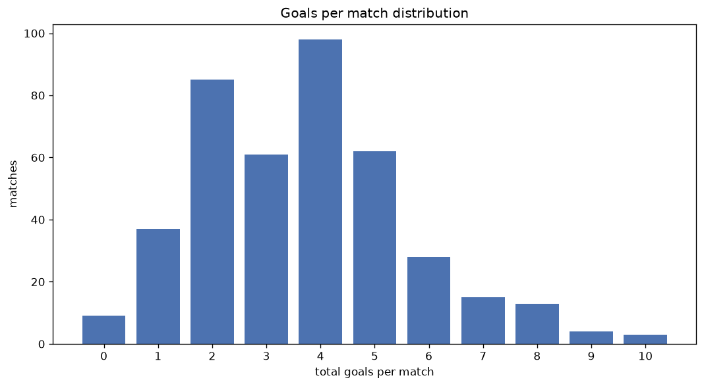
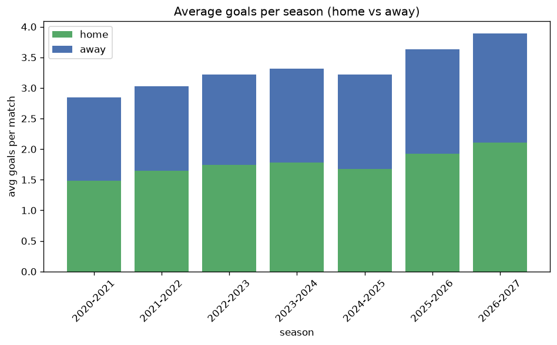

# Goal Analysis
- Report: `goals_analysis`
- Generated: 2026-10-29T02:00:32+00:00
- Script: `backend/scripts/analyze_goals.py` v1.0.0
- League: Regionalliga North (Germany)
- Scope: league `germany-north`

## 1. Goals per match distribution
| goals | matches | pct |
|---|---|---|
| 0 | 78 | 4.6% |
| 1 | 196 | 11.5% |
| 2 | 348 | 20.5% |
| 3 | 336 | 19.8% |
| 4 | 332 | 19.5% |
| 5 | 214 | 12.6% |
| 6 | 100 | 5.9% |
| 7 | 46 | 2.7% |
| 8 | 30 | 1.8% |
| 9 | 12 | 0.7% |
| 10 | 4 | 0.2% |
| 11 | 3 | 0.2% |

## 2. Goals per match per season
| season | matches | total goals | avg home | avg away | avg total |
|---|---|---|---|---|---|
| 2020-2021 | 98 | 279 | 1.48 | 1.367 | 2.847 |
| 2021-2022 | 200 | 605 | 1.645 | 1.38 | 3.025 |
| 2022-2023 | 342 | 1101 | 1.74 | 1.48 | 3.219 |
| 2023-2024 | 306 | 1014 | 1.781 | 1.533 | 3.314 |
| 2024-2025 | 306 | 984 | 1.68 | 1.536 | 3.216 |
| 2025-2026 | 317 | 1152 | 1.927 | 1.707 | 3.634 |
| 2026-2027 | 130 | 506 | 2.108 | 1.785 | 3.892 |

## 3. Home vs away goal share
- Home goals: **3013** (53.4%)
- Away goals: **2628** (46.6%)
- Home/away ratio: **1.146**

| season | home goals | away goals | total | home pct | away pct |
|---|---|---|---|---|---|
| 2020-2021 | 145 | 134 | 279 | 52.0% | 48.0% |
| 2021-2022 | 329 | 276 | 605 | 54.4% | 45.6% |
| 2022-2023 | 595 | 506 | 1101 | 54.0% | 46.0% |
| 2023-2024 | 545 | 469 | 1014 | 53.7% | 46.3% |
| 2024-2025 | 514 | 470 | 984 | 52.2% | 47.8% |
| 2025-2026 | 611 | 541 | 1152 | 53.0% | 47.0% |
| 2026-2027 | 274 | 232 | 506 | 54.2% | 45.8% |

## 4. BTTS (Both Teams To Score)
- Overall: **1016** of `1699` (59.8%)

| season | matches | BTTS | pct |
|---|---|---|---|
| 2020-2021 | 98 | 51 | 52.0% |
| 2021-2022 | 200 | 110 | 55.0% |
| 2022-2023 | 342 | 209 | 61.1% |
| 2023-2024 | 306 | 174 | 56.9% |
| 2024-2025 | 306 | 187 | 61.1% |
| 2025-2026 | 317 | 204 | 64.4% |
| 2026-2027 | 130 | 81 | 62.3% |

## 5. Clean sheets
- Home clean sheets: **402** (23.7%)
- Away clean sheets: **359** (21.1%)
- Total clean sheets recorded: **761**
- Matches with at least one clean sheet: **683** (40.2%)
- Both teams kept clean sheets (0-0): **78**

| season | matches | home CS | away CS | total CS | matches w/ CS |
|---|---|---|---|---|---|
| 2020-2021 | 98 | 26 | 23 | 49 | 47 (48.0%) |
| 2021-2022 | 200 | 59 | 44 | 103 | 90 (45.0%) |
| 2022-2023 | 342 | 81 | 73 | 154 | 133 (38.9%) |
| 2023-2024 | 306 | 79 | 71 | 150 | 132 (43.1%) |
| 2024-2025 | 306 | 74 | 58 | 132 | 119 (38.9%) |
| 2025-2026 | 317 | 59 | 62 | 121 | 113 (35.6%) |
| 2026-2027 | 130 | 24 | 28 | 52 | 49 (37.7%) |

## 6. Scoring intensity
- First-half goals: **2489** (44.2%)
- Second-half goals: **3140** (55.8%)
- Avg first-half goals per match: **1.468**
- Avg second-half goals per match: **1.851**
- Second-half-only scoring (HT 0-0, FT goals >= 1): **307** (18.1%)
- *3 match(es) excluded (no HT score recorded).*

| season | matches | 1st half | 2nd half | 1st half pct | 2nd half pct |
|---|---|---|---|---|---|
| 2020-2021 | 98 | 135 | 144 | 48.4% | 51.6% |
| 2021-2022 | 200 | 271 | 334 | 44.8% | 55.2% |
| 2022-2023 | 342 | 478 | 616 | 43.7% | 56.3% |
| 2023-2024 | 306 | 444 | 565 | 44.0% | 56.0% |
| 2024-2025 | 306 | 452 | 532 | 45.9% | 54.1% |
| 2025-2026 | 317 | 504 | 648 | 43.8% | 56.2% |
| 2026-2027 | 130 | 205 | 301 | 40.5% | 59.5% |

## 7. First-goal timing
- Matches with first-goal time recorded: `1618` of `1699` (95.2%)
- Goalless matches: `81`
- Min `1` | Max `94` | Mean `27.43` | Median (p50) `21.0`

| bucket | count | % of matches | % of scoring matches |
|---|---|---|---|
| 1-15 | 626 | 36.8% | 38.7% |
| 16-30 | 391 | 23.0% | 24.2% |
| 31-45 | 272 | 16.0% | 16.8% |
| 46-60 | 187 | 11.0% | 11.6% |
| 61-75 | 71 | 4.2% | 4.4% |
| 76-90 | 60 | 3.5% | 3.7% |
| 91-120 | 11 | 0.6% | 0.7% |

---
*All statistics are computed from PostgreSQL tables (read-only). Run with `python backend/scripts/analyze_goals.py` to regenerate.*

## Charts

