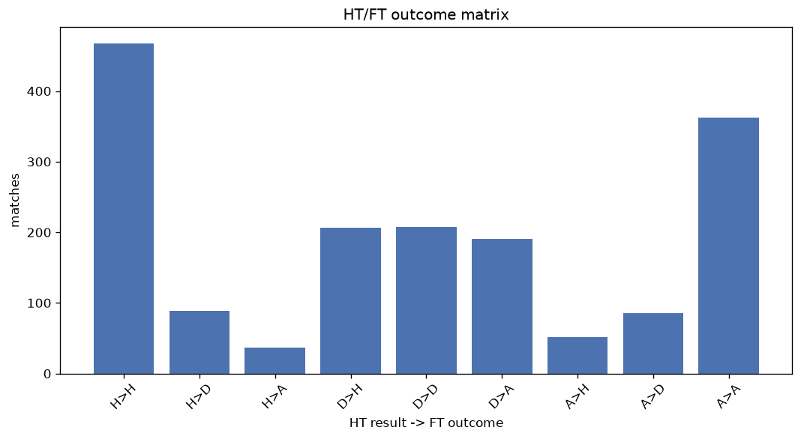
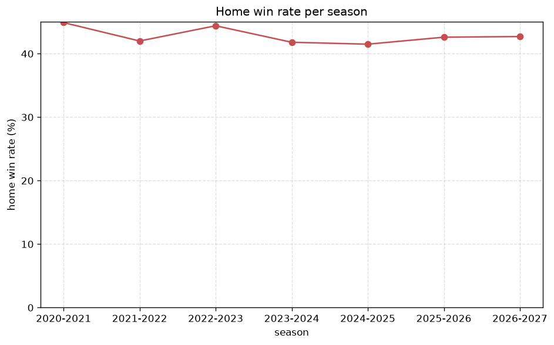

# Match Analysis
- Report: `matches_analysis`
- Generated: 2026-10-30T03:52:13+00:00
- Script: `backend/scripts/analyze_matches.py` v1.0.0
- League: Regionalliga North (Germany)
- Scope: league `germany-north`

## 1. Overall summary
| metric | value |
|---|---|
| Matches | 1700 |
| Home wins | 726 (42.7%) |
| Draws | 383 (22.5%) |
| Away wins | 591 (34.8%) |
| Total goals | 5646 |
| Average goals per match | 3.321 |
| Goalless matches | 78 (4.6%) |

## 2. Per-season breakdown
| season | matches | home wins | draws | away wins | total goals | avg goals | goalless |
|---|---|---|---|---|---|---|---|
| 2020-2021 | 98 | 44 (44.9%) | 13 (13.3%) | 41 (41.8%) | 279 | 2.847 | 2 (2.0%) |
| 2021-2022 | 200 | 84 (42.0%) | 51 (25.5%) | 65 (32.5%) | 605 | 3.025 | 13 (6.5%) |
| 2022-2023 | 342 | 152 (44.4%) | 78 (22.8%) | 112 (32.7%) | 1101 | 3.219 | 21 (6.1%) |
| 2023-2024 | 306 | 128 (41.8%) | 75 (24.5%) | 103 (33.7%) | 1014 | 3.314 | 18 (5.9%) |
| 2024-2025 | 306 | 127 (41.5%) | 70 (22.9%) | 109 (35.6%) | 984 | 3.216 | 13 (4.2%) |
| 2025-2026 | 317 | 135 (42.6%) | 69 (21.8%) | 113 (35.6%) | 1152 | 3.634 | 8 (2.5%) |
| 2026-2027 | 131 | 56 (42.7%) | 27 (20.6%) | 48 (36.6%) | 511 | 3.901 | 3 (2.3%) |

## 3. HT/FT outcome matrix
| HT result \ FT result | Home | Draw | Away | total |
|---|---|---|---|---|
| HT home lead | 467 (78.8%) | 89 (15.0%) | 37 (6.2%) | 593 |
| HT draw | 206 (34.1%) | 208 (34.4%) | 190 (31.5%) | 604 |
| HT away lead | 52 (10.4%) | 86 (17.2%) | 362 (72.4%) | 500 |
- *3 match(es) excluded (no HT score recorded).*

## 4. Comeback matches
- Home comebacks (trailing at HT, won at FT): **52** (3.1%)
- Away comebacks (trailing at HT, won at FT): **37** (2.2%)

### Home comebacks
| season | home | away | HT | FT |
|---|---|---|---|---|
| 2020-2021 | Hannover II | Delmenhorst | 0-1 | 2-1 |
| 2020-2021 | Altona | Holstein Kiel II | 0-1 | 2-1 |
| 2020-2021 | Norderstedt | Hamburger SV II | 1-2 | 3-2 |
| 2020-2021 | Hannover II | Oberneuland | 1-2 | 3-2 |
| 2020-2021 | BSV Rehden | TSV Havelse | 0-1 | 2-1 |
| 2020-2021 | Holstein Kiel II | Heider SV | 0-1 | 2-1 |
| 2021-2022 | Hamburger SV II | Heider SV | 0-1 | 2-1 |
| 2022-2023 | BSV Rehden | Emden | 0-1 | 2-1 |
| 2022-2023 | Teutonia Ottensen | Bremer | 0-1 | 2-1 |
| 2022-2023 | Hamburger SV II | TSV Havelse | 0-1 | 2-1 |
| 2022-2023 | Jeddeloh | Hildesheim | 0-1 | 3-1 |
| 2022-2023 | St. Pauli II | Lubeck | 0-1 | 2-1 |
| 2022-2023 | Norderstedt | Delmenhorst | 0-1 | 3-1 |
| 2023-2024 | Spelle-Venhaus | Eimsbutteler | 0-1 | 3-2 |
| 2023-2024 | Hannover II | TSV Havelse | 0-1 | 3-2 |
| 2023-2024 | Kilia Kiel | Eimsbutteler | 0-1 | 2-1 |
| 2023-2024 | Drochtersen/Assel | Spelle-Venhaus | 0-1 | 3-1 |
| 2023-2024 | Norderstedt | St. Pauli II | 1-2 | 3-2 |
| 2023-2024 | VfB Oldenburg | Lohne | 0-1 | 2-1 |
| 2023-2024 | St. Pauli II | Eimsbutteler | 0-1 | 3-1 |
| 2023-2024 | Meppen | VfB Oldenburg | 1-2 | 3-2 |
| 2023-2024 | Phonix Lubeck | Lohne | 0-1 | 3-1 |
| 2023-2024 | Drochtersen/Assel | Eimsbutteler | 0-1 | 2-1 |
| 2024-2025 | TSV Havelse | Werder Bremen II | 1-3 | 4-3 |
| 2024-2025 | SC Weiche-08 | Jeddeloh | 0-1 | 4-1 |
| 2024-2025 | Hamburger SV II | Bremer | 1-2 | 5-3 |
| 2024-2025 | Werder Bremen II | Emden | 1-2 | 3-2 |
| 2024-2025 | Emden | Teutonia Ottensen | 0-2 | 3-2 |
| 2024-2025 | Bremer | Phonix Lubeck | 1-2 | 3-2 |
| 2024-2025 | VfB Oldenburg | SC Weiche-08 | 0-1 | 5-1 |
| 2024-2025 | SC Weiche-08 | Bremer | 0-1 | 3-2 |
| 2024-2025 | Drochtersen/Assel | Hamburger SV II | 0-1 | 3-1 |
| 2025-2026 | Jeddeloh | Altona | 1-2 | 3-2 |
| 2025-2026 | SC Weiche-08 | Hamburger SV II | 0-1 | 3-2 |
| 2025-2026 | SC Weiche | Hamburger SV II | 0-1 | 3-2 |
| 2025-2026 | VfB Oldenburg | Hannover II | 1-2 | 4-2 |
| 2025-2026 | Lubeck | Schoningen | 0-1 | 4-1 |
| 2025-2026 | VfB Oldenburg | Emden | 0-1 | 2-1 |
| 2025-2026 | Bremer | Hannover II | 0-1 | 2-1 |
| 2025-2026 | Drochtersen/Assel | St. Pauli II | 0-1 | 2-1 |
| 2025-2026 | Werder Bremen II | Altona | 0-1 | 5-1 |
| 2025-2026 | VfB Oldenburg | Norderstedt | 0-1 | 3-1 |
| 2025-2026 | Werder Bremen II | St. Pauli II | 0-1 | 2-1 |
| 2025-2026 | Emden | Norderstedt | 0-1 | 4-2 |
| 2025-2026 | Schoningen | Altona | 1-2 | 3-2 |
| 2025-2026 | Meppen | SC Weiche-08 | 0-1 | 2-1 |
| 2025-2026 | Phonix Lubeck | Jeddeloh | 0-1 | 3-2 |
| 2026-2027 | Drochtersen/Assel | Phonix Lubeck | 0-1 | 2-1 |
| 2026-2027 | VfB Oldenburg | Drochtersen/Assel | 0-1 | 3-1 |
| 2026-2027 | Schoningen | St. Pauli II | 1-2 | 3-2 |
| 2026-2027 | VfB Oldenburg | Hannover II | 0-2 | 4-3 |
| 2026-2027 | VfB Lubeck | Todesfelde | 0-1 | 3-2 |

### Away comebacks
| season | home | away | HT | FT |
|---|---|---|---|---|
| 2020-2021 | Altona | St. Pauli II | 1-0 | 1-2 |
| 2020-2021 | Luneburger Hansa | SC Weiche-08 | 1-0 | 1-2 |
| 2021-2022 | Luneburger Hansa | Hildesheim | 1-0 | 1-2 |
| 2021-2022 | BSV Rehden | Oberneuland | 2-1 | 2-3 |
| 2021-2022 | Altona | Phonix Lubeck | 2-1 | 2-4 |
| 2021-2022 | Phonix Lubeck | Hamburger SV II | 2-1 | 2-3 |
| 2021-2022 | BSV Rehden | Jeddeloh | 1-0 | 2-3 |
| 2022-2023 | Lohne | Phonix Lubeck | 2-1 | 2-3 |
| 2022-2023 | Hildesheim | Jeddeloh | 2-0 | 2-3 |
| 2022-2023 | St. Pauli II | Norderstedt | 1-0 | 1-3 |
| 2022-2023 | Lohne | Hamburger SV II | 2-0 | 2-3 |
| 2022-2023 | Emden | Hamburger SV II | 1-0 | 1-2 |
| 2022-2023 | Hannover II | Hamburger SV II | 1-0 | 1-2 |
| 2022-2023 | Phonix Lubeck | Emden | 1-0 | 1-2 |
| 2023-2024 | SC Weiche-08 | Holstein Kiel II | 2-1 | 2-3 |
| 2023-2024 | Jeddeloh | Eimsbutteler | 1-0 | 1-2 |
| 2023-2024 | Lohne | Hamburger SV II | 1-0 | 1-2 |
| 2023-2024 | Teutonia Ottensen | Phonix Lubeck | 2-0 | 2-3 |
| 2023-2024 | St. Pauli II | Bremer | 1-0 | 1-2 |
| 2023-2024 | TSV Havelse | Drochtersen/Assel | 1-0 | 1-2 |
| 2024-2025 | SC Weiche-08 | TSV Havelse | 1-0 | 1-2 |
| 2024-2025 | Hamburger SV II | Emden | 1-0 | 1-2 |
| 2024-2025 | Holstein Kiel II | Emden | 1-0 | 1-2 |
| 2024-2025 | Hamburger SV II | Lubeck | 1-0 | 2-3 |
| 2024-2025 | Bremer | Emden | 1-0 | 1-2 |
| 2024-2025 | Holstein Kiel II | Todesfelde | 1-0 | 1-3 |
| 2025-2026 | St. Pauli II | Werder Bremen II | 2-0 | 2-3 |
| 2025-2026 | Emden | Hamburger SV II | 1-0 | 3-4 |
| 2025-2026 | Lubeck | Hannoverscher SC | 1-0 | 1-2 |
| 2025-2026 | Bremer | Drochtersen/Assel | 2-1 | 2-3 |
| 2025-2026 | Hannover II | Emden | 2-1 | 2-3 |
| 2025-2026 | Drochtersen/Assel | Meppen | 1-0 | 1-2 |
| 2025-2026 | Schoningen | Phonix Lubeck | 2-1 | 3-5 |
| 2026-2027 | Emden | Eimsbutteler | 2-1 | 2-3 |
| 2026-2027 | Werder Bremen II | SC Weiche-08 | 1-0 | 1-2 |
| 2026-2027 | Norderstedt | SC Weiche-08 | 1-0 | 1-4 |
| 2026-2027 | Eimsbutteler | Werder Bremen II | 2-0 | 2-4 |

## 5. HT lead conversion
| HT state | matches | converted to win | held as draw | collapsed to loss |
|---|---|---|---|---|
| Home lead | 593 | 467 (78.8%) | 89 (15.0%) | 37 (6.2%) |
| Away lead | 500 | 362 (72.4%) | 86 (17.2%) | 52 (10.4%) |

### Matches level at half-time
| FT result | count | pct |
|---|---|---|
| Home win | 206 | 34.1% |
| Draw | 208 | 34.4% |
| Away win | 190 | 31.5% |
- *3 match(es) excluded (no HT score recorded).*

## 6. First-goal timing
- Matches with a first-goal time recorded: `1619` of `1700` (95.2%)

Outcome distribution by first-goal timing bucket:
| bucket | matches | % of matches | home | draw | away |
|---|---|---|---|---|---|
| 1-15 | 627 | 36.9% | 279 (44.5%) | 117 (18.7%) | 231 (36.8%) |
| 16-30 | 391 | 23.0% | 181 (46.3%) | 66 (16.9%) | 144 (36.8%) |
| 31-45 | 272 | 16.0% | 129 (47.4%) | 56 (20.6%) | 87 (32.0%) |
| 46-60 | 187 | 11.0% | 89 (47.6%) | 38 (20.3%) | 60 (32.1%) |
| 61-75 | 71 | 4.2% | 24 (33.8%) | 18 (25.4%) | 29 (40.8%) |
| 76-90 | 60 | 3.5% | 20 (33.3%) | 10 (16.7%) | 30 (50.0%) |
| 91-120 | 11 | 0.6% | 3 (27.3%) | 0 (0.0%) | 8 (72.7%) |

## 7. Goalless matches
- Overall: **78** of `1700` (4.6%)

| season | matches | goalless | pct |
|---|---|---|---|
| 2020-2021 | 98 | 2 | 2.0% |
| 2021-2022 | 200 | 13 | 6.5% |
| 2022-2023 | 342 | 21 | 6.1% |
| 2023-2024 | 306 | 18 | 5.9% |
| 2024-2025 | 306 | 13 | 4.2% |
| 2025-2026 | 317 | 8 | 2.5% |
| 2026-2027 | 131 | 3 | 2.3% |

---
*All statistics are computed from PostgreSQL tables (read-only). Run with `python backend/scripts/analyze_matches.py` to regenerate.*

## Charts

