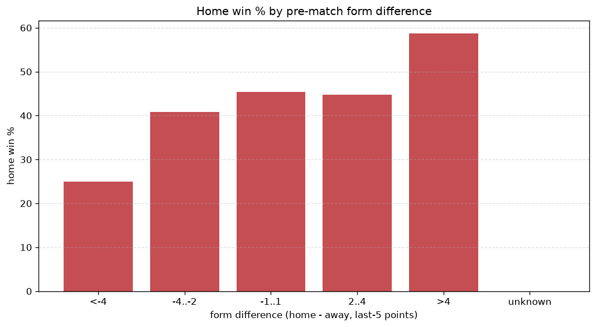
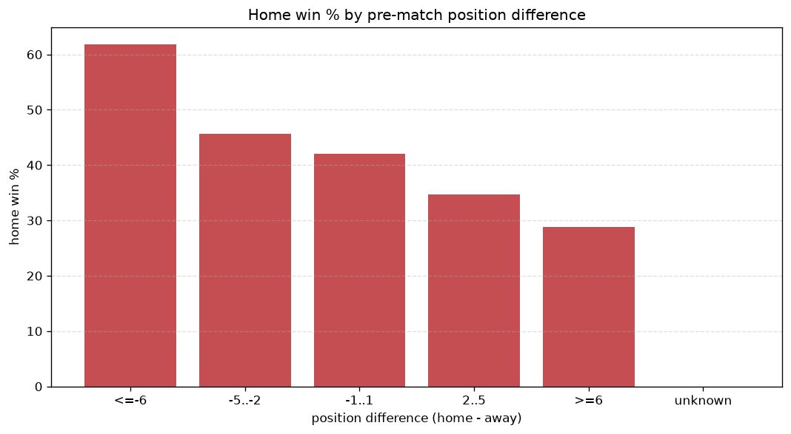

# Relationships Analysis
- Report: `relationships`
- Generated: 2026-10-30T03:52:22+00:00
- Script: `backend/scripts/analyze_relationships.py` v1.0.0
- League: Regionalliga North (Germany)
- Scope: league `germany-north`

- Matches analysed: **1569** (23 leakage-safe pre-match features).

## 1. Correlation matrix
_Pearson correlation of each pre-match feature with observed goals; sorted by |corr(total goals)|._

| feature | corr(home) | corr(away) | corr(total) |
|---|---|---|---|
| position_difference | -0.262 | 0.198 | -0.064 |
| points_difference | 0.268 | -0.206 | 0.062 |
| away_team_away_conceded_avg | 0.139 | -0.067 | 0.062 |
| away_position_before_match | 0.174 | -0.105 | 0.061 |
| away_team_goals_conceded_last_5 | 0.131 | -0.062 | 0.058 |
| home_team_goals_scored_last_5 | 0.128 | -0.070 | 0.050 |
| away_team_points_last_5 | -0.143 | 0.089 | -0.049 |
| home_team_wins_last_5 | 0.156 | -0.108 | 0.045 |
| away_team_wins_last_5 | -0.138 | 0.093 | -0.042 |
| away_points_before_match | -0.118 | 0.077 | -0.038 |
| away_rest_days | -0.051 | 0.007 | -0.036 |
| home_team_home_goals_avg | 0.126 | -0.090 | 0.034 |
| home_team_points_last_5 | 0.146 | -0.116 | 0.032 |
| home_team_goals_conceded_last_5 | -0.126 | 0.094 | -0.031 |
| home_position_before_match | -0.187 | 0.166 | -0.028 |
| home_team_home_win_rate | 0.117 | -0.096 | 0.023 |
| rest_days_difference | 0.025 | 0.000 | 0.020 |
| away_team_goals_scored_last_5 | -0.116 | 0.103 | -0.017 |
| home_rest_days | -0.024 | 0.006 | -0.015 |
| away_team_away_win_rate | -0.105 | 0.099 | -0.011 |
| away_team_away_goals_avg | -0.062 | 0.081 | 0.009 |
| home_points_before_match | 0.081 | -0.077 | 0.009 |
| home_team_home_conceded_avg | -0.074 | 0.083 | 0.002 |

## 2. Form vs outcome
_Home win/draw/away % per bucket of `home_team_points_last_5 - away_team_points_last_5`._

| bucket | matches | home | draw | away | home % | draw % | away % |
|---|---|---|---|---|---|---|---|
| <-4 | 296 | 74 | 66 | 156 | 25.0% | 22.3% | 52.7% |
| -4..-2 | 304 | 124 | 68 | 112 | 40.8% | 22.4% | 36.8% |
| -1..1 | 425 | 193 | 95 | 137 | 45.4% | 22.4% | 32.2% |
| 2..4 | 290 | 130 | 69 | 91 | 44.8% | 23.8% | 31.4% |
| >4 | 254 | 149 | 58 | 47 | 58.7% | 22.8% | 18.5% |
| unknown | 0 | 0 | 0 | 0 | - | - | - |

## 3. Position vs outcome
_Home win/draw/away % per bucket of `position_difference` (home position - away position; negative favours the home team)._

| bucket | matches | home | draw | away | home % | draw % | away % |
|---|---|---|---|---|---|---|---|
| <=-6 | 382 | 236 | 71 | 75 | 61.8% | 18.6% | 19.6% |
| -5..-2 | 258 | 118 | 57 | 83 | 45.7% | 22.1% | 32.2% |
| -1..1 | 226 | 95 | 51 | 80 | 42.0% | 22.6% | 35.4% |
| 2..5 | 314 | 109 | 80 | 125 | 34.7% | 25.5% | 39.8% |
| >=6 | 389 | 112 | 97 | 180 | 28.8% | 24.9% | 46.3% |
| unknown | 0 | 0 | 0 | 0 | - | - | - |

## 4. Rest advantage
_Home win/draw/away % per bucket of `rest_days_difference` (home rest - away rest). Matches with unknown rest are bucketed separately._

| bucket | matches | home | draw | away | home % | draw % | away % |
|---|---|---|---|---|---|---|---|
| <-1 | 285 | 121 | 69 | 95 | 42.5% | 24.2% | 33.3% |
| -1..0 | 242 | 90 | 58 | 94 | 37.2% | 24.0% | 38.8% |
| 0 | 435 | 190 | 94 | 151 | 43.7% | 21.6% | 34.7% |
| 1..2 | 302 | 136 | 69 | 97 | 45.0% | 22.8% | 32.1% |
| >2 | 237 | 103 | 52 | 82 | 43.5% | 21.9% | 34.6% |
| unknown | 68 | 30 | 14 | 24 | 44.1% | 20.6% | 35.3% |
- *68 match(es) had unknown rest difference (missing rest data on at least one side).*

## 5. Home team quality
_Home win rate by `home_team_home_win_rate` tier (split at 0.5)._

- `< 0.5` tier: **38.2%** home win (352/921)
- `>= 0.5` tier: **49.1%** home win (318/648)
- Home-win gap (>= split minus < split): **+10.9 pp**

| tier | label | matches | home | draw | away | home % |
|---|---|---|---|---|---|---|
| low | < 0.5 | 921 | 352 | 216 | 353 | 38.2% |
| high | >= 0.5 | 648 | 318 | 140 | 190 | 49.1% |

## 6. Feature averages by result
_Mean feature value per outcome; `range` is home-minus-away spread of the group means._

| feature | home mean | draw mean | away mean | range |
|---|---|---|---|---|
| points_difference | 3.276 | -1.615 | -3.971 | 7.247 |
| position_difference | -1.951 | 1.135 | 2.471 | 4.422 |
| away_points_before_match | 18.799 | 22.239 | 22.930 | 4.132 |
| home_points_before_match | 22.075 | 20.624 | 18.959 | 3.115 |
| home_position_before_match | 8.997 | 10.778 | 11.523 | 2.526 |
| away_position_before_match | 10.948 | 9.643 | 9.052 | 1.896 |
| away_rest_days | 7.721 | 9.549 | 8.736 | 1.828 |
| home_team_points_last_5 | 6.655 | 6.020 | 5.287 | 1.368 |
| away_team_goals_scored_last_5 | 6.716 | 7.393 | 7.961 | 1.245 |
| home_team_goals_conceded_last_5 | 6.690 | 7.579 | 7.875 | 1.185 |
| away_team_points_last_5 | 5.733 | 6.261 | 6.906 | 1.173 |
| rest_days_difference | 0.731 | -0.333 | -0.002 | 1.065 |
| home_team_goals_scored_last_5 | 7.636 | 6.930 | 6.573 | 1.063 |
| away_team_goals_conceded_last_5 | 7.504 | 7.354 | 6.448 | 1.057 |
| home_rest_days | 8.450 | 9.219 | 8.728 | 0.768 |
| home_team_wins_last_5 | 1.888 | 1.649 | 1.411 | 0.477 |
| away_team_wins_last_5 | 1.570 | 1.722 | 1.974 | 0.404 |
| home_team_home_goals_avg | 1.799 | 1.635 | 1.554 | 0.245 |
| away_team_away_conceded_avg | 1.763 | 1.684 | 1.518 | 0.245 |
| home_team_home_conceded_avg | 1.339 | 1.471 | 1.510 | 0.171 |
| away_team_away_goals_avg | 1.362 | 1.454 | 1.480 | 0.118 |
| home_team_home_win_rate | 0.451 | 0.397 | 0.374 | 0.077 |
| away_team_away_win_rate | 0.294 | 0.330 | 0.348 | 0.054 |

---
*All features are leakage-safe pre-match values built by `ml.features.build_features.build_rows` from strictly prior matches. Run with `python backend/scripts/analyze_relationships.py` to regenerate.*

## Charts

