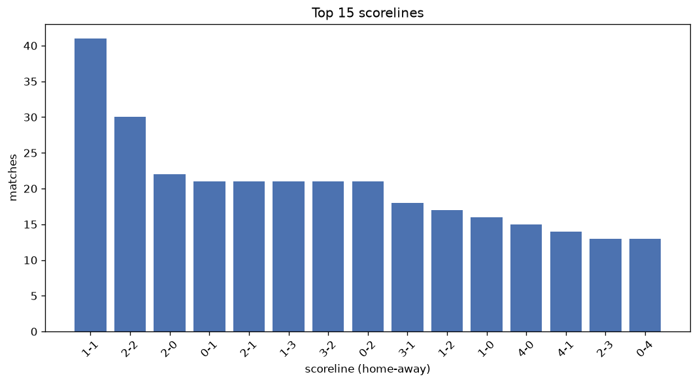
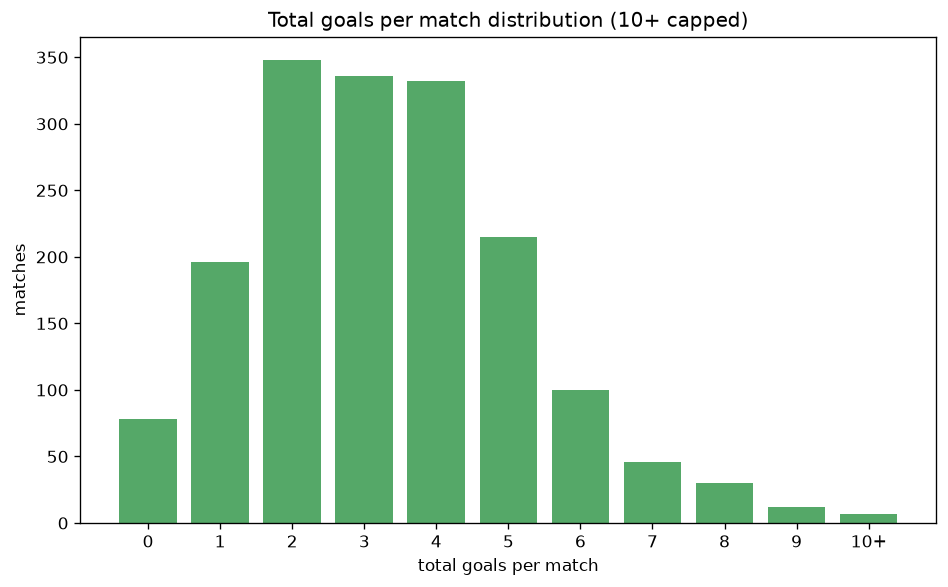

# Scoreline Analysis
- Report: `scoreline_analysis`
- Generated: 2026-10-30T03:52:20+00:00
- Script: `backend/scripts/analyze_scorelines.py` v1.0.0
- League: Regionalliga North (Germany)
- Scope: league `germany-north`

## 1. Scoreline frequency
- Matches analysed: **1700** across **7** seasons.
- Distinct scorelines seen: **56**.

| scoreline | count | pct |
|---|---|---|
| 1-1 | 175 | 10.3% |
| 2-1 | 118 | 6.9% |
| 2-0 | 102 | 6.0% |
| 1-0 | 99 | 5.8% |
| 2-2 | 99 | 5.8% |
| 1-2 | 97 | 5.7% |
| 0-1 | 97 | 5.7% |
| 3-1 | 86 | 5.1% |
| 0-0 | 78 | 4.6% |
| 1-3 | 75 | 4.4% |
| 0-2 | 71 | 4.2% |
| 0-3 | 66 | 3.9% |
| 3-2 | 65 | 3.8% |
| 3-0 | 55 | 3.2% |
| 4-1 | 48 | 2.8% |
| 2-3 | 48 | 2.8% |
| 4-0 | 42 | 2.5% |
| 0-4 | 30 | 1.8% |
| 1-4 | 24 | 1.4% |
| 3-3 | 24 | 1.4% |

## 2. Scoreline frequency per season

### 2020-2021
| scoreline | count | pct |
|---|---|---|
| 0-1 | 11 | 11.2% |
| 1-2 | 10 | 10.2% |
| 1-0 | 9 | 9.2% |
| 1-1 | 8 | 8.2% |
| 2-1 | 7 | 7.1% |

### 2021-2022
| scoreline | count | pct |
|---|---|---|
| 1-1 | 22 | 11.0% |
| 2-1 | 18 | 9.0% |
| 1-0 | 17 | 8.5% |
| 2-2 | 14 | 7.0% |
| 0-0 | 13 | 6.5% |

### 2022-2023
| scoreline | count | pct |
|---|---|---|
| 2-1 | 35 | 10.2% |
| 1-1 | 29 | 8.5% |
| 2-0 | 22 | 6.4% |
| 1-2 | 22 | 6.4% |
| 0-0 | 21 | 6.1% |

### 2023-2024
| scoreline | count | pct |
|---|---|---|
| 1-1 | 34 | 11.1% |
| 1-0 | 21 | 6.9% |
| 2-1 | 18 | 5.9% |
| 0-0 | 18 | 5.9% |
| 2-0 | 17 | 5.6% |

### 2024-2025
| scoreline | count | pct |
|---|---|---|
| 1-1 | 39 | 12.7% |
| 2-0 | 23 | 7.5% |
| 0-1 | 22 | 7.2% |
| 3-1 | 19 | 6.2% |
| 1-0 | 18 | 5.9% |

### 2025-2026
| scoreline | count | pct |
|---|---|---|
| 1-1 | 32 | 10.1% |
| 2-2 | 24 | 7.6% |
| 3-2 | 18 | 5.7% |
| 2-1 | 17 | 5.4% |
| 1-3 | 17 | 5.4% |

### 2026-2027
| scoreline | count | pct |
|---|---|---|
| 1-1 | 11 | 8.4% |
| 0-3 | 8 | 6.1% |
| 0-2 | 8 | 6.1% |
| 2-2 | 8 | 6.1% |
| 2-0 | 8 | 6.1% |

## 3. Total-goal histogram
_10+ groups all matches with 10 or more total goals._

| total goals | matches | pct |
|---|---|---|
| 0 | 78 | 4.6% |
| 1 | 196 | 11.5% |
| 2 | 348 | 20.5% |
| 3 | 336 | 19.8% |
| 4 | 332 | 19.5% |
| 5 | 215 | 12.6% |
| 6 | 100 | 5.9% |
| 7 | 46 | 2.7% |
| 8 | 30 | 1.8% |
| 9 | 12 | 0.7% |
| 10+ | 7 | 0.4% |

## 4. Extreme scorelines
- Matches with 7+ total goals: **95**

| season | date | scoreline | total goals |
|---|---|---|---|
| 2022-2023 | 2023-02-12 | 5-6 | 11 |
| 2023-2024 | 2023-09-03 | 6-5 | 11 |
| 2023-2024 | 2023-10-28 | 9-2 | 11 |
| 2024-2025 | 2024-10-27 | 1-9 | 10 |
| 2026-2027 | 2026-08-02 | 6-4 | 10 |
| 2026-2027 | 2026-08-29 | 7-3 | 10 |
| 2026-2027 | 2026-09-15 | 8-2 | 10 |
| 2021-2022 | 2021-09-25 | 8-1 | 9 |
| 2022-2023 | 2022-11-11 | 5-4 | 9 |
| 2022-2023 | 2023-03-12 | 7-2 | 9 |
| 2022-2023 | 2023-05-27 | 4-5 | 9 |
| 2023-2024 | 2023-10-14 | 7-2 | 9 |
| 2024-2025 | 2025-04-12 | 2-7 | 9 |
| 2024-2025 | 2025-05-09 | 8-1 | 9 |
| 2025-2026 | 2025-10-17 | 7-2 | 9 |
| 2025-2026 | 2026-04-02 | 2-7 | 9 |
| 2025-2026 | 2026-05-16 | 3-6 | 9 |
| 2026-2027 | 2026-09-16 | 9-0 | 9 |
| 2026-2027 | 2026-10-03 | 7-2 | 9 |
| 2020-2021 | 2020-09-13 | 3-5 | 8 |
| 2021-2022 | 2021-09-25 | 1-7 | 8 |
| 2021-2022 | 2021-09-26 | 4-4 | 8 |
| 2021-2022 | 2021-12-12 | 7-1 | 8 |
| 2022-2023 | 2023-04-23 | 4-4 | 8 |
| 2022-2023 | 2023-05-26 | 3-5 | 8 |
| 2022-2023 | 2023-05-27 | 6-2 | 8 |
| 2023-2024 | 2023-08-11 | 3-5 | 8 |
| 2023-2024 | 2023-10-07 | 4-4 | 8 |
| 2023-2024 | 2023-10-21 | 5-3 | 8 |
| 2023-2024 | 2023-11-04 | 2-6 | 8 |
| 2023-2024 | 2024-05-08 | 6-2 | 8 |
| 2023-2024 | 2024-05-08 | 4-4 | 8 |
| 2023-2024 | 2024-05-17 | 2-6 | 8 |
| 2024-2025 | 2024-08-25 | 3-5 | 8 |
| 2024-2025 | 2024-10-06 | 5-3 | 8 |
| 2024-2025 | 2024-11-10 | 5-3 | 8 |
| 2025-2026 | 2025-08-09 | 4-4 | 8 |
| 2025-2026 | 2025-08-22 | 7-1 | 8 |
| 2025-2026 | 2025-08-27 | 6-2 | 8 |
| 2025-2026 | 2025-09-06 | 6-2 | 8 |
| 2025-2026 | 2025-10-04 | 5-3 | 8 |
| 2025-2026 | 2025-10-04 | 5-3 | 8 |
| 2025-2026 | 2025-10-11 | 6-2 | 8 |
| 2025-2026 | 2025-11-29 | 2-6 | 8 |
| 2025-2026 | 2026-05-09 | 4-4 | 8 |
| 2025-2026 | 2026-05-16 | 3-5 | 8 |
| 2026-2027 | 2026-08-01 | 4-4 | 8 |
| 2026-2027 | 2026-08-12 | 6-2 | 8 |
| 2026-2027 | 2026-09-04 | 7-1 | 8 |
| 2020-2021 | 2020-09-23 | 1-6 | 7 |
| 2020-2021 | 2020-09-27 | 7-0 | 7 |
| 2021-2022 | 2021-08-15 | 7-0 | 7 |
| 2021-2022 | 2021-08-21 | 7-0 | 7 |
| 2021-2022 | 2022-02-06 | 3-4 | 7 |
| 2022-2023 | 2022-08-28 | 6-1 | 7 |
| 2022-2023 | 2022-09-25 | 7-0 | 7 |
| 2022-2023 | 2022-10-28 | 5-2 | 7 |
| 2022-2023 | 2022-10-28 | 1-6 | 7 |
| 2022-2023 | 2023-02-05 | 5-2 | 7 |
| 2022-2023 | 2023-02-17 | 6-1 | 7 |
| 2022-2023 | 2023-05-10 | 1-6 | 7 |
| 2023-2024 | 2023-08-12 | 7-0 | 7 |
| 2023-2024 | 2023-08-13 | 1-6 | 7 |
| 2023-2024 | 2023-08-26 | 5-2 | 7 |
| 2023-2024 | 2023-10-22 | 5-2 | 7 |
| 2023-2024 | 2024-03-10 | 3-4 | 7 |
| 2023-2024 | 2024-03-23 | 4-3 | 7 |
| 2023-2024 | 2024-05-08 | 3-4 | 7 |
| 2023-2024 | 2024-05-18 | 3-4 | 7 |
| 2024-2025 | 2024-07-28 | 4-3 | 7 |
| 2024-2025 | 2024-08-03 | 5-2 | 7 |
| 2024-2025 | 2024-08-25 | 5-2 | 7 |
| 2024-2025 | 2024-08-25 | 3-4 | 7 |
| 2024-2025 | 2024-11-30 | 6-1 | 7 |
| 2024-2025 | 2025-04-13 | 3-4 | 7 |
| 2024-2025 | 2025-04-17 | 2-5 | 7 |
| 2024-2025 | 2025-05-11 | 3-4 | 7 |
| 2024-2025 | 2025-05-16 | 1-6 | 7 |
| 2025-2026 | 2025-07-26 | 2-5 | 7 |
| 2025-2026 | 2025-07-26 | 2-5 | 7 |
| 2025-2026 | 2025-08-23 | 3-4 | 7 |
| 2025-2026 | 2025-08-30 | 5-2 | 7 |
| 2025-2026 | 2025-09-06 | 6-1 | 7 |
| 2025-2026 | 2025-10-01 | 3-4 | 7 |
| 2025-2026 | 2025-10-04 | 3-4 | 7 |
| 2025-2026 | 2025-11-22 | 6-1 | 7 |
| 2025-2026 | 2026-05-02 | 3-4 | 7 |
| 2026-2027 | 2026-08-08 | 5-2 | 7 |
| 2026-2027 | 2026-08-15 | 5-2 | 7 |
| 2026-2027 | 2026-09-06 | 5-2 | 7 |
| 2026-2027 | 2026-09-06 | 1-6 | 7 |
| 2026-2027 | 2026-09-11 | 4-3 | 7 |
| 2026-2027 | 2026-09-20 | 2-5 | 7 |
| 2026-2027 | 2026-10-11 | 3-4 | 7 |
| 2026-2027 | 2026-10-24 | 4-3 | 7 |

## 5. Margin-of-victory distribution (decided matches)
- Decided matches: **1317** (draws: **383**)
- Average winning margin: **2.1**

| margin | matches | pct |
|---|---|---|
| 1 | 544 | 41.3% |
| 2 | 384 | 29.2% |
| 3+ | 389 | 29.5% |

## 6. Margin by outcome

### Home wins
- Matches: **726** | avg margin: **2.17** | max margin: **9**
| margin | matches | pct |
|---|---|---|
| 1 | 288 | 39.7% |
| 2 | 212 | 29.2% |
| 3+ | 226 | 31.1% |
- *Full match-by-match list available in `scoreline_analysis.json`.*

### Away wins
- Matches: **591** | avg margin: **2.02** | max margin: **8**
| margin | matches | pct |
|---|---|---|
| 1 | 256 | 43.3% |
| 2 | 172 | 29.1% |
| 3+ | 163 | 27.6% |
- *Full match-by-match list available in `scoreline_analysis.json`.*

## 7. Most common exact score by outcome type
| outcome | matches | most common score | count | pct |
|---|---|---|---|---|
| home | 726 | 2-1 | 118 | 16.3% |
| draw | 383 | 1-1 | 175 | 45.7% |
| away | 591 | 1-2 | 97 | 16.4% |

---
*All statistics are computed from PostgreSQL tables (read-only). Run with `python backend/scripts/analyze_scorelines.py` to regenerate.*

## Charts

