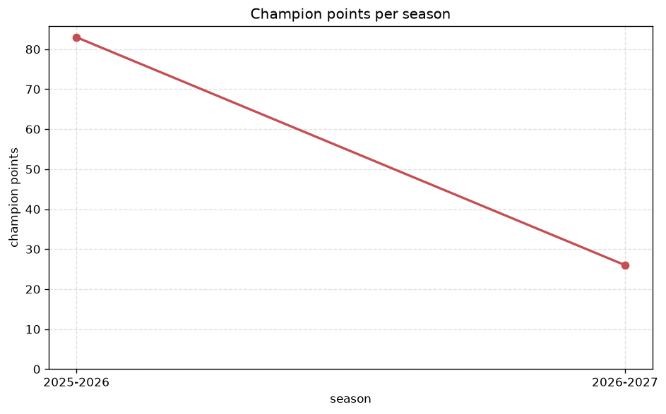
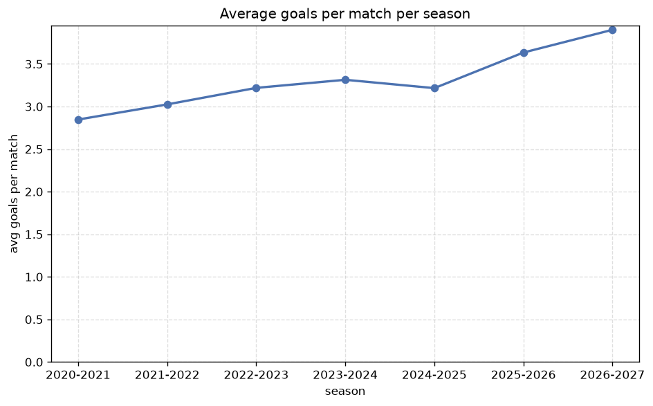

# Season Trends Analysis
- Report: `season_trends`
- Generated: 2026-10-30T03:52:18+00:00
- Script: `backend/scripts/analyze_seasons.py` v1.0.0
- League: Regionalliga North (Germany)
- Scope: league `germany-north`

## 1. Champions per season
| season | champion | pts | runner-up | margin |
|---|---|---|---|---|
| 2020-2021 | TSV Havelse | 20 | Werder Bremen II | 0 pts |
| 2021-2022 | VfB Oldenburg | 43 | Werder Bremen II | 1 pts |
| 2022-2023 | Lubeck | 76 | Hamburger SV II | 4 pts |
| 2023-2024 | Hannover II | 72 | Meppen | 7 pts |
| 2024-2025 | TSV Havelse | 71 | Drochtersen/Assel | 11 pts |
| 2025-2026 | Meppen | 83 | VfB Oldenburg | 11 pts |
| 2026-2027 | SC Weiche-08 | 35 | Hannover II | 2 pts |

## 2. Title-race tightness
- Tight races (margin <= 3 pts): **3** of 7 seasons
- Tightest race: **2020-2021** - TSV Havelse beat Werder Bremen II by **0** pts

| season | margin | tight |
|---|---|---|
| 2020-2021 | 0 pts | yes |
| 2021-2022 | 1 pts | yes |
| 2022-2023 | 4 pts |  |
| 2023-2024 | 7 pts |  |
| 2024-2025 | 11 pts |  |
| 2025-2026 | 11 pts |  |
| 2026-2027 | 2 pts | yes |

## 3. Points thresholds
_Position-specific points per season. Key: 1 = champion, 2 = runner-up, 4 = CL line, 6 = Europa, 16 = last safe, 19 = bottom._

| season | pos 1 | pos 2 | pos 4 | pos 6 | pos 16 | pos 19 |
|---|---|---|---|---|---|---|
| 2020-2021 | 20 | 20 | 16 | 16 | 11 | 9 |
| 2021-2022 | 43 | 42 | 33 | 32 | 18 | 15 |
| 2022-2023 | 76 | 72 | 57 | 50 | 36 | 26 |
| 2023-2024 | 72 | 65 | 57 | 50 | 22 | - |
| 2024-2025 | 71 | 60 | 57 | 53 | 28 | 16 |
| 2025-2026 | 83 | 72 | 67 | 53 | 26 | 16 |
| 2026-2027 | 35 | 33 | 31 | 24 | 13 | 1 |

## 4. Relegation battle
| season | safe pos | safe pts | drop pos | drop pts | gap |
|---|---|---|---|---|---|
| 2020-2021 | 16 | 11 | 17 | - | - |
| 2021-2022 | 16 | 18 | 17 | - | - |
| 2022-2023 | 16 | 36 | 17 | 32 | 4 pts |
| 2023-2024 | 16 | 22 | 17 | 19 | 3 pts |
| 2024-2025 | 16 | 28 | 17 | - | - |
| 2025-2026 | 16 | 26 | 17 | 25 | 1 pts |
| 2026-2027 | 16 | 13 | 17 | 12 | 1 pts |

## 5. League-level trends
| season | matches | total goals | avg goals | home win | draw | away win | goalless | avg pts/team |
|---|---|---|---|---|---|---|---|---|
| 2020-2021 | 98 | 279 | 2.847 | 44.9% | 13.3% | 41.8% | 2.0% | 12.23 |
| 2021-2022 | 200 | 605 | 3.025 | 42.0% | 25.5% | 32.5% | 6.5% | 24.9 |
| 2022-2023 | 342 | 1101 | 3.219 | 44.4% | 22.8% | 32.7% | 6.1% | 47.21 |
| 2023-2024 | 306 | 1014 | 3.314 | 41.8% | 24.5% | 33.7% | 5.9% | 42.0 |
| 2024-2025 | 306 | 984 | 3.216 | 41.5% | 22.9% | 35.6% | 4.2% | 44.5 |
| 2025-2026 | 317 | 1152 | 3.634 | 42.6% | 21.8% | 35.6% | 2.5% | 46.42 |
| 2026-2027 | 131 | 511 | 3.901 | 42.7% | 20.6% | 36.6% | 2.3% | 19.26 |

## 6. View divergence
- Largest divergence: **2023-2024** (goals view, avg abs position diff = 21.444)

_Avg absolute position difference between classic view and alternative view per season._

| season | classic vs luck | classic vs goals |
|---|---|---|
| 2020-2021 | 4.182 | 8.500 |
| 2021-2022 | 6.857 | 9.762 |
| 2022-2023 | 12.053 | 10.053 |
| 2023-2024 | 19.944 | 21.444 |
| 2024-2025 | 8.167 | 9.444 |
| 2025-2026 | 3.053 | 6.421 |
| 2026-2027 | 3.158 | 5.895 |

---
*All statistics are computed from PostgreSQL tables (read-only). Run with `python backend/scripts/analyze_seasons.py` to regenerate.*

## Charts

