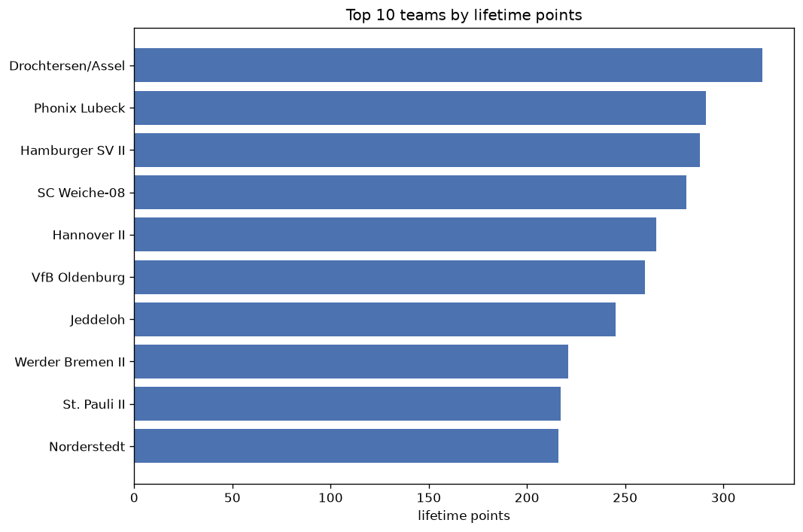
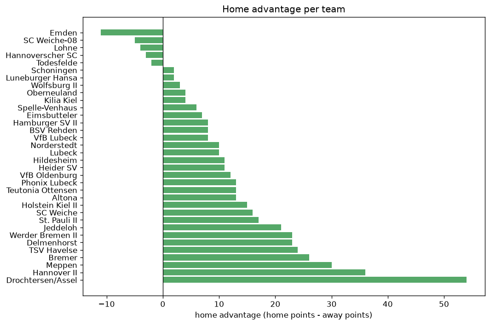

# Team Analysis
- Report: `teams_analysis`
- Generated: 2026-10-30T03:52:17+00:00
- Script: `backend/scripts/analyze_teams.py` v1.0.0
- League: Regionalliga North (Germany)
- Scope: league `germany-north`

- Teams: **34** | Seasons: **7** | Matches: **1700**

## 1. Team standings (lifetime)
| team | seasons | played | W | D | L | pts | GF | GA | GD | avg pts/season | best pos | worst pos | titles |
|---|---|---|---|---|---|---|---|---|---|---|---|---|---|
| Drochtersen/Assel | 7 | 183 | 93 | 41 | 49 | 320 | 326 | 217 | 109 | 45.71 | 2 | 8 | 0 |
| Phonix Lubeck | 7 | 182 | 82 | 45 | 55 | 291 | 342 | 250 | 92 | 41.57 | 3 | 15 | 0 |
| Hamburger SV II | 7 | 185 | 82 | 42 | 61 | 288 | 331 | 290 | 41 | 41.14 | 2 | 12 | 0 |
| SC Weiche-08 | 7 | 183 | 80 | 41 | 62 | 281 | 322 | 279 | 43 | 40.14 | 1 | 19 | 1 |
| Hannover II | 6 | 146 | 82 | 20 | 44 | 266 | 312 | 203 | 109 | 44.33 | 1 | 11 | 1 |
| VfB Oldenburg | 6 | 143 | 76 | 32 | 35 | 260 | 302 | 185 | 117 | 43.33 | 1 | 10 | 1 |
| Jeddeloh | 7 | 180 | 65 | 50 | 65 | 245 | 291 | 320 | -29 | 35.0 | 4 | 14 | 0 |
| Werder Bremen II | 6 | 147 | 63 | 32 | 52 | 221 | 289 | 240 | 49 | 36.83 | 2 | 14 | 0 |
| St. Pauli II | 7 | 182 | 58 | 43 | 81 | 217 | 274 | 317 | -43 | 31.0 | 6 | 17 | 0 |
| Norderstedt | 7 | 180 | 57 | 45 | 78 | 216 | 280 | 328 | -48 | 30.86 | 4 | 16 | 0 |
| Lubeck | 5 | 126 | 59 | 33 | 34 | 210 | 227 | 166 | 61 | 42.0 | 1 | 19 | 1 |
| Meppen | 3 | 103 | 63 | 19 | 21 | 208 | 246 | 118 | 128 | 69.33 | 1 | 7 | 1 |
| TSV Havelse | 4 | 113 | 58 | 24 | 31 | 198 | 200 | 141 | 59 | 49.5 | 1 | 11 | 2 |
| Bremer | 5 | 152 | 52 | 36 | 64 | 192 | 230 | 252 | -22 | 38.4 | 7 | 18 | 0 |
| Teutonia Ottensen | 5 | 134 | 54 | 29 | 51 | 191 | 223 | 221 | 2 | 38.2 | 4 | 15 | 0 |
| Holstein Kiel II | 5 | 134 | 50 | 31 | 53 | 181 | 218 | 212 | 6 | 36.2 | 3 | 19 | 0 |
| Lohne | 4 | 139 | 45 | 33 | 61 | 168 | 212 | 248 | -36 | 42.0 | 9 | 16 | 0 |
| Emden | 4 | 119 | 41 | 22 | 56 | 145 | 191 | 242 | -51 | 36.25 | 4 | 20 | 0 |
| Hildesheim | 3 | 63 | 21 | 16 | 26 | 79 | 94 | 113 | -19 | 26.33 | 8 | 16 | 0 |
| Delmenhorst | 4 | 75 | 19 | 22 | 34 | 79 | 101 | 141 | -40 | 19.75 | 7 | 24 | 0 |
| BSV Rehden | 3 | 63 | 19 | 19 | 25 | 76 | 90 | 101 | -11 | 25.33 | 3 | 16 | 0 |
| Hannoverscher SC | 4 | 78 | 20 | 15 | 43 | 75 | 104 | 186 | -82 | 18.75 | 10 | 20 | 0 |
| Schoningen | 2 | 48 | 17 | 7 | 24 | 58 | 78 | 108 | -30 | 29.0 | 6 | 14 | 0 |
| Todesfelde | 2 | 49 | 10 | 10 | 29 | 40 | 47 | 102 | -55 | 20.0 | 16 | 17 | 0 |
| Eimsbutteler | 2 | 48 | 9 | 10 | 29 | 37 | 57 | 110 | -53 | 18.5 | 13 | 16 | 0 |
| Altona | 3 | 61 | 9 | 8 | 44 | 35 | 66 | 156 | -90 | 11.67 | 18 | 23 | 0 |
| Luneburger Hansa | 2 | 27 | 6 | 10 | 11 | 28 | 25 | 39 | -14 | 14.0 | 14 | 18 | 0 |
| Oberneuland | 2 | 28 | 7 | 3 | 18 | 24 | 20 | 50 | -30 | 12.0 | 15 | 20 | 0 |
| Kilia Kiel | 1 | 34 | 3 | 11 | 20 | 20 | 39 | 86 | -47 | 20.0 | 17 | 17 | 0 |
| VfB Lubeck | 1 | 14 | 4 | 6 | 4 | 18 | 20 | 23 | -3 | 18.0 | 9 | 9 | 0 |
| SC Weiche | 1 | 10 | 5 | 1 | 4 | 16 | 26 | 25 | 1 | 16.0 | 19 | 19 | 0 |
| Heider SV | 2 | 28 | 3 | 4 | 21 | 13 | 21 | 65 | -44 | 6.5 | 21 | 21 | 0 |
| Spelle-Venhaus | 1 | 34 | 2 | 6 | 26 | 12 | 30 | 97 | -67 | 12.0 | 39 | 39 | 0 |
| Wolfsburg II | 1 | 9 | 3 | 0 | 6 | 9 | 12 | 15 | -3 | 9.0 | 18 | 18 | 0 |

## 2. Home vs away split
| team | home P | H-W | H-D | H-L | H-pts | away P | A-W | A-D | A-L | A-pts | adv |
|---|---|---|---|---|---|---|---|---|---|---|---|
| Drochtersen/Assel | 91 | 57 | 16 | 18 | 187 | 92 | 36 | 25 | 31 | 133 | 54 |
| Hannover II | 73 | 47 | 10 | 16 | 151 | 73 | 35 | 10 | 28 | 115 | 36 |
| Meppen | 52 | 37 | 8 | 7 | 119 | 51 | 26 | 11 | 14 | 89 | 30 |
| Bremer | 78 | 30 | 19 | 29 | 109 | 74 | 22 | 17 | 35 | 83 | 26 |
| TSV Havelse | 57 | 33 | 12 | 12 | 111 | 56 | 25 | 12 | 19 | 87 | 24 |
| Werder Bremen II | 75 | 35 | 17 | 23 | 122 | 72 | 28 | 15 | 29 | 99 | 23 |
| Delmenhorst | 36 | 14 | 9 | 13 | 51 | 39 | 5 | 13 | 21 | 28 | 23 |
| Jeddeloh | 88 | 36 | 25 | 27 | 133 | 92 | 29 | 25 | 38 | 112 | 21 |
| St. Pauli II | 92 | 30 | 27 | 35 | 117 | 90 | 28 | 16 | 46 | 100 | 17 |
| SC Weiche | 10 | 5 | 1 | 4 | 16 | 0 | 0 | 0 | 0 | 0 | 16 |
| Holstein Kiel II | 68 | 27 | 17 | 24 | 98 | 66 | 23 | 14 | 29 | 83 | 15 |
| Phonix Lubeck | 88 | 45 | 17 | 26 | 152 | 94 | 37 | 28 | 29 | 139 | 13 |
| Teutonia Ottensen | 67 | 30 | 12 | 25 | 102 | 67 | 24 | 17 | 26 | 89 | 13 |
| Altona | 32 | 6 | 6 | 20 | 24 | 29 | 3 | 2 | 24 | 11 | 13 |
| VfB Oldenburg | 72 | 41 | 13 | 18 | 136 | 71 | 35 | 19 | 17 | 124 | 12 |
| Hildesheim | 31 | 12 | 9 | 10 | 45 | 32 | 9 | 7 | 16 | 34 | 11 |
| Heider SV | 14 | 3 | 3 | 8 | 12 | 14 | 0 | 1 | 13 | 1 | 11 |
| Norderstedt | 89 | 30 | 23 | 36 | 113 | 91 | 27 | 22 | 42 | 103 | 10 |
| Lubeck | 63 | 31 | 17 | 15 | 110 | 63 | 28 | 16 | 19 | 100 | 10 |
| Hamburger SV II | 90 | 42 | 22 | 26 | 148 | 95 | 40 | 20 | 35 | 140 | 8 |
| BSV Rehden | 32 | 10 | 12 | 10 | 42 | 31 | 9 | 7 | 15 | 34 | 8 |
| VfB Lubeck | 9 | 3 | 4 | 2 | 13 | 5 | 1 | 2 | 2 | 5 | 8 |
| Eimsbutteler | 24 | 5 | 7 | 12 | 22 | 24 | 4 | 3 | 17 | 15 | 7 |
| Spelle-Venhaus | 17 | 2 | 3 | 12 | 9 | 17 | 0 | 3 | 14 | 3 | 6 |
| Oberneuland | 14 | 4 | 2 | 8 | 14 | 14 | 3 | 1 | 10 | 10 | 4 |
| Kilia Kiel | 17 | 2 | 6 | 9 | 12 | 17 | 1 | 5 | 11 | 8 | 4 |
| Wolfsburg II | 5 | 2 | 0 | 3 | 6 | 4 | 1 | 0 | 3 | 3 | 3 |
| Schoningen | 24 | 9 | 3 | 12 | 30 | 24 | 8 | 4 | 12 | 28 | 2 |
| Luneburger Hansa | 13 | 3 | 6 | 4 | 15 | 14 | 3 | 4 | 7 | 13 | 2 |
| Todesfelde | 23 | 5 | 4 | 14 | 19 | 26 | 5 | 6 | 15 | 21 | -2 |
| Hannoverscher SC | 38 | 10 | 6 | 22 | 36 | 40 | 10 | 9 | 21 | 39 | -3 |
| Lohne | 69 | 22 | 16 | 31 | 82 | 70 | 23 | 17 | 30 | 86 | -4 |
| SC Weiche-08 | 90 | 39 | 21 | 30 | 138 | 93 | 41 | 20 | 32 | 143 | -5 |
| Emden | 59 | 19 | 10 | 30 | 67 | 60 | 22 | 12 | 26 | 78 | -11 |

## 3. Top performers
### Best points per game (PPG)
| rank | team | PPG |
|---|---|---|
| 1 | Meppen | 2.02 |
| 2 | Hannover II | 1.82 |
| 3 | VfB Oldenburg | 1.82 |
| 4 | TSV Havelse | 1.75 |
| 5 | Drochtersen/Assel | 1.75 |

### Most goals scored
| rank | team | goals |
|---|---|---|
| 1 | Phonix Lubeck | 342 |
| 2 | Hamburger SV II | 331 |
| 3 | Drochtersen/Assel | 326 |
| 4 | SC Weiche-08 | 322 |
| 5 | Hannover II | 312 |

### Best goal difference
| rank | team | GD |
|---|---|---|
| 1 | Meppen | 128 |
| 2 | VfB Oldenburg | 117 |
| 3 | Drochtersen/Assel | 109 |
| 4 | Hannover II | 109 |
| 5 | Phonix Lubeck | 92 |

### Best defence (goals against per match, standings)
| rank | team | GA/match |
|---|---|---|
| 1 | Meppen | 1.170 |
| 2 | Drochtersen/Assel | 1.186 |
| 3 | TSV Havelse | 1.248 |
| 4 | VfB Oldenburg | 1.271 |
| 5 | Lubeck | 1.317 |

## 4. Team consistency
- Teams present in all **7** seasons: **7**

Drochtersen/Assel, Hamburger SV II, Jeddeloh, Norderstedt, Phonix Lubeck, SC Weiche-08, St. Pauli II

## 5. Head-to-head dominance
- Distinct fixtures: **405** (showing the 15 most frequent)

| fixture | meetings | home wins | draws | away wins | home pct | draw pct | away pct |
|---|---|---|---|---|---|---|---|
| SC Weiche-08 vs Drochtersen/Assel | 12 | 8 | 4 | 0 | 66.7% | 33.3% | 0.0% |
| St. Pauli II vs Drochtersen/Assel | 12 | 8 | 0 | 4 | 66.7% | 0.0% | 33.3% |
| Drochtersen/Assel vs Phonix Lubeck | 12 | 7 | 2 | 3 | 58.3% | 16.7% | 25.0% |
| Norderstedt vs Phonix Lubeck | 12 | 5 | 2 | 5 | 41.7% | 16.7% | 41.7% |
| Norderstedt vs St. Pauli II | 12 | 5 | 3 | 4 | 41.7% | 25.0% | 33.3% |
| Drochtersen/Assel vs Hamburger SV II | 12 | 4 | 4 | 4 | 33.3% | 33.3% | 33.3% |
| SC Weiche-08 vs Hamburger SV II | 12 | 4 | 1 | 7 | 33.3% | 8.3% | 58.3% |
| St. Pauli II vs Hamburger SV II | 12 | 4 | 3 | 5 | 33.3% | 25.0% | 41.7% |
| St. Pauli II vs Phonix Lubeck | 12 | 4 | 3 | 5 | 33.3% | 25.0% | 41.7% |
| Norderstedt vs Hamburger SV II | 12 | 3 | 3 | 6 | 25.0% | 25.0% | 50.0% |
| SC Weiche-08 vs Phonix Lubeck | 12 | 3 | 3 | 6 | 25.0% | 25.0% | 50.0% |
| Norderstedt vs SC Weiche-08 | 12 | 2 | 5 | 5 | 16.7% | 41.7% | 41.7% |
| St. Pauli II vs SC Weiche-08 | 12 | 2 | 4 | 6 | 16.7% | 33.3% | 50.0% |
| Norderstedt vs Drochtersen/Assel | 11 | 7 | 1 | 3 | 63.6% | 9.1% | 27.3% |
| Phonix Lubeck vs Hamburger SV II | 11 | 6 | 3 | 2 | 54.5% | 27.3% | 18.2% |

## 6. Position per season (classic view)
_Cells show final position; '-' when the team was absent from that season._

| team | 2020-2021 | 2021-2022 | 2022-2023 | 2023-2024 | 2024-2025 | 2025-2026 | 2026-2027 |
|---|---|---|---|---|---|---|---|
| Drochtersen/Assel | 8 | 6 | 6 | 4 | 2 | 3 | 3 |
| Phonix Lubeck | 9 | 15 | 10 | 3 | 5 | 5 | 5 |
| Hamburger SV II | 12 | 7 | 2 | 7 | 8 | 10 | 11 |
| SC Weiche-08 | 7 | 14 | 19 | 15 | 19 | 9 | 1 |
| Hannover II | 11 | 10 | 3 | 1 | - | 6 | 2 |
| VfB Oldenburg | 10 | 1 | - | 5 | 10 | 2 | 4 |
| Jeddeloh | 13 | 11 | 7 | 14 | 13 | 4 | 14 |
| Werder Bremen II | 2 | 2 | 14 | - | 3 | 12 | 12 |
| St. Pauli II | 6 | 13 | 8 | 12 | 11 | 17 | 15 |
| Norderstedt | 4 | 12 | 9 | 13 | 12 | 15 | 16 |
| Lubeck | - | 4 | 1 | - | 6 | 11 | 19 |
| Meppen | - | - | - | 2 | 7 | 1 | - |
| TSV Havelse | 1 | - | 5 | 11 | 1 | - | - |
| Bremer | - | - | 13 | 9 | 14 | 7 | 18 |
| Teutonia Ottensen | 5 | 5 | 4 | 8 | 15 | - | - |
| Holstein Kiel II | 19 | 3 | 11 | 6 | 18 | - | - |
| Lohne | - | - | 12 | 10 | 9 | 16 | - |
| Emden | - | - | 20 | - | 4 | 8 | 8 |
| Hildesheim | 16 | 8 | 16 | - | - | - | - |
| Delmenhorst | 24 | 9 | 17 | - | - | - | 7 |
| BSV Rehden | 3 | 16 | 15 | - | - | - | - |
| Hannoverscher SC | 20 | 19 | - | - | - | 13 | 10 |
| Schoningen | - | - | - | - | - | 14 | 6 |
| Todesfelde | - | - | - | - | 16 | - | 17 |
| Eimsbutteler | - | - | - | 16 | - | - | 13 |
| Altona | 23 | 22 | - | - | - | 18 | - |
| Luneburger Hansa | 14 | 18 | - | - | - | - | - |
| Oberneuland | 15 | 20 | - | - | - | - | - |
| Kilia Kiel | - | - | - | 17 | - | - | - |
| VfB Lubeck | - | - | - | - | - | - | 9 |
| SC Weiche | - | - | - | - | - | 19 | - |
| Heider SV | 21 | 21 | - | - | - | - | - |
| Spelle-Venhaus | - | - | - | 39 | - | - | - |
| Wolfsburg II | 18 | - | - | - | - | - | - |

---
*All statistics are computed from PostgreSQL tables (read-only). Run with `python backend/scripts/analyze_teams.py` to regenerate.*

## Charts

