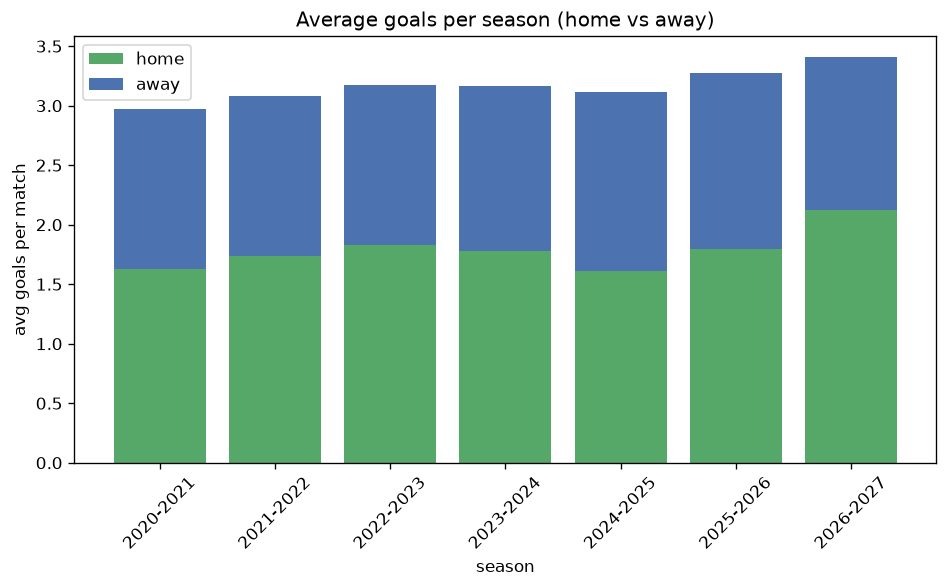

# Goal Analysis
- Report: `goals_analysis`
- Generated: 2026-10-29T02:00:50+00:00
- Script: `backend/scripts/analyze_goals.py` v1.0.0
- League: Bundesliga (Germany)
- Scope: league `germany1`

## 1. Goals per match distribution
| goals | matches | pct |
|---|---|---|
| 0 | 88 | 5.2% |
| 1 | 198 | 11.7% |
| 2 | 383 | 22.7% |
| 3 | 348 | 20.6% |
| 4 | 318 | 18.8% |
| 5 | 188 | 11.1% |
| 6 | 99 | 5.9% |
| 7 | 54 | 3.2% |
| 8 | 9 | 0.5% |
| 9 | 5 | 0.3% |

## 2. Goals per match per season
| season | matches | total goals | avg home | avg away | avg total |
|---|---|---|---|---|---|
| 2020-2021 | 272 | 808 | 1.632 | 1.338 | 2.971 |
| 2021-2022 | 272 | 839 | 1.735 | 1.349 | 3.085 |
| 2022-2023 | 272 | 864 | 1.831 | 1.346 | 3.176 |
| 2023-2024 | 272 | 862 | 1.783 | 1.386 | 3.169 |
| 2024-2025 | 272 | 847 | 1.614 | 1.5 | 3.114 |
| 2025-2026 | 274 | 898 | 1.799 | 1.478 | 3.277 |
| 2026-2027 | 56 | 191 | 2.125 | 1.286 | 3.411 |

## 3. Home vs away goal share
- Home goals: **2950** (55.6%)
- Away goals: **2359** (44.4%)
- Home/away ratio: **1.251**

| season | home goals | away goals | total | home pct | away pct |
|---|---|---|---|---|---|
| 2020-2021 | 444 | 364 | 808 | 55.0% | 45.0% |
| 2021-2022 | 472 | 367 | 839 | 56.3% | 43.7% |
| 2022-2023 | 498 | 366 | 864 | 57.6% | 42.4% |
| 2023-2024 | 485 | 377 | 862 | 56.3% | 43.7% |
| 2024-2025 | 439 | 408 | 847 | 51.8% | 48.2% |
| 2025-2026 | 493 | 405 | 898 | 54.9% | 45.1% |
| 2026-2027 | 119 | 72 | 191 | 62.3% | 37.7% |

## 4. BTTS (Both Teams To Score)
- Overall: **1006** of `1690` (59.5%)

| season | matches | BTTS | pct |
|---|---|---|---|
| 2020-2021 | 272 | 160 | 58.8% |
| 2021-2022 | 272 | 162 | 59.6% |
| 2022-2023 | 272 | 161 | 59.2% |
| 2023-2024 | 272 | 164 | 60.3% |
| 2024-2025 | 272 | 152 | 55.9% |
| 2025-2026 | 274 | 176 | 64.2% |
| 2026-2027 | 56 | 31 | 55.4% |

## 5. Clean sheets
- Home clean sheets: **444** (26.3%)
- Away clean sheets: **328** (19.4%)
- Total clean sheets recorded: **772**
- Matches with at least one clean sheet: **684** (40.5%)
- Both teams kept clean sheets (0-0): **88**

| season | matches | home CS | away CS | total CS | matches w/ CS |
|---|---|---|---|---|---|
| 2020-2021 | 272 | 71 | 58 | 129 | 112 (41.2%) |
| 2021-2022 | 272 | 78 | 48 | 126 | 110 (40.4%) |
| 2022-2023 | 272 | 73 | 49 | 122 | 111 (40.8%) |
| 2023-2024 | 272 | 69 | 49 | 118 | 108 (39.7%) |
| 2024-2025 | 272 | 71 | 70 | 141 | 120 (44.1%) |
| 2025-2026 | 274 | 62 | 44 | 106 | 98 (35.8%) |
| 2026-2027 | 56 | 20 | 10 | 30 | 25 (44.6%) |

## 6. Scoring intensity
- First-half goals: **2406** (45.3%)
- Second-half goals: **2901** (54.7%)
- Avg first-half goals per match: **1.425**
- Avg second-half goals per match: **1.718**
- Second-half-only scoring (HT 0-0, FT goals >= 1): **318** (18.8%)
- *1 match(es) excluded (no HT score recorded).*

| season | matches | 1st half | 2nd half | 1st half pct | 2nd half pct |
|---|---|---|---|---|---|
| 2020-2021 | 272 | 352 | 456 | 43.6% | 56.4% |
| 2021-2022 | 272 | 376 | 463 | 44.8% | 55.2% |
| 2022-2023 | 272 | 404 | 460 | 46.8% | 53.2% |
| 2023-2024 | 272 | 403 | 459 | 46.8% | 53.2% |
| 2024-2025 | 272 | 400 | 445 | 47.3% | 52.7% |
| 2025-2026 | 274 | 398 | 500 | 44.3% | 55.7% |
| 2026-2027 | 56 | 73 | 118 | 38.2% | 61.8% |

## 7. First-goal timing
- Matches with first-goal time recorded: `1601` of `1690` (94.7%)
- Goalless matches: `89`
- Min `1` | Max `96` | Mean `28.31` | Median (p50) `23`

| bucket | count | % of matches | % of scoring matches |
|---|---|---|---|
| 1-15 | 577 | 34.1% | 36.0% |
| 16-30 | 407 | 24.1% | 25.4% |
| 31-45 | 272 | 16.1% | 17.0% |
| 46-60 | 190 | 11.2% | 11.9% |
| 61-75 | 94 | 5.6% | 5.9% |
| 76-90 | 54 | 3.2% | 3.4% |
| 91-120 | 7 | 0.4% | 0.4% |

---
*All statistics are computed from PostgreSQL tables (read-only). Run with `python backend/scripts/analyze_goals.py` to regenerate.*

## Charts

