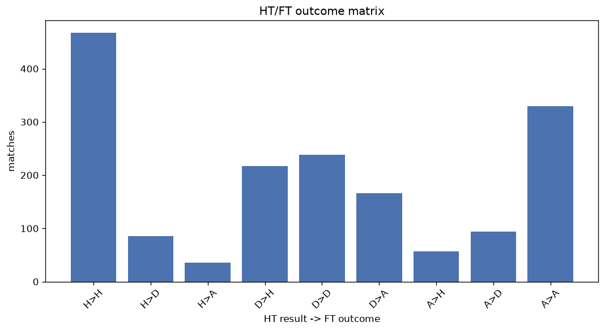
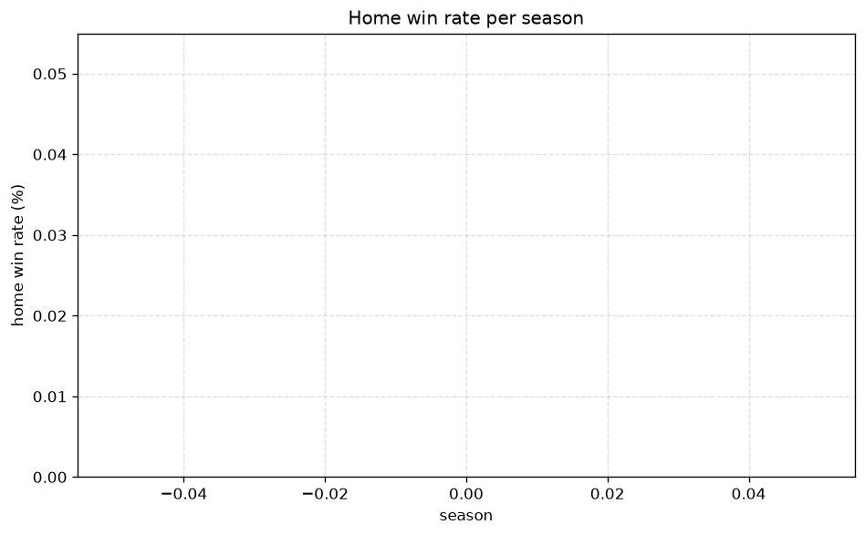

# Match Analysis
- Report: `matches_analysis`
- Generated: 2026-10-30T03:52:32+00:00
- Script: `backend/scripts/analyze_matches.py` v1.0.0
- League: Bundesliga (Germany)
- Scope: league `germany1`

## 1. Overall summary
| metric | value |
|---|---|
| Matches | 1690 |
| Home wins | 741 (43.8%) |
| Draws | 417 (24.7%) |
| Away wins | 532 (31.5%) |
| Total goals | 5309 |
| Average goals per match | 3.141 |
| Goalless matches | 88 (5.2%) |

## 2. Per-season breakdown
| season | matches | home wins | draws | away wins | total goals | avg goals | goalless |
|---|---|---|---|---|---|---|---|
| 2020-2021 | 272 | 115 (42.3%) | 71 (26.1%) | 86 (31.6%) | 808 | 2.971 | 17 (6.2%) |
| 2021-2022 | 272 | 127 (46.7%) | 64 (23.5%) | 81 (29.8%) | 839 | 3.085 | 16 (5.9%) |
| 2022-2023 | 272 | 126 (46.3%) | 65 (23.9%) | 81 (29.8%) | 864 | 3.176 | 11 (4.0%) |
| 2023-2024 | 272 | 121 (44.5%) | 68 (25.0%) | 83 (30.5%) | 862 | 3.169 | 10 (3.7%) |
| 2024-2025 | 272 | 103 (37.9%) | 71 (26.1%) | 98 (36.0%) | 847 | 3.114 | 21 (7.7%) |
| 2025-2026 | 274 | 120 (43.8%) | 65 (23.7%) | 89 (32.5%) | 898 | 3.277 | 8 (2.9%) |
| 2026-2027 | 56 | 29 (51.8%) | 13 (23.2%) | 14 (25.0%) | 191 | 3.411 | 5 (8.9%) |

## 3. HT/FT outcome matrix
| HT result \ FT result | Home | Draw | Away | total |
|---|---|---|---|---|
| HT home lead | 467 (79.4%) | 85 (14.5%) | 36 (6.1%) | 588 |
| HT draw | 217 (34.9%) | 238 (38.3%) | 166 (26.7%) | 621 |
| HT away lead | 57 (11.9%) | 94 (19.6%) | 329 (68.5%) | 480 |
- *1 match(es) excluded (no HT score recorded).*

## 4. Comeback matches
- Home comebacks (trailing at HT, won at FT): **57** (3.4%)
- Away comebacks (trailing at HT, won at FT): **36** (2.1%)

### Home comebacks
| season | home | away | HT | FT |
|---|---|---|---|---|
| 2020-2021 | Eintracht Frankfurt | Hoffenheim | 0-1 | 2-1 |
| 2020-2021 | Hertha Berlin | Union Berlin | 0-1 | 3-1 |
| 2020-2021 | Bayern Munich | Mainz | 0-2 | 5-2 |
| 2020-2021 | Werder Bremen | Eintracht Frankfurt | 0-1 | 2-1 |
| 2020-2021 | Hertha Berlin | Augsburg | 0-1 | 2-1 |
| 2020-2021 | Union Berlin | FC Koln | 0-1 | 2-1 |
| 2020-2021 | Hoffenheim | Schalke | 0-2 | 4-2 |
| 2020-2021 | Hoffenheim | Hertha Berlin | 0-1 | 2-1 |
| 2021-2022 | FC Koln | Greuther Furth | 0-1 | 3-1 |
| 2021-2022 | RB Leipzig | Greuther Furth | 0-1 | 4-1 |
| 2021-2022 | Bayern Munich | Mainz | 0-1 | 2-1 |
| 2021-2022 | Hertha Berlin | Dortmund | 0-1 | 3-2 |
| 2021-2022 | Mainz | Bayer Leverkusen | 0-1 | 3-2 |
| 2021-2022 | Bayern Munich | Greuther Furth | 0-1 | 4-1 |
| 2021-2022 | Eintracht Frankfurt | Bochum | 0-1 | 2-1 |
| 2021-2022 | Stuttgart | Augsburg | 1-2 | 3-2 |
| 2021-2022 | FC Koln | Mainz | 0-1 | 3-2 |
| 2021-2022 | Dortmund | Hertha Berlin | 0-1 | 2-1 |
| 2022-2023 | FC Koln | Dortmund | 0-1 | 3-2 |
| 2022-2023 | FC Koln | Augsburg | 0-1 | 3-2 |
| 2022-2023 | Union Berlin | Hoffenheim | 0-1 | 3-1 |
| 2022-2023 | Freiburg | Stuttgart | 0-1 | 2-1 |
| 2022-2023 | Bayer Leverkusen | Bayern Munich | 0-1 | 2-1 |
| 2022-2023 | Mainz | Bayern Munich | 0-1 | 3-1 |
| 2022-2023 | Schalke | Werder Bremen | 0-1 | 2-1 |
| 2022-2023 | Eintracht Frankfurt | Freiburg | 0-1 | 2-1 |
| 2023-2024 | RB Leipzig | Stuttgart | 0-1 | 5-1 |
| 2023-2024 | Dortmund | Union Berlin | 1-2 | 4-2 |
| 2023-2024 | Stuttgart | Wolfsburg | 0-1 | 3-1 |
| 2023-2024 | Augsburg | Wolfsburg | 1-2 | 3-2 |
| 2023-2024 | Heidenheim | Freiburg | 0-1 | 3-2 |
| 2023-2024 | Augsburg | Freiburg | 0-1 | 2-1 |
| 2023-2024 | Bayer Leverkusen | Hoffenheim | 0-1 | 2-1 |
| 2023-2024 | Heidenheim | Bayern Munich | 0-2 | 3-2 |
| 2023-2024 | Mainz | Hoffenheim | 0-1 | 4-1 |
| 2023-2024 | Eintracht Frankfurt | Augsburg | 0-1 | 3-1 |
| 2023-2024 | FC Koln | Union Berlin | 1-2 | 3-2 |
| 2023-2024 | Hoffenheim | Bayern Munich | 1-2 | 4-2 |
| 2024-2025 | Freiburg | Bochum | 0-1 | 2-1 |
| 2024-2025 | Bayer Leverkusen | Wolfsburg | 2-3 | 4-3 |
| 2024-2025 | Dortmund | Bochum | 1-2 | 4-2 |
| 2024-2025 | RB Leipzig | Freiburg | 0-1 | 3-1 |
| 2024-2025 | Hoffenheim | RB Leipzig | 1-2 | 4-3 |
| 2024-2025 | Stuttgart | Union Berlin | 0-1 | 3-2 |
| 2024-2025 | Wolfsburg | Mainz | 1-2 | 4-3 |
| 2024-2025 | Stuttgart | RB Leipzig | 0-1 | 2-1 |
| 2025-2026 | Freiburg | Stuttgart | 0-1 | 3-1 |
| 2025-2026 | Werder Bremen | Wolfsburg | 0-1 | 2-1 |
| 2025-2026 | Heidenheim | Freiburg | 0-1 | 2-1 |
| 2025-2026 | Hamburger SV | Werder Bremen | 0-1 | 3-2 |
| 2025-2026 | FC Koln | Mainz | 0-1 | 2-1 |
| 2025-2026 | Mainz | Wolfsburg | 0-1 | 3-1 |
| 2025-2026 | RB Leipzig | Augsburg | 0-1 | 2-1 |
| 2025-2026 | Dortmund | Hamburger SV | 0-2 | 3-2 |
| 2025-2026 | Bayer Leverkusen | Wolfsburg | 2-3 | 6-3 |
| 2026-2027 | FC Koln | Hoffenheim | 0-1 | 3-2 |
| 2026-2027 | Werder Bremen | Augsburg | 0-1 | 3-2 |

### Away comebacks
| season | home | away | HT | FT |
|---|---|---|---|---|
| 2020-2021 | Hertha Berlin | Dortmund | 1-0 | 2-5 |
| 2020-2021 | Stuttgart | Dortmund | 1-0 | 2-3 |
| 2021-2022 | Bayer Leverkusen | Dortmund | 2-1 | 3-4 |
| 2021-2022 | Mainz | Union Berlin | 1-0 | 1-2 |
| 2021-2022 | Eintracht Frankfurt | Dortmund | 2-0 | 2-3 |
| 2021-2022 | Wolfsburg | Hoffenheim | 1-0 | 1-2 |
| 2021-2022 | Hoffenheim | Bayer Leverkusen | 2-1 | 2-4 |
| 2022-2023 | Freiburg | Dortmund | 1-0 | 1-3 |
| 2022-2023 | Dortmund | Werder Bremen | 1-0 | 2-3 |
| 2022-2023 | Bayer Leverkusen | Freiburg | 1-0 | 2-3 |
| 2022-2023 | FC Koln | Bayer Leverkusen | 1-0 | 1-2 |
| 2022-2023 | RB Leipzig | Union Berlin | 1-0 | 1-2 |
| 2022-2023 | Bayern Munich | RB Leipzig | 1-0 | 1-3 |
| 2022-2023 | Wolfsburg | Hertha Berlin | 1-0 | 1-2 |
| 2023-2024 | Heidenheim | Hoffenheim | 1-0 | 2-3 |
| 2023-2024 | Freiburg | Dortmund | 2-1 | 2-4 |
| 2023-2024 | RB Leipzig | Bayer Leverkusen | 1-0 | 2-3 |
| 2023-2024 | Dortmund | Hoffenheim | 2-1 | 2-3 |
| 2023-2024 | Freiburg | Wolfsburg | 1-0 | 1-2 |
| 2024-2025 | Bayer Leverkusen | RB Leipzig | 2-1 | 2-3 |
| 2024-2025 | RB Leipzig | Mainz | 1-0 | 1-2 |
| 2024-2025 | Bayern Munich | Bochum | 2-1 | 2-3 |
| 2024-2025 | Eintracht Frankfurt | Union Berlin | 1-0 | 1-2 |
| 2024-2025 | Stuttgart | Bayer Leverkusen | 1-0 | 3-4 |
| 2024-2025 | RB Leipzig | Stuttgart | 2-1 | 2-3 |
| 2024-2025 | Augsburg | Union Berlin | 1-0 | 1-2 |
| 2025-2026 | Union Berlin | Heidenheim | 1-0 | 1-2 |
| 2025-2026 | RB Leipzig | Bayern Munich | 1-0 | 1-5 |
| 2025-2026 | Eintracht Frankfurt | Hoffenheim | 1-0 | 1-3 |
| 2025-2026 | Bayern Munich | Augsburg | 1-0 | 1-2 |
| 2025-2026 | Wolfsburg | Augsburg | 1-0 | 2-3 |
| 2025-2026 | Dortmund | Bayern Munich | 1-0 | 2-3 |
| 2025-2026 | St. Pauli | Freiburg | 1-0 | 1-2 |
| 2025-2026 | Mainz | Bayern Munich | 3-0 | 3-4 |
| 2026-2027 | Hoffenheim | Dortmund | 1-0 | 2-3 |
| 2026-2027 | Eintracht Frankfurt | Augsburg | 1-0 | 1-4 |

## 5. HT lead conversion
| HT state | matches | converted to win | held as draw | collapsed to loss |
|---|---|---|---|---|
| Home lead | 588 | 467 (79.4%) | 85 (14.5%) | 36 (6.1%) |
| Away lead | 480 | 329 (68.5%) | 94 (19.6%) | 57 (11.9%) |

### Matches level at half-time
| FT result | count | pct |
|---|---|---|
| Home win | 217 | 34.9% |
| Draw | 238 | 38.3% |
| Away win | 166 | 26.7% |
- *1 match(es) excluded (no HT score recorded).*

## 6. First-goal timing
- Matches with a first-goal time recorded: `1601` of `1690` (94.7%)

Outcome distribution by first-goal timing bucket:
| bucket | matches | % of matches | home | draw | away |
|---|---|---|---|---|---|
| 1-15 | 577 | 34.1% | 275 (47.7%) | 112 (19.4%) | 190 (32.9%) |
| 16-30 | 407 | 24.1% | 192 (47.2%) | 69 (17.0%) | 146 (35.9%) |
| 31-45 | 272 | 16.1% | 114 (41.9%) | 75 (27.6%) | 83 (30.5%) |
| 46-60 | 190 | 11.2% | 85 (44.7%) | 43 (22.6%) | 62 (32.6%) |
| 61-75 | 94 | 5.6% | 42 (44.7%) | 23 (24.5%) | 29 (30.9%) |
| 76-90 | 54 | 3.2% | 31 (57.4%) | 7 (13.0%) | 16 (29.6%) |
| 91-120 | 7 | 0.4% | 2 (28.6%) | 0 (0.0%) | 5 (71.4%) |

## 7. Goalless matches
- Overall: **88** of `1690` (5.2%)

| season | matches | goalless | pct |
|---|---|---|---|
| 2020-2021 | 272 | 17 | 6.2% |
| 2021-2022 | 272 | 16 | 5.9% |
| 2022-2023 | 272 | 11 | 4.0% |
| 2023-2024 | 272 | 10 | 3.7% |
| 2024-2025 | 272 | 21 | 7.7% |
| 2025-2026 | 274 | 8 | 2.9% |
| 2026-2027 | 56 | 5 | 8.9% |

---
*All statistics are computed from PostgreSQL tables (read-only). Run with `python backend/scripts/analyze_matches.py` to regenerate.*

## Charts

