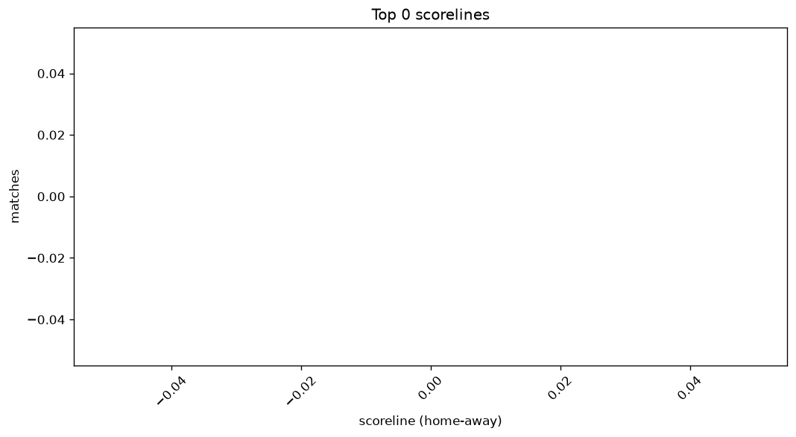
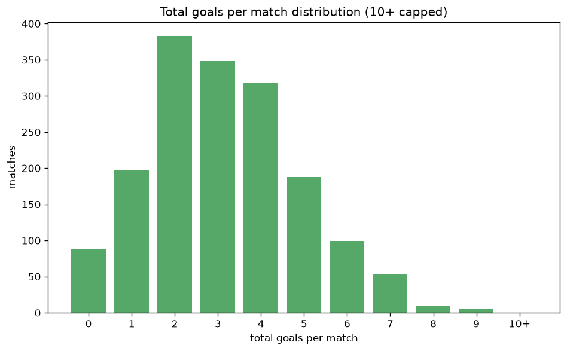

# Scoreline Analysis
- Report: `scoreline_analysis`
- Generated: 2026-10-30T03:52:39+00:00
- Script: `backend/scripts/analyze_scorelines.py` v1.0.0
- League: Bundesliga (Germany)
- Scope: league `germany1`

## 1. Scoreline frequency
- Matches analysed: **1690** across **7** seasons.
- Distinct scorelines seen: **45**.

| scoreline | count | pct |
|---|---|---|
| 1-1 | 199 | 11.8% |
| 2-1 | 144 | 8.5% |
| 2-0 | 107 | 6.3% |
| 1-0 | 102 | 6.0% |
| 2-2 | 102 | 6.0% |
| 1-2 | 101 | 6.0% |
| 0-1 | 96 | 5.7% |
| 0-0 | 88 | 5.2% |
| 3-1 | 87 | 5.1% |
| 0-2 | 77 | 4.6% |
| 3-0 | 65 | 3.8% |
| 1-3 | 64 | 3.8% |
| 2-3 | 50 | 3.0% |
| 4-0 | 48 | 2.8% |
| 3-2 | 48 | 2.8% |
| 0-3 | 38 | 2.2% |
| 4-1 | 32 | 1.9% |
| 1-4 | 31 | 1.8% |
| 3-3 | 27 | 1.6% |
| 4-2 | 21 | 1.2% |

## 2. Scoreline frequency per season

### 2020-2021
| scoreline | count | pct |
|---|---|---|
| 1-1 | 37 | 13.6% |
| 2-1 | 29 | 10.7% |
| 0-1 | 18 | 6.6% |
| 0-0 | 17 | 6.2% |
| 2-0 | 16 | 5.9% |

### 2021-2022
| scoreline | count | pct |
|---|---|---|
| 1-1 | 34 | 12.5% |
| 2-1 | 27 | 9.9% |
| 1-0 | 20 | 7.4% |
| 2-0 | 18 | 6.6% |
| 0-0 | 16 | 5.9% |

### 2022-2023
| scoreline | count | pct |
|---|---|---|
| 1-1 | 36 | 13.2% |
| 2-1 | 23 | 8.5% |
| 1-2 | 19 | 7.0% |
| 2-0 | 19 | 7.0% |
| 2-2 | 16 | 5.9% |

### 2023-2024
| scoreline | count | pct |
|---|---|---|
| 1-1 | 38 | 14.0% |
| 2-0 | 20 | 7.4% |
| 2-1 | 20 | 7.4% |
| 0-1 | 17 | 6.2% |
| 3-1 | 16 | 5.9% |

### 2024-2025
| scoreline | count | pct |
|---|---|---|
| 1-1 | 22 | 8.1% |
| 2-2 | 22 | 8.1% |
| 0-0 | 21 | 7.7% |
| 0-2 | 18 | 6.6% |
| 0-1 | 18 | 6.6% |

### 2025-2026
| scoreline | count | pct |
|---|---|---|
| 1-1 | 30 | 10.9% |
| 2-1 | 26 | 9.5% |
| 1-2 | 22 | 8.0% |
| 3-1 | 18 | 6.6% |
| 1-0 | 18 | 6.6% |

### 2026-2027
| scoreline | count | pct |
|---|---|---|
| 0-0 | 5 | 8.9% |
| 2-2 | 5 | 8.9% |
| 1-0 | 5 | 8.9% |
| 2-1 | 4 | 7.1% |
| 3-2 | 3 | 5.4% |

## 3. Total-goal histogram
_10+ groups all matches with 10 or more total goals._

| total goals | matches | pct |
|---|---|---|
| 0 | 88 | 5.2% |
| 1 | 198 | 11.7% |
| 2 | 383 | 22.7% |
| 3 | 348 | 20.6% |
| 4 | 318 | 18.8% |
| 5 | 188 | 11.1% |
| 6 | 99 | 5.9% |
| 7 | 54 | 3.2% |
| 8 | 9 | 0.5% |
| 9 | 5 | 0.3% |
| 10+ | 0 | 0.0% |

## 4. Extreme scorelines
- Matches with 7+ total goals: **68**

| season | date | scoreline | total goals |
|---|---|---|---|
| 2021-2022 | 2021-11-27 | 3-6 | 9 |
| 2023-2024 | 2024-03-09 | 8-1 | 9 |
| 2024-2025 | 2024-11-02 | 7-2 | 9 |
| 2025-2026 | 2026-01-11 | 8-1 | 9 |
| 2025-2026 | 2026-04-04 | 6-3 | 9 |
| 2020-2021 | 2020-09-18 | 8-0 | 8 |
| 2020-2021 | 2020-11-27 | 5-3 | 8 |
| 2021-2022 | 2021-12-04 | 7-1 | 8 |
| 2022-2023 | 2022-10-29 | 6-2 | 8 |
| 2022-2023 | 2023-01-21 | 7-1 | 8 |
| 2022-2023 | 2023-03-11 | 5-3 | 8 |
| 2023-2024 | 2023-10-28 | 8-0 | 8 |
| 2024-2025 | 2025-04-19 | 4-4 | 8 |
| 2025-2026 | 2025-11-22 | 6-2 | 8 |
| 2020-2021 | 2020-10-04 | 4-3 | 7 |
| 2020-2021 | 2020-11-21 | 2-5 | 7 |
| 2020-2021 | 2021-01-03 | 5-2 | 7 |
| 2020-2021 | 2021-02-06 | 5-2 | 7 |
| 2020-2021 | 2021-03-20 | 5-2 | 7 |
| 2020-2021 | 2021-04-10 | 4-3 | 7 |
| 2020-2021 | 2021-05-15 | 4-3 | 7 |
| 2020-2021 | 2021-05-22 | 5-2 | 7 |
| 2021-2022 | 2021-08-14 | 5-2 | 7 |
| 2021-2022 | 2021-09-11 | 3-4 | 7 |
| 2021-2022 | 2021-09-18 | 7-0 | 7 |
| 2021-2022 | 2021-10-30 | 2-5 | 7 |
| 2021-2022 | 2021-12-12 | 5-2 | 7 |
| 2021-2022 | 2022-02-06 | 2-5 | 7 |
| 2021-2022 | 2022-02-20 | 1-6 | 7 |
| 2021-2022 | 2022-03-13 | 1-6 | 7 |
| 2021-2022 | 2022-04-16 | 6-1 | 7 |
| 2021-2022 | 2022-04-30 | 3-4 | 7 |
| 2021-2022 | 2022-04-30 | 3-4 | 7 |
| 2022-2023 | 2022-08-05 | 1-6 | 7 |
| 2022-2023 | 2022-08-21 | 0-7 | 7 |
| 2022-2023 | 2022-08-27 | 1-6 | 7 |
| 2022-2023 | 2022-08-28 | 3-4 | 7 |
| 2022-2023 | 2022-11-08 | 6-1 | 7 |
| 2022-2023 | 2023-01-22 | 4-3 | 7 |
| 2022-2023 | 2023-01-24 | 1-6 | 7 |
| 2022-2023 | 2023-01-28 | 5-2 | 7 |
| 2022-2023 | 2023-02-04 | 5-2 | 7 |
| 2022-2023 | 2023-03-18 | 6-1 | 7 |
| 2022-2023 | 2023-04-14 | 5-2 | 7 |
| 2022-2023 | 2023-05-12 | 5-2 | 7 |
| 2023-2024 | 2023-09-23 | 7-0 | 7 |
| 2023-2024 | 2023-10-22 | 2-5 | 7 |
| 2023-2024 | 2024-01-27 | 5-2 | 7 |
| 2023-2024 | 2024-03-16 | 2-5 | 7 |
| 2023-2024 | 2024-05-05 | 3-4 | 7 |
| 2024-2025 | 2024-09-14 | 1-6 | 7 |
| 2024-2025 | 2024-09-22 | 4-3 | 7 |
| 2024-2025 | 2024-09-29 | 3-4 | 7 |
| 2024-2025 | 2024-11-23 | 4-3 | 7 |
| 2024-2025 | 2024-11-23 | 5-2 | 7 |
| 2024-2025 | 2024-12-08 | 4-3 | 7 |
| 2024-2025 | 2025-02-01 | 4-3 | 7 |
| 2024-2025 | 2025-03-16 | 3-4 | 7 |
| 2025-2026 | 2025-09-21 | 3-4 | 7 |
| 2025-2026 | 2025-10-18 | 3-4 | 7 |
| 2025-2026 | 2025-11-22 | 3-4 | 7 |
| 2025-2026 | 2025-12-20 | 3-4 | 7 |
| 2025-2026 | 2026-03-22 | 2-5 | 7 |
| 2025-2026 | 2026-04-25 | 3-4 | 7 |
| 2026-2027 | 2026-09-18 | 7-0 | 7 |
| 2026-2027 | 2026-10-10 | 3-4 | 7 |
| 2026-2027 | 2026-10-17 | 4-3 | 7 |
| 2026-2027 | 2026-10-17 | 6-1 | 7 |

## 5. Margin-of-victory distribution (decided matches)
- Decided matches: **1273** (draws: **417**)
- Average winning margin: **2.02**

| margin | matches | pct |
|---|---|---|
| 1 | 563 | 44.2% |
| 2 | 369 | 29.0% |
| 3+ | 341 | 26.8% |

## 6. Margin by outcome

### Home wins
- Matches: **741** | avg margin: **2.13** | max margin: **8**
| margin | matches | pct |
|---|---|---|
| 1 | 303 | 40.9% |
| 2 | 217 | 29.3% |
| 3+ | 221 | 29.8% |
- *Full match-by-match list available in `scoreline_analysis.json`.*

### Away wins
- Matches: **532** | avg margin: **1.86** | max margin: **7**
| margin | matches | pct |
|---|---|---|
| 1 | 260 | 48.9% |
| 2 | 152 | 28.6% |
| 3+ | 120 | 22.6% |
- *Full match-by-match list available in `scoreline_analysis.json`.*

## 7. Most common exact score by outcome type
| outcome | matches | most common score | count | pct |
|---|---|---|---|---|
| home | 741 | 2-1 | 144 | 19.4% |
| draw | 417 | 1-1 | 199 | 47.7% |
| away | 532 | 1-2 | 101 | 19.0% |

---
*All statistics are computed from PostgreSQL tables (read-only). Run with `python backend/scripts/analyze_scorelines.py` to regenerate.*

## Charts

