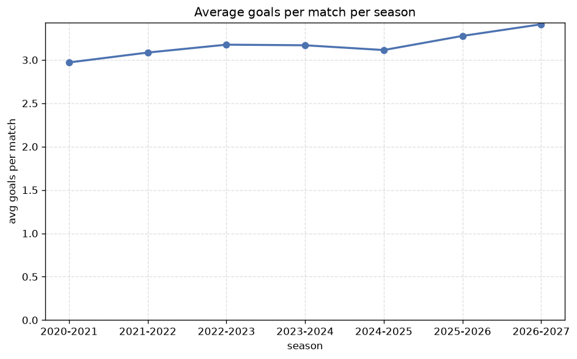

# Season Trends Analysis
- Report: `season_trends`
- Generated: 2026-10-30T03:52:37+00:00
- Script: `backend/scripts/analyze_seasons.py` v1.0.0
- League: Bundesliga (Germany)
- Scope: league `germany1`

## 1. Champions per season
| season | champion | pts | runner-up | margin |
|---|---|---|---|---|
| 2020-2021 | Bayern Munich | 78 | RB Leipzig | 13 pts |
| 2021-2022 | Bayern Munich | 77 | Dortmund | 8 pts |
| 2022-2023 | Bayern Munich | 71 | Dortmund | 0 pts |
| 2023-2024 | Bayer Leverkusen | 90 | Stuttgart | 17 pts |
| 2024-2025 | Bayern Munich | 82 | Bayer Leverkusen | 13 pts |
| 2025-2026 | Bayern Munich | 89 | Dortmund | 16 pts |
| 2026-2027 | Bayern Munich | 17 | Dortmund | 0 pts |

## 2. Title-race tightness
- Tight races (margin <= 3 pts): **2** of 7 seasons
- Tightest race: **2022-2023** - Bayern Munich beat Dortmund by **0** pts

| season | margin | tight |
|---|---|---|
| 2020-2021 | 13 pts |  |
| 2021-2022 | 8 pts |  |
| 2022-2023 | 0 pts | yes |
| 2023-2024 | 17 pts |  |
| 2024-2025 | 13 pts |  |
| 2025-2026 | 16 pts |  |
| 2026-2027 | 0 pts | yes |

## 3. Points thresholds
_Position-specific points per season. Key: 1 = champion, 2 = runner-up, 4 = CL line, 6 = Europa, 15 = last safe, 18 = bottom._

| season | pos 1 | pos 2 | pos 4 | pos 6 | pos 15 | pos 18 |
|---|---|---|---|---|---|---|
| 2020-2021 | 78 | 65 | 61 | 52 | 33 | - |
| 2021-2022 | 77 | 69 | 58 | 55 | 33 | - |
| 2022-2023 | 71 | 71 | 62 | 50 | 33 | - |
| 2023-2024 | 90 | 73 | 65 | 47 | 33 | - |
| 2024-2025 | 82 | 69 | 57 | 52 | 29 | - |
| 2025-2026 | 89 | 73 | 62 | 59 | 30 | 1 |
| 2026-2027 | 17 | 17 | 13 | 12 | 6 | - |

## 4. Relegation battle
| season | safe pos | safe pts | drop pos | drop pts | gap |
|---|---|---|---|---|---|
| 2020-2021 | 15 | 33 | 16 | 31 | 2 pts |
| 2021-2022 | 15 | 33 | 16 | 28 | 5 pts |
| 2022-2023 | 15 | 33 | 16 | 31 | 2 pts |
| 2023-2024 | 15 | 33 | 16 | 27 | 6 pts |
| 2024-2025 | 15 | 29 | 16 | 25 | 4 pts |
| 2025-2026 | 15 | 30 | 16 | 26 | 4 pts |
| 2026-2027 | 15 | 6 | 16 | 6 | 0 pts |

## 5. League-level trends
| season | matches | total goals | avg goals | home win | draw | away win | goalless | avg pts/team |
|---|---|---|---|---|---|---|---|---|
| 2020-2021 | 272 | 808 | 2.971 | 42.3% | 26.1% | 31.6% | 6.2% | 46.35 |
| 2021-2022 | 272 | 839 | 3.085 | 46.7% | 23.5% | 29.8% | 5.9% | 47.06 |
| 2022-2023 | 272 | 864 | 3.176 | 46.3% | 23.9% | 29.8% | 4.0% | 47.06 |
| 2023-2024 | 272 | 862 | 3.169 | 44.5% | 25.0% | 30.5% | 3.7% | 47.24 |
| 2024-2025 | 272 | 847 | 3.114 | 37.9% | 26.1% | 36.0% | 7.7% | 46.82 |
| 2025-2026 | 274 | 898 | 3.277 | 43.8% | 23.7% | 32.5% | 2.9% | 44.83 |
| 2026-2027 | 56 | 191 | 3.411 | 51.8% | 23.2% | 25.0% | 8.9% | 10.18 |

## 6. View divergence
- Largest divergence: **2022-2023** (goals view, avg abs position diff = 4.824)

_Avg absolute position difference between classic view and alternative view per season._

| season | classic vs luck | classic vs goals |
|---|---|---|
| 2020-2021 | 4.471 | 4.235 |
| 2021-2022 | 4.588 | 3.529 |
| 2022-2023 | 3.882 | 4.824 |
| 2023-2024 | 2.588 | 3.529 |
| 2024-2025 | 3.882 | 4.118 |
| 2025-2026 | 2.222 | 3.222 |
| 2026-2027 | 4.118 | 3.529 |

---
*All statistics are computed from PostgreSQL tables (read-only). Run with `python backend/scripts/analyze_seasons.py` to regenerate.*

## Charts

