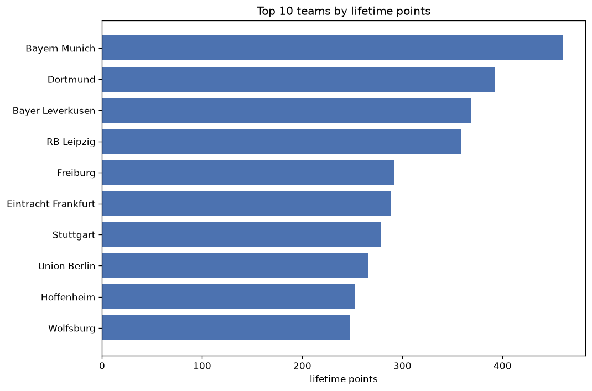
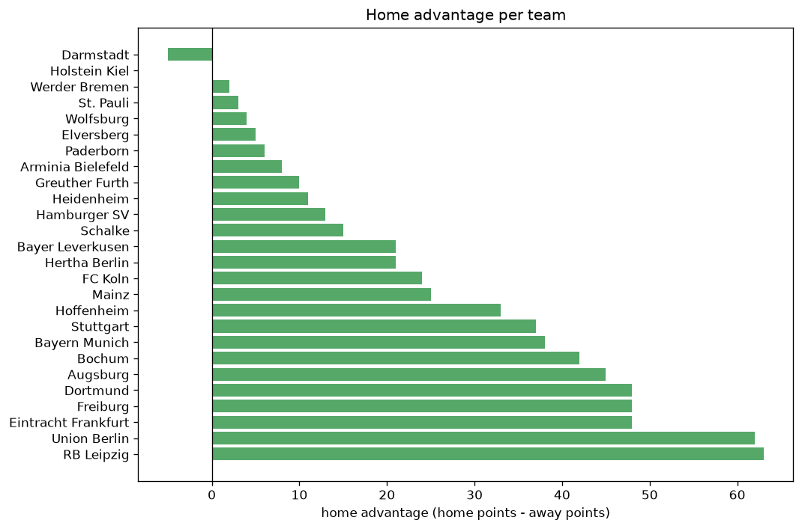

# Team Analysis
- Report: `teams_analysis`
- Generated: 2026-10-26T01:33:26+00:00
- Script: `backend/scripts/analyze_teams.py` v1.0.0
- League: Bundesliga (Germany)
- Scope: league `germany1`

- Teams: **26** | Seasons: **7** | Matches: **1688**

## 1. Team standings (lifetime)
| team | seasons | played | W | D | L | pts | GF | GA | GD | avg pts/season | best pos | worst pos | titles |
|---|---|---|---|---|---|---|---|---|---|---|---|---|---|
| Bayern Munich | 7 | 198 | 142 | 34 | 22 | 460 | 597 | 224 | 373 | 65.71 | 1 | 3 | 5 |
| Dortmund | 7 | 199 | 119 | 35 | 45 | 392 | 434 | 256 | 178 | 56.0 | 1 | 5 | 1 |
| Bayer Leverkusen | 7 | 198 | 107 | 48 | 43 | 369 | 408 | 245 | 163 | 52.71 | 1 | 6 | 1 |
| RB Leipzig | 7 | 198 | 105 | 44 | 49 | 359 | 394 | 244 | 150 | 51.29 | 2 | 7 | 0 |
| Freiburg | 7 | 197 | 82 | 46 | 69 | 292 | 291 | 303 | -12 | 41.71 | 3 | 10 | 0 |
| Eintracht Frankfurt | 7 | 199 | 74 | 66 | 59 | 288 | 336 | 313 | 23 | 41.14 | 3 | 13 | 0 |
| Stuttgart | 7 | 198 | 76 | 51 | 71 | 279 | 339 | 306 | 33 | 39.86 | 2 | 15 | 0 |
| Union Berlin | 7 | 199 | 70 | 56 | 73 | 266 | 253 | 299 | -46 | 38.0 | 4 | 17 | 0 |
| Hoffenheim | 7 | 197 | 69 | 46 | 82 | 253 | 320 | 338 | -18 | 36.14 | 5 | 14 | 0 |
| Wolfsburg | 6 | 194 | 67 | 47 | 80 | 248 | 288 | 301 | -13 | 41.33 | 4 | 15 | 0 |
| Mainz | 7 | 198 | 64 | 55 | 79 | 247 | 274 | 300 | -26 | 35.29 | 6 | 13 | 0 |
| Augsburg | 7 | 199 | 57 | 48 | 94 | 219 | 242 | 340 | -98 | 31.29 | 9 | 14 | 0 |
| Werder Bremen | 6 | 167 | 51 | 41 | 75 | 194 | 220 | 285 | -65 | 32.33 | 6 | 16 | 0 |
| FC Koln | 6 | 166 | 41 | 53 | 72 | 176 | 196 | 275 | -79 | 29.33 | 7 | 16 | 0 |
| Bochum | 4 | 128 | 34 | 30 | 64 | 132 | 147 | 245 | -98 | 33.0 | 12 | 17 | 0 |
| Heidenheim | 3 | 96 | 24 | 23 | 49 | 95 | 122 | 177 | -55 | 31.67 | 8 | 16 | 0 |
| Hertha Berlin | 3 | 96 | 22 | 23 | 51 | 89 | 112 | 185 | -73 | 29.67 | 13 | 17 | 0 |
| Arminia Bielefeld | 2 | 64 | 14 | 20 | 30 | 62 | 51 | 95 | -44 | 31.0 | 14 | 16 | 0 |
| St. Pauli | 2 | 64 | 14 | 15 | 35 | 57 | 56 | 92 | -36 | 28.5 | 13 | 17 | 0 |
| Schalke | 3 | 71 | 11 | 18 | 42 | 51 | 61 | 155 | -94 | 17.0 | 16 | 17 | 0 |
| Hamburger SV | 2 | 39 | 12 | 9 | 18 | 45 | 46 | 70 | -24 | 22.5 | 10 | 12 | 0 |
| Holstein Kiel | 1 | 32 | 5 | 7 | 20 | 22 | 44 | 73 | -29 | 22.0 | 16 | 16 | 0 |
| Greuther Furth | 1 | 32 | 3 | 9 | 20 | 18 | 28 | 76 | -48 | 18.0 | 17 | 17 | 0 |
| Darmstadt | 1 | 32 | 3 | 6 | 23 | 15 | 27 | 83 | -56 | 15.0 | 17 | 17 | 0 |
| Paderborn | 2 | 9 | 3 | 3 | 3 | 12 | 8 | 10 | -2 | 6.0 | 12 | 18 | 0 |
| Elversberg | 1 | 6 | 2 | 1 | 3 | 7 | 8 | 12 | -4 | 7.0 | 8 | 8 | 0 |

## 2. Home vs away split
| team | home P | H-W | H-D | H-L | H-pts | away P | A-W | A-D | A-L | A-pts | adv |
|---|---|---|---|---|---|---|---|---|---|---|---|
| RB Leipzig | 99 | 64 | 19 | 16 | 211 | 99 | 41 | 25 | 33 | 148 | 63 |
| Union Berlin | 100 | 43 | 35 | 22 | 164 | 99 | 27 | 21 | 51 | 102 | 62 |
| Dortmund | 100 | 69 | 13 | 18 | 220 | 99 | 50 | 22 | 27 | 172 | 48 |
| Freiburg | 98 | 48 | 26 | 24 | 170 | 99 | 34 | 20 | 45 | 122 | 48 |
| Eintracht Frankfurt | 99 | 45 | 33 | 21 | 168 | 100 | 29 | 33 | 38 | 120 | 48 |
| Augsburg | 100 | 34 | 30 | 36 | 132 | 99 | 23 | 18 | 58 | 87 | 45 |
| Bochum | 64 | 23 | 18 | 23 | 87 | 64 | 11 | 12 | 41 | 45 | 42 |
| Bayern Munich | 99 | 78 | 15 | 6 | 249 | 99 | 64 | 19 | 16 | 211 | 38 |
| Stuttgart | 98 | 45 | 23 | 30 | 158 | 100 | 31 | 28 | 41 | 121 | 37 |
| Hoffenheim | 99 | 41 | 20 | 38 | 143 | 98 | 28 | 26 | 44 | 110 | 33 |
| Mainz | 100 | 35 | 31 | 34 | 136 | 98 | 29 | 24 | 45 | 111 | 25 |
| FC Koln | 83 | 26 | 22 | 35 | 100 | 83 | 15 | 31 | 37 | 76 | 24 |
| Bayer Leverkusen | 99 | 59 | 18 | 22 | 195 | 99 | 48 | 30 | 21 | 174 | 21 |
| Hertha Berlin | 48 | 14 | 13 | 21 | 55 | 48 | 8 | 10 | 30 | 34 | 21 |
| Schalke | 35 | 8 | 9 | 18 | 33 | 36 | 3 | 9 | 24 | 18 | 15 |
| Hamburger SV | 19 | 8 | 5 | 6 | 29 | 20 | 4 | 4 | 12 | 16 | 13 |
| Heidenheim | 48 | 14 | 11 | 23 | 53 | 48 | 10 | 12 | 26 | 42 | 11 |
| Greuther Furth | 16 | 3 | 5 | 8 | 14 | 16 | 0 | 4 | 12 | 4 | 10 |
| Arminia Bielefeld | 32 | 8 | 11 | 13 | 35 | 32 | 6 | 9 | 17 | 27 | 8 |
| Paderborn | 5 | 3 | 0 | 2 | 9 | 4 | 0 | 3 | 1 | 3 | 6 |
| Elversberg | 3 | 2 | 0 | 1 | 6 | 3 | 0 | 1 | 2 | 1 | 5 |
| Wolfsburg | 97 | 33 | 27 | 37 | 126 | 97 | 34 | 20 | 43 | 122 | 4 |
| St. Pauli | 32 | 7 | 9 | 16 | 30 | 32 | 7 | 6 | 19 | 27 | 3 |
| Werder Bremen | 83 | 26 | 20 | 37 | 98 | 84 | 25 | 21 | 38 | 96 | 2 |
| Holstein Kiel | 16 | 3 | 2 | 11 | 11 | 16 | 2 | 5 | 9 | 11 | 0 |
| Darmstadt | 16 | 1 | 2 | 13 | 5 | 16 | 2 | 4 | 10 | 10 | -5 |

## 3. Top performers
### Best points per game (PPG)
| rank | team | PPG |
|---|---|---|
| 1 | Bayern Munich | 2.32 |
| 2 | Dortmund | 1.97 |
| 3 | Bayer Leverkusen | 1.86 |
| 4 | RB Leipzig | 1.81 |
| 5 | Freiburg | 1.48 |

### Most goals scored
| rank | team | goals |
|---|---|---|
| 1 | Bayern Munich | 597 |
| 2 | Dortmund | 434 |
| 3 | Bayer Leverkusen | 408 |
| 4 | RB Leipzig | 394 |
| 5 | Stuttgart | 339 |

### Best goal difference
| rank | team | GD |
|---|---|---|
| 1 | Bayern Munich | 373 |
| 2 | Dortmund | 178 |
| 3 | Bayer Leverkusen | 163 |
| 4 | RB Leipzig | 150 |
| 5 | Stuttgart | 33 |

### Best defence (goals against per match, standings)
| rank | team | GA/match |
|---|---|---|
| 1 | Paderborn | 1.125 |
| 2 | Bayern Munich | 1.129 |
| 3 | RB Leipzig | 1.209 |
| 4 | Bayer Leverkusen | 1.229 |
| 5 | Dortmund | 1.299 |

## 4. Team consistency
- Teams present in all **7** seasons: **11**

Augsburg, Bayer Leverkusen, Bayern Munich, Dortmund, Eintracht Frankfurt, Freiburg, Hoffenheim, Mainz, RB Leipzig, Stuttgart, Union Berlin

## 5. Head-to-head dominance
- Distinct fixtures: **262** (showing the 15 most frequent)

| fixture | meetings | home wins | draws | away wins | home pct | draw pct | away pct |
|---|---|---|---|---|---|---|---|
| Dortmund vs Union Berlin | 13 | 9 | 1 | 3 | 69.2% | 7.7% | 23.1% |
| Bayern Munich vs Augsburg | 13 | 7 | 1 | 5 | 53.8% | 7.7% | 38.5% |
| Dortmund vs Eintracht Frankfurt | 13 | 7 | 3 | 3 | 53.8% | 23.1% | 23.1% |
| Bayer Leverkusen vs Augsburg | 13 | 6 | 2 | 5 | 46.2% | 15.4% | 38.5% |
| Bayer Leverkusen vs Freiburg | 13 | 6 | 3 | 4 | 46.2% | 23.1% | 30.8% |
| Bayer Leverkusen vs Union Berlin | 13 | 6 | 5 | 2 | 46.2% | 38.5% | 15.4% |
| Bayern Munich vs Stuttgart | 13 | 6 | 2 | 5 | 46.2% | 15.4% | 38.5% |
| Bayern Munich vs Union Berlin | 13 | 6 | 5 | 2 | 46.2% | 38.5% | 15.4% |
| RB Leipzig vs Bayer Leverkusen | 13 | 6 | 2 | 5 | 46.2% | 15.4% | 38.5% |
| RB Leipzig vs Eintracht Frankfurt | 13 | 6 | 5 | 2 | 46.2% | 38.5% | 15.4% |
| Bayern Munich vs RB Leipzig | 13 | 5 | 4 | 4 | 38.5% | 30.8% | 30.8% |
| Eintracht Frankfurt vs Mainz | 13 | 5 | 5 | 3 | 38.5% | 38.5% | 23.1% |
| Eintracht Frankfurt vs Union Berlin | 13 | 5 | 5 | 3 | 38.5% | 38.5% | 23.1% |
| Union Berlin vs Augsburg | 13 | 5 | 5 | 3 | 38.5% | 38.5% | 23.1% |
| Bayer Leverkusen vs Mainz | 13 | 4 | 3 | 6 | 30.8% | 23.1% | 46.2% |

## 6. Position per season (classic view)
_Cells show final position; '-' when the team was absent from that season._

| team | 2020-2021 | 2021-2022 | 2022-2023 | 2023-2024 | 2024-2025 | 2025-2026 | 2026-2027 |
|---|---|---|---|---|---|---|---|
| Bayern Munich | 1 | 1 | 1 | 3 | 1 | 1 | 2 |
| Dortmund | 3 | 2 | 2 | 5 | 4 | 2 | 1 |
| Bayer Leverkusen | 6 | 3 | 6 | 1 | 2 | 6 | 4 |
| RB Leipzig | 2 | 4 | 3 | 4 | 7 | 3 | 5 |
| Freiburg | 9 | 6 | 5 | 10 | 5 | 7 | 3 |
| Eintracht Frankfurt | 5 | 10 | 7 | 6 | 3 | 8 | 13 |
| Stuttgart | 8 | 14 | 15 | 2 | 9 | 4 | 15 |
| Union Berlin | 7 | 5 | 4 | 14 | 12 | 11 | 17 |
| Hoffenheim | 10 | 9 | 11 | 7 | 14 | 5 | 14 |
| Wolfsburg | 4 | 11 | 8 | 12 | 10 | 15 | - |
| Mainz | 11 | 8 | 9 | 13 | 6 | 10 | 7 |
| Augsburg | 12 | 13 | 14 | 11 | 11 | 9 | 9 |
| Werder Bremen | 16 | - | 12 | 9 | 8 | 14 | 6 |
| FC Koln | 15 | 7 | 10 | 16 | - | 13 | 11 |
| Bochum | - | 12 | 13 | 15 | 17 | - | - |
| Heidenheim | - | - | - | 8 | 15 | 16 | - |
| Hertha Berlin | 13 | 15 | 17 | - | - | - | - |
| Arminia Bielefeld | 14 | 16 | - | - | - | - | - |
| St. Pauli | - | - | - | - | 13 | 17 | - |
| Schalke | 17 | - | 16 | - | - | - | 16 |
| Hamburger SV | - | - | - | - | - | 12 | 10 |
| Holstein Kiel | - | - | - | - | 16 | - | - |
| Greuther Furth | - | 17 | - | - | - | - | - |
| Darmstadt | - | - | - | 17 | - | - | - |
| Paderborn | - | - | - | - | - | 18 | 12 |
| Elversberg | - | - | - | - | - | - | 8 |

---
*All statistics are computed from PostgreSQL tables (read-only). Run with `python backend/scripts/analyze_teams.py` to regenerate.*

## Charts

