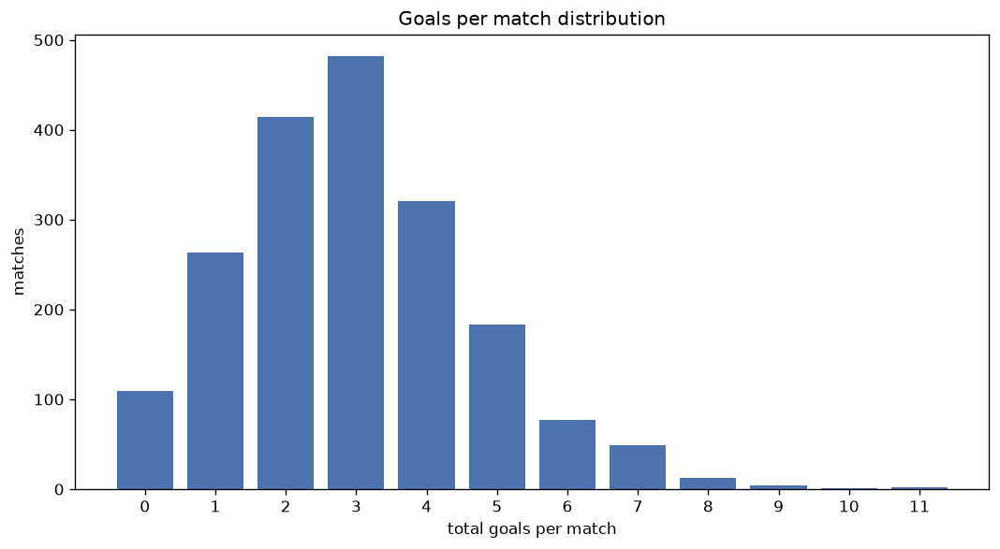
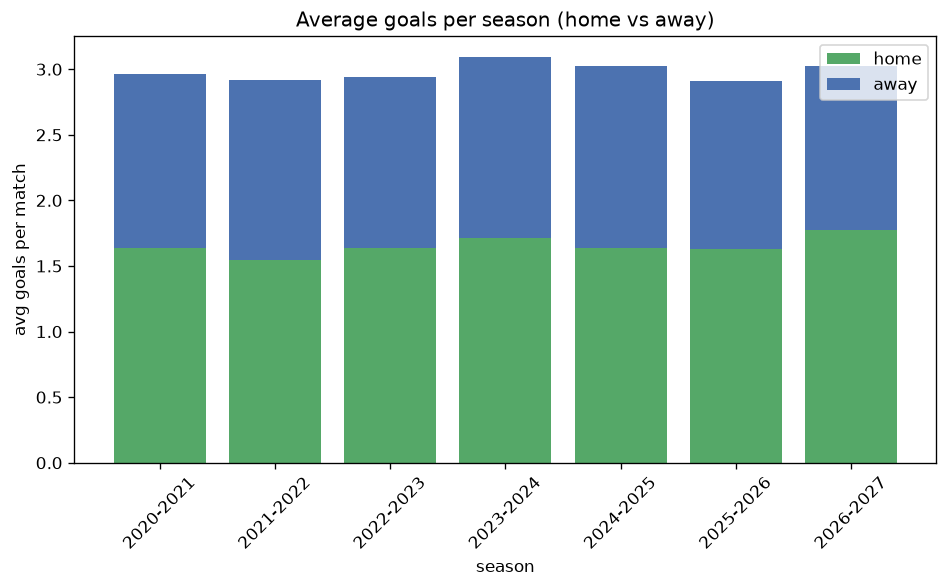

# Goal Analysis
- Report: `goals_analysis`
- Generated: 2026-10-30T03:52:54+00:00
- Script: `backend/scripts/analyze_goals.py` v1.0.0
- League: 2. Bundesliga (Germany)
- Scope: league `germany2`

## 1. Goals per match distribution
| goals | matches | pct |
|---|---|---|
| 0 | 109 | 5.7% |
| 1 | 263 | 13.7% |
| 2 | 415 | 21.6% |
| 3 | 484 | 25.2% |
| 4 | 321 | 16.7% |
| 5 | 183 | 9.5% |
| 6 | 77 | 4.0% |
| 7 | 49 | 2.6% |
| 8 | 13 | 0.7% |
| 9 | 4 | 0.2% |
| 10 | 1 | 0.1% |
| 11 | 2 | 0.1% |

## 2. Goals per match per season
| season | matches | total goals | avg home | avg away | avg total |
|---|---|---|---|---|---|
| 2020-2021 | 306 | 908 | 1.637 | 1.33 | 2.967 |
| 2021-2022 | 306 | 892 | 1.546 | 1.369 | 2.915 |
| 2022-2023 | 306 | 901 | 1.637 | 1.307 | 2.944 |
| 2023-2024 | 306 | 947 | 1.716 | 1.379 | 3.095 |
| 2024-2025 | 306 | 925 | 1.637 | 1.386 | 3.023 |
| 2025-2026 | 310 | 903 | 1.626 | 1.287 | 2.913 |
| 2026-2027 | 81 | 245 | 1.778 | 1.247 | 3.025 |

## 3. Home vs away goal share
- Home goals: **3149** (55.0%)
- Away goals: **2572** (45.0%)
- Home/away ratio: **1.224**

| season | home goals | away goals | total | home pct | away pct |
|---|---|---|---|---|---|
| 2020-2021 | 501 | 407 | 908 | 55.2% | 44.8% |
| 2021-2022 | 473 | 419 | 892 | 53.0% | 47.0% |
| 2022-2023 | 501 | 400 | 901 | 55.6% | 44.4% |
| 2023-2024 | 525 | 422 | 947 | 55.4% | 44.6% |
| 2024-2025 | 501 | 424 | 925 | 54.2% | 45.8% |
| 2025-2026 | 504 | 399 | 903 | 55.8% | 44.2% |
| 2026-2027 | 144 | 101 | 245 | 58.8% | 41.2% |

## 4. BTTS (Both Teams To Score)
- Overall: **1119** of `1921` (58.3%)

| season | matches | BTTS | pct |
|---|---|---|---|
| 2020-2021 | 306 | 177 | 57.8% |
| 2021-2022 | 306 | 179 | 58.5% |
| 2022-2023 | 306 | 170 | 55.6% |
| 2023-2024 | 306 | 181 | 59.2% |
| 2024-2025 | 306 | 184 | 60.1% |
| 2025-2026 | 310 | 183 | 59.0% |
| 2026-2027 | 81 | 45 | 55.6% |

## 5. Clean sheets
- Home clean sheets: **536** (27.9%)
- Away clean sheets: **375** (19.5%)
- Total clean sheets recorded: **911**
- Matches with at least one clean sheet: **802** (41.7%)
- Both teams kept clean sheets (0-0): **109**

| season | matches | home CS | away CS | total CS | matches w/ CS |
|---|---|---|---|---|---|
| 2020-2021 | 306 | 88 | 60 | 148 | 129 (42.2%) |
| 2021-2022 | 306 | 82 | 63 | 145 | 127 (41.5%) |
| 2022-2023 | 306 | 90 | 61 | 151 | 136 (44.4%) |
| 2023-2024 | 306 | 80 | 58 | 138 | 125 (40.8%) |
| 2024-2025 | 306 | 86 | 58 | 144 | 122 (39.9%) |
| 2025-2026 | 310 | 85 | 59 | 144 | 127 (41.0%) |
| 2026-2027 | 81 | 25 | 16 | 41 | 36 (44.4%) |

## 6. Scoring intensity
- First-half goals: **2540** (44.4%)
- Second-half goals: **3181** (55.6%)
- Avg first-half goals per match: **1.322**
- Avg second-half goals per match: **1.656**
- Second-half-only scoring (HT 0-0, FT goals >= 1): **398** (20.7%)

| season | matches | 1st half | 2nd half | 1st half pct | 2nd half pct |
|---|---|---|---|---|---|
| 2020-2021 | 306 | 401 | 507 | 44.2% | 55.8% |
| 2021-2022 | 306 | 386 | 506 | 43.3% | 56.7% |
| 2022-2023 | 306 | 387 | 514 | 43.0% | 57.0% |
| 2023-2024 | 306 | 434 | 513 | 45.8% | 54.2% |
| 2024-2025 | 306 | 411 | 514 | 44.4% | 55.6% |
| 2025-2026 | 310 | 403 | 500 | 44.6% | 55.4% |
| 2026-2027 | 81 | 118 | 127 | 48.2% | 51.8% |

## 7. First-goal timing
- Matches with first-goal time recorded: `1812` of `1921` (94.3%)
- Goalless matches: `109`
- Min `1` | Max `96` | Mean `29.43` | Median (p50) `23.0`

| bucket | count | % of matches | % of scoring matches |
|---|---|---|---|
| 1-15 | 652 | 33.9% | 36.0% |
| 16-30 | 430 | 22.4% | 23.7% |
| 31-45 | 309 | 16.1% | 17.1% |
| 46-60 | 218 | 11.3% | 12.0% |
| 61-75 | 109 | 5.7% | 6.0% |
| 76-90 | 75 | 3.9% | 4.1% |
| 91-120 | 19 | 1.0% | 1.0% |

---
*All statistics are computed from PostgreSQL tables (read-only). Run with `python backend/scripts/analyze_goals.py` to regenerate.*

## Charts

