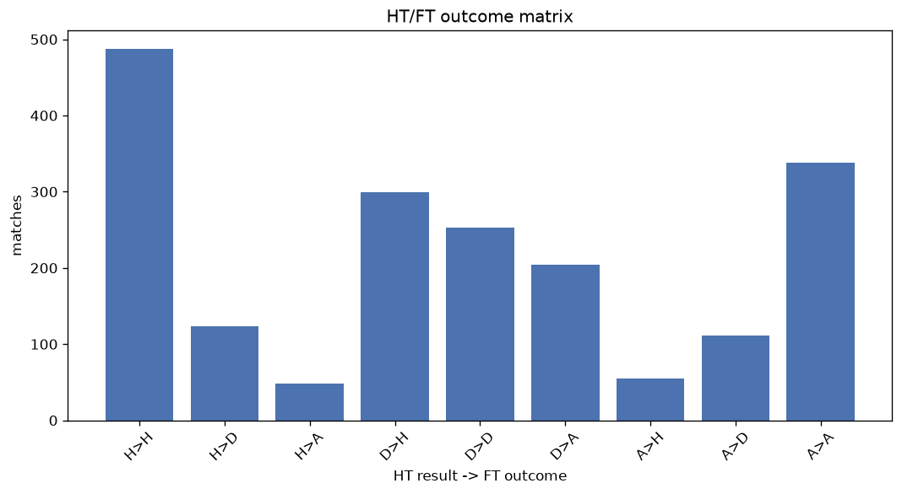
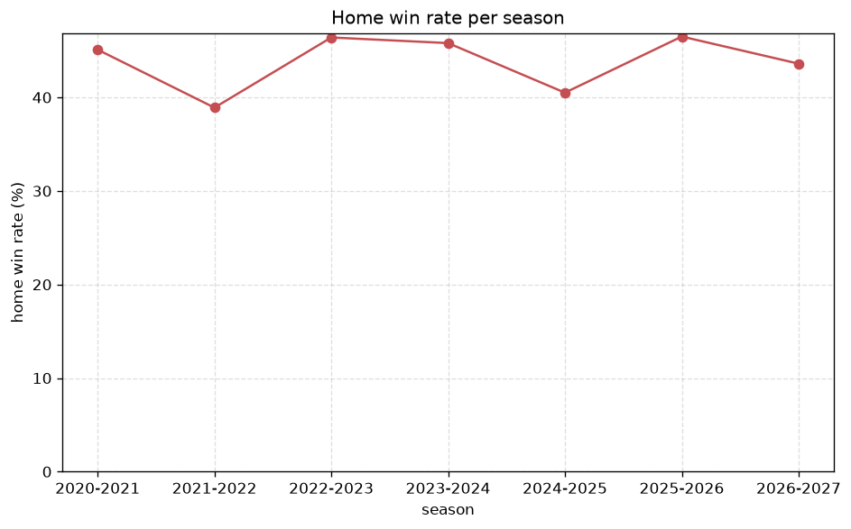

# Match Analysis
- Report: `matches_analysis`
- Generated: 2026-10-26T01:33:40+00:00
- Script: `backend/scripts/analyze_matches.py` v1.0.0
- League: 2. Bundesliga (Germany)
- Scope: league `germany2`

## 1. Overall summary
| metric | value |
|---|---|
| Matches | 1918 |
| Home wins | 841 (43.8%) |
| Draws | 487 (25.4%) |
| Away wins | 590 (30.8%) |
| Total goals | 5713 |
| Average goals per match | 2.979 |
| Goalless matches | 109 (5.7%) |

## 2. Per-season breakdown
| season | matches | home wins | draws | away wins | total goals | avg goals | goalless |
|---|---|---|---|---|---|---|---|
| 2020-2021 | 306 | 138 (45.1%) | 72 (23.5%) | 96 (31.4%) | 908 | 2.967 | 19 (6.2%) |
| 2021-2022 | 306 | 119 (38.9%) | 86 (28.1%) | 101 (33.0%) | 892 | 2.915 | 18 (5.9%) |
| 2022-2023 | 306 | 142 (46.4%) | 73 (23.9%) | 91 (29.7%) | 901 | 2.944 | 15 (4.9%) |
| 2023-2024 | 306 | 140 (45.8%) | 71 (23.2%) | 95 (31.0%) | 947 | 3.095 | 13 (4.2%) |
| 2024-2025 | 306 | 124 (40.5%) | 86 (28.1%) | 96 (31.4%) | 925 | 3.023 | 22 (7.2%) |
| 2025-2026 | 310 | 144 (46.5%) | 75 (24.2%) | 91 (29.4%) | 903 | 2.913 | 17 (5.5%) |
| 2026-2027 | 78 | 34 (43.6%) | 24 (30.8%) | 20 (25.6%) | 237 | 3.038 | 5 (6.4%) |

## 3. HT/FT outcome matrix
| HT result \ FT result | Home | Draw | Away | total |
|---|---|---|---|---|
| HT home lead | 487 (74.0%) | 123 (18.7%) | 48 (7.3%) | 658 |
| HT draw | 299 (39.6%) | 253 (33.5%) | 204 (27.0%) | 756 |
| HT away lead | 55 (10.9%) | 111 (22.0%) | 338 (67.1%) | 504 |

## 4. Comeback matches
- Home comebacks (trailing at HT, won at FT): **55** (2.9%)
- Away comebacks (trailing at HT, won at FT): **48** (2.5%)

### Home comebacks
| season | home | away | HT | FT |
|---|---|---|---|---|
| 2020-2021 | Hamburger SV | Wurzburger Kickers | 0-1 | 3-1 |
| 2020-2021 | Braunschweig | Nurnberg | 1-2 | 3-2 |
| 2020-2021 | Wurzburger Kickers | Hannover | 0-1 | 2-1 |
| 2020-2021 | Braunschweig | St. Pauli | 0-1 | 2-1 |
| 2020-2021 | Regensburg | Sandhausen | 0-1 | 3-1 |
| 2020-2021 | Heidenheim | Sandhausen | 0-1 | 2-1 |
| 2020-2021 | Karlsruher SC | Holstein Kiel | 0-1 | 3-2 |
| 2020-2021 | Greuther Furth | Dusseldorf | 0-1 | 3-2 |
| 2020-2021 | Aue | VfL Osnabruck | 0-1 | 2-1 |
| 2021-2022 | Holstein Kiel | SG Dynamo Dresden | 0-1 | 2-1 |
| 2021-2022 | Hamburger SV | St. Pauli | 0-1 | 2-1 |
| 2021-2022 | Schalke | Regensburg | 0-1 | 2-1 |
| 2021-2022 | Dusseldorf | Schalke | 0-1 | 2-1 |
| 2021-2022 | Darmstadt | Heidenheim | 0-1 | 3-2 |
| 2021-2022 | Schalke | St. Pauli | 0-2 | 3-2 |
| 2022-2023 | Paderborn | Hannover | 1-2 | 4-2 |
| 2022-2023 | Holstein Kiel | Greuther Furth | 0-1 | 2-1 |
| 2022-2023 | Karlsruher SC | Arminia Bielefeld | 0-1 | 4-2 |
| 2022-2023 | Paderborn | Heidenheim | 1-2 | 3-2 |
| 2023-2024 | Hamburger SV | Schalke | 1-2 | 5-3 |
| 2023-2024 | Magdeburg | Hertha Berlin | 2-3 | 6-4 |
| 2023-2024 | Paderborn | Wehen | 0-1 | 2-1 |
| 2023-2024 | Schalke | Magdeburg | 1-2 | 4-3 |
| 2023-2024 | Dusseldorf | Kaiserslautern | 1-3 | 4-3 |
| 2023-2024 | Nurnberg | Hertha Berlin | 0-1 | 3-1 |
| 2023-2024 | St. Pauli | Karlsruher SC | 0-1 | 2-1 |
| 2023-2024 | Wehen | Kaiserslautern | 0-1 | 2-1 |
| 2023-2024 | Hansa Rostock | Elversberg | 0-1 | 2-1 |
| 2023-2024 | Hannover | Greuther Furth | 0-1 | 2-1 |
| 2023-2024 | Greuther Furth | Kaiserslautern | 0-1 | 2-1 |
| 2024-2025 | Karlsruher SC | Nurnberg | 1-2 | 3-2 |
| 2024-2025 | Nurnberg | Schalke | 0-1 | 3-1 |
| 2024-2025 | Paderborn | Darmstadt | 0-1 | 3-1 |
| 2024-2025 | Nurnberg | Preussen Munster | 1-2 | 3-2 |
| 2024-2025 | Hertha Berlin | Braunschweig | 0-1 | 3-1 |
| 2024-2025 | Hannover | Karlsruher SC | 0-1 | 2-1 |
| 2024-2025 | Hannover | Ulm | 0-1 | 3-2 |
| 2024-2025 | Dusseldorf | Hertha Berlin | 0-1 | 2-1 |
| 2024-2025 | Magdeburg | Darmstadt | 0-1 | 4-1 |
| 2024-2025 | Regensburg | Nurnberg | 0-1 | 2-1 |
| 2024-2025 | Schalke | Ulm | 0-1 | 2-1 |
| 2024-2025 | Magdeburg | Dusseldorf | 0-1 | 4-2 |
| 2024-2025 | Darmstadt | Regensburg | 0-1 | 3-1 |
| 2025-2026 | Darmstadt | Braunschweig | 0-1 | 2-1 |
| 2025-2026 | Hannover | Arminia Bielefeld | 0-1 | 3-1 |
| 2025-2026 | Paderborn | Arminia Bielefeld | 1-2 | 4-3 |
| 2025-2026 | Preussen Munster | Holstein Kiel | 0-1 | 2-1 |
| 2025-2026 | Nurnberg | Elversberg | 0-1 | 3-2 |
| 2025-2026 | Paderborn | Preussen Munster | 0-1 | 2-1 |
| 2025-2026 | Dusseldorf | Paderborn | 0-1 | 2-1 |
| 2025-2026 | Karlsruher SC | Greuther Furth | 0-1 | 3-1 |
| 2025-2026 | Paderborn | SG Dynamo Dresden | 0-1 | 2-1 |
| 2025-2026 | Arminia Bielefeld | Darmstadt | 0-1 | 2-1 |
| 2025-2026 | Arminia Bielefeld | Hertha Berlin | 0-1 | 6-1 |
| 2026-2027 | Heidenheim | SG Dynamo Dresden | 0-1 | 5-3 |

### Away comebacks
| season | home | away | HT | FT |
|---|---|---|---|---|
| 2020-2021 | Paderborn | Hamburger SV | 3-2 | 3-4 |
| 2020-2021 | Nurnberg | Darmstadt | 1-0 | 2-3 |
| 2020-2021 | Karlsruher SC | Darmstadt | 2-1 | 3-4 |
| 2020-2021 | VfL Osnabruck | Karlsruher SC | 1-0 | 1-2 |
| 2020-2021 | VfL Osnabruck | Wurzburger Kickers | 1-0 | 2-3 |
| 2020-2021 | Braunschweig | Hamburger SV | 2-1 | 2-4 |
| 2020-2021 | Sandhausen | Karlsruher SC | 2-0 | 2-3 |
| 2020-2021 | Holstein Kiel | Darmstadt | 1-0 | 2-3 |
| 2021-2022 | Schalke | Hamburger SV | 1-0 | 1-3 |
| 2021-2022 | Paderborn | Holstein Kiel | 1-0 | 1-2 |
| 2021-2022 | Heidenheim | St. Pauli | 1-0 | 2-4 |
| 2021-2022 | Nurnberg | Werder Bremen | 1-0 | 1-2 |
| 2021-2022 | Paderborn | Werder Bremen | 2-1 | 3-4 |
| 2021-2022 | Werder Bremen | Holstein Kiel | 2-1 | 2-3 |
| 2021-2022 | Hansa Rostock | Hamburger SV | 1-0 | 2-3 |
| 2022-2023 | Sandhausen | Nurnberg | 1-0 | 1-2 |
| 2022-2023 | Greuther Furth | Kaiserslautern | 1-0 | 1-3 |
| 2022-2023 | Nurnberg | Holstein Kiel | 1-0 | 2-3 |
| 2022-2023 | Karlsruher SC | Darmstadt | 1-0 | 1-2 |
| 2022-2023 | Dusseldorf | Kaiserslautern | 1-0 | 1-2 |
| 2022-2023 | Hannover | Kaiserslautern | 1-0 | 1-3 |
| 2022-2023 | Magdeburg | St. Pauli | 1-0 | 1-2 |
| 2023-2024 | Magdeburg | Hansa Rostock | 1-0 | 1-2 |
| 2023-2024 | Wehen | Braunschweig | 1-0 | 1-3 |
| 2023-2024 | Kaiserslautern | Hertha Berlin | 1-0 | 1-2 |
| 2023-2024 | Magdeburg | Dusseldorf | 2-0 | 2-3 |
| 2023-2024 | Kaiserslautern | Paderborn | 1-0 | 1-2 |
| 2023-2024 | Kaiserslautern | Dusseldorf | 1-0 | 1-3 |
| 2023-2024 | St. Pauli | Elversberg | 1-0 | 3-4 |
| 2023-2024 | Hansa Rostock | Karlsruher SC | 1-0 | 1-2 |
| 2023-2024 | Wehen | St. Pauli | 1-0 | 1-2 |
| 2024-2025 | Ulm | Dusseldorf | 1-0 | 1-2 |
| 2024-2025 | Kaiserslautern | Hertha Berlin | 2-1 | 3-4 |
| 2024-2025 | Braunschweig | Karlsruher SC | 1-0 | 1-2 |
| 2024-2025 | Schalke | Darmstadt | 3-1 | 3-5 |
| 2024-2025 | Greuther Furth | Karlsruher SC | 1-0 | 2-3 |
| 2024-2025 | Hertha Berlin | Preussen Munster | 1-0 | 1-2 |
| 2024-2025 | Dusseldorf | Magdeburg | 2-1 | 2-5 |
| 2024-2025 | Elversberg | Magdeburg | 2-0 | 2-5 |
| 2024-2025 | Karlsruher SC | Dusseldorf | 2-0 | 2-3 |
| 2024-2025 | Schalke | Hannover | 1-0 | 1-2 |
| 2024-2025 | Hannover | Elversberg | 1-0 | 1-3 |
| 2024-2025 | Ulm | Hertha Berlin | 1-0 | 2-3 |
| 2024-2025 | Nurnberg | Elversberg | 1-0 | 1-3 |
| 2025-2026 | Holstein Kiel | Hannover | 1-0 | 1-2 |
| 2025-2026 | Preussen Munster | Dusseldorf | 1-0 | 1-2 |
| 2025-2026 | Hannover | Darmstadt | 2-1 | 2-3 |
| 2025-2026 | SG Dynamo Dresden | Elversberg | 1-0 | 1-2 |

## 5. HT lead conversion
| HT state | matches | converted to win | held as draw | collapsed to loss |
|---|---|---|---|---|
| Home lead | 658 | 487 (74.0%) | 123 (18.7%) | 48 (7.3%) |
| Away lead | 504 | 338 (67.1%) | 111 (22.0%) | 55 (10.9%) |

### Matches level at half-time
| FT result | count | pct |
|---|---|---|
| Home win | 299 | 39.6% |
| Draw | 253 | 33.5% |
| Away win | 204 | 27.0% |

## 6. First-goal timing
- Matches with a first-goal time recorded: `1809` of `1918` (94.3%)

Outcome distribution by first-goal timing bucket:
| bucket | matches | % of matches | home | draw | away |
|---|---|---|---|---|---|
| 1-15 | 651 | 33.9% | 292 (44.9%) | 142 (21.8%) | 217 (33.3%) |
| 16-30 | 429 | 22.4% | 203 (47.3%) | 94 (21.9%) | 132 (30.8%) |
| 31-45 | 308 | 16.1% | 142 (46.1%) | 73 (23.7%) | 93 (30.2%) |
| 46-60 | 218 | 11.4% | 92 (42.2%) | 46 (21.1%) | 80 (36.7%) |
| 61-75 | 109 | 5.7% | 58 (53.2%) | 19 (17.4%) | 32 (29.4%) |
| 76-90 | 75 | 3.9% | 44 (58.7%) | 4 (5.3%) | 27 (36.0%) |
| 91-120 | 19 | 1.0% | 10 (52.6%) | 0 (0.0%) | 9 (47.4%) |

## 7. Goalless matches
- Overall: **109** of `1918` (5.7%)

| season | matches | goalless | pct |
|---|---|---|---|
| 2020-2021 | 306 | 19 | 6.2% |
| 2021-2022 | 306 | 18 | 5.9% |
| 2022-2023 | 306 | 15 | 4.9% |
| 2023-2024 | 306 | 13 | 4.2% |
| 2024-2025 | 306 | 22 | 7.2% |
| 2025-2026 | 310 | 17 | 5.5% |
| 2026-2027 | 78 | 5 | 6.4% |

---
*All statistics are computed from PostgreSQL tables (read-only). Run with `python backend/scripts/analyze_matches.py` to regenerate.*

## Charts

