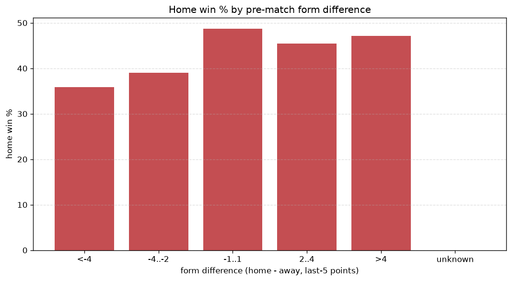
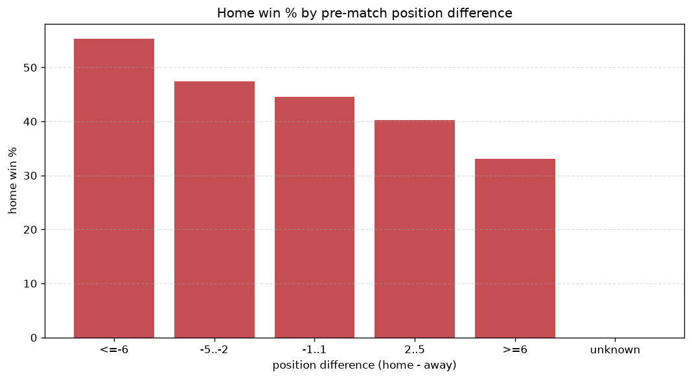

# Relationships Analysis
- Report: `relationships`
- Generated: 2026-10-30T03:53:01+00:00
- Script: `backend/scripts/analyze_relationships.py` v1.0.0
- League: 2. Bundesliga (Germany)
- Scope: league `germany2`

- Matches analysed: **1840** (23 leakage-safe pre-match features).

## 1. Correlation matrix
_Pearson correlation of each pre-match feature with observed goals; sorted by |corr(total goals)|._

| feature | corr(home) | corr(away) | corr(total) |
|---|---|---|---|
| home_position_before_match | -0.154 | 0.031 | -0.094 |
| position_difference | -0.186 | 0.094 | -0.073 |
| points_difference | 0.185 | -0.093 | 0.073 |
| home_team_home_goals_avg | 0.112 | -0.021 | 0.070 |
| home_points_before_match | 0.097 | -0.013 | 0.064 |
| home_team_goals_scored_last_5 | 0.087 | -0.009 | 0.059 |
| home_team_home_win_rate | 0.078 | -0.003 | 0.056 |
| home_team_points_last_5 | 0.059 | -0.000 | 0.044 |
| home_team_wins_last_5 | 0.045 | -0.002 | 0.032 |
| away_team_goals_scored_last_5 | -0.044 | 0.090 | 0.030 |
| away_team_away_win_rate | -0.071 | 0.042 | -0.023 |
| home_team_home_conceded_avg | -0.039 | 0.020 | -0.015 |
| away_team_away_conceded_avg | 0.066 | -0.050 | 0.015 |
| away_points_before_match | -0.027 | 0.050 | 0.015 |
| away_team_points_last_5 | -0.047 | 0.067 | 0.012 |
| away_team_wins_last_5 | -0.048 | 0.039 | -0.009 |
| away_position_before_match | 0.105 | -0.100 | 0.008 |
| home_team_goals_conceded_last_5 | -0.032 | 0.043 | 0.007 |
| away_team_away_goals_avg | -0.069 | 0.064 | -0.007 |
| away_rest_days | 0.001 | 0.006 | 0.005 |
| rest_days_difference | 0.013 | -0.019 | -0.004 |
| home_rest_days | 0.004 | 0.001 | 0.003 |
| away_team_goals_conceded_last_5 | 0.028 | -0.029 | 0.001 |

## 2. Form vs outcome
_Home win/draw/away % per bucket of `home_team_points_last_5 - away_team_points_last_5`._

| bucket | matches | home | draw | away | home % | draw % | away % |
|---|---|---|---|---|---|---|---|
| <-4 | 259 | 93 | 70 | 96 | 35.9% | 27.0% | 37.1% |
| -4..-2 | 420 | 164 | 105 | 151 | 39.0% | 25.0% | 36.0% |
| -1..1 | 571 | 278 | 137 | 156 | 48.7% | 24.0% | 27.3% |
| 2..4 | 365 | 166 | 99 | 100 | 45.5% | 27.1% | 27.4% |
| >4 | 225 | 106 | 52 | 67 | 47.1% | 23.1% | 29.8% |
| unknown | 0 | 0 | 0 | 0 | - | - | - |

## 3. Position vs outcome
_Home win/draw/away % per bucket of `position_difference` (home position - away position; negative favours the home team)._

| bucket | matches | home | draw | away | home % | draw % | away % |
|---|---|---|---|---|---|---|---|
| <=-6 | 418 | 231 | 92 | 95 | 55.3% | 22.0% | 22.7% |
| -5..-2 | 344 | 163 | 93 | 88 | 47.4% | 27.0% | 25.6% |
| -1..1 | 265 | 118 | 62 | 85 | 44.5% | 23.4% | 32.1% |
| 2..5 | 363 | 146 | 93 | 124 | 40.2% | 25.6% | 34.2% |
| >=6 | 450 | 149 | 123 | 178 | 33.1% | 27.3% | 39.6% |
| unknown | 0 | 0 | 0 | 0 | - | - | - |

## 4. Rest advantage
_Home win/draw/away % per bucket of `rest_days_difference` (home rest - away rest). Matches with unknown rest are bucketed separately._

| bucket | matches | home | draw | away | home % | draw % | away % |
|---|---|---|---|---|---|---|---|
| <-1 | 156 | 68 | 37 | 51 | 43.6% | 23.7% | 32.7% |
| -1..0 | 458 | 203 | 102 | 153 | 44.3% | 22.3% | 33.4% |
| 0 | 519 | 235 | 122 | 162 | 45.3% | 23.5% | 31.2% |
| 1..2 | 621 | 259 | 183 | 179 | 41.7% | 29.5% | 28.8% |
| >2 | 30 | 13 | 8 | 9 | 43.3% | 26.7% | 30.0% |
| unknown | 56 | 29 | 11 | 16 | 51.8% | 19.6% | 28.6% |
- *56 match(es) had unknown rest difference (missing rest data on at least one side).*

## 5. Home team quality
_Home win rate by `home_team_home_win_rate` tier (split at 0.5)._

- `< 0.5` tier: **41.7%** home win (460/1102)
- `>= 0.5` tier: **47.0%** home win (347/738)
- Home-win gap (>= split minus < split): **+5.3 pp**

| tier | label | matches | home | draw | away | home % |
|---|---|---|---|---|---|---|
| low | < 0.5 | 1102 | 460 | 282 | 360 | 41.7% |
| high | >= 0.5 | 738 | 347 | 181 | 210 | 47.0% |

## 6. Feature averages by result
_Mean feature value per outcome; `range` is home-minus-away spread of the group means._

| feature | home mean | draw mean | away mean | range |
|---|---|---|---|---|
| points_difference | 1.705 | -1.114 | -2.225 | 3.930 |
| position_difference | -1.103 | 0.739 | 1.668 | 2.771 |
| home_points_before_match | 23.691 | 22.248 | 21.249 | 2.442 |
| away_points_before_match | 21.986 | 23.363 | 23.474 | 1.487 |
| home_position_before_match | 9.207 | 9.994 | 10.595 | 1.388 |
| away_position_before_match | 10.310 | 9.255 | 8.926 | 1.383 |
| away_rest_days | 8.816 | 8.278 | 8.861 | 0.583 |
| away_team_points_last_5 | 6.087 | 6.546 | 6.633 | 0.547 |
| away_team_goals_scored_last_5 | 6.548 | 6.927 | 7.084 | 0.537 |
| home_team_goals_scored_last_5 | 6.818 | 6.607 | 6.388 | 0.430 |
| home_team_goals_conceded_last_5 | 6.659 | 6.747 | 7.028 | 0.369 |
| home_rest_days | 8.825 | 8.460 | 8.819 | 0.365 |
| away_team_goals_conceded_last_5 | 6.812 | 6.451 | 6.537 | 0.360 |
| home_team_points_last_5 | 6.230 | 6.246 | 5.905 | 0.341 |
| rest_days_difference | 0.004 | 0.173 | -0.042 | 0.214 |
| away_team_wins_last_5 | 1.657 | 1.788 | 1.812 | 0.156 |
| home_team_home_goals_avg | 1.575 | 1.494 | 1.448 | 0.128 |
| away_team_away_goals_avg | 1.199 | 1.264 | 1.322 | 0.122 |
| home_team_wins_last_5 | 1.680 | 1.700 | 1.584 | 0.116 |
| away_team_away_conceded_avg | 1.572 | 1.496 | 1.456 | 0.116 |
| home_team_home_conceded_avg | 1.233 | 1.244 | 1.301 | 0.068 |
| away_team_away_win_rate | 0.277 | 0.304 | 0.313 | 0.036 |
| home_team_home_win_rate | 0.421 | 0.408 | 0.388 | 0.033 |

---
*All features are leakage-safe pre-match values built by `ml.features.build_features.build_rows` from strictly prior matches. Run with `python backend/scripts/analyze_relationships.py` to regenerate.*

## Charts

