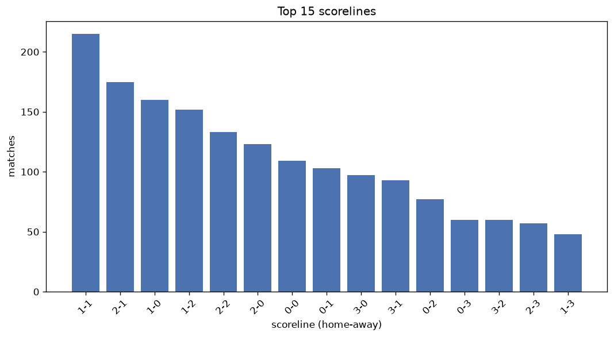
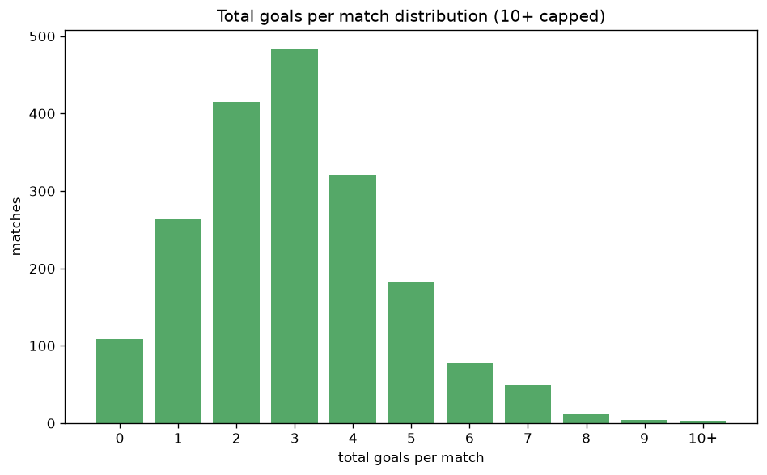

# Scoreline Analysis
- Report: `scoreline_analysis`
- Generated: 2026-10-29T02:01:14+00:00
- Script: `backend/scripts/analyze_scorelines.py` v1.0.0
- League: 2. Bundesliga (Germany)
- Scope: league `germany2`

## 1. Scoreline frequency
- Matches analysed: **1921** across **7** seasons.
- Distinct scorelines seen: **44**.

| scoreline | count | pct |
|---|---|---|
| 1-1 | 215 | 11.2% |
| 2-1 | 175 | 9.1% |
| 1-0 | 160 | 8.3% |
| 1-2 | 152 | 7.9% |
| 2-2 | 133 | 6.9% |
| 2-0 | 123 | 6.4% |
| 0-0 | 109 | 5.7% |
| 0-1 | 103 | 5.4% |
| 3-0 | 97 | 5.0% |
| 3-1 | 93 | 4.8% |
| 0-2 | 77 | 4.0% |
| 0-3 | 60 | 3.1% |
| 3-2 | 60 | 3.1% |
| 2-3 | 57 | 3.0% |
| 1-3 | 48 | 2.5% |
| 4-1 | 32 | 1.7% |
| 4-0 | 29 | 1.5% |
| 3-3 | 25 | 1.3% |
| 3-4 | 18 | 0.9% |
| 0-4 | 18 | 0.9% |

## 2. Scoreline frequency per season

### 2020-2021
| scoreline | count | pct |
|---|---|---|
| 1-1 | 31 | 10.1% |
| 2-1 | 27 | 8.8% |
| 1-0 | 26 | 8.5% |
| 1-2 | 24 | 7.8% |
| 2-2 | 19 | 6.2% |

### 2021-2022
| scoreline | count | pct |
|---|---|---|
| 1-1 | 47 | 15.4% |
| 3-0 | 25 | 8.2% |
| 2-1 | 25 | 8.2% |
| 2-2 | 20 | 6.5% |
| 1-2 | 20 | 6.5% |

### 2022-2023
| scoreline | count | pct |
|---|---|---|
| 2-1 | 34 | 11.1% |
| 1-0 | 30 | 9.8% |
| 1-1 | 28 | 9.2% |
| 2-0 | 24 | 7.8% |
| 2-2 | 23 | 7.5% |

### 2023-2024
| scoreline | count | pct |
|---|---|---|
| 1-1 | 33 | 10.8% |
| 1-2 | 27 | 8.8% |
| 2-1 | 27 | 8.8% |
| 1-0 | 26 | 8.5% |
| 2-2 | 21 | 6.9% |

### 2024-2025
| scoreline | count | pct |
|---|---|---|
| 1-1 | 35 | 11.4% |
| 1-2 | 30 | 9.8% |
| 1-0 | 25 | 8.2% |
| 2-2 | 24 | 7.8% |
| 0-0 | 22 | 7.2% |

### 2025-2026
| scoreline | count | pct |
|---|---|---|
| 2-1 | 36 | 11.6% |
| 1-0 | 31 | 10.0% |
| 1-1 | 31 | 10.0% |
| 1-2 | 26 | 8.4% |
| 2-0 | 22 | 7.1% |

### 2026-2027
| scoreline | count | pct |
|---|---|---|
| 1-1 | 10 | 12.3% |
| 0-1 | 9 | 11.1% |
| 2-2 | 7 | 8.6% |
| 2-1 | 7 | 8.6% |
| 3-0 | 7 | 8.6% |

## 3. Total-goal histogram
_10+ groups all matches with 10 or more total goals._

| total goals | matches | pct |
|---|---|---|
| 0 | 109 | 5.7% |
| 1 | 263 | 13.7% |
| 2 | 415 | 21.6% |
| 3 | 484 | 25.2% |
| 4 | 321 | 16.7% |
| 5 | 183 | 9.5% |
| 6 | 77 | 4.0% |
| 7 | 49 | 2.6% |
| 8 | 13 | 0.7% |
| 9 | 4 | 0.2% |
| 10+ | 3 | 0.2% |

## 4. Extreme scorelines
- Matches with 7+ total goals: **69**

| season | date | scoreline | total goals |
|---|---|---|---|
| 2020-2021 | 2021-05-09 | 3-8 | 11 |
| 2024-2025 | 2024-10-25 | 8-3 | 11 |
| 2023-2024 | 2023-09-02 | 6-4 | 10 |
| 2022-2023 | 2022-08-20 | 7-2 | 9 |
| 2022-2023 | 2022-11-12 | 5-4 | 9 |
| 2025-2026 | 2025-08-31 | 4-5 | 9 |
| 2025-2026 | 2026-02-06 | 4-5 | 9 |
| 2022-2023 | 2022-08-28 | 4-4 | 8 |
| 2022-2023 | 2022-11-12 | 4-4 | 8 |
| 2023-2024 | 2023-07-28 | 5-3 | 8 |
| 2023-2024 | 2023-11-25 | 5-3 | 8 |
| 2023-2024 | 2024-04-28 | 3-5 | 8 |
| 2024-2025 | 2024-09-20 | 3-5 | 8 |
| 2024-2025 | 2024-09-29 | 4-4 | 8 |
| 2024-2025 | 2025-03-15 | 5-3 | 8 |
| 2025-2026 | 2026-02-21 | 5-3 | 8 |
| 2026-2027 | 2026-08-28 | 3-5 | 8 |
| 2026-2027 | 2026-08-29 | 5-3 | 8 |
| 2026-2027 | 2026-09-05 | 4-4 | 8 |
| 2026-2027 | 2026-10-10 | 4-4 | 8 |
| 2020-2021 | 2020-09-28 | 3-4 | 7 |
| 2020-2021 | 2020-11-01 | 3-4 | 7 |
| 2020-2021 | 2021-01-24 | 2-5 | 7 |
| 2020-2021 | 2021-01-31 | 3-4 | 7 |
| 2020-2021 | 2021-04-18 | 4-3 | 7 |
| 2020-2021 | 2021-05-10 | 5-2 | 7 |
| 2021-2022 | 2021-08-15 | 6-1 | 7 |
| 2021-2022 | 2021-10-03 | 1-6 | 7 |
| 2021-2022 | 2021-11-27 | 5-2 | 7 |
| 2021-2022 | 2022-01-22 | 3-4 | 7 |
| 2021-2022 | 2022-03-04 | 3-4 | 7 |
| 2021-2022 | 2022-03-05 | 3-4 | 7 |
| 2021-2022 | 2022-04-17 | 2-5 | 7 |
| 2022-2023 | 2022-11-09 | 3-4 | 7 |
| 2022-2023 | 2023-02-11 | 3-4 | 7 |
| 2022-2023 | 2023-03-17 | 5-2 | 7 |
| 2022-2023 | 2023-03-19 | 2-5 | 7 |
| 2022-2023 | 2023-04-08 | 6-1 | 7 |
| 2022-2023 | 2023-04-21 | 4-3 | 7 |
| 2022-2023 | 2023-05-19 | 3-4 | 7 |
| 2023-2024 | 2023-09-16 | 4-3 | 7 |
| 2023-2024 | 2023-09-17 | 7-0 | 7 |
| 2023-2024 | 2023-09-23 | 4-3 | 7 |
| 2023-2024 | 2023-10-21 | 4-3 | 7 |
| 2023-2024 | 2024-01-28 | 3-4 | 7 |
| 2023-2024 | 2024-02-04 | 4-3 | 7 |
| 2023-2024 | 2024-02-09 | 3-4 | 7 |
| 2023-2024 | 2024-02-23 | 3-4 | 7 |
| 2023-2024 | 2024-03-17 | 7-0 | 7 |
| 2023-2024 | 2024-03-17 | 5-2 | 7 |
| 2023-2024 | 2024-04-14 | 3-4 | 7 |
| 2024-2025 | 2024-08-31 | 3-4 | 7 |
| 2024-2025 | 2024-10-26 | 3-4 | 7 |
| 2024-2025 | 2024-10-26 | 3-4 | 7 |
| 2024-2025 | 2024-12-20 | 2-5 | 7 |
| 2024-2025 | 2025-01-19 | 2-5 | 7 |
| 2024-2025 | 2025-02-01 | 2-5 | 7 |
| 2024-2025 | 2025-02-08 | 3-4 | 7 |
| 2024-2025 | 2025-05-10 | 6-1 | 7 |
| 2025-2026 | 2025-10-18 | 4-3 | 7 |
| 2025-2026 | 2026-02-22 | 5-2 | 7 |
| 2025-2026 | 2026-03-22 | 2-5 | 7 |
| 2025-2026 | 2026-04-12 | 4-3 | 7 |
| 2025-2026 | 2026-05-17 | 6-1 | 7 |
| 2026-2027 | 2026-08-08 | 1-6 | 7 |
| 2026-2027 | 2026-08-08 | 4-3 | 7 |
| 2026-2027 | 2026-08-29 | 3-4 | 7 |
| 2026-2027 | 2026-08-29 | 2-5 | 7 |
| 2026-2027 | 2026-10-24 | 6-1 | 7 |

## 5. Margin-of-victory distribution (decided matches)
- Decided matches: **1434** (draws: **487**)
- Average winning margin: **1.81**

| margin | matches | pct |
|---|---|---|
| 1 | 737 | 51.4% |
| 2 | 379 | 26.4% |
| 3+ | 318 | 22.2% |

## 6. Margin by outcome

### Home wins
- Matches: **844** | avg margin: **1.88** | max margin: **7**
| margin | matches | pct |
|---|---|---|
| 1 | 405 | 48.0% |
| 2 | 237 | 28.1% |
| 3+ | 202 | 23.9% |
- *Full match-by-match list available in `scoreline_analysis.json`.*

### Away wins
- Matches: **590** | avg margin: **1.71** | max margin: **6**
| margin | matches | pct |
|---|---|---|
| 1 | 332 | 56.3% |
| 2 | 142 | 24.1% |
| 3+ | 116 | 19.7% |
- *Full match-by-match list available in `scoreline_analysis.json`.*

## 7. Most common exact score by outcome type
| outcome | matches | most common score | count | pct |
|---|---|---|---|---|
| home | 844 | 2-1 | 175 | 20.7% |
| draw | 487 | 1-1 | 215 | 44.1% |
| away | 590 | 1-2 | 152 | 25.8% |

---
*All statistics are computed from PostgreSQL tables (read-only). Run with `python backend/scripts/analyze_scorelines.py` to regenerate.*

## Charts

