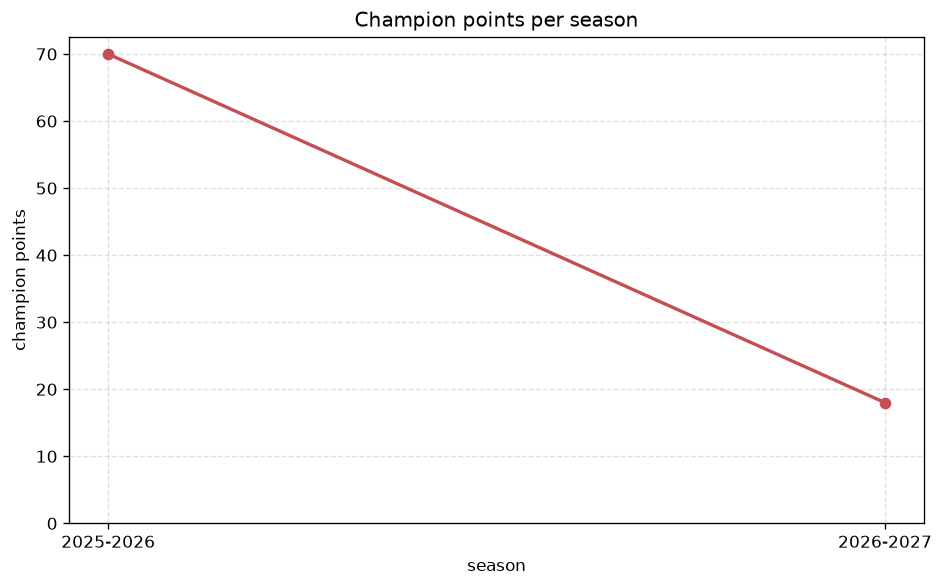
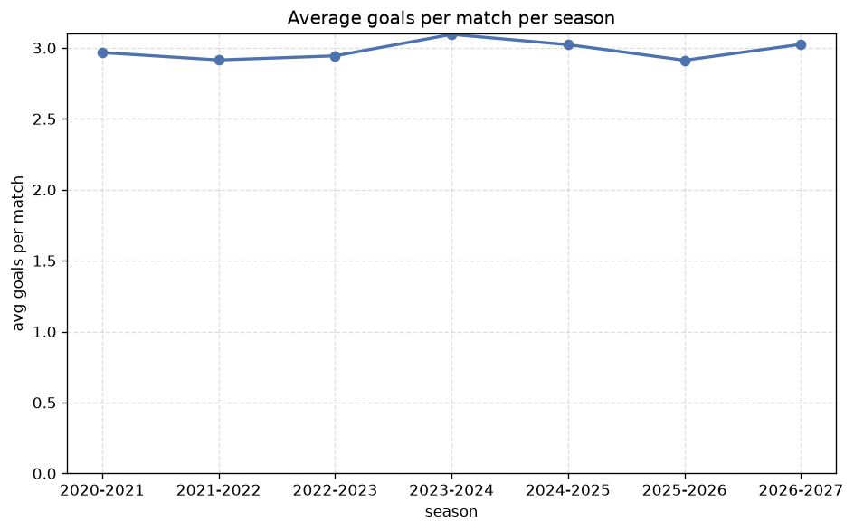

# Season Trends Analysis
- Report: `season_trends`
- Generated: 2026-10-27T01:49:29+00:00
- Script: `backend/scripts/analyze_seasons.py` v1.0.0
- League: 2. Bundesliga (Germany)
- Scope: league `germany2`

## 1. Champions per season
| season | champion | pts | runner-up | margin |
|---|---|---|---|---|
| 2020-2021 | Bochum | 67 | Greuther Furth | 3 pts |
| 2021-2022 | Schalke | 65 | Werder Bremen | 2 pts |
| 2022-2023 | Heidenheim | 67 | Darmstadt | 0 pts |
| 2023-2024 | St. Pauli | 69 | Holstein Kiel | 1 pts |
| 2024-2025 | FC Koln | 61 | Hamburger SV | 2 pts |
| 2025-2026 | Schalke | 70 | Paderborn | 7 pts |
| 2026-2027 | Hertha Berlin | 25 | Nurnberg | 7 pts |

## 2. Title-race tightness
- Tight races (margin <= 3 pts): **5** of 7 seasons
- Tightest race: **2022-2023** - Heidenheim beat Darmstadt by **0** pts

| season | margin | tight |
|---|---|---|
| 2020-2021 | 3 pts | yes |
| 2021-2022 | 2 pts | yes |
| 2022-2023 | 0 pts | yes |
| 2023-2024 | 1 pts | yes |
| 2024-2025 | 2 pts | yes |
| 2025-2026 | 7 pts |  |
| 2026-2027 | 7 pts |  |

## 3. Points thresholds
_Position-specific points per season. Key: 1 = champion, 2 = runner-up, 4 = CL line, 6 = Europa, 15 = last safe, 18 = bottom._

| season | pos 1 | pos 2 | pos 4 | pos 6 | pos 15 | pos 18 |
|---|---|---|---|---|---|---|
| 2020-2021 | 67 | 64 | 58 | 52 | 34 | 25 |
| 2021-2022 | 65 | 63 | 60 | 52 | 40 | 21 |
| 2022-2023 | 67 | 67 | 58 | 55 | 36 | 28 |
| 2023-2024 | 69 | 68 | 58 | 52 | 38 | 28 |
| 2024-2025 | 61 | 59 | 55 | 53 | 36 | 25 |
| 2025-2026 | 70 | 63 | 60 | 52 | 39 | 30 |
| 2026-2027 | 25 | 18 | 16 | 15 | 8 | 8 |

## 4. Relegation battle
| season | safe pos | safe pts | drop pos | drop pts | gap |
|---|---|---|---|---|---|
| 2020-2021 | 15 | 34 | 16 | 33 | 1 pts |
| 2021-2022 | 15 | 40 | 16 | 32 | 8 pts |
| 2022-2023 | 15 | 36 | 16 | 34 | 2 pts |
| 2023-2024 | 15 | 38 | 16 | 32 | 6 pts |
| 2024-2025 | 15 | 36 | 16 | 35 | 1 pts |
| 2025-2026 | 15 | 39 | 16 | 37 | 2 pts |
| 2026-2027 | 15 | 8 | 16 | 8 | 0 pts |

## 5. League-level trends
| season | matches | total goals | avg goals | home win | draw | away win | goalless | avg pts/team |
|---|---|---|---|---|---|---|---|---|
| 2020-2021 | 306 | 908 | 2.967 | 45.1% | 23.5% | 31.4% | 6.2% | 47.0 |
| 2021-2022 | 306 | 892 | 2.915 | 38.9% | 28.1% | 33.0% | 5.9% | 46.22 |
| 2022-2023 | 306 | 901 | 2.944 | 46.4% | 23.9% | 29.7% | 4.9% | 46.94 |
| 2023-2024 | 306 | 947 | 3.095 | 45.8% | 23.2% | 31.0% | 4.2% | 47.06 |
| 2024-2025 | 306 | 925 | 3.023 | 40.5% | 28.1% | 31.4% | 7.2% | 46.22 |
| 2025-2026 | 310 | 903 | 2.913 | 46.5% | 24.2% | 29.4% | 5.5% | 42.6 |
| 2026-2027 | 81 | 245 | 3.025 | 45.7% | 29.6% | 24.7% | 6.2% | 12.17 |

## 6. View divergence
- Largest divergence: **2025-2026** (goals view, avg abs position diff = 5.400)

_Avg absolute position difference between classic view and alternative view per season._

| season | classic vs luck | classic vs goals |
|---|---|---|
| 2020-2021 | 2.222 | 4.444 |
| 2021-2022 | 2.889 | 4.111 |
| 2022-2023 | 2.111 | 5.000 |
| 2023-2024 | 2.556 | 4.667 |
| 2024-2025 | 3.444 | 4.889 |
| 2025-2026 | 3.600 | 5.400 |
| 2026-2027 | 2.111 | 4.667 |

---
*All statistics are computed from PostgreSQL tables (read-only). Run with `python backend/scripts/analyze_seasons.py` to regenerate.*

## Charts

