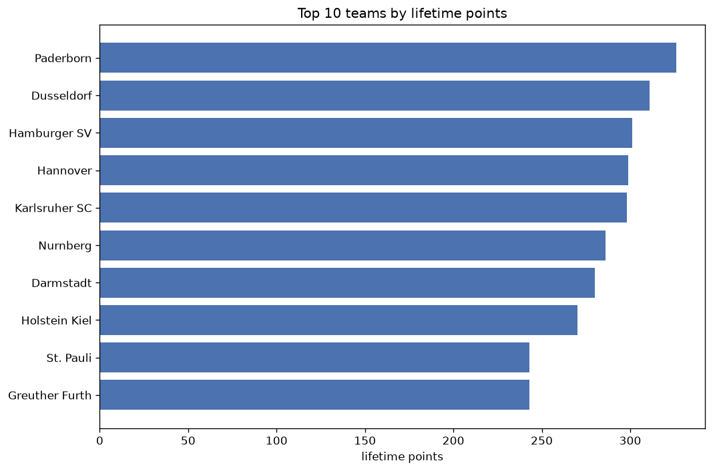
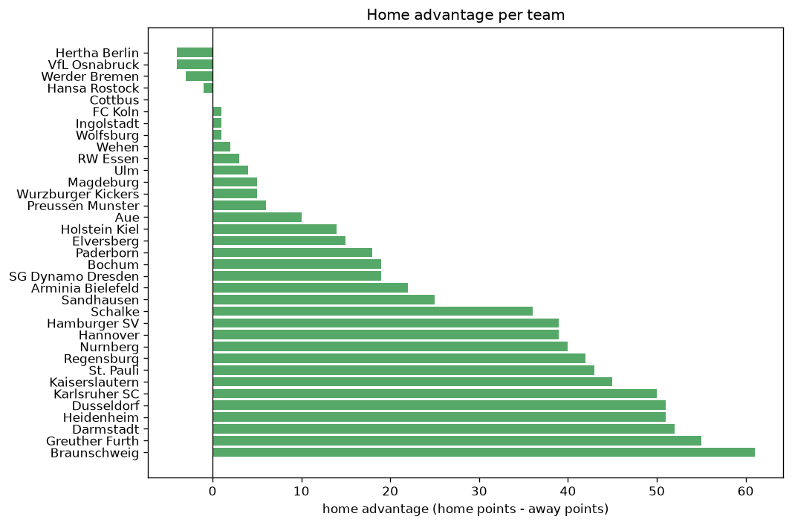

# Team Analysis
- Report: `teams_analysis`
- Generated: 2026-10-29T02:01:11+00:00
- Script: `backend/scripts/analyze_teams.py` v1.0.0
- League: 2. Bundesliga (Germany)
- Scope: league `germany2`

- Teams: **35** | Seasons: **7** | Matches: **1921**

## 1. Team standings (lifetime)
| team | seasons | played | W | D | L | pts | GF | GA | GD | avg pts/season | best pos | worst pos | titles |
|---|---|---|---|---|---|---|---|---|---|---|---|---|---|
| Paderborn | 6 | 206 | 90 | 56 | 60 | 326 | 348 | 279 | 69 | 54.33 | 2 | 9 | 0 |
| Dusseldorf | 6 | 204 | 87 | 50 | 67 | 311 | 322 | 276 | 46 | 51.83 | 3 | 17 | 0 |
| Hamburger SV | 5 | 170 | 85 | 46 | 39 | 301 | 350 | 212 | 138 | 60.2 | 2 | 4 | 0 |
| Hannover | 7 | 213 | 79 | 62 | 72 | 299 | 306 | 294 | 12 | 42.71 | 4 | 16 | 0 |
| Karlsruher SC | 7 | 213 | 79 | 61 | 73 | 298 | 350 | 339 | 11 | 42.57 | 5 | 17 | 0 |
| Nurnberg | 7 | 213 | 77 | 55 | 81 | 286 | 298 | 327 | -29 | 40.86 | 2 | 14 | 0 |
| Darmstadt | 6 | 179 | 79 | 43 | 57 | 280 | 305 | 252 | 53 | 46.67 | 2 | 18 | 0 |
| Holstein Kiel | 6 | 179 | 75 | 45 | 59 | 270 | 280 | 248 | 32 | 45.0 | 2 | 13 | 0 |
| St. Pauli | 5 | 145 | 67 | 42 | 36 | 243 | 240 | 186 | 54 | 48.6 | 1 | 10 | 1 |
| Greuther Furth | 6 | 181 | 65 | 48 | 68 | 243 | 274 | 287 | -13 | 40.5 | 2 | 13 | 0 |
| Schalke | 4 | 136 | 63 | 27 | 46 | 216 | 227 | 197 | 30 | 54.0 | 1 | 14 | 2 |
| Kaiserslautern | 5 | 145 | 58 | 33 | 54 | 207 | 223 | 218 | 5 | 41.4 | 3 | 13 | 0 |
| Magdeburg | 5 | 145 | 52 | 33 | 60 | 189 | 230 | 231 | -1 | 37.8 | 5 | 15 | 0 |
| Braunschweig | 6 | 179 | 48 | 43 | 88 | 187 | 198 | 304 | -106 | 31.17 | 10 | 17 | 0 |
| Heidenheim | 4 | 111 | 53 | 26 | 32 | 185 | 175 | 146 | 29 | 46.25 | 1 | 8 | 1 |
| Hertha Berlin | 4 | 111 | 47 | 27 | 37 | 168 | 185 | 162 | 23 | 42.0 | 1 | 11 | 1 |
| Elversberg | 3 | 102 | 46 | 25 | 31 | 163 | 177 | 139 | 38 | 54.33 | 3 | 11 | 0 |
| Regensburg | 4 | 136 | 33 | 35 | 68 | 134 | 144 | 230 | -86 | 33.5 | 14 | 18 | 0 |
| Bochum | 3 | 77 | 34 | 17 | 26 | 119 | 121 | 96 | 25 | 39.67 | 1 | 14 | 1 |
| Hansa Rostock | 3 | 102 | 31 | 20 | 51 | 113 | 103 | 157 | -54 | 37.67 | 13 | 17 | 0 |
| Sandhausen | 3 | 102 | 27 | 22 | 53 | 103 | 118 | 177 | -59 | 34.33 | 14 | 18 | 0 |
| Arminia Bielefeld | 3 | 77 | 22 | 18 | 37 | 84 | 116 | 127 | -11 | 28.0 | 9 | 16 | 0 |
| SG Dynamo Dresden | 3 | 77 | 20 | 21 | 36 | 81 | 98 | 117 | -19 | 27.0 | 11 | 16 | 0 |
| VfL Osnabruck | 3 | 77 | 18 | 18 | 41 | 72 | 80 | 142 | -62 | 24.0 | 8 | 18 | 0 |
| Aue | 2 | 68 | 18 | 16 | 34 | 70 | 76 | 125 | -49 | 35.0 | 12 | 17 | 0 |
| Preussen Munster | 2 | 68 | 14 | 24 | 30 | 66 | 78 | 104 | -26 | 33.0 | 15 | 18 | 0 |
| Werder Bremen | 1 | 34 | 18 | 9 | 7 | 63 | 65 | 43 | 22 | 63.0 | 2 | 2 | 0 |
| FC Koln | 1 | 34 | 18 | 7 | 9 | 61 | 53 | 38 | 15 | 61.0 | 1 | 1 | 1 |
| Wehen | 1 | 34 | 8 | 8 | 18 | 32 | 36 | 50 | -14 | 32.0 | 16 | 16 | 0 |
| Ulm | 1 | 34 | 6 | 12 | 16 | 30 | 36 | 48 | -12 | 30.0 | 17 | 17 | 0 |
| Wurzburger Kickers | 1 | 34 | 6 | 7 | 21 | 25 | 37 | 69 | -32 | 25.0 | 18 | 18 | 0 |
| Ingolstadt | 1 | 34 | 4 | 9 | 21 | 21 | 30 | 65 | -35 | 21.0 | 18 | 18 | 0 |
| Wolfsburg | 2 | 11 | 4 | 5 | 2 | 17 | 24 | 16 | 8 | 8.5 | 4 | 20 | 0 |
| Cottbus | 1 | 9 | 2 | 4 | 3 | 10 | 17 | 18 | -1 | 10.0 | 11 | 11 | 0 |
| RW Essen | 1 | 2 | 1 | 0 | 1 | 3 | 1 | 2 | -1 | 3.0 | 19 | 19 | 0 |

## 2. Home vs away split
| team | home P | H-W | H-D | H-L | H-pts | away P | A-W | A-D | A-L | A-pts | adv |
|---|---|---|---|---|---|---|---|---|---|---|---|
| Braunschweig | 90 | 34 | 22 | 34 | 124 | 89 | 14 | 21 | 54 | 63 | 61 |
| Greuther Furth | 90 | 41 | 26 | 23 | 149 | 91 | 24 | 22 | 45 | 94 | 55 |
| Darmstadt | 90 | 48 | 22 | 20 | 166 | 89 | 31 | 21 | 37 | 114 | 52 |
| Dusseldorf | 102 | 52 | 25 | 25 | 181 | 102 | 35 | 25 | 42 | 130 | 51 |
| Heidenheim | 56 | 35 | 13 | 8 | 118 | 55 | 18 | 13 | 24 | 67 | 51 |
| Karlsruher SC | 107 | 48 | 30 | 29 | 174 | 106 | 31 | 31 | 44 | 124 | 50 |
| Kaiserslautern | 72 | 37 | 15 | 20 | 126 | 73 | 21 | 18 | 34 | 81 | 45 |
| St. Pauli | 72 | 41 | 20 | 11 | 143 | 73 | 26 | 22 | 25 | 100 | 43 |
| Regensburg | 68 | 22 | 22 | 24 | 88 | 68 | 11 | 13 | 44 | 46 | 42 |
| Nurnberg | 107 | 46 | 25 | 36 | 163 | 106 | 31 | 30 | 45 | 123 | 40 |
| Hamburger SV | 85 | 50 | 20 | 15 | 170 | 85 | 35 | 26 | 24 | 131 | 39 |
| Hannover | 106 | 45 | 34 | 27 | 169 | 107 | 34 | 28 | 45 | 130 | 39 |
| Schalke | 68 | 38 | 12 | 18 | 126 | 68 | 25 | 15 | 28 | 90 | 36 |
| Sandhausen | 51 | 17 | 13 | 21 | 64 | 51 | 10 | 9 | 32 | 39 | 25 |
| Arminia Bielefeld | 38 | 14 | 11 | 13 | 53 | 39 | 8 | 7 | 24 | 31 | 22 |
| Bochum | 39 | 20 | 9 | 10 | 69 | 38 | 14 | 8 | 16 | 50 | 19 |
| SG Dynamo Dresden | 38 | 14 | 8 | 16 | 50 | 39 | 6 | 13 | 20 | 31 | 19 |
| Paderborn | 103 | 50 | 22 | 31 | 172 | 103 | 40 | 34 | 29 | 154 | 18 |
| Elversberg | 51 | 26 | 11 | 14 | 89 | 51 | 20 | 14 | 17 | 74 | 15 |
| Holstein Kiel | 90 | 41 | 19 | 30 | 142 | 89 | 34 | 26 | 29 | 128 | 14 |
| Aue | 34 | 11 | 7 | 16 | 40 | 34 | 7 | 9 | 18 | 30 | 10 |
| Preussen Munster | 34 | 7 | 15 | 12 | 36 | 34 | 7 | 9 | 18 | 30 | 6 |
| Magdeburg | 73 | 26 | 19 | 28 | 97 | 72 | 26 | 14 | 32 | 92 | 5 |
| Wurzburger Kickers | 17 | 3 | 6 | 8 | 15 | 17 | 3 | 1 | 13 | 10 | 5 |
| Ulm | 17 | 4 | 5 | 8 | 17 | 17 | 2 | 7 | 8 | 13 | 4 |
| RW Essen | 1 | 1 | 0 | 0 | 3 | 1 | 0 | 0 | 1 | 0 | 3 |
| Wehen | 17 | 4 | 5 | 8 | 17 | 17 | 4 | 3 | 10 | 15 | 2 |
| FC Koln | 17 | 9 | 4 | 4 | 31 | 17 | 9 | 3 | 5 | 30 | 1 |
| Ingolstadt | 17 | 2 | 5 | 10 | 11 | 17 | 2 | 4 | 11 | 10 | 1 |
| Wolfsburg | 5 | 2 | 3 | 0 | 9 | 6 | 2 | 2 | 2 | 8 | 1 |
| Cottbus | 4 | 1 | 2 | 1 | 5 | 5 | 1 | 2 | 2 | 5 | 0 |
| Hansa Rostock | 51 | 16 | 8 | 27 | 56 | 51 | 15 | 12 | 24 | 57 | -1 |
| Werder Bremen | 17 | 8 | 6 | 3 | 30 | 17 | 10 | 3 | 4 | 33 | -3 |
| Hertha Berlin | 55 | 22 | 16 | 17 | 82 | 56 | 25 | 11 | 20 | 86 | -4 |
| VfL Osnabruck | 39 | 9 | 7 | 23 | 34 | 38 | 9 | 11 | 18 | 38 | -4 |

## 3. Top performers
### Best points per game (PPG)
| rank | team | PPG |
|---|---|---|
| 1 | Werder Bremen | 1.85 |
| 2 | FC Koln | 1.79 |
| 3 | Hamburger SV | 1.77 |
| 4 | St. Pauli | 1.68 |
| 5 | Heidenheim | 1.67 |

### Most goals scored
| rank | team | goals |
|---|---|---|
| 1 | Hamburger SV | 350 |
| 2 | Karlsruher SC | 350 |
| 3 | Paderborn | 348 |
| 4 | Dusseldorf | 322 |
| 5 | Hannover | 306 |

### Best goal difference
| rank | team | GD |
|---|---|---|
| 1 | Hamburger SV | 138 |
| 2 | Paderborn | 69 |
| 3 | St. Pauli | 54 |
| 4 | Darmstadt | 53 |
| 5 | Dusseldorf | 46 |

### Best defence (goals against per match, standings)
| rank | team | GA/match |
|---|---|---|
| 1 | RW Essen | 1.000 |
| 2 | FC Koln | 1.118 |
| 3 | Bochum | 1.247 |
| 4 | Hamburger SV | 1.247 |
| 5 | Werder Bremen | 1.265 |

## 4. Team consistency
- Teams present in all **7** seasons: **3**

Hannover, Karlsruher SC, Nurnberg

## 5. Head-to-head dominance
- Distinct fixtures: **429** (showing the 15 most frequent)

| fixture | meetings | home wins | draws | away wins | home pct | draw pct | away pct |
|---|---|---|---|---|---|---|---|
| Karlsruher SC vs Hannover | 13 | 9 | 2 | 2 | 69.2% | 15.4% | 15.4% |
| Karlsruher SC vs Nurnberg | 13 | 8 | 2 | 3 | 61.5% | 15.4% | 23.1% |
| Nurnberg vs Hannover | 13 | 5 | 4 | 4 | 38.5% | 30.8% | 30.8% |
| Paderborn vs Dusseldorf | 12 | 6 | 2 | 4 | 50.0% | 16.7% | 33.3% |
| Paderborn vs Hannover | 12 | 6 | 4 | 2 | 50.0% | 33.3% | 16.7% |
| Dusseldorf vs Hannover | 12 | 5 | 6 | 1 | 41.7% | 50.0% | 8.3% |
| Dusseldorf vs Karlsruher SC | 12 | 4 | 5 | 3 | 33.3% | 41.7% | 25.0% |
| Dusseldorf vs Nurnberg | 12 | 4 | 3 | 5 | 33.3% | 25.0% | 41.7% |
| Paderborn vs Nurnberg | 12 | 4 | 2 | 6 | 33.3% | 16.7% | 50.0% |
| Paderborn vs Karlsruher SC | 12 | 3 | 4 | 5 | 25.0% | 33.3% | 41.7% |
| Darmstadt vs Karlsruher SC | 11 | 6 | 2 | 3 | 54.5% | 18.2% | 27.3% |
| Hannover vs Braunschweig | 11 | 6 | 3 | 2 | 54.5% | 27.3% | 18.2% |
| Greuther Furth vs Braunschweig | 11 | 5 | 3 | 3 | 45.5% | 27.3% | 27.3% |
| Darmstadt vs Hannover | 11 | 4 | 1 | 6 | 36.4% | 9.1% | 54.5% |
| Greuther Furth vs Nurnberg | 11 | 4 | 4 | 3 | 36.4% | 36.4% | 27.3% |

## 6. Position per season (classic view)
_Cells show final position; '-' when the team was absent from that season._

| team | 2020-2021 | 2021-2022 | 2022-2023 | 2023-2024 | 2024-2025 | 2025-2026 | 2026-2027 |
|---|---|---|---|---|---|---|---|
| Paderborn | 9 | 7 | 6 | 7 | 4 | 2 | - |
| Dusseldorf | 5 | 10 | 4 | 3 | 6 | 17 | - |
| Hamburger SV | 4 | 3 | 3 | 4 | 2 | - | - |
| Hannover | 13 | 11 | 10 | 6 | 9 | 4 | 16 |
| Karlsruher SC | 6 | 12 | 7 | 5 | 8 | 10 | 17 |
| Nurnberg | 11 | 8 | 14 | 12 | 10 | 8 | 2 |
| Darmstadt | 7 | 4 | 2 | - | 12 | 5 | 18 |
| Holstein Kiel | 3 | 9 | 8 | 2 | - | 12 | 13 |
| St. Pauli | 10 | 5 | 5 | 1 | - | - | 7 |
| Greuther Furth | 2 | - | 12 | 8 | 13 | 13 | 12 |
| Schalke | - | 1 | - | 10 | 14 | 1 | - |
| Kaiserslautern | - | - | 9 | 13 | 7 | 6 | 3 |
| Magdeburg | - | - | 11 | 14 | 5 | 15 | 5 |
| Braunschweig | 17 | - | 15 | 15 | 16 | 16 | 10 |
| Heidenheim | 8 | 6 | 1 | - | - | - | 6 |
| Hertha Berlin | - | - | - | 9 | 11 | 7 | 1 |
| Elversberg | - | - | - | 11 | 3 | 3 | - |
| Regensburg | 14 | 15 | 17 | - | 18 | - | - |
| Bochum | 1 | - | - | - | - | 9 | 14 |
| Hansa Rostock | - | 13 | 13 | 17 | - | - | - |
| Sandhausen | 15 | 14 | 18 | - | - | - | - |
| Arminia Bielefeld | - | - | 16 | - | - | 14 | 9 |
| SG Dynamo Dresden | - | 16 | - | - | - | 11 | 15 |
| VfL Osnabruck | 16 | - | - | 18 | - | - | 8 |
| Aue | 12 | 17 | - | - | - | - | - |
| Preussen Munster | - | - | - | - | 15 | 18 | - |
| Werder Bremen | - | 2 | - | - | - | - | - |
| FC Koln | - | - | - | - | 1 | - | - |
| Wehen | - | - | - | 16 | - | - | - |
| Ulm | - | - | - | - | 17 | - | - |
| Wurzburger Kickers | 18 | - | - | - | - | - | - |
| Ingolstadt | - | 18 | - | - | - | - | - |
| Wolfsburg | - | - | - | - | - | 20 | 4 |
| Cottbus | - | - | - | - | - | - | 11 |
| RW Essen | - | - | - | - | - | 19 | - |

---
*All statistics are computed from PostgreSQL tables (read-only). Run with `python backend/scripts/analyze_teams.py` to regenerate.*

## Charts

