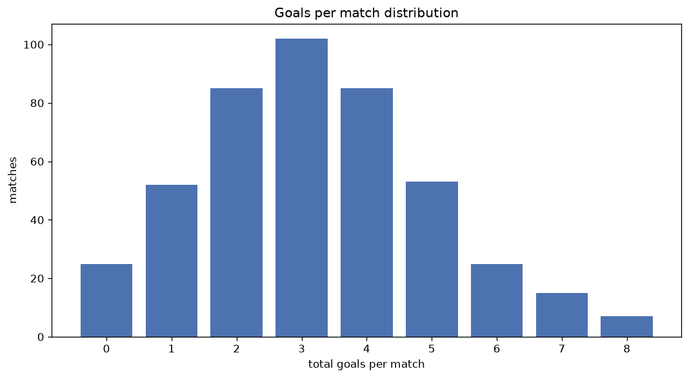
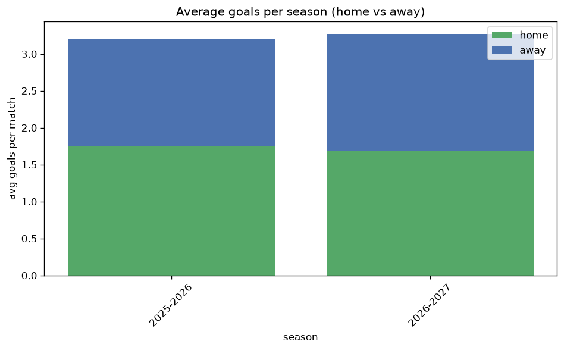

# Goal Analysis
- Report: `goals_analysis`
- Generated: 2026-10-29T02:01:27+00:00
- Script: `backend/scripts/analyze_goals.py` v1.0.0
- League: 3. Liga (Germany)
- Scope: league `germany3`

## 1. Goals per match distribution
| goals | matches | pct |
|---|---|---|
| 0 | 142 | 6.0% |
| 1 | 364 | 15.3% |
| 2 | 571 | 24.0% |
| 3 | 513 | 21.5% |
| 4 | 400 | 16.8% |
| 5 | 215 | 9.0% |
| 6 | 96 | 4.0% |
| 7 | 54 | 2.3% |
| 8 | 22 | 0.9% |
| 9 | 5 | 0.2% |
| 10 | 1 | 0.0% |

## 2. Goals per match per season
| season | matches | total goals | avg home | avg away | avg total |
|---|---|---|---|---|---|
| 2020-2021 | 380 | 1015 | 1.366 | 1.305 | 2.671 |
| 2021-2022 | 373 | 1028 | 1.469 | 1.287 | 2.756 |
| 2022-2023 | 380 | 1108 | 1.597 | 1.318 | 2.916 |
| 2023-2024 | 380 | 1066 | 1.576 | 1.229 | 2.805 |
| 2024-2025 | 380 | 1103 | 1.571 | 1.332 | 2.903 |
| 2025-2026 | 380 | 1219 | 1.758 | 1.45 | 3.208 |
| 2026-2027 | 110 | 366 | 1.764 | 1.564 | 3.327 |

## 3. Home vs away goal share
- Home goals: **3732** (54.0%)
- Away goals: **3173** (46.0%)
- Home/away ratio: **1.176**

| season | home goals | away goals | total | home pct | away pct |
|---|---|---|---|---|---|
| 2020-2021 | 519 | 496 | 1015 | 51.1% | 48.9% |
| 2021-2022 | 548 | 480 | 1028 | 53.3% | 46.7% |
| 2022-2023 | 607 | 501 | 1108 | 54.8% | 45.2% |
| 2023-2024 | 599 | 467 | 1066 | 56.2% | 43.8% |
| 2024-2025 | 597 | 506 | 1103 | 54.1% | 45.9% |
| 2025-2026 | 668 | 551 | 1219 | 54.8% | 45.2% |
| 2026-2027 | 194 | 172 | 366 | 53.0% | 47.0% |

## 4. BTTS (Both Teams To Score)
- Overall: **1373** of `2383` (57.6%)

| season | matches | BTTS | pct |
|---|---|---|---|
| 2020-2021 | 380 | 207 | 54.5% |
| 2021-2022 | 373 | 192 | 51.5% |
| 2022-2023 | 380 | 219 | 57.6% |
| 2023-2024 | 380 | 216 | 56.8% |
| 2024-2025 | 380 | 225 | 59.2% |
| 2025-2026 | 380 | 245 | 64.5% |
| 2026-2027 | 110 | 69 | 62.7% |

## 5. Clean sheets
- Home clean sheets: **646** (27.1%)
- Away clean sheets: **506** (21.2%)
- Total clean sheets recorded: **1152**
- Matches with at least one clean sheet: **1010** (42.4%)
- Both teams kept clean sheets (0-0): **142**

| season | matches | home CS | away CS | total CS | matches w/ CS |
|---|---|---|---|---|---|
| 2020-2021 | 380 | 95 | 103 | 198 | 173 (45.5%) |
| 2021-2022 | 373 | 115 | 95 | 210 | 181 (48.5%) |
| 2022-2023 | 380 | 103 | 74 | 177 | 161 (42.4%) |
| 2023-2024 | 380 | 116 | 74 | 190 | 164 (43.2%) |
| 2024-2025 | 380 | 101 | 73 | 174 | 155 (40.8%) |
| 2025-2026 | 380 | 88 | 70 | 158 | 135 (35.5%) |
| 2026-2027 | 110 | 28 | 17 | 45 | 41 (37.3%) |

## 6. Scoring intensity
- First-half goals: **3108** (45.0%)
- Second-half goals: **3795** (55.0%)
- Avg first-half goals per match: **1.305**
- Avg second-half goals per match: **1.593**
- Second-half-only scoring (HT 0-0, FT goals >= 1): **486** (20.4%)
- *1 match(es) excluded (no HT score recorded).*

| season | matches | 1st half | 2nd half | 1st half pct | 2nd half pct |
|---|---|---|---|---|---|
| 2020-2021 | 380 | 472 | 543 | 46.5% | 53.5% |
| 2021-2022 | 373 | 469 | 559 | 45.6% | 54.4% |
| 2022-2023 | 380 | 484 | 622 | 43.8% | 56.2% |
| 2023-2024 | 380 | 479 | 587 | 44.9% | 55.1% |
| 2024-2025 | 380 | 507 | 596 | 46.0% | 54.0% |
| 2025-2026 | 380 | 523 | 696 | 42.9% | 57.1% |
| 2026-2027 | 110 | 174 | 192 | 47.5% | 52.5% |

## 7. First-goal timing
- Matches with first-goal time recorded: `2240` of `2383` (94.0%)
- Goalless matches: `143`
- Min `1` | Max `96` | Mean `29.4` | Median (p50) `24.0`

| bucket | count | % of matches | % of scoring matches |
|---|---|---|---|
| 1-15 | 790 | 33.2% | 35.3% |
| 16-30 | 555 | 23.3% | 24.8% |
| 31-45 | 382 | 16.0% | 17.1% |
| 46-60 | 253 | 10.6% | 11.3% |
| 61-75 | 144 | 6.0% | 6.4% |
| 76-90 | 94 | 3.9% | 4.2% |
| 91-120 | 22 | 0.9% | 1.0% |

---
*All statistics are computed from PostgreSQL tables (read-only). Run with `python backend/scripts/analyze_goals.py` to regenerate.*

## Charts

