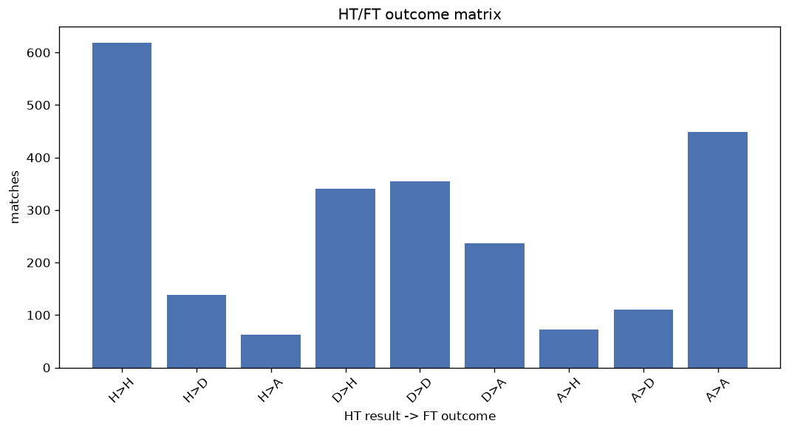
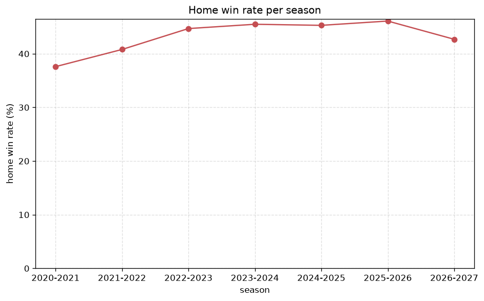

# Match Analysis
- Report: `matches_analysis`
- Generated: 2026-10-27T01:49:44+00:00
- Script: `backend/scripts/analyze_matches.py` v1.0.0
- League: 3. Liga (Germany)
- Scope: league `germany3`

## 1. Overall summary
| metric | value |
|---|---|
| Matches | 2383 |
| Home wins | 1032 (43.3%) |
| Draws | 603 (25.3%) |
| Away wins | 748 (31.4%) |
| Total goals | 6905 |
| Average goals per match | 2.898 |
| Goalless matches | 142 (6.0%) |

## 2. Per-season breakdown
| season | matches | home wins | draws | away wins | total goals | avg goals | goalless |
|---|---|---|---|---|---|---|---|
| 2020-2021 | 380 | 143 (37.6%) | 108 (28.4%) | 129 (33.9%) | 1015 | 2.671 | 25 (6.6%) |
| 2021-2022 | 373 | 152 (40.8%) | 96 (25.7%) | 125 (33.5%) | 1028 | 2.756 | 29 (7.8%) |
| 2022-2023 | 380 | 170 (44.7%) | 89 (23.4%) | 121 (31.8%) | 1108 | 2.916 | 16 (4.2%) |
| 2023-2024 | 380 | 173 (45.5%) | 100 (26.3%) | 107 (28.2%) | 1066 | 2.805 | 26 (6.8%) |
| 2024-2025 | 380 | 172 (45.3%) | 96 (25.3%) | 112 (29.5%) | 1103 | 2.903 | 19 (5.0%) |
| 2025-2026 | 380 | 175 (46.1%) | 89 (23.4%) | 116 (30.5%) | 1219 | 3.208 | 23 (6.1%) |
| 2026-2027 | 110 | 47 (42.7%) | 25 (22.7%) | 38 (34.5%) | 366 | 3.327 | 4 (3.6%) |

## 3. HT/FT outcome matrix
| HT result \ FT result | Home | Draw | Away | total |
|---|---|---|---|---|
| HT home lead | 618 (75.6%) | 138 (16.9%) | 62 (7.6%) | 818 |
| HT draw | 341 (36.5%) | 355 (38.0%) | 237 (25.4%) | 933 |
| HT away lead | 73 (11.6%) | 110 (17.4%) | 448 (71.0%) | 631 |
- *1 match(es) excluded (no HT score recorded).*

## 4. Comeback matches
- Home comebacks (trailing at HT, won at FT): **73** (3.1%)
- Away comebacks (trailing at HT, won at FT): **62** (2.6%)

### Home comebacks
| season | home | away | HT | FT |
|---|---|---|---|---|
| 2020-2021 | Hansa Rostock | Duisburg | 0-1 | 3-1 |
| 2020-2021 | Wehen | Lubeck | 1-2 | 4-2 |
| 2020-2021 | Zwickau | Lubeck | 0-1 | 2-1 |
| 2020-2021 | Hansa Rostock | Verl | 0-2 | 3-2 |
| 2020-2021 | Ingolstadt | Viktoria Koln | 0-1 | 2-1 |
| 2020-2021 | Hansa Rostock | Kaiserslautern | 0-1 | 2-1 |
| 2020-2021 | Duisburg | Turkgucu Munchen | 0-2 | 3-2 |
| 2020-2021 | Zwickau | Wehen | 0-1 | 2-1 |
| 2021-2022 | Saarbrucken | Magdeburg | 0-1 | 2-1 |
| 2021-2022 | Munich 1860 | Wehen | 1-2 | 3-2 |
| 2021-2022 | Viktoria Koln | Verl | 0-1 | 5-2 |
| 2021-2022 | Saarbrucken | Wurzburger Kickers | 0-1 | 2-1 |
| 2022-2023 | Mannheim | Dortmund II | 0-1 | 2-1 |
| 2022-2023 | VfB Oldenburg | VfL Osnabruck | 1-2 | 4-3 |
| 2022-2023 | SG Dynamo Dresden | VfL Osnabruck | 0-2 | 3-2 |
| 2022-2023 | Freiburg II | Mannheim | 0-1 | 3-2 |
| 2022-2023 | VfL Osnabruck | Hallescher | 1-2 | 3-2 |
| 2022-2023 | VfL Osnabruck | Verl | 0-1 | 2-1 |
| 2022-2023 | Viktoria Koln | Bayreuth | 0-1 | 2-1 |
| 2022-2023 | Bayreuth | Dortmund II | 0-1 | 3-1 |
| 2022-2023 | Aue | Saarbrucken | 0-1 | 2-1 |
| 2022-2023 | Mannheim | Elversberg | 0-1 | 2-1 |
| 2022-2023 | Wehen | Zwickau | 0-2 | 4-3 |
| 2022-2023 | Viktoria Koln | Verl | 0-1 | 2-1 |
| 2022-2023 | Saarbrucken | Mannheim | 0-1 | 2-1 |
| 2022-2023 | Mannheim | Freiburg II | 0-1 | 2-1 |
| 2022-2023 | Hallescher | Aue | 1-2 | 5-2 |
| 2022-2023 | VfL Osnabruck | Zwickau | 1-2 | 4-3 |
| 2022-2023 | Zwickau | Mannheim | 0-1 | 3-1 |
| 2022-2023 | Meppen | SG Dynamo Dresden | 0-1 | 4-1 |
| 2023-2024 | Unterhaching | Ulm | 1-2 | 3-2 |
| 2023-2024 | Preussen Munster | Ingolstadt | 0-1 | 3-1 |
| 2023-2024 | Saarbrucken | Verl | 1-2 | 4-3 |
| 2023-2024 | Ingolstadt | Munich 1860 | 0-1 | 2-1 |
| 2023-2024 | Aue | Hallescher | 0-1 | 3-1 |
| 2023-2024 | Arminia Bielefeld | Mannheim | 0-1 | 3-1 |
| 2023-2024 | Hallescher | Viktoria Koln | 0-1 | 2-1 |
| 2023-2024 | RW Essen | Hallescher | 0-1 | 3-2 |
| 2023-2024 | Aue | RW Essen | 0-1 | 2-1 |
| 2023-2024 | RW Essen | Freiburg II | 1-2 | 4-3 |
| 2023-2024 | Mannheim | Regensburg | 0-1 | 3-1 |
| 2023-2024 | Aue | Viktoria Koln | 0-1 | 2-1 |
| 2023-2024 | Mannheim | Unterhaching | 0-1 | 6-1 |
| 2023-2024 | Saarbrucken | Sandhausen | 0-1 | 4-1 |
| 2024-2025 | Viktoria Koln | Verl | 0-1 | 2-1 |
| 2024-2025 | Wehen | VfL Osnabruck | 0-1 | 2-1 |
| 2024-2025 | SG Dynamo Dresden | Hannover II | 0-1 | 2-1 |
| 2024-2025 | Alemannia Aachen | Stuttgart II | 0-1 | 2-1 |
| 2024-2025 | Ingolstadt | Sandhausen | 0-1 | 2-1 |
| 2024-2025 | Saarbrucken | Dortmund II | 0-1 | 2-1 |
| 2025-2026 | Aue | TSV Havelse | 0-1 | 2-1 |
| 2025-2026 | Ulm | Regensburg | 0-1 | 2-1 |
| 2025-2026 | Cottbus | Alemannia Aachen | 1-2 | 3-2 |
| 2025-2026 | Regensburg | Stuttgart II | 0-2 | 3-2 |
| 2025-2026 | Viktoria Koln | Ingolstadt | 0-1 | 3-1 |
| 2025-2026 | Wehen | Aue | 0-1 | 3-1 |
| 2025-2026 | Cottbus | Viktoria Koln | 0-1 | 3-2 |
| 2025-2026 | TSV Havelse | Aue | 0-1 | 3-1 |
| 2025-2026 | Ingolstadt | TSV Havelse | 0-1 | 3-2 |
| 2025-2026 | Mannheim | Alemannia Aachen | 0-1 | 2-1 |
| 2025-2026 | TSV Havelse | Viktoria Koln | 0-2 | 3-2 |
| 2025-2026 | Mannheim | Aue | 0-1 | 2-1 |
| 2025-2026 | Cottbus | RW Essen | 1-2 | 5-3 |
| 2025-2026 | VfL Osnabruck | Verl | 0-1 | 2-1 |
| 2025-2026 | TSV Havelse | Schweinfurt | 1-2 | 3-2 |
| 2026-2027 | Alemannia Aachen | Verl | 0-1 | 4-1 |
| 2026-2027 | TSV Havelse | Mannheim | 1-2 | 3-2 |
| 2026-2027 | Verl | Meppen | 0-1 | 2-1 |
| 2026-2027 | Duisburg | TSV Havelse | 0-1 | 2-1 |
| 2026-2027 | Duisburg | Hoffenheim II | 0-2 | 3-2 |
| 2026-2027 | Grossaspach | Preussen Munster | 0-2 | 3-2 |
| 2026-2027 | Viktoria Koln | Verl | 0-1 | 3-1 |
| 2026-2027 | Mannheim | Hoffenheim II | 0-1 | 4-1 |

### Away comebacks
| season | home | away | HT | FT |
|---|---|---|---|---|
| 2020-2021 | Lubeck | Hallescher | 1-0 | 2-3 |
| 2020-2021 | Viktoria Koln | SG Dynamo Dresden | 1-0 | 2-4 |
| 2020-2021 | Duisburg | Magdeburg | 1-0 | 1-2 |
| 2020-2021 | Viktoria Koln | Mannheim | 1-0 | 1-2 |
| 2020-2021 | Saarbrucken | Viktoria Koln | 1-0 | 2-3 |
| 2020-2021 | Turkgucu Munchen | Verl | 1-0 | 1-2 |
| 2020-2021 | Duisburg | Ingolstadt | 1-0 | 1-5 |
| 2021-2022 | Viktoria Berlin | TSV Havelse | 2-1 | 3-4 |
| 2021-2022 | Hallescher | Saarbrucken | 2-1 | 2-3 |
| 2021-2022 | Viktoria Koln | Braunschweig | 1-0 | 1-2 |
| 2021-2022 | Mannheim | Dortmund II | 1-0 | 1-3 |
| 2021-2022 | Zwickau | Munich 1860 | 1-0 | 1-3 |
| 2021-2022 | Verl | Mannheim | 1-0 | 1-3 |
| 2021-2022 | Meppen | Duisburg | 1-0 | 1-2 |
| 2021-2022 | Meppen | Wurzburger Kickers | 2-1 | 2-4 |
| 2021-2022 | Dortmund II | Verl | 1-0 | 1-2 |
| 2022-2023 | Ingolstadt | Wehen | 2-1 | 2-3 |
| 2022-2023 | Zwickau | Dortmund II | 1-0 | 1-2 |
| 2022-2023 | Elversberg | Verl | 1-0 | 1-2 |
| 2022-2023 | VfB Oldenburg | SG Dynamo Dresden | 1-0 | 1-3 |
| 2022-2023 | Munich 1860 | SG Dynamo Dresden | 1-0 | 1-2 |
| 2022-2023 | VfL Osnabruck | Bayreuth | 1-0 | 2-3 |
| 2022-2023 | Saarbrucken | Ingolstadt | 2-1 | 3-4 |
| 2022-2023 | Saarbrucken | VfL Osnabruck | 1-0 | 1-2 |
| 2022-2023 | VfB Oldenburg | Zwickau | 1-0 | 1-2 |
| 2023-2024 | Duisburg | Verl | 2-1 | 2-3 |
| 2023-2024 | Sandhausen | Ulm | 1-0 | 1-2 |
| 2023-2024 | Aue | Ulm | 1-0 | 1-2 |
| 2023-2024 | Mannheim | Verl | 1-0 | 1-2 |
| 2023-2024 | Unterhaching | Regensburg | 1-0 | 1-2 |
| 2023-2024 | Duisburg | Hallescher | 2-1 | 2-3 |
| 2023-2024 | Ingolstadt | Freiburg II | 2-1 | 2-3 |
| 2023-2024 | Unterhaching | Dortmund II | 1-0 | 3-4 |
| 2023-2024 | Ingolstadt | Viktoria Koln | 1-0 | 1-3 |
| 2023-2024 | Viktoria Koln | Preussen Munster | 2-1 | 3-5 |
| 2024-2025 | Cottbus | Arminia Bielefeld | 1-0 | 1-2 |
| 2024-2025 | Mannheim | Viktoria Koln | 1-0 | 1-2 |
| 2024-2025 | Alemannia Aachen | Aue | 1-0 | 1-2 |
| 2024-2025 | Aue | Arminia Bielefeld | 1-0 | 1-3 |
| 2024-2025 | Wehen | Sandhausen | 1-0 | 1-3 |
| 2024-2025 | Dortmund II | Munich 1860 | 1-0 | 1-2 |
| 2024-2025 | Viktoria Koln | Dortmund II | 3-2 | 3-5 |
| 2024-2025 | Stuttgart II | Saarbrucken | 2-1 | 2-3 |
| 2024-2025 | Sandhausen | SG Dynamo Dresden | 2-1 | 2-4 |
| 2024-2025 | Munich 1860 | Hansa Rostock | 1-0 | 1-2 |
| 2024-2025 | Viktoria Koln | Munich 1860 | 1-0 | 1-2 |
| 2024-2025 | Wehen | RW Essen | 1-0 | 1-3 |
| 2024-2025 | Hannover II | Munich 1860 | 1-0 | 1-3 |
| 2024-2025 | Stuttgart II | VfL Osnabruck | 1-0 | 1-2 |
| 2024-2025 | Ingolstadt | Wehen | 2-1 | 2-3 |
| 2025-2026 | Wehen | RW Essen | 1-0 | 3-4 |
| 2025-2026 | Verl | Duisburg | 1-0 | 2-3 |
| 2025-2026 | Ingolstadt | Schweinfurt | 2-1 | 2-3 |
| 2025-2026 | Mannheim | VfL Osnabruck | 1-0 | 1-4 |
| 2025-2026 | Schweinfurt | Verl | 1-0 | 1-2 |
| 2025-2026 | VfL Osnabruck | Stuttgart II | 1-0 | 1-2 |
| 2025-2026 | Verl | Hansa Rostock | 1-0 | 1-2 |
| 2025-2026 | Regensburg | Alemannia Aachen | 1-0 | 1-3 |
| 2025-2026 | Wehen | VfL Osnabruck | 1-0 | 2-3 |
| 2025-2026 | Ingolstadt | Aue | 3-1 | 3-5 |
| 2025-2026 | Munich 1860 | Ingolstadt | 1-0 | 1-2 |
| 2026-2027 | Verl | Duisburg | 1-0 | 2-4 |

## 5. HT lead conversion
| HT state | matches | converted to win | held as draw | collapsed to loss |
|---|---|---|---|---|
| Home lead | 818 | 618 (75.6%) | 138 (16.9%) | 62 (7.6%) |
| Away lead | 631 | 448 (71.0%) | 110 (17.4%) | 73 (11.6%) |

### Matches level at half-time
| FT result | count | pct |
|---|---|---|
| Home win | 341 | 36.5% |
| Draw | 355 | 38.0% |
| Away win | 237 | 25.4% |
- *1 match(es) excluded (no HT score recorded).*

## 6. First-goal timing
- Matches with a first-goal time recorded: `2240` of `2383` (94.0%)

Outcome distribution by first-goal timing bucket:
| bucket | matches | % of matches | home | draw | away |
|---|---|---|---|---|---|
| 1-15 | 790 | 33.2% | 361 (45.7%) | 158 (20.0%) | 271 (34.3%) |
| 16-30 | 555 | 23.3% | 241 (43.4%) | 126 (22.7%) | 188 (33.9%) |
| 31-45 | 382 | 16.0% | 183 (47.9%) | 76 (19.9%) | 123 (32.2%) |
| 46-60 | 253 | 10.6% | 115 (45.5%) | 54 (21.3%) | 84 (33.2%) |
| 61-75 | 144 | 6.0% | 68 (47.2%) | 30 (20.8%) | 46 (31.9%) |
| 76-90 | 94 | 3.9% | 53 (56.4%) | 17 (18.1%) | 24 (25.5%) |
| 91-120 | 22 | 0.9% | 11 (50.0%) | 0 (0.0%) | 11 (50.0%) |

## 7. Goalless matches
- Overall: **142** of `2383` (6.0%)

| season | matches | goalless | pct |
|---|---|---|---|
| 2020-2021 | 380 | 25 | 6.6% |
| 2021-2022 | 373 | 29 | 7.8% |
| 2022-2023 | 380 | 16 | 4.2% |
| 2023-2024 | 380 | 26 | 6.8% |
| 2024-2025 | 380 | 19 | 5.0% |
| 2025-2026 | 380 | 23 | 6.1% |
| 2026-2027 | 110 | 4 | 3.6% |

---
*All statistics are computed from PostgreSQL tables (read-only). Run with `python backend/scripts/analyze_matches.py` to regenerate.*

## Charts

