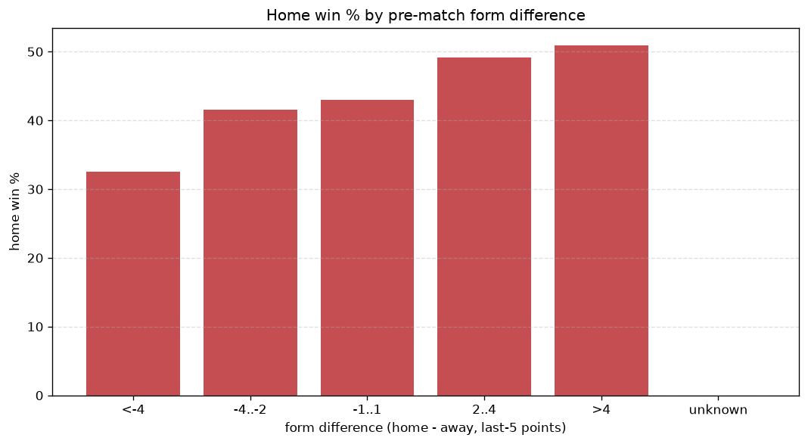
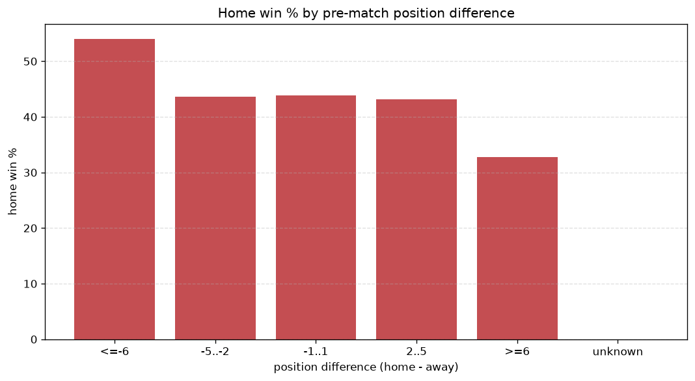

# Relationships Analysis
- Report: `relationships`
- Generated: 2026-10-26T01:34:10+00:00
- Script: `backend/scripts/analyze_relationships.py` v1.0.0
- League: 3. Liga (Germany)
- Scope: league `germany3`

- Matches analysed: **2273** (23 leakage-safe pre-match features).

## 1. Correlation matrix
_Pearson correlation of each pre-match feature with observed goals; sorted by |corr(total goals)|._

| feature | corr(home) | corr(away) | corr(total) |
|---|---|---|---|
| home_team_goals_scored_last_5 | 0.093 | -0.018 | 0.057 |
| away_team_away_conceded_avg | 0.082 | -0.006 | 0.056 |
| away_team_goals_conceded_last_5 | 0.064 | 0.004 | 0.050 |
| home_team_goals_conceded_last_5 | -0.025 | 0.096 | 0.048 |
| home_team_home_goals_avg | 0.076 | -0.017 | 0.045 |
| away_team_away_goals_avg | -0.023 | 0.084 | 0.041 |
| home_points_before_match | 0.086 | -0.035 | 0.039 |
| away_team_goals_scored_last_5 | -0.007 | 0.055 | 0.033 |
| points_difference | 0.159 | -0.129 | 0.028 |
| away_position_before_match | 0.099 | -0.066 | 0.027 |
| home_team_points_last_5 | 0.087 | -0.055 | 0.026 |
| home_team_home_conceded_avg | -0.020 | 0.054 | 0.023 |
| away_team_points_last_5 | -0.018 | 0.051 | 0.022 |
| home_team_home_win_rate | 0.060 | -0.033 | 0.022 |
| position_difference | -0.148 | 0.128 | -0.021 |
| away_points_before_match | -0.018 | 0.049 | 0.021 |
| home_team_wins_last_5 | 0.077 | -0.056 | 0.018 |
| away_team_wins_last_5 | -0.014 | 0.039 | 0.017 |
| away_team_away_win_rate | -0.045 | 0.061 | 0.009 |
| home_position_before_match | -0.108 | 0.112 | -0.002 |
| away_rest_days | 0.009 | -0.012 | -0.002 |
| home_rest_days | 0.012 | -0.015 | -0.002 |
| rest_days_difference | 0.007 | -0.007 | 0.001 |

## 2. Form vs outcome
_Home win/draw/away % per bucket of `home_team_points_last_5 - away_team_points_last_5`._

| bucket | matches | home | draw | away | home % | draw % | away % |
|---|---|---|---|---|---|---|---|
| <-4 | 335 | 109 | 89 | 137 | 32.5% | 26.6% | 40.9% |
| -4..-2 | 507 | 211 | 123 | 173 | 41.6% | 24.3% | 34.1% |
| -1..1 | 696 | 299 | 183 | 214 | 43.0% | 26.3% | 30.7% |
| 2..4 | 442 | 217 | 108 | 117 | 49.1% | 24.4% | 26.5% |
| >4 | 293 | 149 | 75 | 69 | 50.9% | 25.6% | 23.5% |
| unknown | 0 | 0 | 0 | 0 | - | - | - |

## 3. Position vs outcome
_Home win/draw/away % per bucket of `position_difference` (home position - away position; negative favours the home team)._

| bucket | matches | home | draw | away | home % | draw % | away % |
|---|---|---|---|---|---|---|---|
| <=-6 | 581 | 314 | 137 | 130 | 54.0% | 23.6% | 22.4% |
| -5..-2 | 374 | 163 | 114 | 97 | 43.6% | 30.5% | 25.9% |
| -1..1 | 297 | 130 | 87 | 80 | 43.8% | 29.3% | 26.9% |
| 2..5 | 412 | 178 | 92 | 142 | 43.2% | 22.3% | 34.5% |
| >=6 | 609 | 200 | 148 | 261 | 32.8% | 24.3% | 42.9% |
| unknown | 0 | 0 | 0 | 0 | - | - | - |

## 4. Rest advantage
_Home win/draw/away % per bucket of `rest_days_difference` (home rest - away rest). Matches with unknown rest are bucketed separately._

| bucket | matches | home | draw | away | home % | draw % | away % |
|---|---|---|---|---|---|---|---|
| <-1 | 213 | 89 | 58 | 66 | 41.8% | 27.2% | 31.0% |
| -1..0 | 494 | 213 | 117 | 164 | 43.1% | 23.7% | 33.2% |
| 0 | 842 | 364 | 190 | 288 | 43.2% | 22.6% | 34.2% |
| 1..2 | 565 | 252 | 161 | 152 | 44.6% | 28.5% | 26.9% |
| >2 | 98 | 43 | 28 | 27 | 43.9% | 28.6% | 27.6% |
| unknown | 61 | 24 | 24 | 13 | 39.3% | 39.3% | 21.3% |
- *61 match(es) had unknown rest difference (missing rest data on at least one side).*

## 5. Home team quality
_Home win rate by `home_team_home_win_rate` tier (split at 0.5)._

- `< 0.5` tier: **41.5%** home win (579/1396)
- `>= 0.5` tier: **46.3%** home win (406/877)
- Home-win gap (>= split minus < split): **+4.8 pp**

| tier | label | matches | home | draw | away | home % |
|---|---|---|---|---|---|---|
| low | < 0.5 | 1396 | 579 | 350 | 467 | 41.5% |
| high | >= 0.5 | 877 | 406 | 228 | 243 | 46.3% |

## 6. Feature averages by result
_Mean feature value per outcome; `range` is home-minus-away spread of the group means._

| feature | home mean | draw mean | away mean | range |
|---|---|---|---|---|
| points_difference | 1.804 | 0.059 | -3.039 | 4.843 |
| position_difference | -1.181 | 0.031 | 2.217 | 3.398 |
| home_points_before_match | 26.641 | 24.507 | 23.744 | 2.897 |
| away_points_before_match | 24.837 | 24.448 | 26.783 | 2.335 |
| home_position_before_match | 10.045 | 10.567 | 11.946 | 1.902 |
| away_position_before_match | 11.225 | 10.536 | 9.730 | 1.496 |
| home_team_points_last_5 | 6.552 | 6.142 | 5.848 | 0.704 |
| home_team_goals_conceded_last_5 | 6.436 | 6.441 | 7.017 | 0.581 |
| home_team_goals_scored_last_5 | 6.748 | 6.393 | 6.192 | 0.557 |
| away_team_points_last_5 | 6.232 | 6.266 | 6.772 | 0.539 |
| away_team_goals_scored_last_5 | 6.550 | 6.481 | 6.911 | 0.430 |
| away_team_goals_conceded_last_5 | 6.693 | 6.426 | 6.307 | 0.386 |
| home_rest_days | 7.759 | 7.643 | 7.514 | 0.244 |
| home_team_wins_last_5 | 1.792 | 1.649 | 1.561 | 0.231 |
| rest_days_difference | -0.037 | -0.002 | -0.185 | 0.183 |
| away_team_wins_last_5 | 1.687 | 1.701 | 1.859 | 0.172 |
| away_rest_days | 7.804 | 7.644 | 7.700 | 0.159 |
| away_team_away_goals_avg | 1.186 | 1.201 | 1.279 | 0.093 |
| home_team_home_goals_avg | 1.465 | 1.435 | 1.378 | 0.087 |
| away_team_away_conceded_avg | 1.477 | 1.408 | 1.390 | 0.087 |
| home_team_home_conceded_avg | 1.192 | 1.191 | 1.271 | 0.080 |
| away_team_away_win_rate | 0.274 | 0.286 | 0.310 | 0.035 |
| home_team_home_win_rate | 0.416 | 0.402 | 0.383 | 0.032 |

---
*All features are leakage-safe pre-match values built by `ml.features.build_features.build_rows` from strictly prior matches. Run with `python backend/scripts/analyze_relationships.py` to regenerate.*

## Charts

