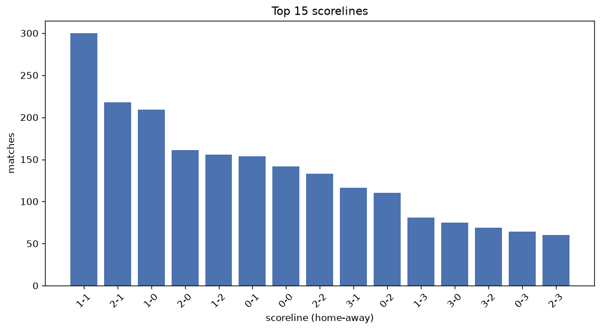
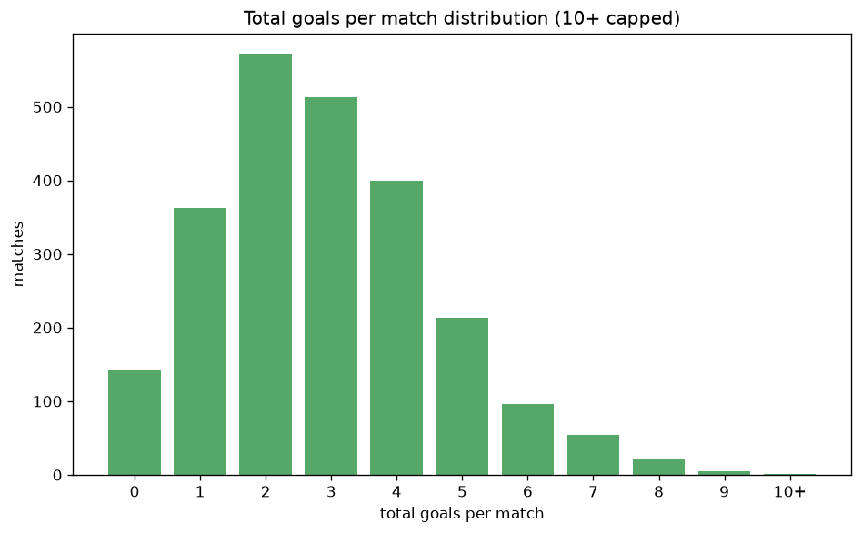

# Scoreline Analysis
- Report: `scoreline_analysis`
- Generated: 2026-10-26T01:34:07+00:00
- Script: `backend/scripts/analyze_scorelines.py` v1.0.0
- League: 3. Liga (Germany)
- Scope: league `germany3`

## 1. Scoreline frequency
- Matches analysed: **2380** across **7** seasons.
- Distinct scorelines seen: **46**.

| scoreline | count | pct |
|---|---|---|
| 1-1 | 300 | 12.6% |
| 2-1 | 218 | 9.2% |
| 1-0 | 209 | 8.8% |
| 2-0 | 161 | 6.8% |
| 1-2 | 156 | 6.6% |
| 0-1 | 154 | 6.5% |
| 0-0 | 142 | 6.0% |
| 2-2 | 133 | 5.6% |
| 3-1 | 116 | 4.9% |
| 0-2 | 110 | 4.6% |
| 1-3 | 81 | 3.4% |
| 3-0 | 75 | 3.2% |
| 3-2 | 69 | 2.9% |
| 0-3 | 64 | 2.7% |
| 2-3 | 60 | 2.5% |
| 4-1 | 47 | 2.0% |
| 4-0 | 44 | 1.8% |
| 0-4 | 26 | 1.1% |
| 3-3 | 24 | 1.0% |
| 4-2 | 22 | 0.9% |

## 2. Scoreline frequency per season

### 2020-2021
| scoreline | count | pct |
|---|---|---|
| 1-1 | 56 | 14.7% |
| 1-0 | 34 | 8.9% |
| 0-2 | 33 | 8.7% |
| 1-2 | 30 | 7.9% |
| 2-1 | 29 | 7.6% |

### 2021-2022
| scoreline | count | pct |
|---|---|---|
| 1-1 | 49 | 13.1% |
| 0-1 | 35 | 9.4% |
| 1-0 | 33 | 8.8% |
| 2-1 | 31 | 8.3% |
| 0-0 | 29 | 7.8% |

### 2022-2023
| scoreline | count | pct |
|---|---|---|
| 1-1 | 46 | 12.1% |
| 1-0 | 38 | 10.0% |
| 2-1 | 28 | 7.4% |
| 0-1 | 26 | 6.8% |
| 3-1 | 25 | 6.6% |

### 2023-2024
| scoreline | count | pct |
|---|---|---|
| 1-1 | 48 | 12.6% |
| 1-0 | 37 | 9.7% |
| 2-1 | 36 | 9.5% |
| 2-0 | 33 | 8.7% |
| 1-2 | 28 | 7.4% |

### 2024-2025
| scoreline | count | pct |
|---|---|---|
| 1-1 | 51 | 13.4% |
| 2-1 | 45 | 11.8% |
| 1-0 | 36 | 9.5% |
| 2-0 | 27 | 7.1% |
| 0-1 | 23 | 6.1% |

### 2025-2026
| scoreline | count | pct |
|---|---|---|
| 1-1 | 41 | 10.8% |
| 2-1 | 40 | 10.5% |
| 3-1 | 26 | 6.8% |
| 2-0 | 24 | 6.3% |
| 0-0 | 23 | 6.1% |

### 2026-2027
| scoreline | count | pct |
|---|---|---|
| 1-0 | 10 | 9.3% |
| 2-1 | 9 | 8.4% |
| 1-1 | 9 | 8.4% |
| 1-2 | 9 | 8.4% |
| 2-2 | 8 | 7.5% |

## 3. Total-goal histogram
_10+ groups all matches with 10 or more total goals._

| total goals | matches | pct |
|---|---|---|
| 0 | 142 | 6.0% |
| 1 | 363 | 15.3% |
| 2 | 571 | 24.0% |
| 3 | 513 | 21.6% |
| 4 | 400 | 16.8% |
| 5 | 213 | 8.9% |
| 6 | 96 | 4.0% |
| 7 | 54 | 2.3% |
| 8 | 22 | 0.9% |
| 9 | 5 | 0.2% |
| 10+ | 1 | 0.0% |

## 4. Extreme scorelines
- Matches with 7+ total goals: **82**

| season | date | scoreline | total goals |
|---|---|---|---|
| 2024-2025 | 2024-12-14 | 4-6 | 10 |
| 2021-2022 | 2022-02-02 | 3-6 | 9 |
| 2021-2022 | 2022-04-17 | 4-5 | 9 |
| 2021-2022 | 2022-05-14 | 6-3 | 9 |
| 2023-2024 | 2024-02-10 | 7-2 | 9 |
| 2023-2024 | 2024-02-17 | 6-3 | 9 |
| 2020-2021 | 2020-10-03 | 4-4 | 8 |
| 2021-2022 | 2021-08-27 | 4-4 | 8 |
| 2021-2022 | 2021-10-18 | 5-3 | 8 |
| 2022-2023 | 2022-08-14 | 6-2 | 8 |
| 2022-2023 | 2022-11-06 | 3-5 | 8 |
| 2022-2023 | 2023-02-04 | 7-1 | 8 |
| 2022-2023 | 2023-02-25 | 5-3 | 8 |
| 2023-2024 | 2023-09-29 | 2-6 | 8 |
| 2023-2024 | 2024-03-31 | 4-4 | 8 |
| 2023-2024 | 2024-04-27 | 3-5 | 8 |
| 2023-2024 | 2024-05-03 | 5-3 | 8 |
| 2024-2025 | 2024-10-19 | 3-5 | 8 |
| 2024-2025 | 2024-10-22 | 4-4 | 8 |
| 2024-2025 | 2024-10-25 | 5-3 | 8 |
| 2025-2026 | 2025-09-17 | 2-6 | 8 |
| 2025-2026 | 2025-12-12 | 3-5 | 8 |
| 2025-2026 | 2026-04-04 | 3-5 | 8 |
| 2025-2026 | 2026-04-19 | 5-3 | 8 |
| 2025-2026 | 2026-05-03 | 3-5 | 8 |
| 2025-2026 | 2026-05-09 | 5-3 | 8 |
| 2026-2027 | 2026-09-12 | 6-2 | 8 |
| 2026-2027 | 2026-10-24 | 7-1 | 8 |
| 2020-2021 | 2020-10-20 | 4-3 | 7 |
| 2020-2021 | 2020-10-31 | 5-2 | 7 |
| 2020-2021 | 2020-11-07 | 6-1 | 7 |
| 2020-2021 | 2021-01-12 | 3-4 | 7 |
| 2020-2021 | 2021-01-23 | 4-3 | 7 |
| 2021-2022 | 2021-08-13 | 2-5 | 7 |
| 2021-2022 | 2021-09-03 | 3-4 | 7 |
| 2021-2022 | 2021-09-27 | 3-4 | 7 |
| 2021-2022 | 2021-10-23 | 3-4 | 7 |
| 2021-2022 | 2021-12-04 | 2-5 | 7 |
| 2021-2022 | 2022-01-22 | 5-2 | 7 |
| 2021-2022 | 2022-01-23 | 3-4 | 7 |
| 2021-2022 | 2022-05-14 | 7-0 | 7 |
| 2021-2022 | 2022-05-14 | 3-4 | 7 |
| 2021-2022 | 2022-05-14 | 7-0 | 7 |
| 2022-2023 | 2022-07-23 | 3-4 | 7 |
| 2022-2023 | 2022-09-03 | 4-3 | 7 |
| 2022-2023 | 2022-11-06 | 4-3 | 7 |
| 2022-2023 | 2023-01-21 | 4-3 | 7 |
| 2022-2023 | 2023-02-18 | 3-4 | 7 |
| 2022-2023 | 2023-04-01 | 4-3 | 7 |
| 2022-2023 | 2023-04-08 | 5-2 | 7 |
| 2022-2023 | 2023-04-30 | 4-3 | 7 |
| 2022-2023 | 2023-05-06 | 5-2 | 7 |
| 2023-2024 | 2023-08-23 | 4-3 | 7 |
| 2023-2024 | 2024-02-03 | 4-3 | 7 |
| 2023-2024 | 2024-02-17 | 5-2 | 7 |
| 2023-2024 | 2024-02-21 | 2-5 | 7 |
| 2023-2024 | 2024-02-24 | 3-4 | 7 |
| 2023-2024 | 2024-04-06 | 6-1 | 7 |
| 2023-2024 | 2024-05-11 | 6-1 | 7 |
| 2024-2025 | 2024-09-24 | 2-5 | 7 |
| 2024-2025 | 2024-09-24 | 4-3 | 7 |
| 2024-2025 | 2024-11-30 | 2-5 | 7 |
| 2024-2025 | 2024-12-14 | 2-5 | 7 |
| 2024-2025 | 2025-01-25 | 3-4 | 7 |
| 2024-2025 | 2025-02-16 | 5-2 | 7 |
| 2024-2025 | 2025-05-03 | 4-3 | 7 |
| 2025-2026 | 2025-08-22 | 3-4 | 7 |
| 2025-2026 | 2025-09-27 | 6-1 | 7 |
| 2025-2026 | 2025-10-25 | 4-3 | 7 |
| 2025-2026 | 2025-11-01 | 4-3 | 7 |
| 2025-2026 | 2026-01-17 | 5-2 | 7 |
| 2025-2026 | 2026-02-14 | 6-1 | 7 |
| 2025-2026 | 2026-03-21 | 5-2 | 7 |
| 2025-2026 | 2026-04-25 | 2-5 | 7 |
| 2025-2026 | 2026-05-02 | 6-1 | 7 |
| 2025-2026 | 2026-05-16 | 6-1 | 7 |
| 2025-2026 | 2026-05-16 | 3-4 | 7 |
| 2025-2026 | 2026-05-16 | 3-4 | 7 |
| 2026-2027 | 2026-08-08 | 2-5 | 7 |
| 2026-2027 | 2026-08-09 | 5-2 | 7 |
| 2026-2027 | 2026-09-05 | 1-6 | 7 |
| 2026-2027 | 2026-10-11 | 2-5 | 7 |

## 5. Margin-of-victory distribution (decided matches)
- Decided matches: **1777** (draws: **603**)
- Average winning margin: **1.8**

| margin | matches | pct |
|---|---|---|
| 1 | 893 | 50.3% |
| 2 | 524 | 29.5% |
| 3+ | 360 | 20.3% |

## 6. Margin by outcome

### Home wins
- Matches: **1029** | avg margin: **1.82** | max margin: **7**
| margin | matches | pct |
|---|---|---|
| 1 | 509 | 49.5% |
| 2 | 305 | 29.6% |
| 3+ | 215 | 20.9% |
- *Full match-by-match list available in `scoreline_analysis.json`.*

### Away wins
- Matches: **748** | avg margin: **1.77** | max margin: **6**
| margin | matches | pct |
|---|---|---|
| 1 | 384 | 51.3% |
| 2 | 219 | 29.3% |
| 3+ | 145 | 19.4% |
- *Full match-by-match list available in `scoreline_analysis.json`.*

## 7. Most common exact score by outcome type
| outcome | matches | most common score | count | pct |
|---|---|---|---|---|
| home | 1029 | 2-1 | 218 | 21.2% |
| draw | 603 | 1-1 | 300 | 49.8% |
| away | 748 | 1-2 | 156 | 20.9% |

---
*All statistics are computed from PostgreSQL tables (read-only). Run with `python backend/scripts/analyze_scorelines.py` to regenerate.*

## Charts

