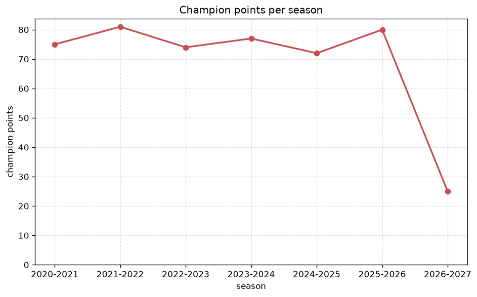
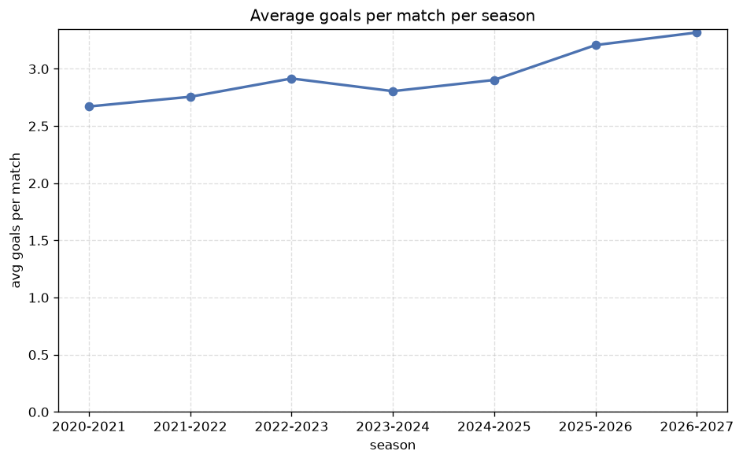

# Season Trends Analysis
- Report: `season_trends`
- Generated: 2026-10-30T03:53:18+00:00
- Script: `backend/scripts/analyze_seasons.py` v1.0.0
- League: 3. Liga (Germany)
- Scope: league `germany3`

## 1. Champions per season
| season | champion | pts | runner-up | margin |
|---|---|---|---|---|
| 2020-2021 | SG Dynamo Dresden | 75 | Hansa Rostock | 4 pts |
| 2021-2022 | Magdeburg | 81 | Braunschweig | 14 pts |
| 2022-2023 | Elversberg | 74 | Freiburg II | 1 pts |
| 2023-2024 | Ulm | 77 | Preussen Munster | 10 pts |
| 2024-2025 | Arminia Bielefeld | 72 | SG Dynamo Dresden | 2 pts |
| 2025-2026 | VfL Osnabruck | 80 | Cottbus | 8 pts |
| 2026-2027 | Duisburg | 25 | Viktoria Koln | 2 pts |

## 2. Title-race tightness
- Tight races (margin <= 3 pts): **3** of 7 seasons
- Tightest race: **2022-2023** - Elversberg beat Freiburg II by **1** pts

| season | margin | tight |
|---|---|---|
| 2020-2021 | 4 pts |  |
| 2021-2022 | 14 pts |  |
| 2022-2023 | 1 pts | yes |
| 2023-2024 | 10 pts |  |
| 2024-2025 | 2 pts | yes |
| 2025-2026 | 8 pts |  |
| 2026-2027 | 2 pts | yes |

## 3. Points thresholds
_Position-specific points per season. Key: 1 = champion, 2 = runner-up, 4 = CL line, 6 = Europa, 17 = last safe, 20 = bottom._

| season | pos 1 | pos 2 | pos 4 | pos 6 | pos 17 | pos 20 |
|---|---|---|---|---|---|---|
| 2020-2021 | 75 | 71 | 66 | 56 | 41 | 32 |
| 2021-2022 | 81 | 67 | 64 | 62 | 38 | 26 |
| 2022-2023 | 74 | 73 | 70 | 69 | 37 | 32 |
| 2023-2024 | 77 | 67 | 62 | 60 | 40 | 30 |
| 2024-2025 | 72 | 70 | 62 | 59 | 43 | 25 |
| 2025-2026 | 80 | 72 | 68 | 64 | 35 | 21 |
| 2026-2027 | 25 | 23 | 17 | 17 | 11 | 9 |

## 4. Relegation battle
| season | safe pos | safe pts | drop pos | drop pts | gap |
|---|---|---|---|---|---|
| 2020-2021 | 17 | 41 | 18 | 37 | 4 pts |
| 2021-2022 | 17 | 38 | 18 | 33 | 5 pts |
| 2022-2023 | 17 | 37 | 18 | 35 | 2 pts |
| 2023-2024 | 17 | 40 | 18 | 34 | 6 pts |
| 2024-2025 | 17 | 43 | 18 | 37 | 6 pts |
| 2025-2026 | 17 | 35 | 18 | 34 | 1 pts |
| 2026-2027 | 17 | 11 | 18 | 10 | 1 pts |

## 5. League-level trends
| season | matches | total goals | avg goals | home win | draw | away win | goalless | avg pts/team |
|---|---|---|---|---|---|---|---|---|
| 2020-2021 | 380 | 1015 | 2.671 | 37.6% | 28.4% | 33.9% | 6.6% | 51.6 |
| 2021-2022 | 373 | 1028 | 2.756 | 40.8% | 25.7% | 33.5% | 7.8% | 51.15 |
| 2022-2023 | 380 | 1108 | 2.916 | 44.7% | 23.4% | 31.8% | 4.2% | 52.55 |
| 2023-2024 | 380 | 1066 | 2.805 | 45.5% | 26.3% | 28.2% | 6.8% | 52.0 |
| 2024-2025 | 380 | 1103 | 2.903 | 45.3% | 25.3% | 29.5% | 5.0% | 52.2 |
| 2025-2026 | 380 | 1219 | 3.208 | 46.1% | 23.4% | 30.5% | 6.1% | 52.55 |
| 2026-2027 | 110 | 366 | 3.327 | 42.7% | 22.7% | 34.5% | 3.6% | 15.25 |

## 6. View divergence
- Largest divergence: **2023-2024** (goals view, avg abs position diff = 7.500)

_Avg absolute position difference between classic view and alternative view per season._

| season | classic vs luck | classic vs goals |
|---|---|---|
| 2020-2021 | 2.400 | 6.900 |
| 2021-2022 | 2.700 | 6.000 |
| 2022-2023 | 2.300 | 5.200 |
| 2023-2024 | 3.300 | 7.500 |
| 2024-2025 | 2.700 | 7.500 |
| 2025-2026 | 2.100 | 7.200 |
| 2026-2027 | 3.200 | 5.900 |

---
*All statistics are computed from PostgreSQL tables (read-only). Run with `python backend/scripts/analyze_seasons.py` to regenerate.*

## Charts

