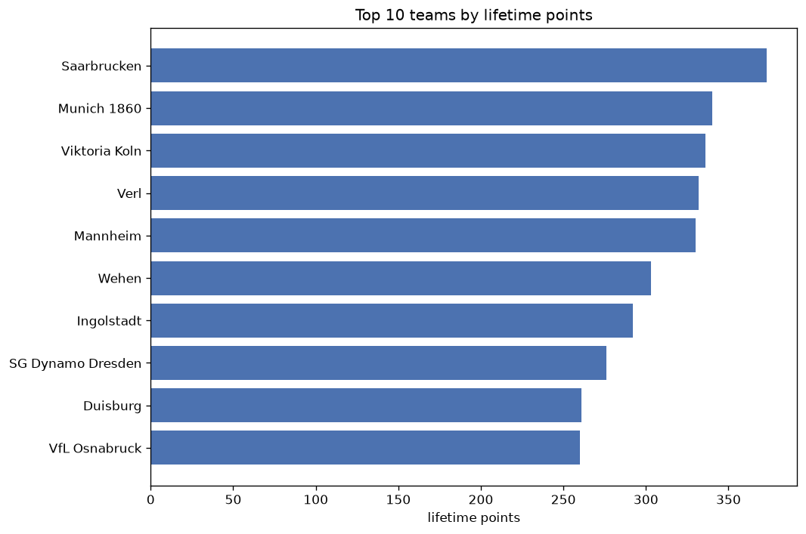
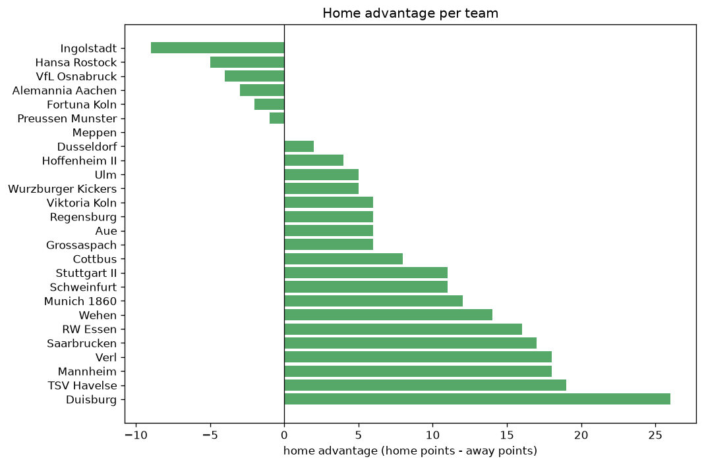

# Team Analysis
- Report: `teams_analysis`
- Generated: 2026-10-30T03:53:16+00:00
- Script: `backend/scripts/analyze_teams.py` v1.0.0
- League: 3. Liga (Germany)
- Scope: league `germany3`

- Teams: **46** | Seasons: **7** | Matches: **2383**

## 1. Team standings (lifetime)
| team | seasons | played | W | D | L | pts | GF | GA | GD | avg pts/season | best pos | worst pos | titles |
|---|---|---|---|---|---|---|---|---|---|---|---|---|---|
| Saarbrucken | 7 | 239 | 100 | 73 | 66 | 373 | 384 | 303 | 81 | 53.29 | 3 | 15 | 0 |
| Munich 1860 | 6 | 228 | 94 | 58 | 76 | 340 | 350 | 296 | 54 | 56.67 | 4 | 15 | 0 |
| Viktoria Koln | 7 | 238 | 93 | 57 | 88 | 336 | 350 | 346 | 4 | 48.0 | 2 | 13 | 0 |
| Mannheim | 7 | 239 | 91 | 60 | 88 | 333 | 347 | 354 | -7 | 47.57 | 4 | 16 | 0 |
| Verl | 7 | 239 | 87 | 71 | 81 | 332 | 403 | 362 | 41 | 47.43 | 6 | 16 | 0 |
| Wehen | 6 | 201 | 85 | 48 | 68 | 303 | 310 | 277 | 33 | 50.5 | 4 | 10 | 0 |
| Ingolstadt | 6 | 201 | 80 | 52 | 69 | 292 | 327 | 282 | 45 | 48.67 | 3 | 12 | 0 |
| SG Dynamo Dresden | 4 | 152 | 82 | 30 | 40 | 276 | 255 | 153 | 102 | 69.0 | 1 | 6 | 1 |
| Duisburg | 6 | 201 | 71 | 48 | 82 | 261 | 289 | 325 | -36 | 43.5 | 1 | 18 | 1 |
| VfL Osnabruck | 4 | 152 | 75 | 35 | 42 | 260 | 242 | 187 | 55 | 65.0 | 1 | 14 | 1 |
| RW Essen | 5 | 163 | 68 | 44 | 51 | 248 | 255 | 242 | 13 | 49.6 | 3 | 15 | 0 |
| Hansa Rostock | 4 | 125 | 60 | 34 | 31 | 214 | 198 | 148 | 50 | 53.5 | 2 | 9 | 0 |
| Dortmund II | 4 | 152 | 52 | 35 | 65 | 191 | 210 | 213 | -3 | 47.75 | 11 | 17 | 0 |
| Aue | 4 | 152 | 50 | 39 | 63 | 189 | 203 | 244 | -41 | 47.25 | 6 | 18 | 0 |
| Hallescher | 4 | 152 | 46 | 42 | 64 | 180 | 199 | 236 | -37 | 45.0 | 9 | 17 | 0 |
| Freiburg II | 3 | 114 | 42 | 27 | 45 | 153 | 129 | 145 | -16 | 51.0 | 2 | 20 | 0 |
| Meppen | 4 | 124 | 38 | 28 | 58 | 142 | 144 | 203 | -59 | 35.5 | 10 | 17 | 0 |
| Cottbus | 2 | 76 | 39 | 17 | 20 | 134 | 136 | 105 | 31 | 67.0 | 2 | 4 | 0 |
| Zwickau | 3 | 113 | 33 | 35 | 45 | 134 | 136 | 163 | -27 | 44.67 | 10 | 19 | 0 |
| Magdeburg | 2 | 76 | 39 | 15 | 22 | 132 | 130 | 86 | 44 | 66.0 | 1 | 11 | 1 |
| Alemannia Aachen | 3 | 87 | 36 | 23 | 28 | 131 | 137 | 118 | 19 | 43.67 | 5 | 12 | 0 |
| Regensburg | 3 | 87 | 33 | 23 | 31 | 122 | 125 | 120 | 5 | 40.67 | 3 | 18 | 0 |
| Arminia Bielefeld | 2 | 76 | 32 | 22 | 22 | 118 | 112 | 83 | 29 | 59.0 | 1 | 14 | 1 |
| Unterhaching | 3 | 114 | 29 | 25 | 60 | 112 | 130 | 178 | -48 | 37.33 | 9 | 20 | 0 |
| Ulm | 2 | 76 | 32 | 14 | 30 | 110 | 114 | 116 | -2 | 55.0 | 1 | 19 | 1 |
| Kaiserslautern | 2 | 75 | 27 | 28 | 20 | 109 | 105 | 80 | 25 | 54.5 | 3 | 15 | 0 |
| Stuttgart II | 3 | 87 | 29 | 20 | 38 | 107 | 124 | 148 | -24 | 35.67 | 14 | 15 | 0 |
| Sandhausen | 2 | 76 | 24 | 19 | 33 | 91 | 107 | 126 | -19 | 45.5 | 8 | 19 | 0 |
| Preussen Munster | 2 | 49 | 23 | 13 | 13 | 82 | 87 | 70 | 17 | 41.0 | 2 | 11 | 0 |
| Turkgucu Munchen | 2 | 69 | 20 | 19 | 30 | 79 | 75 | 102 | -27 | 39.5 | 13 | 19 | 0 |
| Elversberg | 1 | 38 | 22 | 8 | 8 | 74 | 80 | 40 | 40 | 74.0 | 1 | 1 | 1 |
| TSV Havelse | 3 | 87 | 17 | 19 | 51 | 70 | 102 | 188 | -86 | 23.33 | 17 | 20 | 0 |
| Braunschweig | 1 | 37 | 19 | 10 | 8 | 67 | 63 | 36 | 27 | 67.0 | 2 | 2 | 0 |
| Lubeck | 2 | 76 | 14 | 25 | 37 | 67 | 78 | 134 | -56 | 33.5 | 19 | 19 | 0 |
| Hoffenheim II | 2 | 49 | 17 | 8 | 24 | 59 | 86 | 90 | -4 | 29.5 | 8 | 16 | 0 |
| Uerdingen | 1 | 38 | 11 | 11 | 16 | 44 | 38 | 50 | -12 | 44.0 | 14 | 14 | 0 |
| Wurzburger Kickers | 2 | 48 | 11 | 11 | 26 | 44 | 51 | 83 | -32 | 22.0 | 17 | 18 | 0 |
| Viktoria Berlin | 1 | 37 | 10 | 8 | 19 | 38 | 44 | 62 | -18 | 38.0 | 17 | 17 | 0 |
| Bayern II | 1 | 38 | 8 | 13 | 17 | 37 | 47 | 58 | -11 | 37.0 | 18 | 18 | 0 |
| Hannover II | 1 | 38 | 9 | 10 | 19 | 37 | 51 | 70 | -19 | 37.0 | 18 | 18 | 0 |
| VfB Oldenburg | 1 | 38 | 9 | 8 | 21 | 35 | 42 | 64 | -22 | 35.0 | 18 | 18 | 0 |
| Bayreuth | 1 | 38 | 9 | 5 | 24 | 32 | 39 | 81 | -42 | 32.0 | 20 | 20 | 0 |
| Schweinfurt | 1 | 38 | 5 | 6 | 27 | 21 | 38 | 87 | -49 | 21.0 | 20 | 20 | 0 |
| Dusseldorf | 1 | 11 | 4 | 3 | 4 | 15 | 12 | 14 | -2 | 15.0 | 12 | 12 | 0 |
| Grossaspach | 1 | 11 | 3 | 3 | 5 | 12 | 13 | 25 | -12 | 12.0 | 16 | 16 | 0 |
| Fortuna Koln | 1 | 11 | 2 | 4 | 5 | 10 | 8 | 12 | -4 | 10.0 | 19 | 19 | 0 |

## 2. Home vs away split
| team | home P | H-W | H-D | H-L | H-pts | away P | A-W | A-D | A-L | A-pts | adv |
|---|---|---|---|---|---|---|---|---|---|---|---|
| Mannheim | 120 | 60 | 27 | 33 | 207 | 119 | 31 | 33 | 55 | 126 | 81 |
| RW Essen | 82 | 43 | 22 | 17 | 151 | 81 | 25 | 22 | 34 | 97 | 54 |
| Duisburg | 100 | 43 | 27 | 30 | 156 | 101 | 28 | 21 | 52 | 105 | 51 |
| Aue | 76 | 33 | 19 | 24 | 118 | 76 | 17 | 20 | 39 | 71 | 47 |
| Hallescher | 76 | 30 | 22 | 24 | 112 | 76 | 16 | 20 | 40 | 68 | 44 |
| Freiburg II | 57 | 27 | 16 | 14 | 97 | 57 | 15 | 11 | 31 | 56 | 41 |
| Saarbrucken | 119 | 58 | 32 | 29 | 206 | 120 | 42 | 41 | 37 | 167 | 39 |
| Viktoria Koln | 119 | 54 | 25 | 40 | 187 | 119 | 39 | 32 | 48 | 149 | 38 |
| Wehen | 101 | 49 | 22 | 30 | 169 | 100 | 36 | 26 | 38 | 134 | 35 |
| Unterhaching | 57 | 20 | 13 | 24 | 73 | 57 | 9 | 12 | 36 | 39 | 34 |
| Munich 1860 | 114 | 52 | 29 | 33 | 185 | 114 | 42 | 29 | 43 | 155 | 30 |
| Ingolstadt | 101 | 45 | 26 | 30 | 161 | 100 | 35 | 26 | 39 | 131 | 30 |
| Stuttgart II | 43 | 20 | 8 | 15 | 68 | 44 | 9 | 12 | 23 | 39 | 29 |
| Verl | 119 | 47 | 39 | 33 | 180 | 120 | 40 | 32 | 48 | 152 | 28 |
| Meppen | 63 | 25 | 9 | 29 | 84 | 61 | 13 | 19 | 29 | 58 | 26 |
| SG Dynamo Dresden | 76 | 44 | 18 | 14 | 150 | 76 | 38 | 12 | 26 | 126 | 24 |
| Kaiserslautern | 37 | 17 | 15 | 5 | 66 | 38 | 10 | 13 | 15 | 43 | 23 |
| TSV Havelse | 44 | 13 | 7 | 24 | 46 | 43 | 4 | 12 | 27 | 24 | 22 |
| Sandhausen | 38 | 16 | 7 | 15 | 55 | 38 | 8 | 12 | 18 | 36 | 19 |
| Preussen Munster | 25 | 14 | 8 | 3 | 50 | 24 | 9 | 5 | 10 | 32 | 18 |
| Turkgucu Munchen | 34 | 12 | 11 | 11 | 47 | 35 | 8 | 8 | 19 | 32 | 15 |
| Cottbus | 38 | 21 | 11 | 6 | 74 | 38 | 18 | 6 | 14 | 60 | 14 |
| Lubeck | 38 | 8 | 16 | 14 | 40 | 38 | 6 | 9 | 23 | 27 | 13 |
| Viktoria Berlin | 19 | 7 | 4 | 8 | 25 | 18 | 3 | 4 | 11 | 13 | 12 |
| Alemannia Aachen | 44 | 20 | 11 | 13 | 71 | 43 | 16 | 12 | 15 | 60 | 11 |
| Schweinfurt | 19 | 4 | 4 | 11 | 16 | 19 | 1 | 2 | 16 | 5 | 11 |
| Hansa Rostock | 62 | 31 | 19 | 12 | 112 | 63 | 29 | 15 | 19 | 102 | 10 |
| Regensburg | 43 | 18 | 12 | 13 | 66 | 44 | 15 | 11 | 18 | 56 | 10 |
| Ulm | 38 | 18 | 6 | 14 | 60 | 38 | 14 | 8 | 16 | 50 | 10 |
| Bayreuth | 19 | 6 | 3 | 10 | 21 | 19 | 3 | 2 | 14 | 11 | 10 |
| Magdeburg | 38 | 20 | 10 | 8 | 70 | 38 | 19 | 5 | 14 | 62 | 8 |
| Grossaspach | 6 | 3 | 1 | 2 | 10 | 5 | 0 | 2 | 3 | 2 | 8 |
| Hoffenheim II | 24 | 9 | 6 | 9 | 33 | 25 | 8 | 2 | 15 | 26 | 7 |
| VfL Osnabruck | 76 | 39 | 16 | 21 | 133 | 76 | 36 | 19 | 21 | 127 | 6 |
| Elversberg | 19 | 12 | 4 | 3 | 40 | 19 | 10 | 4 | 5 | 34 | 6 |
| Arminia Bielefeld | 38 | 16 | 13 | 9 | 61 | 38 | 16 | 9 | 13 | 57 | 4 |
| Hannover II | 19 | 5 | 5 | 9 | 20 | 19 | 4 | 5 | 10 | 17 | 3 |
| Zwickau | 56 | 18 | 14 | 24 | 68 | 57 | 15 | 21 | 21 | 66 | 2 |
| Wurzburger Kickers | 24 | 6 | 5 | 13 | 23 | 24 | 5 | 6 | 13 | 21 | 2 |
| Dortmund II | 76 | 26 | 18 | 32 | 96 | 76 | 26 | 17 | 33 | 95 | 1 |
| Braunschweig | 19 | 9 | 6 | 4 | 33 | 18 | 10 | 4 | 4 | 34 | -1 |
| Bayern II | 19 | 5 | 3 | 11 | 18 | 19 | 3 | 10 | 6 | 19 | -1 |
| Dusseldorf | 5 | 2 | 1 | 2 | 7 | 6 | 2 | 2 | 2 | 8 | -1 |
| Fortuna Koln | 5 | 0 | 3 | 2 | 3 | 6 | 2 | 1 | 3 | 7 | -4 |
| VfB Oldenburg | 19 | 3 | 5 | 11 | 14 | 19 | 6 | 3 | 10 | 21 | -7 |
| Uerdingen | 19 | 4 | 5 | 10 | 17 | 19 | 7 | 6 | 6 | 27 | -10 |

## 3. Top performers
### Best points per game (PPG)
| rank | team | PPG |
|---|---|---|
| 1 | Elversberg | 1.95 |
| 2 | SG Dynamo Dresden | 1.82 |
| 3 | Braunschweig | 1.81 |
| 4 | Cottbus | 1.76 |
| 5 | Magdeburg | 1.74 |

### Most goals scored
| rank | team | goals |
|---|---|---|
| 1 | Verl | 403 |
| 2 | Saarbrucken | 384 |
| 3 | Munich 1860 | 350 |
| 4 | Viktoria Koln | 350 |
| 5 | Mannheim | 347 |

### Best goal difference
| rank | team | GD |
|---|---|---|
| 1 | SG Dynamo Dresden | 102 |
| 2 | Saarbrucken | 81 |
| 3 | VfL Osnabruck | 55 |
| 4 | Munich 1860 | 54 |
| 5 | Hansa Rostock | 50 |

### Best defence (goals against per match, standings)
| rank | team | GA/match |
|---|---|---|
| 1 | Braunschweig | 0.973 |
| 2 | SG Dynamo Dresden | 1.007 |
| 3 | Elversberg | 1.053 |
| 4 | Kaiserslautern | 1.067 |
| 5 | Fortuna Koln | 1.091 |

## 4. Team consistency
- Teams present in all **7** seasons: **4**

Mannheim, Saarbrucken, Verl, Viktoria Koln

## 5. Head-to-head dominance
- Distinct fixtures: **670** (showing the 15 most frequent)

| fixture | meetings | home wins | draws | away wins | home pct | draw pct | away pct |
|---|---|---|---|---|---|---|---|
| Verl vs Viktoria Koln | 13 | 7 | 5 | 1 | 53.8% | 38.5% | 7.7% |
| Verl vs Mannheim | 13 | 2 | 7 | 4 | 15.4% | 53.8% | 30.8% |
| Munich 1860 vs Mannheim | 12 | 8 | 1 | 3 | 66.7% | 8.3% | 25.0% |
| Saarbrucken vs Mannheim | 12 | 8 | 2 | 2 | 66.7% | 16.7% | 16.7% |
| Saarbrucken vs Verl | 12 | 5 | 2 | 5 | 41.7% | 16.7% | 41.7% |
| Munich 1860 vs Saarbrucken | 12 | 4 | 4 | 4 | 33.3% | 33.3% | 33.3% |
| Munich 1860 vs Verl | 12 | 4 | 3 | 5 | 33.3% | 25.0% | 41.7% |
| Munich 1860 vs Viktoria Koln | 12 | 4 | 3 | 5 | 33.3% | 25.0% | 41.7% |
| Saarbrucken vs Viktoria Koln | 12 | 4 | 1 | 7 | 33.3% | 8.3% | 58.3% |
| Mannheim vs Viktoria Koln | 12 | 3 | 3 | 6 | 25.0% | 25.0% | 50.0% |
| Ingolstadt vs Viktoria Koln | 11 | 7 | 1 | 3 | 63.6% | 9.1% | 27.3% |
| Ingolstadt vs Mannheim | 11 | 6 | 4 | 1 | 54.5% | 36.4% | 9.1% |
| Viktoria Koln vs Duisburg | 11 | 5 | 5 | 1 | 45.5% | 45.5% | 9.1% |
| Saarbrucken vs Duisburg | 11 | 4 | 3 | 4 | 36.4% | 27.3% | 36.4% |
| Ingolstadt vs Saarbrucken | 11 | 3 | 4 | 4 | 27.3% | 36.4% | 36.4% |

## 6. Position per season (classic view)
_Cells show final position; '-' when the team was absent from that season._

| team | 2020-2021 | 2021-2022 | 2022-2023 | 2023-2024 | 2024-2025 | 2025-2026 | 2026-2027 |
|---|---|---|---|---|---|---|---|
| Saarbrucken | 5 | 7 | 5 | 5 | 3 | 15 | 4 |
| Munich 1860 | 4 | 5 | 8 | 15 | 11 | 8 | - |
| Viktoria Koln | 12 | 13 | 9 | 13 | 6 | 11 | 2 |
| Mannheim | 8 | 4 | 7 | 16 | 16 | 10 | 7 |
| Verl | 7 | 16 | 10 | 12 | 7 | 6 | 15 |
| Wehen | 6 | 8 | 4 | - | 9 | 9 | 10 |
| Ingolstadt | 3 | - | 11 | 10 | 10 | 12 | 6 |
| SG Dynamo Dresden | 1 | - | 6 | 4 | 2 | - | - |
| Duisburg | 16 | 15 | 12 | 18 | - | 4 | 1 |
| VfL Osnabruck | - | 6 | 3 | - | 14 | 1 | - |
| RW Essen | - | - | 15 | 7 | 8 | 3 | 3 |
| Hansa Rostock | 2 | - | - | - | 5 | 5 | 9 |
| Dortmund II | - | 11 | 13 | 11 | 17 | - | - |
| Aue | - | - | 14 | 6 | 13 | 18 | - |
| Hallescher | 9 | 14 | 16 | 17 | - | - | - |
| Freiburg II | - | 9 | 2 | 20 | - | - | - |
| Meppen | 17 | 10 | 17 | - | - | - | 13 |
| Cottbus | - | - | - | - | 4 | 2 | - |
| Zwickau | 10 | 12 | 19 | - | - | - | - |
| Magdeburg | 11 | 1 | - | - | - | - | - |
| Alemannia Aachen | - | - | - | - | 12 | 7 | 5 |
| Regensburg | - | - | - | 3 | - | 13 | 18 |
| Arminia Bielefeld | - | - | - | 14 | 1 | - | - |
| Unterhaching | 20 | - | - | 9 | 20 | - | - |
| Ulm | - | - | - | 1 | - | 19 | - |
| Kaiserslautern | 15 | 3 | - | - | - | - | - |
| Stuttgart II | - | - | - | - | 15 | 14 | 14 |
| Sandhausen | - | - | - | 8 | 19 | - | - |
| Preussen Munster | - | - | - | 2 | - | - | 11 |
| Turkgucu Munchen | 13 | 19 | - | - | - | - | - |
| Elversberg | - | - | 1 | - | - | - | - |
| TSV Havelse | - | 20 | - | - | - | 17 | 20 |
| Braunschweig | - | 2 | - | - | - | - | - |
| Lubeck | 19 | - | - | 19 | - | - | - |
| Hoffenheim II | - | - | - | - | - | 16 | 8 |
| Uerdingen | 14 | - | - | - | - | - | - |
| Wurzburger Kickers | - | 18 | - | - | - | - | 17 |
| Viktoria Berlin | - | 17 | - | - | - | - | - |
| Bayern II | 18 | - | - | - | - | - | - |
| Hannover II | - | - | - | - | 18 | - | - |
| VfB Oldenburg | - | - | 18 | - | - | - | - |
| Bayreuth | - | - | 20 | - | - | - | - |
| Schweinfurt | - | - | - | - | - | 20 | - |
| Dusseldorf | - | - | - | - | - | - | 12 |
| Grossaspach | - | - | - | - | - | - | 16 |
| Fortuna Koln | - | - | - | - | - | - | 19 |

---
*All statistics are computed from PostgreSQL tables (read-only). Run with `python backend/scripts/analyze_teams.py` to regenerate.*

## Charts

