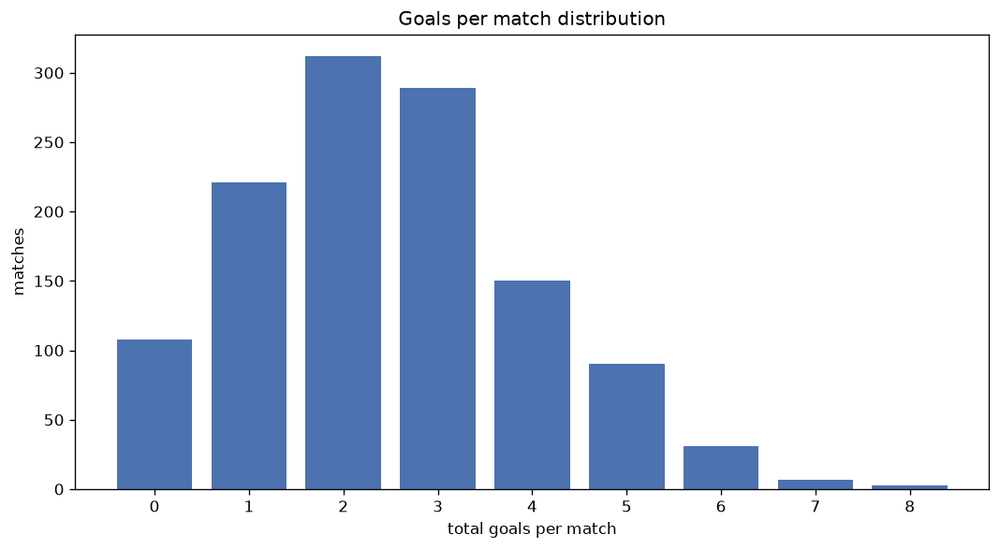
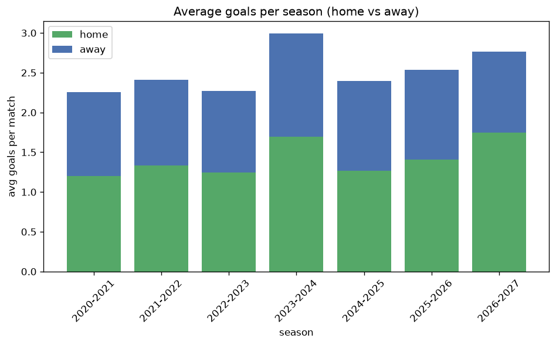

# Goal Analysis
- Report: `goals_analysis`
- Generated: 2026-10-27T01:50:17+00:00
- Script: `backend/scripts/analyze_goals.py` v1.0.0
- League: Super League (Greece)
- Scope: league `greece1`

## 1. Goals per match distribution
| goals | matches | pct |
|---|---|---|
| 0 | 108 | 8.9% |
| 1 | 221 | 18.2% |
| 2 | 312 | 25.8% |
| 3 | 289 | 23.9% |
| 4 | 150 | 12.4% |
| 5 | 90 | 7.4% |
| 6 | 31 | 2.6% |
| 7 | 7 | 0.6% |
| 8 | 3 | 0.2% |

## 2. Goals per match per season
| season | matches | total goals | avg home | avg away | avg total |
|---|---|---|---|---|---|
| 2020-2021 | 182 | 411 | 1.203 | 1.055 | 2.258 |
| 2021-2022 | 182 | 439 | 1.335 | 1.077 | 2.412 |
| 2022-2023 | 182 | 414 | 1.247 | 1.027 | 2.275 |
| 2023-2024 | 182 | 545 | 1.698 | 1.297 | 2.995 |
| 2024-2025 | 182 | 436 | 1.264 | 1.132 | 2.396 |
| 2025-2026 | 246 | 624 | 1.407 | 1.13 | 2.537 |
| 2026-2027 | 55 | 152 | 1.745 | 1.018 | 2.764 |

## 3. Home vs away goal share
- Home goals: **1670** (55.3%)
- Away goals: **1351** (44.7%)
- Home/away ratio: **1.236**

| season | home goals | away goals | total | home pct | away pct |
|---|---|---|---|---|---|
| 2020-2021 | 219 | 192 | 411 | 53.3% | 46.7% |
| 2021-2022 | 243 | 196 | 439 | 55.4% | 44.6% |
| 2022-2023 | 227 | 187 | 414 | 54.8% | 45.2% |
| 2023-2024 | 309 | 236 | 545 | 56.7% | 43.3% |
| 2024-2025 | 230 | 206 | 436 | 52.8% | 47.2% |
| 2025-2026 | 346 | 278 | 624 | 55.4% | 44.6% |
| 2026-2027 | 96 | 56 | 152 | 63.2% | 36.8% |

## 4. BTTS (Both Teams To Score)
- Overall: **552** of `1211` (45.6%)

| season | matches | BTTS | pct |
|---|---|---|---|
| 2020-2021 | 182 | 76 | 41.8% |
| 2021-2022 | 182 | 79 | 43.4% |
| 2022-2023 | 182 | 70 | 38.5% |
| 2023-2024 | 182 | 96 | 52.7% |
| 2024-2025 | 182 | 87 | 47.8% |
| 2025-2026 | 246 | 117 | 47.6% |
| 2026-2027 | 55 | 27 | 49.1% |

## 5. Clean sheets
- Home clean sheets: **432** (35.7%)
- Away clean sheets: **335** (27.7%)
- Total clean sheets recorded: **767**
- Matches with at least one clean sheet: **659** (54.4%)
- Both teams kept clean sheets (0-0): **108**

| season | matches | home CS | away CS | total CS | matches w/ CS |
|---|---|---|---|---|---|
| 2020-2021 | 182 | 67 | 56 | 123 | 106 (58.2%) |
| 2021-2022 | 182 | 71 | 53 | 124 | 103 (56.6%) |
| 2022-2023 | 182 | 75 | 59 | 134 | 112 (61.5%) |
| 2023-2024 | 182 | 60 | 34 | 94 | 86 (47.3%) |
| 2024-2025 | 182 | 57 | 52 | 109 | 95 (52.2%) |
| 2025-2026 | 246 | 83 | 68 | 151 | 129 (52.4%) |
| 2026-2027 | 55 | 19 | 13 | 32 | 28 (50.9%) |

## 6. Scoring intensity
- First-half goals: **1349** (44.7%)
- Second-half goals: **1666** (55.3%)
- Avg first-half goals per match: **1.116**
- Avg second-half goals per match: **1.378**
- Second-half-only scoring (HT 0-0, FT goals >= 1): **260** (21.5%)
- *2 match(es) excluded (no HT score recorded).*

| season | matches | 1st half | 2nd half | 1st half pct | 2nd half pct |
|---|---|---|---|---|---|
| 2020-2021 | 182 | 168 | 243 | 40.9% | 59.1% |
| 2021-2022 | 182 | 205 | 234 | 46.7% | 53.3% |
| 2022-2023 | 182 | 184 | 230 | 44.4% | 55.6% |
| 2023-2024 | 182 | 249 | 290 | 46.2% | 53.8% |
| 2024-2025 | 182 | 187 | 249 | 42.9% | 57.1% |
| 2025-2026 | 246 | 290 | 334 | 46.5% | 53.5% |
| 2026-2027 | 55 | 66 | 86 | 43.4% | 56.6% |

## 7. First-goal timing
- Matches with first-goal time recorded: `1101` of `1211` (90.9%)
- Goalless matches: `110`
- Min `1` | Max `101` | Mean `31.74` | Median (p50) `27`

| bucket | count | % of matches | % of scoring matches |
|---|---|---|---|
| 1-15 | 329 | 27.2% | 29.9% |
| 16-30 | 266 | 22.0% | 24.2% |
| 31-45 | 216 | 17.8% | 19.6% |
| 46-60 | 151 | 12.5% | 13.7% |
| 61-75 | 75 | 6.2% | 6.8% |
| 76-90 | 47 | 3.9% | 4.3% |
| 91-120 | 17 | 1.4% | 1.5% |

---
*All statistics are computed from PostgreSQL tables (read-only). Run with `python backend/scripts/analyze_goals.py` to regenerate.*

## Charts

