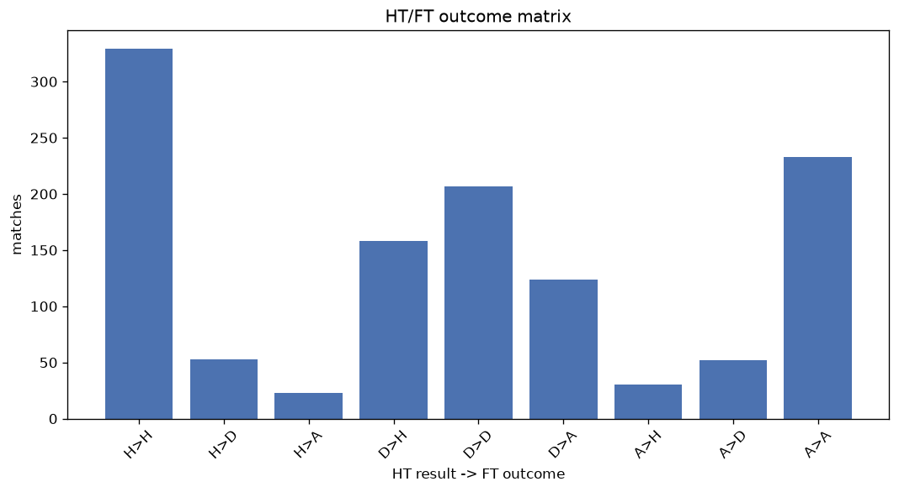
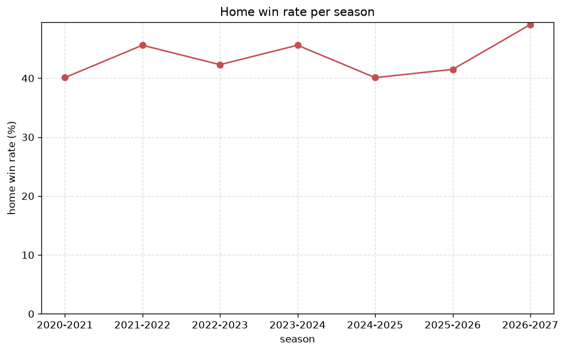

# Match Analysis
- Report: `matches_analysis`
- Generated: 2026-10-27T01:50:14+00:00
- Script: `backend/scripts/analyze_matches.py` v1.0.0
- League: Super League (Greece)
- Scope: league `greece1`

## 1. Overall summary
| metric | value |
|---|---|
| Matches | 1211 |
| Home wins | 518 (42.8%) |
| Draws | 312 (25.8%) |
| Away wins | 381 (31.5%) |
| Total goals | 3021 |
| Average goals per match | 2.495 |
| Goalless matches | 108 (8.9%) |

## 2. Per-season breakdown
| season | matches | home wins | draws | away wins | total goals | avg goals | goalless |
|---|---|---|---|---|---|---|---|
| 2020-2021 | 182 | 73 (40.1%) | 48 (26.4%) | 61 (33.5%) | 411 | 2.258 | 17 (9.3%) |
| 2021-2022 | 182 | 83 (45.6%) | 41 (22.5%) | 58 (31.9%) | 439 | 2.412 | 21 (11.5%) |
| 2022-2023 | 182 | 77 (42.3%) | 53 (29.1%) | 52 (28.6%) | 414 | 2.275 | 22 (12.1%) |
| 2023-2024 | 182 | 83 (45.6%) | 49 (26.9%) | 50 (27.5%) | 545 | 2.995 | 8 (4.4%) |
| 2024-2025 | 182 | 73 (40.1%) | 42 (23.1%) | 67 (36.8%) | 436 | 2.396 | 14 (7.7%) |
| 2025-2026 | 246 | 102 (41.5%) | 68 (27.6%) | 76 (30.9%) | 624 | 2.537 | 22 (8.9%) |
| 2026-2027 | 55 | 27 (49.1%) | 11 (20.0%) | 17 (30.9%) | 152 | 2.764 | 4 (7.3%) |

## 3. HT/FT outcome matrix
| HT result \ FT result | Home | Draw | Away | total |
|---|---|---|---|---|
| HT home lead | 329 (81.2%) | 53 (13.1%) | 23 (5.7%) | 405 |
| HT draw | 158 (32.3%) | 207 (42.3%) | 124 (25.4%) | 489 |
| HT away lead | 30 (9.5%) | 52 (16.5%) | 233 (74.0%) | 315 |
- *2 match(es) excluded (no HT score recorded).*

## 4. Comeback matches
- Home comebacks (trailing at HT, won at FT): **30** (2.5%)
- Away comebacks (trailing at HT, won at FT): **23** (1.9%)

### Home comebacks
| season | home | away | HT | FT |
|---|---|---|---|---|
| 2020-2021 | Aris | Lamia | 0-1 | 3-1 |
| 2020-2021 | Volos | Giannina | 0-1 | 2-1 |
| 2020-2021 | PAOK | Giannina | 0-1 | 2-1 |
| 2020-2021 | Atromitos | PAOK | 0-1 | 3-2 |
| 2020-2021 | Asteras Tripolis | Aris | 0-1 | 2-1 |
| 2021-2022 | Giannina | Volos | 1-2 | 3-2 |
| 2021-2022 | Lamia | OFI Crete | 0-1 | 2-1 |
| 2021-2022 | OFI Crete | Panathinaikos | 1-2 | 3-2 |
| 2021-2022 | PAOK | Panathinaikos | 0-1 | 2-1 |
| 2021-2022 | Atromitos | Lamia | 0-1 | 3-1 |
| 2021-2022 | Aris | Olympiacos Piraeus | 0-1 | 2-1 |
| 2022-2023 | Aris | Olympiacos Piraeus | 0-1 | 2-1 |
| 2022-2023 | Aris | Ionikos | 0-1 | 2-1 |
| 2022-2023 | OFI Crete | Levadiakos | 0-1 | 2-1 |
| 2023-2024 | Atromitos | Panetolikos | 0-1 | 3-2 |
| 2023-2024 | Asteras Tripolis | Aris | 1-2 | 3-2 |
| 2023-2024 | Lamia | Asteras Tripolis | 0-1 | 2-1 |
| 2023-2024 | Olympiacos Piraeus | Asteras Tripolis | 0-1 | 2-1 |
| 2023-2024 | AEK Athens FC | Giannina | 1-2 | 4-2 |
| 2024-2025 | Atromitos | Levadiakos | 0-1 | 2-1 |
| 2024-2025 | Asteras Tripolis | Aris | 0-1 | 2-1 |
| 2024-2025 | Olympiacos Piraeus | Aris | 0-1 | 2-1 |
| 2024-2025 | Panathinaikos | OFI Crete | 0-2 | 3-2 |
| 2025-2026 | PAOK | Olympiacos Piraeus | 0-1 | 2-1 |
| 2025-2026 | AEK Athens | OFI Crete | 0-1 | 2-1 |
| 2025-2026 | Panserraikos | Kifisia | 0-1 | 2-1 |
| 2025-2026 | Volos | PAOK | 0-1 | 2-1 |
| 2025-2026 | Aris | Volos | 1-2 | 3-2 |
| 2025-2026 | Levadiakos | OFI Crete | 0-2 | 3-2 |
| 2026-2027 | Kalamata | Volos | 0-1 | 3-1 |

### Away comebacks
| season | home | away | HT | FT |
|---|---|---|---|---|
| 2020-2021 | Panetolikos | Giannina | 1-0 | 1-2 |
| 2021-2022 | Atromitos | Panetolikos | 1-0 | 1-2 |
| 2021-2022 | Lamia | Panathinaikos | 1-0 | 1-3 |
| 2021-2022 | AEK Athens FC | Panetolikos | 1-0 | 1-2 |
| 2021-2022 | Asteras Tripolis | Ionikos | 1-0 | 2-3 |
| 2022-2023 | Ionikos | Atromitos | 1-0 | 1-4 |
| 2022-2023 | PAOK | Panathinaikos | 1-0 | 1-2 |
| 2022-2023 | OFI Crete | Olympiacos Piraeus | 1-0 | 1-2 |
| 2022-2023 | Ionikos | AEK Athens FC | 1-0 | 1-2 |
| 2023-2024 | Panetolikos | PAOK | 1-0 | 1-3 |
| 2023-2024 | Panetolikos | Olympiacos Piraeus | 1-0 | 1-2 |
| 2024-2025 | OFI Crete | Panetolikos | 1-0 | 1-2 |
| 2024-2025 | Atromitos | Volos | 1-0 | 1-2 |
| 2024-2025 | PAOK | OFI Crete | 1-0 | 1-2 |
| 2024-2025 | Lamia | PAOK | 1-0 | 1-2 |
| 2024-2025 | Athens Kallithea | Levadiakos | 1-0 | 2-4 |
| 2024-2025 | Levadiakos | Asteras Tripolis | 1-0 | 1-2 |
| 2024-2025 | Volos | Levadiakos | 1-0 | 1-2 |
| 2025-2026 | Panetolikos | Panathinaikos | 1-0 | 1-2 |
| 2025-2026 | Kifisia | AEK Athens | 2-1 | 2-3 |
| 2025-2026 | Kifisia | AEK Athens FC | 2-1 | 2-3 |
| 2025-2026 | Panserraikos | Kifisia | 1-0 | 1-2 |
| 2025-2026 | Atromitos | Panetolikos | 1-0 | 1-2 |

## 5. HT lead conversion
| HT state | matches | converted to win | held as draw | collapsed to loss |
|---|---|---|---|---|
| Home lead | 405 | 329 (81.2%) | 53 (13.1%) | 23 (5.7%) |
| Away lead | 315 | 233 (74.0%) | 52 (16.5%) | 30 (9.5%) |

### Matches level at half-time
| FT result | count | pct |
|---|---|---|
| Home win | 158 | 32.3% |
| Draw | 207 | 42.3% |
| Away win | 124 | 25.4% |
- *2 match(es) excluded (no HT score recorded).*

## 6. First-goal timing
- Matches with a first-goal time recorded: `1101` of `1211` (90.9%)

Outcome distribution by first-goal timing bucket:
| bucket | matches | % of matches | home | draw | away |
|---|---|---|---|---|---|
| 1-15 | 329 | 27.2% | 164 (49.8%) | 54 (16.4%) | 111 (33.7%) |
| 16-30 | 266 | 22.0% | 132 (49.6%) | 54 (20.3%) | 80 (30.1%) |
| 31-45 | 216 | 17.8% | 89 (41.2%) | 36 (16.7%) | 91 (42.1%) |
| 46-60 | 151 | 12.5% | 70 (46.4%) | 41 (27.2%) | 40 (26.5%) |
| 61-75 | 75 | 6.2% | 33 (44.0%) | 13 (17.3%) | 29 (38.7%) |
| 76-90 | 47 | 3.9% | 18 (38.3%) | 6 (12.8%) | 23 (48.9%) |
| 91-120 | 17 | 1.4% | 11 (64.7%) | 0 (0.0%) | 6 (35.3%) |

## 7. Goalless matches
- Overall: **108** of `1211` (8.9%)

| season | matches | goalless | pct |
|---|---|---|---|
| 2020-2021 | 182 | 17 | 9.3% |
| 2021-2022 | 182 | 21 | 11.5% |
| 2022-2023 | 182 | 22 | 12.1% |
| 2023-2024 | 182 | 8 | 4.4% |
| 2024-2025 | 182 | 14 | 7.7% |
| 2025-2026 | 246 | 22 | 8.9% |
| 2026-2027 | 55 | 4 | 7.3% |

---
*All statistics are computed from PostgreSQL tables (read-only). Run with `python backend/scripts/analyze_matches.py` to regenerate.*

## Charts

