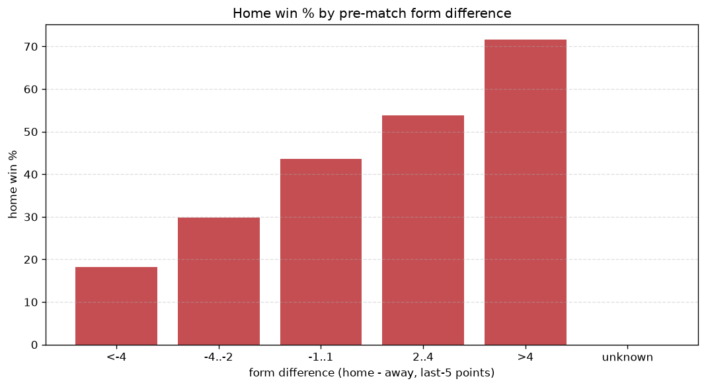
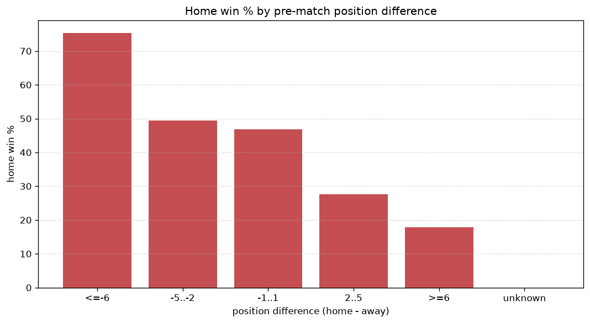

# Relationships Analysis
- Report: `relationships`
- Generated: 2026-10-26T01:34:32+00:00
- Script: `backend/scripts/analyze_relationships.py` v1.0.0
- League: Super League (Greece)
- Scope: league `greece1`

- Matches analysed: **1156** (23 leakage-safe pre-match features).

## 1. Correlation matrix
_Pearson correlation of each pre-match feature with observed goals; sorted by |corr(total goals)|._

| feature | corr(home) | corr(away) | corr(total) |
|---|---|---|---|
| home_team_goals_scored_last_5 | 0.230 | -0.086 | 0.121 |
| home_team_home_goals_avg | 0.199 | -0.090 | 0.093 |
| home_team_wins_last_5 | 0.201 | -0.123 | 0.070 |
| home_team_points_last_5 | 0.187 | -0.108 | 0.070 |
| away_team_goals_scored_last_5 | -0.130 | 0.228 | 0.064 |
| home_team_home_win_rate | 0.218 | -0.172 | 0.048 |
| home_position_before_match | -0.261 | 0.228 | -0.042 |
| away_team_away_conceded_avg | 0.147 | -0.104 | 0.041 |
| points_difference | 0.355 | -0.333 | 0.039 |
| away_team_goals_conceded_last_5 | 0.169 | -0.133 | 0.038 |
| away_team_wins_last_5 | -0.177 | 0.243 | 0.037 |
| home_team_home_conceded_avg | -0.199 | 0.169 | -0.035 |
| home_points_before_match | 0.165 | -0.133 | 0.034 |
| away_rest_days | 0.024 | 0.020 | 0.034 |
| away_team_points_last_5 | -0.179 | 0.239 | 0.032 |
| home_rest_days | 0.029 | 0.012 | 0.032 |
| away_team_away_goals_avg | -0.129 | 0.182 | 0.030 |
| away_team_away_win_rate | -0.153 | 0.202 | 0.026 |
| position_difference | -0.346 | 0.348 | -0.022 |
| away_position_before_match | 0.214 | -0.249 | -0.012 |
| rest_days_difference | 0.015 | -0.015 | 0.001 |
| away_points_before_match | -0.138 | 0.151 | 0.001 |
| home_team_goals_conceded_last_5 | -0.129 | 0.140 | -0.000 |

## 2. Form vs outcome
_Home win/draw/away % per bucket of `home_team_points_last_5 - away_team_points_last_5`._

| bucket | matches | home | draw | away | home % | draw % | away % |
|---|---|---|---|---|---|---|---|
| <-4 | 209 | 38 | 64 | 107 | 18.2% | 30.6% | 51.2% |
| -4..-2 | 225 | 67 | 67 | 91 | 29.8% | 29.8% | 40.4% |
| -1..1 | 319 | 139 | 83 | 97 | 43.6% | 26.0% | 30.4% |
| 2..4 | 234 | 126 | 54 | 54 | 53.8% | 23.1% | 23.1% |
| >4 | 169 | 121 | 33 | 15 | 71.6% | 19.5% | 8.9% |
| unknown | 0 | 0 | 0 | 0 | - | - | - |

## 3. Position vs outcome
_Home win/draw/away % per bucket of `position_difference` (home position - away position; negative favours the home team)._

| bucket | matches | home | draw | away | home % | draw % | away % |
|---|---|---|---|---|---|---|---|
| <=-6 | 198 | 149 | 34 | 15 | 75.3% | 17.2% | 7.6% |
| -5..-2 | 259 | 128 | 65 | 66 | 49.4% | 25.1% | 25.5% |
| -1..1 | 213 | 100 | 63 | 50 | 46.9% | 29.6% | 23.5% |
| 2..5 | 274 | 76 | 80 | 118 | 27.7% | 29.2% | 43.1% |
| >=6 | 212 | 38 | 59 | 115 | 17.9% | 27.8% | 54.2% |
| unknown | 0 | 0 | 0 | 0 | - | - | - |

## 4. Rest advantage
_Home win/draw/away % per bucket of `rest_days_difference` (home rest - away rest). Matches with unknown rest are bucketed separately._

| bucket | matches | home | draw | away | home % | draw % | away % |
|---|---|---|---|---|---|---|---|
| <-1 | 65 | 22 | 25 | 18 | 33.8% | 38.5% | 27.7% |
| -1..0 | 251 | 104 | 59 | 88 | 41.4% | 23.5% | 35.1% |
| 0 | 452 | 191 | 107 | 154 | 42.3% | 23.7% | 34.1% |
| 1..2 | 299 | 125 | 90 | 84 | 41.8% | 30.1% | 28.1% |
| >2 | 41 | 22 | 8 | 11 | 53.7% | 19.5% | 26.8% |
| unknown | 48 | 27 | 12 | 9 | 56.2% | 25.0% | 18.8% |
- *48 match(es) had unknown rest difference (missing rest data on at least one side).*

## 5. Home team quality
_Home win rate by `home_team_home_win_rate` tier (split at 0.5)._

- `< 0.5` tier: **33.2%** home win (240/723)
- `>= 0.5` tier: **58.0%** home win (251/433)
- Home-win gap (>= split minus < split): **+24.8 pp**

| tier | label | matches | home | draw | away | home % |
|---|---|---|---|---|---|---|
| low | < 0.5 | 723 | 240 | 206 | 277 | 33.2% |
| high | >= 0.5 | 433 | 251 | 95 | 87 | 58.0% |

## 6. Feature averages by result
_Mean feature value per outcome; `range` is home-minus-away spread of the group means._

| feature | home mean | draw mean | away mean | range |
|---|---|---|---|---|
| points_difference | 4.621 | -1.628 | -6.379 | 11.000 |
| home_points_before_match | 20.711 | 16.701 | 14.772 | 5.939 |
| position_difference | -2.312 | 0.824 | 2.973 | 5.284 |
| away_points_before_match | 16.090 | 18.329 | 21.151 | 5.061 |
| home_position_before_match | 6.432 | 8.478 | 9.179 | 2.747 |
| away_position_before_match | 8.743 | 7.654 | 6.206 | 2.537 |
| away_team_points_last_5 | 5.251 | 6.243 | 7.429 | 2.178 |
| away_team_goals_scored_last_5 | 4.914 | 5.555 | 6.505 | 1.591 |
| home_team_points_last_5 | 6.880 | 5.332 | 5.294 | 1.586 |
| away_team_goals_conceded_last_5 | 6.069 | 5.379 | 4.615 | 1.454 |
| home_team_goals_scored_last_5 | 6.200 | 4.897 | 4.799 | 1.400 |
| home_team_goals_conceded_last_5 | 4.971 | 5.767 | 6.236 | 1.265 |
| away_team_wins_last_5 | 1.340 | 1.721 | 2.091 | 0.751 |
| home_team_wins_last_5 | 1.939 | 1.392 | 1.341 | 0.598 |
| away_rest_days | 7.561 | 7.945 | 7.772 | 0.384 |
| home_team_home_conceded_avg | 0.870 | 1.089 | 1.232 | 0.363 |
| away_team_away_goals_avg | 0.927 | 1.017 | 1.209 | 0.282 |
| away_team_away_conceded_avg | 1.375 | 1.262 | 1.099 | 0.276 |
| home_team_home_goals_avg | 1.391 | 1.182 | 1.133 | 0.258 |
| home_rest_days | 7.720 | 7.941 | 7.779 | 0.221 |
| rest_days_difference | 0.153 | -0.024 | 0.014 | 0.177 |
| home_team_home_win_rate | 0.454 | 0.350 | 0.288 | 0.166 |
| away_team_away_win_rate | 0.237 | 0.294 | 0.371 | 0.134 |

---
*All features are leakage-safe pre-match values built by `ml.features.build_features.build_rows` from strictly prior matches. Run with `python backend/scripts/analyze_relationships.py` to regenerate.*

## Charts

