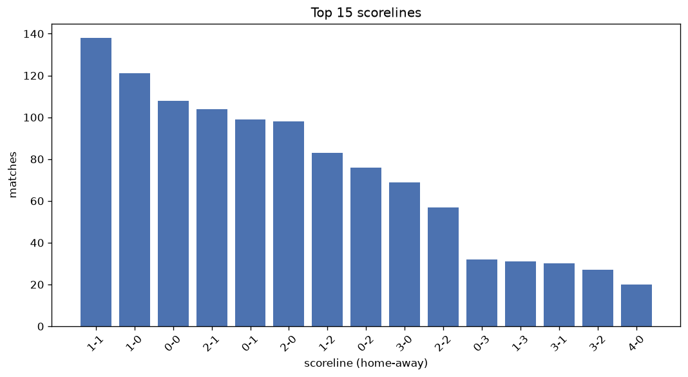
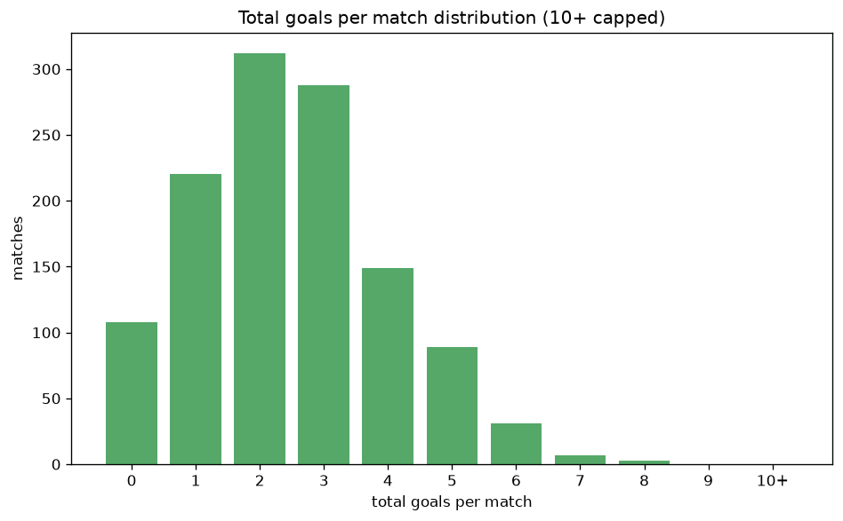

# Scoreline Analysis
- Report: `scoreline_analysis`
- Generated: 2026-10-26T01:34:29+00:00
- Script: `backend/scripts/analyze_scorelines.py` v1.0.0
- League: Super League (Greece)
- Scope: league `greece1`

## 1. Scoreline frequency
- Matches analysed: **1207** across **7** seasons.
- Distinct scorelines seen: **36**.

| scoreline | count | pct |
|---|---|---|
| 1-1 | 138 | 11.4% |
| 1-0 | 121 | 10.0% |
| 0-0 | 108 | 8.9% |
| 2-1 | 104 | 8.6% |
| 0-1 | 99 | 8.2% |
| 2-0 | 98 | 8.1% |
| 1-2 | 83 | 6.9% |
| 0-2 | 76 | 6.3% |
| 3-0 | 69 | 5.7% |
| 2-2 | 57 | 4.7% |
| 0-3 | 32 | 2.7% |
| 1-3 | 31 | 2.6% |
| 3-1 | 30 | 2.5% |
| 3-2 | 27 | 2.2% |
| 4-0 | 20 | 1.7% |
| 2-3 | 18 | 1.5% |
| 4-1 | 15 | 1.2% |
| 1-4 | 13 | 1.1% |
| 0-4 | 11 | 0.9% |
| 5-0 | 10 | 0.8% |

## 2. Scoreline frequency per season

### 2020-2021
| scoreline | count | pct |
|---|---|---|
| 1-0 | 24 | 13.2% |
| 0-1 | 22 | 12.1% |
| 1-1 | 18 | 9.9% |
| 0-0 | 17 | 9.3% |
| 2-1 | 17 | 9.3% |

### 2021-2022
| scoreline | count | pct |
|---|---|---|
| 1-0 | 23 | 12.6% |
| 0-0 | 21 | 11.5% |
| 2-1 | 18 | 9.9% |
| 2-0 | 17 | 9.3% |
| 1-2 | 15 | 8.2% |

### 2022-2023
| scoreline | count | pct |
|---|---|---|
| 1-1 | 24 | 13.2% |
| 0-0 | 22 | 12.1% |
| 1-0 | 20 | 11.0% |
| 2-0 | 19 | 10.4% |
| 2-1 | 16 | 8.8% |

### 2023-2024
| scoreline | count | pct |
|---|---|---|
| 1-1 | 22 | 12.1% |
| 3-0 | 16 | 8.8% |
| 2-2 | 15 | 8.2% |
| 2-1 | 14 | 7.7% |
| 2-0 | 13 | 7.1% |

### 2024-2025
| scoreline | count | pct |
|---|---|---|
| 0-1 | 23 | 12.6% |
| 1-1 | 21 | 11.5% |
| 2-1 | 19 | 10.4% |
| 1-2 | 19 | 10.4% |
| 1-0 | 18 | 9.9% |

### 2025-2026
| scoreline | count | pct |
|---|---|---|
| 1-1 | 35 | 14.2% |
| 1-0 | 22 | 8.9% |
| 0-0 | 22 | 8.9% |
| 0-1 | 20 | 8.1% |
| 3-0 | 18 | 7.3% |

### 2026-2027
| scoreline | count | pct |
|---|---|---|
| 2-0 | 6 | 11.8% |
| 1-1 | 6 | 11.8% |
| 3-1 | 4 | 7.8% |
| 1-2 | 4 | 7.8% |
| 0-1 | 4 | 7.8% |

## 3. Total-goal histogram
_10+ groups all matches with 10 or more total goals._

| total goals | matches | pct |
|---|---|---|
| 0 | 108 | 8.9% |
| 1 | 220 | 18.2% |
| 2 | 312 | 25.8% |
| 3 | 288 | 23.9% |
| 4 | 149 | 12.3% |
| 5 | 89 | 7.4% |
| 6 | 31 | 2.6% |
| 7 | 7 | 0.6% |
| 8 | 3 | 0.2% |
| 9 | 0 | 0.0% |
| 10+ | 0 | 0.0% |

## 4. Extreme scorelines
- Matches with 7+ total goals: **10**

| season | date | scoreline | total goals |
|---|---|---|---|
| 2021-2022 | 2021-10-17 | 4-4 | 8 |
| 2021-2022 | 2021-11-27 | 6-2 | 8 |
| 2023-2024 | 2023-09-17 | 4-4 | 8 |
| 2020-2021 | 2020-12-13 | 3-4 | 7 |
| 2022-2023 | 2023-02-13 | 6-1 | 7 |
| 2024-2025 | 2025-02-16 | 7-0 | 7 |
| 2025-2026 | 2025-10-04 | 2-5 | 7 |
| 2025-2026 | 2025-11-09 | 5-2 | 7 |
| 2025-2026 | 2026-05-03 | 5-2 | 7 |
| 2026-2027 | 2026-10-18 | 4-3 | 7 |

## 5. Margin-of-victory distribution (decided matches)
- Decided matches: **895** (draws: **312**)
- Average winning margin: **1.82**

| margin | matches | pct |
|---|---|---|
| 1 | 454 | 50.7% |
| 2 | 246 | 27.5% |
| 3+ | 195 | 21.8% |

## 6. Margin by outcome

### Home wins
- Matches: **515** | avg margin: **1.88** | max margin: **7**
| margin | matches | pct |
|---|---|---|
| 1 | 253 | 49.1% |
| 2 | 134 | 26.0% |
| 3+ | 128 | 24.9% |
- *Full match-by-match list available in `scoreline_analysis.json`.*

### Away wins
- Matches: **380** | avg margin: **1.73** | max margin: **6**
| margin | matches | pct |
|---|---|---|
| 1 | 201 | 52.9% |
| 2 | 112 | 29.5% |
| 3+ | 67 | 17.6% |
- *Full match-by-match list available in `scoreline_analysis.json`.*

## 7. Most common exact score by outcome type
| outcome | matches | most common score | count | pct |
|---|---|---|---|---|
| home | 515 | 1-0 | 121 | 23.5% |
| draw | 312 | 1-1 | 138 | 44.2% |
| away | 380 | 0-1 | 99 | 26.1% |

---
*All statistics are computed from PostgreSQL tables (read-only). Run with `python backend/scripts/analyze_scorelines.py` to regenerate.*

## Charts

