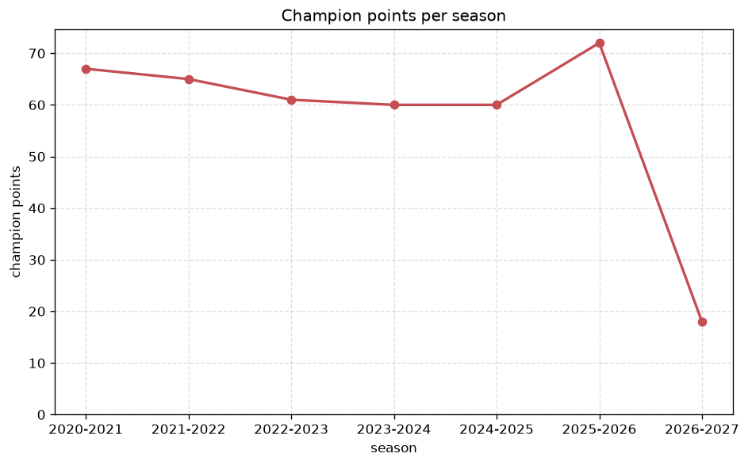
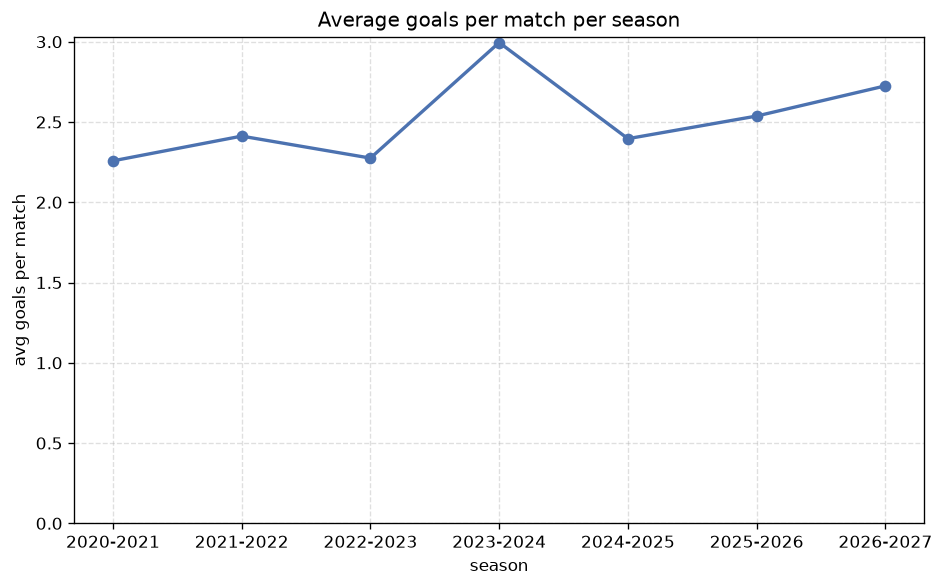

# Season Trends Analysis
- Report: `season_trends`
- Generated: 2026-10-29T02:01:47+00:00
- Script: `backend/scripts/analyze_seasons.py` v1.0.0
- League: Super League (Greece)
- Scope: league `greece1`

## 1. Champions per season
| season | champion | pts | runner-up | margin |
|---|---|---|---|---|
| 2020-2021 | Olympiacos Piraeus | 67 | Aris | 16 pts |
| 2021-2022 | Olympiacos Piraeus | 65 | PAOK | 12 pts |
| 2022-2023 | Panathinaikos | 61 | AEK Athens FC | 2 pts |
| 2023-2024 | PAOK | 60 | AEK Athens FC | 1 pts |
| 2024-2025 | Olympiacos Piraeus | 60 | AEK Athens FC | 7 pts |
| 2025-2026 | AEK Athens | 72 | Olympiacos Piraeus | 3 pts |
| 2026-2027 | Panathinaikos | 21 | Olympiacos Piraeus | 2 pts |

## 2. Title-race tightness
- Tight races (margin <= 3 pts): **4** of 7 seasons
- Tightest race: **2023-2024** - PAOK beat AEK Athens FC by **1** pts

| season | margin | tight |
|---|---|---|
| 2020-2021 | 16 pts |  |
| 2021-2022 | 12 pts |  |
| 2022-2023 | 2 pts | yes |
| 2023-2024 | 1 pts | yes |
| 2024-2025 | 7 pts |  |
| 2025-2026 | 3 pts | yes |
| 2026-2027 | 2 pts | yes |

## 3. Points thresholds
_Position-specific points per season. Key: 1 = champion, 2 = runner-up, 4 = CL line, 6 = Europa, 11 = last safe, 14 = bottom._

| season | pos 1 | pos 2 | pos 4 | pos 6 | pos 11 | pos 14 |
|---|---|---|---|---|---|---|
| 2020-2021 | 67 | 51 | 47 | 42 | 23 | 16 |
| 2021-2022 | 65 | 53 | 45 | 40 | 26 | 13 |
| 2022-2023 | 61 | 59 | 54 | 39 | 23 | 17 |
| 2023-2024 | 60 | 59 | 56 | 34 | 21 | 18 |
| 2024-2025 | 60 | 53 | 46 | 36 | 28 | 15 |
| 2025-2026 | 72 | 69 | 52 | 46 | 36 | 29 |
| 2026-2027 | 21 | 19 | 16 | 13 | 6 | 2 |

## 4. Relegation battle
| season | safe pos | safe pts | drop pos | drop pts | gap |
|---|---|---|---|---|---|
| 2020-2021 | 11 | 23 | 12 | 20 | 3 pts |
| 2021-2022 | 11 | 26 | 12 | 23 | 3 pts |
| 2022-2023 | 11 | 23 | 12 | 18 | 5 pts |
| 2023-2024 | 11 | 21 | 12 | 20 | 1 pts |
| 2024-2025 | 11 | 28 | 12 | 22 | 6 pts |
| 2025-2026 | 11 | 36 | 12 | 32 | 4 pts |
| 2026-2027 | 11 | 6 | 12 | 3 | 3 pts |

## 5. League-level trends
| season | matches | total goals | avg goals | home win | draw | away win | goalless | avg pts/team |
|---|---|---|---|---|---|---|---|---|
| 2020-2021 | 182 | 411 | 2.258 | 40.1% | 26.4% | 33.5% | 9.3% | 35.57 |
| 2021-2022 | 182 | 439 | 2.412 | 45.6% | 22.5% | 31.9% | 11.5% | 36.07 |
| 2022-2023 | 182 | 414 | 2.275 | 42.3% | 29.1% | 28.6% | 12.1% | 35.21 |
| 2023-2024 | 182 | 545 | 2.995 | 45.6% | 26.9% | 27.5% | 4.4% | 35.5 |
| 2024-2025 | 182 | 436 | 2.396 | 40.1% | 23.1% | 36.8% | 7.7% | 36.0 |
| 2025-2026 | 246 | 624 | 2.537 | 41.5% | 27.6% | 30.9% | 8.9% | 44.67 |
| 2026-2027 | 55 | 152 | 2.764 | 49.1% | 20.0% | 30.9% | 7.3% | 11.0 |

## 6. View divergence
- Largest divergence: **2024-2025** (goals view, avg abs position diff = 5.429)

_Avg absolute position difference between classic view and alternative view per season._

| season | classic vs luck | classic vs goals |
|---|---|---|
| 2020-2021 | 2.000 | 3.857 |
| 2021-2022 | 2.714 | 4.143 |
| 2022-2023 | 1.571 | 3.714 |
| 2023-2024 | 1.429 | 2.571 |
| 2024-2025 | 3.857 | 5.429 |
| 2025-2026 | 3.600 | 4.667 |
| 2026-2027 | 2.429 | 3.143 |

---
*All statistics are computed from PostgreSQL tables (read-only). Run with `python backend/scripts/analyze_seasons.py` to regenerate.*

## Charts

