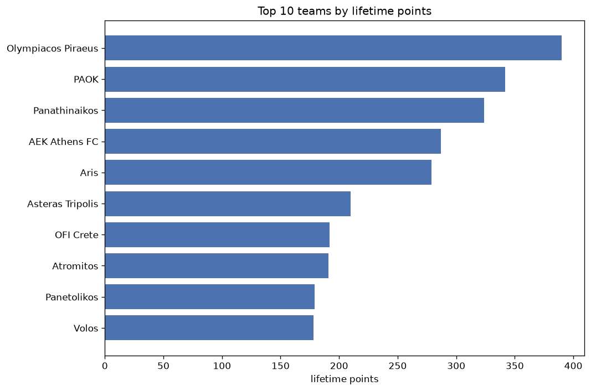
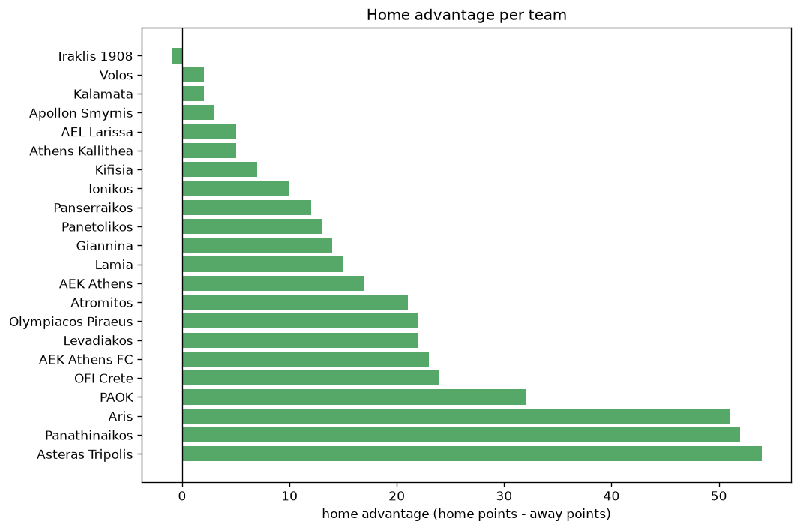

# Team Analysis
- Report: `teams_analysis`
- Generated: 2026-10-26T01:34:25+00:00
- Script: `backend/scripts/analyze_teams.py` v1.0.0
- League: Super League (Greece)
- Scope: league `greece1`

- Teams: **22** | Seasons: **7** | Matches: **1207**

## 1. Team standings (lifetime)
| team | seasons | played | W | D | L | pts | GF | GA | GD | avg pts/season | best pos | worst pos | titles |
|---|---|---|---|---|---|---|---|---|---|---|---|---|---|
| Olympiacos Piraeus | 7 | 170 | 118 | 36 | 16 | 390 | 327 | 100 | 227 | 55.71 | 1 | 3 | 3 |
| PAOK | 7 | 170 | 101 | 39 | 30 | 342 | 335 | 146 | 189 | 48.86 | 1 | 4 | 1 |
| Panathinaikos | 7 | 169 | 96 | 36 | 37 | 324 | 266 | 132 | 134 | 46.29 | 1 | 5 | 2 |
| AEK Athens FC | 6 | 140 | 87 | 26 | 27 | 287 | 249 | 119 | 130 | 47.83 | 2 | 15 | 0 |
| Aris | 7 | 169 | 79 | 42 | 48 | 279 | 214 | 163 | 51 | 39.86 | 2 | 7 | 0 |
| Asteras Tripolis | 7 | 175 | 53 | 51 | 71 | 210 | 179 | 224 | -45 | 30.0 | 6 | 11 | 0 |
| OFI Crete | 7 | 170 | 50 | 42 | 78 | 192 | 195 | 258 | -63 | 27.43 | 6 | 13 | 0 |
| Atromitos | 7 | 172 | 47 | 50 | 75 | 191 | 191 | 238 | -47 | 27.29 | 6 | 14 | 0 |
| Panetolikos | 7 | 175 | 45 | 44 | 86 | 179 | 155 | 245 | -90 | 25.57 | 8 | 12 | 0 |
| Volos | 7 | 170 | 46 | 40 | 84 | 178 | 175 | 274 | -99 | 25.43 | 6 | 13 | 0 |
| Giannina | 4 | 104 | 26 | 34 | 44 | 112 | 100 | 139 | -39 | 28.0 | 6 | 14 | 0 |
| Lamia | 5 | 130 | 23 | 38 | 69 | 107 | 95 | 208 | -113 | 21.4 | 6 | 14 | 0 |
| Levadiakos | 4 | 93 | 24 | 28 | 41 | 100 | 107 | 131 | -24 | 25.0 | 4 | 13 | 0 |
| AEK Athens | 2 | 39 | 26 | 11 | 2 | 89 | 78 | 23 | 55 | 44.5 | 1 | 2 | 1 |
| Panserraikos | 3 | 89 | 21 | 21 | 47 | 84 | 83 | 167 | -84 | 28.0 | 9 | 14 | 0 |
| Kifisia | 3 | 71 | 16 | 25 | 30 | 73 | 83 | 121 | -38 | 24.33 | 6 | 11 | 0 |
| AEL Larissa | 2 | 63 | 8 | 23 | 32 | 47 | 53 | 99 | -46 | 23.5 | 13 | 14 | 0 |
| Ionikos | 2 | 52 | 10 | 14 | 28 | 44 | 42 | 76 | -34 | 22.0 | 11 | 12 | 0 |
| Apollon Smyrnis | 2 | 52 | 10 | 11 | 31 | 41 | 35 | 82 | -47 | 20.5 | 9 | 14 | 0 |
| Athens Kallithea | 1 | 26 | 4 | 9 | 13 | 21 | 24 | 40 | -16 | 21.0 | 13 | 13 | 0 |
| Kalamata | 1 | 7 | 3 | 1 | 3 | 10 | 13 | 12 | 1 | 10.0 | 7 | 7 | 0 |
| Iraklis 1908 | 1 | 8 | 2 | 3 | 3 | 9 | 9 | 11 | -2 | 9.0 | 9 | 9 | 0 |

## 2. Home vs away split
| team | home P | H-W | H-D | H-L | H-pts | away P | A-W | A-D | A-L | A-pts | adv |
|---|---|---|---|---|---|---|---|---|---|---|---|
| Asteras Tripolis | 88 | 36 | 24 | 28 | 132 | 87 | 17 | 27 | 43 | 78 | 54 |
| Panathinaikos | 85 | 56 | 20 | 9 | 188 | 84 | 40 | 16 | 28 | 136 | 52 |
| Aris | 84 | 47 | 24 | 13 | 165 | 85 | 32 | 18 | 35 | 114 | 51 |
| PAOK | 85 | 56 | 19 | 10 | 187 | 85 | 45 | 20 | 20 | 155 | 32 |
| OFI Crete | 85 | 29 | 21 | 35 | 108 | 85 | 21 | 21 | 43 | 84 | 24 |
| AEK Athens FC | 70 | 48 | 11 | 11 | 155 | 70 | 39 | 15 | 16 | 132 | 23 |
| Olympiacos Piraeus | 85 | 64 | 14 | 7 | 206 | 85 | 54 | 22 | 9 | 184 | 22 |
| Levadiakos | 47 | 16 | 13 | 18 | 61 | 46 | 8 | 15 | 23 | 39 | 22 |
| Atromitos | 86 | 26 | 28 | 32 | 106 | 86 | 21 | 22 | 43 | 85 | 21 |
| AEK Athens | 20 | 17 | 2 | 1 | 53 | 19 | 9 | 9 | 1 | 36 | 17 |
| Lamia | 65 | 15 | 16 | 34 | 61 | 65 | 8 | 22 | 35 | 46 | 15 |
| Giannina | 52 | 15 | 18 | 19 | 63 | 52 | 11 | 16 | 25 | 49 | 14 |
| Panetolikos | 87 | 26 | 18 | 43 | 96 | 88 | 19 | 26 | 43 | 83 | 13 |
| Panserraikos | 44 | 11 | 15 | 18 | 48 | 45 | 10 | 6 | 29 | 36 | 12 |
| Ionikos | 26 | 6 | 9 | 11 | 27 | 26 | 4 | 5 | 17 | 17 | 10 |
| Kifisia | 36 | 9 | 13 | 14 | 40 | 35 | 7 | 12 | 16 | 33 | 7 |
| AEL Larissa | 32 | 4 | 14 | 14 | 26 | 31 | 4 | 9 | 18 | 21 | 5 |
| Athens Kallithea | 13 | 3 | 4 | 6 | 13 | 13 | 1 | 5 | 7 | 8 | 5 |
| Apollon Smyrnis | 26 | 5 | 7 | 14 | 22 | 26 | 5 | 4 | 17 | 19 | 3 |
| Volos | 84 | 23 | 21 | 40 | 90 | 86 | 23 | 19 | 44 | 88 | 2 |
| Kalamata | 4 | 2 | 0 | 2 | 6 | 3 | 1 | 1 | 1 | 4 | 2 |
| Iraklis 1908 | 3 | 1 | 1 | 1 | 4 | 5 | 1 | 2 | 2 | 5 | -1 |

## 3. Top performers
### Best points per game (PPG)
| rank | team | PPG |
|---|---|---|
| 1 | Olympiacos Piraeus | 2.29 |
| 2 | AEK Athens | 2.28 |
| 3 | AEK Athens FC | 2.05 |
| 4 | PAOK | 2.01 |
| 5 | Panathinaikos | 1.92 |

### Most goals scored
| rank | team | goals |
|---|---|---|
| 1 | PAOK | 335 |
| 2 | Olympiacos Piraeus | 327 |
| 3 | Panathinaikos | 266 |
| 4 | AEK Athens FC | 249 |
| 5 | Aris | 214 |

### Best goal difference
| rank | team | GD |
|---|---|---|
| 1 | Olympiacos Piraeus | 227 |
| 2 | PAOK | 189 |
| 3 | Panathinaikos | 134 |
| 4 | AEK Athens FC | 130 |
| 5 | AEK Athens | 55 |

### Best defence (goals against per match, standings)
| rank | team | GA/match |
|---|---|---|
| 1 | Olympiacos Piraeus | 0.588 |
| 2 | AEK Athens | 0.590 |
| 3 | Panathinaikos | 0.781 |
| 4 | AEK Athens FC | 0.850 |
| 5 | PAOK | 0.859 |

## 4. Team consistency
- Teams present in all **7** seasons: **9**

Aris, Asteras Tripolis, Atromitos, OFI Crete, Olympiacos Piraeus, PAOK, Panathinaikos, Panetolikos, Volos

## 5. Head-to-head dominance
- Distinct fixtures: **188** (showing the 15 most frequent)

| fixture | meetings | home wins | draws | away wins | home pct | draw pct | away pct |
|---|---|---|---|---|---|---|---|
| Asteras Tripolis vs Atromitos | 15 | 8 | 3 | 4 | 53.3% | 20.0% | 26.7% |
| PAOK vs Panathinaikos | 15 | 8 | 4 | 3 | 53.3% | 26.7% | 20.0% |
| Aris vs OFI Crete | 15 | 7 | 3 | 5 | 46.7% | 20.0% | 33.3% |
| Aris vs Volos | 15 | 7 | 2 | 6 | 46.7% | 13.3% | 40.0% |
| Asteras Tripolis vs Panetolikos | 15 | 6 | 7 | 2 | 40.0% | 46.7% | 13.3% |
| Olympiacos Piraeus vs Panathinaikos | 15 | 5 | 7 | 3 | 33.3% | 46.7% | 20.0% |
| Volos vs OFI Crete | 15 | 5 | 4 | 6 | 33.3% | 26.7% | 40.0% |
| Atromitos vs Panetolikos | 14 | 6 | 3 | 5 | 42.9% | 21.4% | 35.7% |
| Olympiacos Piraeus vs PAOK | 14 | 5 | 5 | 4 | 35.7% | 35.7% | 28.6% |
| Asteras Tripolis vs OFI Crete | 13 | 9 | 2 | 2 | 69.2% | 15.4% | 15.4% |
| PAOK vs Atromitos | 13 | 8 | 2 | 3 | 61.5% | 15.4% | 23.1% |
| Panathinaikos vs Panetolikos | 13 | 8 | 1 | 4 | 61.5% | 7.7% | 30.8% |
| Panathinaikos vs Asteras Tripolis | 13 | 7 | 1 | 5 | 53.8% | 7.7% | 38.5% |
| Olympiacos Piraeus vs Asteras Tripolis | 13 | 6 | 2 | 5 | 46.2% | 15.4% | 38.5% |
| Olympiacos Piraeus vs Atromitos | 13 | 6 | 3 | 4 | 46.2% | 23.1% | 30.8% |

## 6. Position per season (classic view)
_Cells show final position; '-' when the team was absent from that season._

| team | 2020-2021 | 2021-2022 | 2022-2023 | 2023-2024 | 2024-2025 | 2025-2026 | 2026-2027 |
|---|---|---|---|---|---|---|---|
| Olympiacos Piraeus | 1 | 1 | 3 | 3 | 1 | 2 | 3 |
| PAOK | 4 | 2 | 4 | 1 | 4 | 3 | 4 |
| Panathinaikos | 5 | 5 | 1 | 4 | 3 | 5 | 1 |
| AEK Athens FC | 3 | 3 | 2 | 2 | 2 | 15 | - |
| Aris | 2 | 4 | 5 | 5 | 5 | 7 | 5 |
| Asteras Tripolis | 6 | 8 | 10 | 7 | 8 | 10 | 11 |
| OFI Crete | 13 | 7 | 9 | 10 | 6 | 9 | 8 |
| Atromitos | 10 | 12 | 7 | 8 | 7 | 6 | 14 |
| Panetolikos | 12 | 9 | 8 | 12 | 9 | 11 | 10 |
| Volos | 7 | 10 | 6 | 13 | 12 | 12 | 12 |
| Giannina | 8 | 6 | 11 | 14 | - | - | - |
| Lamia | 11 | 13 | 14 | 6 | 14 | - | - |
| Levadiakos | - | - | 13 | - | 10 | 4 | 13 |
| AEK Athens | - | - | - | - | - | 1 | 2 |
| Panserraikos | - | - | - | 9 | 11 | 14 | - |
| Kifisia | - | - | - | 11 | - | 8 | 6 |
| AEL Larissa | 14 | - | - | - | - | 13 | - |
| Ionikos | - | 11 | 12 | - | - | - | - |
| Apollon Smyrnis | 9 | 14 | - | - | - | - | - |
| Athens Kallithea | - | - | - | - | 13 | - | - |
| Kalamata | - | - | - | - | - | - | 7 |
| Iraklis 1908 | - | - | - | - | - | - | 9 |

---
*All statistics are computed from PostgreSQL tables (read-only). Run with `python backend/scripts/analyze_teams.py` to regenerate.*

## Charts

