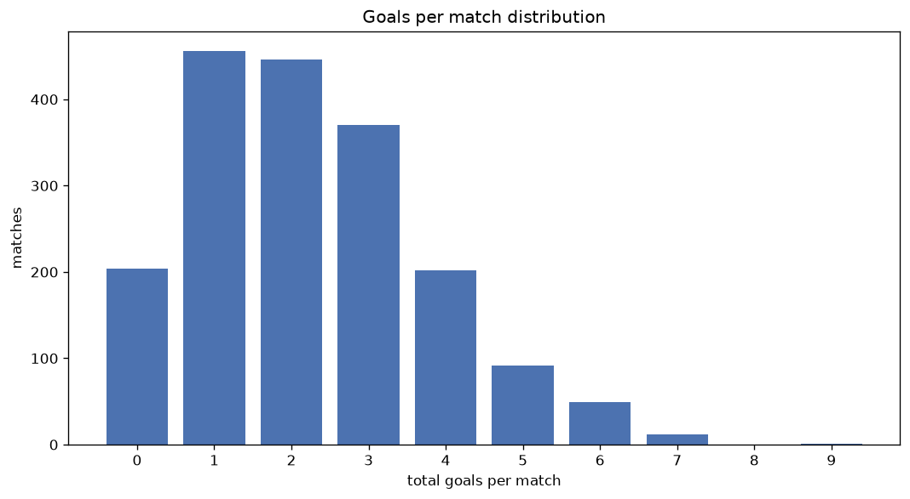
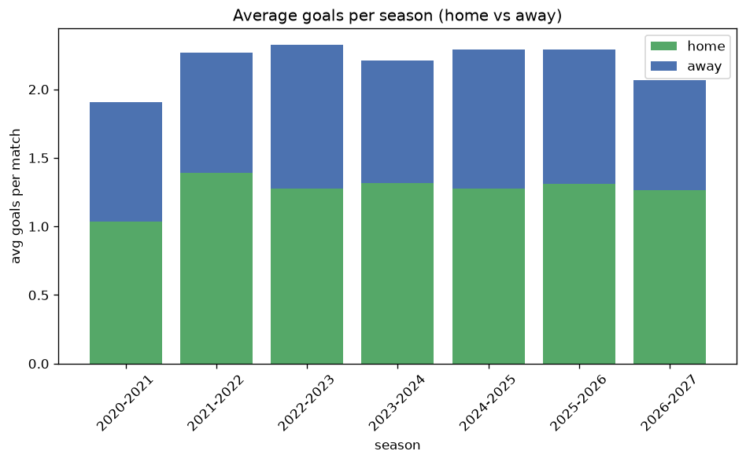

# Goal Analysis
- Report: `goals_analysis`
- Generated: 2026-10-26T01:34:45+00:00
- Script: `backend/scripts/analyze_goals.py` v1.0.0
- League: Super League 2 (Greece)
- Scope: league `greece2`

## 1. Goals per match distribution
| goals | matches | pct |
|---|---|---|
| 0 | 204 | 11.1% |
| 1 | 456 | 24.9% |
| 2 | 446 | 24.3% |
| 3 | 370 | 20.2% |
| 4 | 202 | 11.0% |
| 5 | 92 | 5.0% |
| 6 | 49 | 2.7% |
| 7 | 12 | 0.7% |
| 8 | 0 | 0.0% |
| 9 | 1 | 0.1% |

## 2. Goals per match per season
| season | matches | total goals | avg home | avg away | avg total |
|---|---|---|---|---|---|
| 2020-2021 | 132 | 252 | 1.038 | 0.871 | 1.909 |
| 2021-2022 | 544 | 1234 | 1.392 | 0.877 | 2.268 |
| 2022-2023 | 387 | 900 | 1.279 | 1.047 | 2.326 |
| 2023-2024 | 264 | 584 | 1.314 | 0.898 | 2.212 |
| 2024-2025 | 180 | 412 | 1.278 | 1.011 | 2.289 |
| 2025-2026 | 265 | 607 | 1.313 | 0.977 | 2.291 |
| 2026-2027 | 60 | 124 | 1.267 | 0.8 | 2.067 |

## 3. Home vs away goal share
- Home goals: **2390** (58.1%)
- Away goals: **1723** (41.9%)
- Home/away ratio: **1.387**

| season | home goals | away goals | total | home pct | away pct |
|---|---|---|---|---|---|
| 2020-2021 | 137 | 115 | 252 | 54.4% | 45.6% |
| 2021-2022 | 757 | 477 | 1234 | 61.3% | 38.7% |
| 2022-2023 | 495 | 405 | 900 | 55.0% | 45.0% |
| 2023-2024 | 347 | 237 | 584 | 59.4% | 40.6% |
| 2024-2025 | 230 | 182 | 412 | 55.8% | 44.2% |
| 2025-2026 | 348 | 259 | 607 | 57.3% | 42.7% |
| 2026-2027 | 76 | 48 | 124 | 61.3% | 38.7% |

## 4. BTTS (Both Teams To Score)
- Overall: **715** of `1832` (39.0%)

| season | matches | BTTS | pct |
|---|---|---|---|
| 2020-2021 | 132 | 47 | 35.6% |
| 2021-2022 | 544 | 207 | 38.1% |
| 2022-2023 | 387 | 150 | 38.8% |
| 2023-2024 | 264 | 105 | 39.8% |
| 2024-2025 | 180 | 74 | 41.1% |
| 2025-2026 | 265 | 106 | 40.0% |
| 2026-2027 | 60 | 26 | 43.3% |

## 5. Clean sheets
- Home clean sheets: **771** (42.1%)
- Away clean sheets: **550** (30.0%)
- Total clean sheets recorded: **1321**
- Matches with at least one clean sheet: **1117** (61.0%)
- Both teams kept clean sheets (0-0): **204**

| season | matches | home CS | away CS | total CS | matches w/ CS |
|---|---|---|---|---|---|
| 2020-2021 | 132 | 58 | 44 | 102 | 85 (64.4%) |
| 2021-2022 | 544 | 245 | 159 | 404 | 337 (61.9%) |
| 2022-2023 | 387 | 153 | 130 | 283 | 237 (61.2%) |
| 2023-2024 | 264 | 111 | 74 | 185 | 159 (60.2%) |
| 2024-2025 | 180 | 70 | 56 | 126 | 106 (58.9%) |
| 2025-2026 | 265 | 105 | 75 | 180 | 159 (60.0%) |
| 2026-2027 | 60 | 29 | 12 | 41 | 34 (56.7%) |

## 6. Scoring intensity
- First-half goals: **1857** (45.4%)
- Second-half goals: **2232** (54.6%)
- Avg first-half goals per match: **1.018**
- Avg second-half goals per match: **1.224**
- Second-half-only scoring (HT 0-0, FT goals >= 1): **468** (25.5%)
- *8 match(es) excluded (no HT score recorded).*

| season | matches | 1st half | 2nd half | 1st half pct | 2nd half pct |
|---|---|---|---|---|---|
| 2020-2021 | 132 | 107 | 145 | 42.5% | 57.5% |
| 2021-2022 | 544 | 572 | 638 | 47.3% | 52.7% |
| 2022-2023 | 387 | 389 | 511 | 43.2% | 56.8% |
| 2023-2024 | 264 | 279 | 305 | 47.8% | 52.2% |
| 2024-2025 | 180 | 190 | 222 | 46.1% | 53.9% |
| 2025-2026 | 265 | 276 | 331 | 45.5% | 54.5% |
| 2026-2027 | 60 | 44 | 80 | 35.5% | 64.5% |

## 7. First-goal timing
- Matches with first-goal time recorded: `1620` of `1832` (88.4%)
- Goalless matches: `212`
- Min `1` | Max `99` | Mean `33.58` | Median (p50) `28.0`

| bucket | count | % of matches | % of scoring matches |
|---|---|---|---|
| 1-15 | 468 | 25.5% | 28.9% |
| 16-30 | 393 | 21.5% | 24.3% |
| 31-45 | 259 | 14.1% | 16.0% |
| 46-60 | 229 | 12.5% | 14.1% |
| 61-75 | 161 | 8.8% | 9.9% |
| 76-90 | 82 | 4.5% | 5.1% |
| 91-120 | 28 | 1.5% | 1.7% |

---
*All statistics are computed from PostgreSQL tables (read-only). Run with `python backend/scripts/analyze_goals.py` to regenerate.*

## Charts

