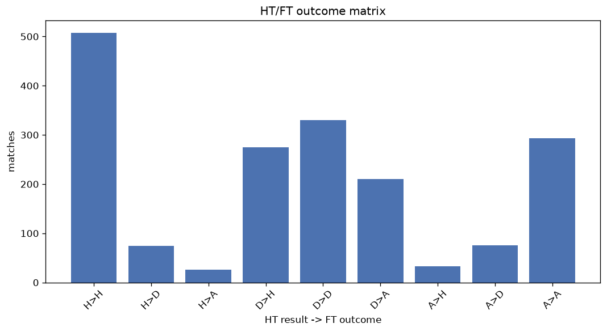
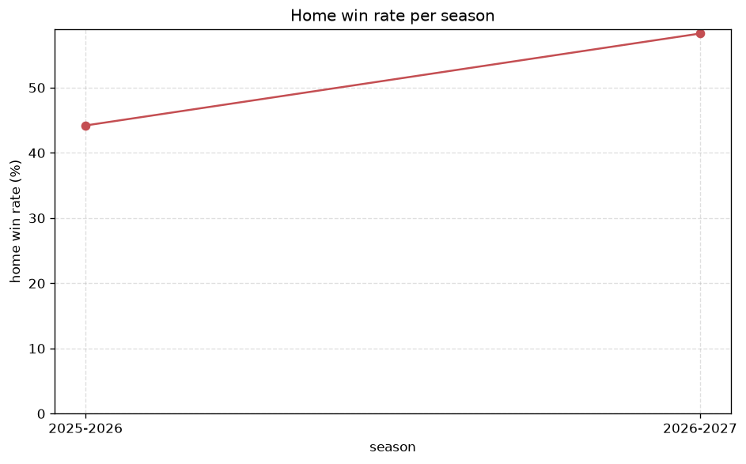

# Match Analysis
- Report: `matches_analysis`
- Generated: 2026-10-30T03:53:50+00:00
- Script: `backend/scripts/analyze_matches.py` v1.0.0
- League: Super League 2 (Greece)
- Scope: league `greece2`

## 1. Overall summary
| metric | value |
|---|---|
| Matches | 1836 |
| Home wins | 821 (44.7%) |
| Draws | 481 (26.2%) |
| Away wins | 534 (29.1%) |
| Total goals | 4127 |
| Average goals per match | 2.248 |
| Goalless matches | 204 (11.1%) |

## 2. Per-season breakdown
| season | matches | home wins | draws | away wins | total goals | avg goals | goalless |
|---|---|---|---|---|---|---|---|
| 2020-2021 | 132 | 53 (40.2%) | 39 (29.5%) | 40 (30.3%) | 252 | 1.909 | 17 (12.9%) |
| 2021-2022 | 544 | 255 (46.9%) | 149 (27.4%) | 140 (25.7%) | 1234 | 2.268 | 67 (12.3%) |
| 2022-2023 | 387 | 157 (40.6%) | 99 (25.6%) | 131 (33.9%) | 900 | 2.326 | 46 (11.9%) |
| 2023-2024 | 264 | 130 (49.2%) | 63 (23.9%) | 71 (26.9%) | 584 | 2.212 | 26 (9.8%) |
| 2024-2025 | 180 | 77 (42.8%) | 50 (27.8%) | 53 (29.4%) | 412 | 2.289 | 20 (11.1%) |
| 2025-2026 | 265 | 117 (44.2%) | 61 (23.0%) | 87 (32.8%) | 607 | 2.291 | 21 (7.9%) |
| 2026-2027 | 64 | 32 (50.0%) | 20 (31.2%) | 12 (18.8%) | 138 | 2.156 | 7 (10.9%) |

## 3. HT/FT outcome matrix
| HT result \ FT result | Home | Draw | Away | total |
|---|---|---|---|---|
| HT home lead | 508 (83.6%) | 74 (12.2%) | 26 (4.3%) | 608 |
| HT draw | 275 (33.7%) | 331 (40.6%) | 210 (25.7%) | 816 |
| HT away lead | 33 (8.2%) | 76 (18.8%) | 295 (73.0%) | 404 |
- *8 match(es) excluded (no HT score recorded).*

## 4. Comeback matches
- Home comebacks (trailing at HT, won at FT): **33** (1.8%)
- Away comebacks (trailing at HT, won at FT): **26** (1.4%)

### Home comebacks
| season | home | away | HT | FT |
|---|---|---|---|---|
| 2021-2022 | Olympiacos Piraeus B | PAOK B | 0-1 | 3-1 |
| 2021-2022 | Levadiakos | Asteras Vlachioti | 0-1 | 2-1 |
| 2021-2022 | AO Trikala | Thesprotos | 0-1 | 2-1 |
| 2021-2022 | Pierikos | Apollon Larissa | 0-1 | 3-2 |
| 2021-2022 | Panserraikos | Karditsa | 0-1 | 2-1 |
| 2021-2022 | PAE Egaleo | Panathinaikos B | 0-1 | 2-1 |
| 2021-2022 | Pierikos | Veria | 0-1 | 2-1 |
| 2021-2022 | Karditsa | Kalamaria | 0-1 | 2-1 |
| 2021-2022 | Asteras Vlachioti | PAE Egaleo | 0-1 | 2-1 |
| 2021-2022 | Episkopi | Panathinaikos B | 0-2 | 3-2 |
| 2021-2022 | Olympiacos Piraeus B | O. Volos | 0-2 | 3-2 |
| 2022-2023 | Athens Kallithea | O.F. Ierapetra | 0-1 | 2-1 |
| 2022-2023 | Panserraikos | AEL Larissa | 0-1 | 2-1 |
| 2022-2023 | Athens Kallithea | Panachaiki | 0-1 | 3-1 |
| 2022-2023 | O.F. Ierapetra | Panachaiki | 0-1 | 2-1 |
| 2022-2023 | PAOK B | Panathinaikos B | 0-1 | 3-1 |
| 2023-2024 | Karditsa | AEK Athens FC B | 0-1 | 2-1 |
| 2023-2024 | Ionikos | Kalamata | 1-2 | 3-2 |
| 2023-2024 | Panathinaikos B | Tilikratis L. | 0-1 | 2-1 |
| 2023-2024 | Tilikratis L. | Ionikos | 1-2 | 3-2 |
| 2023-2024 | PAE Egaleo | Panathinaikos B | 0-1 | 2-1 |
| 2023-2024 | Levadiakos | Makedonikos | 0-1 | 2-1 |
| 2023-2024 | Panachaiki | Tilikratis L. | 0-1 | 2-1 |
| 2023-2024 | Athens Kallithea | Ionikos | 0-1 | 2-1 |
| 2024-2025 | AEL Larissa | Kavala | 0-1 | 2-1 |
| 2024-2025 | Giannina | Diagoras | 0-1 | 2-1 |
| 2024-2025 | Iraklis 1908 | Niki Volos | 0-1 | 2-1 |
| 2024-2025 | PAE Chania | Ilioupoli | 0-1 | 3-2 |
| 2025-2026 | Panionios | Olympiacos Piraeus B | 0-1 | 4-1 |
| 2025-2026 | Olympiacos Piraeus B | PAE Egaleo | 0-1 | 2-1 |
| 2025-2026 | Kavala | PAOK B | 0-1 | 2-1 |
| 2025-2026 | PAOK B | Giannina | 0-1 | 2-1 |
| 2026-2027 | Panserraikos | Chrisoupolis | 0-1 | 2-1 |

### Away comebacks
| season | home | away | HT | FT |
|---|---|---|---|---|
| 2020-2021 | PAE Chania | AO Trikala | 1-0 | 1-2 |
| 2020-2021 | AO Trikala | Ionikos | 2-0 | 2-3 |
| 2020-2021 | Levadiakos | Ionikos | 1-0 | 1-2 |
| 2020-2021 | O.F. Ierapetra | Xanthi | 1-0 | 1-2 |
| 2021-2022 | Panserraikos | Kalamaria | 2-1 | 2-4 |
| 2021-2022 | Thesprotos | Kalamaria | 1-0 | 1-2 |
| 2021-2022 | Kifisia | Kalamata | 1-0 | 1-2 |
| 2022-2023 | Irodotos | Athens Kallithea | 1-0 | 1-2 |
| 2022-2023 | Panathinaikos B | Veria | 1-0 | 1-2 |
| 2022-2023 | Apollon Larissa | Niki Volos | 1-0 | 1-4 |
| 2022-2023 | Makedonikos | Iraklis Larissa | 2-1 | 2-3 |
| 2022-2023 | Iraklis Larissa | PAOK B | 1-0 | 1-4 |
| 2022-2023 | Apollon Smyrnis | Ilioupoli | 2-1 | 2-4 |
| 2022-2023 | Episkopi | Rouf FC | 2-0 | 2-3 |
| 2022-2023 | Ilioupoli | PAE Egaleo | 2-1 | 2-3 |
| 2022-2023 | Makedonikos | Kalamaria | 1-0 | 1-2 |
| 2023-2024 | PAOK B | Kampaniakos | 2-1 | 2-3 |
| 2023-2024 | PAE Egaleo | Ionikos | 1-0 | 1-2 |
| 2024-2025 | PAE Chania | Kalamata | 1-0 | 1-2 |
| 2024-2025 | Ethnikos Neou | AEL Larissa | 1-0 | 1-3 |
| 2024-2025 | PAE Egaleo | Panionios | 1-0 | 1-2 |
| 2024-2025 | Ethnikos Neou | Makedonikos | 1-0 | 1-2 |
| 2025-2026 | Chrisoupolis | Iraklis 1908 | 1-0 | 1-2 |
| 2025-2026 | Kampaniakos | Makedonikos | 1-0 | 1-2 |
| 2026-2027 | Niki Volos | Olympiacos Piraeus B | 1-0 | 1-2 |
| 2026-2027 | Olympiacos Piraeus B | Chrisoupolis | 1-0 | 1-2 |

## 5. HT lead conversion
| HT state | matches | converted to win | held as draw | collapsed to loss |
|---|---|---|---|---|
| Home lead | 608 | 508 (83.6%) | 74 (12.2%) | 26 (4.3%) |
| Away lead | 404 | 295 (73.0%) | 76 (18.8%) | 33 (8.2%) |

### Matches level at half-time
| FT result | count | pct |
|---|---|---|
| Home win | 275 | 33.7% |
| Draw | 331 | 40.6% |
| Away win | 210 | 25.7% |
- *8 match(es) excluded (no HT score recorded).*

## 6. First-goal timing
- Matches with a first-goal time recorded: `1624` of `1836` (88.5%)

Outcome distribution by first-goal timing bucket:
| bucket | matches | % of matches | home | draw | away |
|---|---|---|---|---|---|
| 1-15 | 468 | 25.5% | 231 (49.4%) | 83 (17.7%) | 154 (32.9%) |
| 16-30 | 395 | 21.5% | 209 (52.9%) | 73 (18.5%) | 113 (28.6%) |
| 31-45 | 261 | 14.2% | 131 (50.2%) | 51 (19.5%) | 79 (30.3%) |
| 46-60 | 229 | 12.5% | 115 (50.2%) | 35 (15.3%) | 79 (34.5%) |
| 61-75 | 161 | 8.8% | 71 (44.1%) | 27 (16.8%) | 63 (39.1%) |
| 76-90 | 82 | 4.5% | 40 (48.8%) | 7 (8.5%) | 35 (42.7%) |
| 91-120 | 28 | 1.5% | 19 (67.9%) | 1 (3.6%) | 8 (28.6%) |

## 7. Goalless matches
- Overall: **204** of `1836` (11.1%)

| season | matches | goalless | pct |
|---|---|---|---|
| 2020-2021 | 132 | 17 | 12.9% |
| 2021-2022 | 544 | 67 | 12.3% |
| 2022-2023 | 387 | 46 | 11.9% |
| 2023-2024 | 264 | 26 | 9.8% |
| 2024-2025 | 180 | 20 | 11.1% |
| 2025-2026 | 265 | 21 | 7.9% |
| 2026-2027 | 64 | 7 | 10.9% |

---
*All statistics are computed from PostgreSQL tables (read-only). Run with `python backend/scripts/analyze_matches.py` to regenerate.*

## Charts

