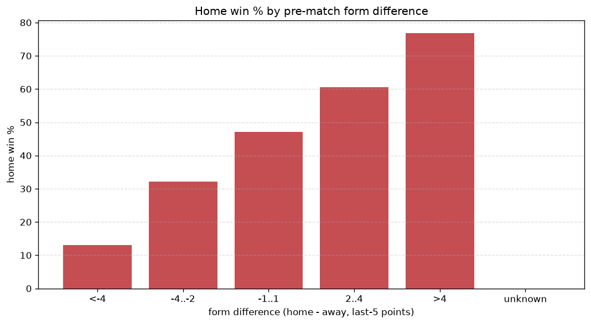
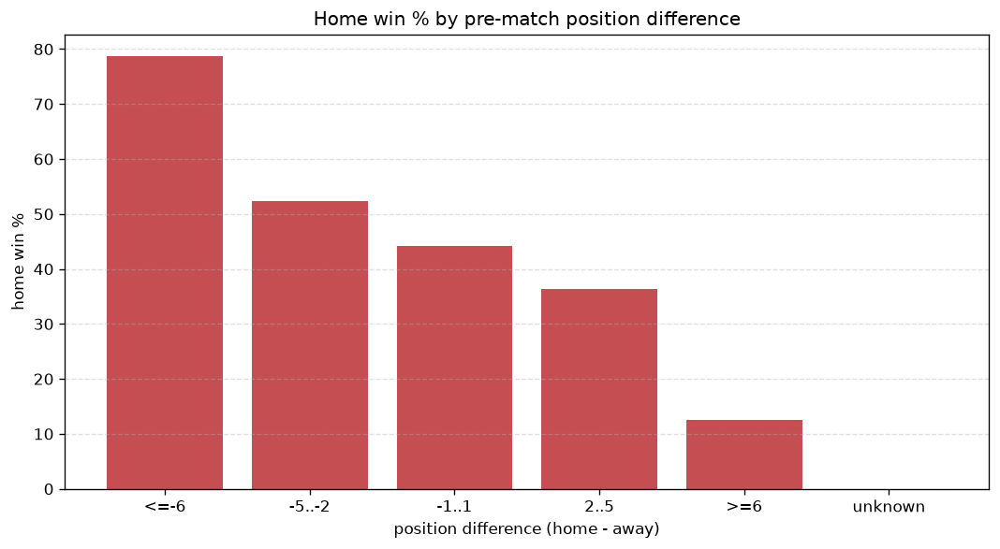

# Relationships Analysis
- Report: `relationships`
- Generated: 2026-10-30T03:54:00+00:00
- Script: `backend/scripts/analyze_relationships.py` v1.0.0
- League: Super League 2 (Greece)
- Scope: league `greece2`

- Matches analysed: **1772** (23 leakage-safe pre-match features).

## 1. Correlation matrix
_Pearson correlation of each pre-match feature with observed goals; sorted by |corr(total goals)|._

| feature | corr(home) | corr(away) | corr(total) |
|---|---|---|---|
| away_team_goals_conceded_last_5 | 0.226 | -0.090 | 0.126 |
| away_team_away_conceded_avg | 0.214 | -0.088 | 0.117 |
| away_position_before_match | 0.224 | -0.144 | 0.087 |
| position_difference | -0.308 | 0.263 | -0.076 |
| home_team_home_goals_avg | 0.186 | -0.131 | 0.065 |
| home_team_goals_scored_last_5 | 0.173 | -0.115 | 0.064 |
| points_difference | 0.300 | -0.272 | 0.064 |
| home_points_before_match | 0.165 | -0.111 | 0.061 |
| away_team_points_last_5 | -0.163 | 0.115 | -0.056 |
| home_team_home_win_rate | 0.201 | -0.166 | 0.053 |
| away_team_wins_last_5 | -0.149 | 0.112 | -0.047 |
| home_rest_days | 0.008 | 0.044 | 0.037 |
| away_team_away_win_rate | -0.125 | 0.100 | -0.035 |
| home_team_goals_conceded_last_5 | -0.120 | 0.194 | 0.032 |
| away_team_away_goals_avg | -0.117 | 0.097 | -0.031 |
| away_rest_days | 0.015 | 0.023 | 0.028 |
| home_team_points_last_5 | 0.178 | -0.180 | 0.025 |
| home_team_wins_last_5 | 0.163 | -0.174 | 0.017 |
| away_team_goals_scored_last_5 | -0.118 | 0.129 | -0.010 |
| home_team_home_conceded_avg | -0.118 | 0.130 | -0.009 |
| rest_days_difference | -0.009 | 0.025 | 0.009 |
| home_position_before_match | -0.165 | 0.187 | -0.009 |
| away_points_before_match | -0.079 | 0.110 | 0.009 |

## 2. Form vs outcome
_Home win/draw/away % per bucket of `home_team_points_last_5 - away_team_points_last_5`._

| bucket | matches | home | draw | away | home % | draw % | away % |
|---|---|---|---|---|---|---|---|
| <-4 | 289 | 66 | 68 | 155 | 22.8% | 23.5% | 53.6% |
| -4..-2 | 370 | 131 | 102 | 137 | 35.4% | 27.6% | 37.0% |
| -1..1 | 511 | 218 | 154 | 139 | 42.7% | 30.1% | 27.2% |
| 2..4 | 356 | 199 | 97 | 60 | 55.9% | 27.2% | 16.9% |
| >4 | 246 | 175 | 40 | 31 | 71.1% | 16.3% | 12.6% |
| unknown | 0 | 0 | 0 | 0 | - | - | - |

## 3. Position vs outcome
_Home win/draw/away % per bucket of `position_difference` (home position - away position; negative favours the home team)._

| bucket | matches | home | draw | away | home % | draw % | away % |
|---|---|---|---|---|---|---|---|
| <=-6 | 510 | 331 | 98 | 81 | 64.9% | 19.2% | 15.9% |
| -5..-2 | 246 | 126 | 77 | 43 | 51.2% | 31.3% | 17.5% |
| -1..1 | 215 | 86 | 63 | 66 | 40.0% | 29.3% | 30.7% |
| 2..5 | 279 | 113 | 84 | 82 | 40.5% | 30.1% | 29.4% |
| >=6 | 522 | 133 | 139 | 250 | 25.5% | 26.6% | 47.9% |
| unknown | 0 | 0 | 0 | 0 | - | - | - |

## 4. Rest advantage
_Home win/draw/away % per bucket of `rest_days_difference` (home rest - away rest). Matches with unknown rest are bucketed separately._

| bucket | matches | home | draw | away | home % | draw % | away % |
|---|---|---|---|---|---|---|---|
| <-1 | 222 | 101 | 56 | 65 | 45.5% | 25.2% | 29.3% |
| -1..0 | 237 | 106 | 61 | 70 | 44.7% | 25.7% | 29.5% |
| 0 | 766 | 350 | 195 | 221 | 45.7% | 25.5% | 28.9% |
| 1..2 | 306 | 126 | 89 | 91 | 41.2% | 29.1% | 29.7% |
| >2 | 165 | 77 | 37 | 51 | 46.7% | 22.4% | 30.9% |
| unknown | 76 | 29 | 23 | 24 | 38.2% | 30.3% | 31.6% |
- *76 match(es) had unknown rest difference (missing rest data on at least one side).*

## 5. Home team quality
_Home win rate by `home_team_home_win_rate` tier (split at 0.5)._

- `< 0.5` tier: **35.8%** home win (372/1040)
- `>= 0.5` tier: **57.0%** home win (417/732)
- Home-win gap (>= split minus < split): **+21.2 pp**

| tier | label | matches | home | draw | away | home % |
|---|---|---|---|---|---|---|
| low | < 0.5 | 1040 | 372 | 293 | 375 | 35.8% |
| high | >= 0.5 | 732 | 417 | 168 | 147 | 57.0% |

## 6. Feature averages by result
_Mean feature value per outcome; `range` is home-minus-away spread of the group means._

| feature | home mean | draw mean | away mean | range |
|---|---|---|---|---|
| points_difference | 3.684 | -0.976 | -5.573 | 9.257 |
| position_difference | -3.497 | 1.486 | 5.199 | 8.696 |
| home_points_before_match | 19.454 | 17.063 | 13.761 | 5.693 |
| home_position_before_match | 12.100 | 14.085 | 16.676 | 4.576 |
| away_position_before_match | 15.597 | 12.599 | 11.477 | 4.120 |
| away_points_before_match | 15.769 | 18.039 | 19.333 | 3.564 |
| home_team_points_last_5 | 6.819 | 5.839 | 4.780 | 2.039 |
| away_team_points_last_5 | 5.446 | 6.347 | 7.044 | 1.598 |
| home_team_goals_conceded_last_5 | 4.303 | 4.967 | 5.793 | 1.490 |
| home_team_goals_scored_last_5 | 5.337 | 4.790 | 4.034 | 1.303 |
| away_team_goals_conceded_last_5 | 5.390 | 4.412 | 4.102 | 1.289 |
| away_team_goals_scored_last_5 | 4.431 | 5.113 | 5.557 | 1.127 |
| home_team_wins_last_5 | 1.868 | 1.555 | 1.236 | 0.633 |
| away_team_wins_last_5 | 1.435 | 1.735 | 1.956 | 0.521 |
| home_team_home_goals_avg | 1.297 | 1.146 | 0.945 | 0.352 |
| rest_days_difference | -0.234 | 0.080 | 0.050 | 0.314 |
| home_rest_days | 6.991 | 7.114 | 7.290 | 0.299 |
| away_team_away_conceded_avg | 1.292 | 1.092 | 1.008 | 0.284 |
| home_team_home_conceded_avg | 0.760 | 0.895 | 0.974 | 0.214 |
| away_rest_days | 7.231 | 7.041 | 7.244 | 0.202 |
| away_team_away_goals_avg | 0.763 | 0.901 | 0.954 | 0.191 |
| home_team_home_win_rate | 0.476 | 0.372 | 0.309 | 0.167 |
| away_team_away_win_rate | 0.243 | 0.279 | 0.330 | 0.088 |

---
*All features are leakage-safe pre-match values built by `ml.features.build_features.build_rows` from strictly prior matches. Run with `python backend/scripts/analyze_relationships.py` to regenerate.*

## Charts

