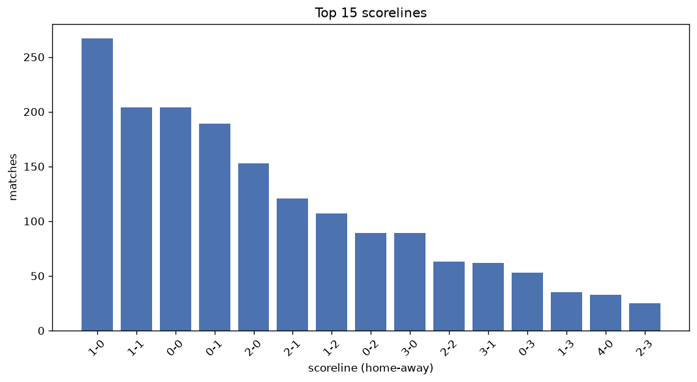
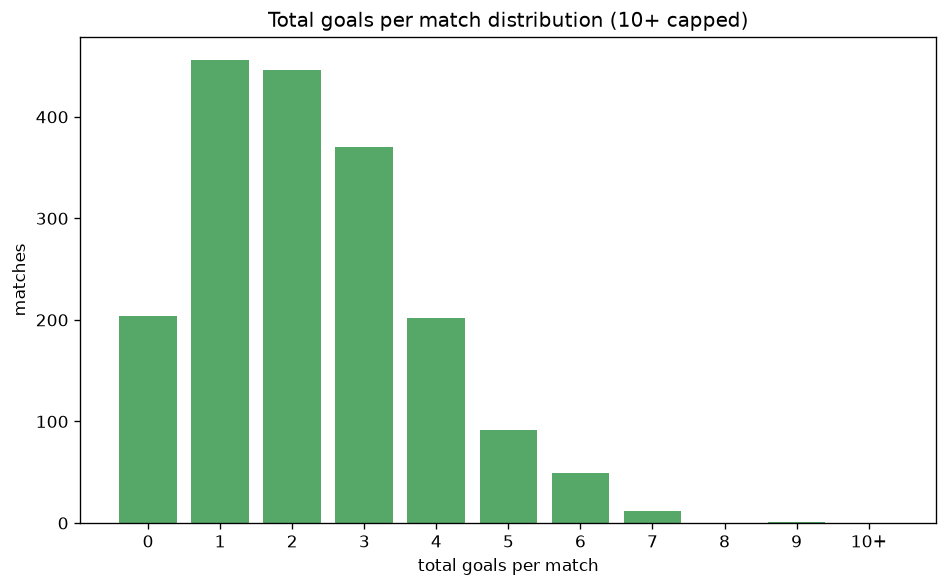

# Scoreline Analysis
- Report: `scoreline_analysis`
- Generated: 2026-10-26T01:34:53+00:00
- Script: `backend/scripts/analyze_scorelines.py` v1.0.0
- League: Super League 2 (Greece)
- Scope: league `greece2`

## 1. Scoreline frequency
- Matches analysed: **1832** across **7** seasons.
- Distinct scorelines seen: **34**.

| scoreline | count | pct |
|---|---|---|
| 1-0 | 267 | 14.6% |
| 1-1 | 204 | 11.1% |
| 0-0 | 204 | 11.1% |
| 0-1 | 189 | 10.3% |
| 2-0 | 153 | 8.4% |
| 2-1 | 121 | 6.6% |
| 1-2 | 107 | 5.8% |
| 0-2 | 89 | 4.9% |
| 3-0 | 89 | 4.9% |
| 2-2 | 63 | 3.4% |
| 3-1 | 62 | 3.4% |
| 0-3 | 53 | 2.9% |
| 1-3 | 35 | 1.9% |
| 4-0 | 33 | 1.8% |
| 2-3 | 25 | 1.4% |
| 3-2 | 22 | 1.2% |
| 4-1 | 18 | 1.0% |
| 5-0 | 13 | 0.7% |
| 4-2 | 11 | 0.6% |
| 5-1 | 11 | 0.6% |

## 2. Scoreline frequency per season

### 2020-2021
| scoreline | count | pct |
|---|---|---|
| 1-0 | 28 | 21.2% |
| 1-1 | 20 | 15.2% |
| 0-1 | 18 | 13.6% |
| 0-0 | 17 | 12.9% |
| 2-1 | 9 | 6.8% |

### 2021-2022
| scoreline | count | pct |
|---|---|---|
| 1-0 | 79 | 14.5% |
| 0-0 | 67 | 12.3% |
| 1-1 | 58 | 10.7% |
| 0-1 | 51 | 9.4% |
| 2-0 | 42 | 7.7% |

### 2022-2023
| scoreline | count | pct |
|---|---|---|
| 0-0 | 46 | 11.9% |
| 0-1 | 43 | 11.1% |
| 1-0 | 41 | 10.6% |
| 1-1 | 40 | 10.3% |
| 2-0 | 37 | 9.6% |

### 2023-2024
| scoreline | count | pct |
|---|---|---|
| 1-0 | 44 | 16.7% |
| 0-0 | 26 | 9.8% |
| 2-0 | 26 | 9.8% |
| 1-1 | 26 | 9.8% |
| 0-1 | 24 | 9.1% |

### 2024-2025
| scoreline | count | pct |
|---|---|---|
| 1-0 | 23 | 12.8% |
| 0-0 | 20 | 11.1% |
| 0-1 | 19 | 10.6% |
| 1-1 | 19 | 10.6% |
| 2-1 | 16 | 8.9% |

### 2025-2026
| scoreline | count | pct |
|---|---|---|
| 1-0 | 39 | 14.7% |
| 1-1 | 32 | 12.1% |
| 0-1 | 31 | 11.7% |
| 2-0 | 23 | 8.7% |
| 0-0 | 21 | 7.9% |

### 2026-2027
| scoreline | count | pct |
|---|---|---|
| 1-0 | 13 | 21.7% |
| 1-1 | 9 | 15.0% |
| 0-0 | 7 | 11.7% |
| 2-1 | 7 | 11.7% |
| 2-0 | 6 | 10.0% |

## 3. Total-goal histogram
_10+ groups all matches with 10 or more total goals._

| total goals | matches | pct |
|---|---|---|
| 0 | 204 | 11.1% |
| 1 | 456 | 24.9% |
| 2 | 446 | 24.3% |
| 3 | 370 | 20.2% |
| 4 | 202 | 11.0% |
| 5 | 92 | 5.0% |
| 6 | 49 | 2.7% |
| 7 | 12 | 0.7% |
| 8 | 0 | 0.0% |
| 9 | 1 | 0.1% |
| 10+ | 0 | 0.0% |

## 4. Extreme scorelines
- Matches with 7+ total goals: **13**

| season | date | scoreline | total goals |
|---|---|---|---|
| 2022-2023 | 2023-04-29 | 5-4 | 9 |
| 2021-2022 | 2021-11-21 | 7-0 | 7 |
| 2021-2022 | 2021-11-28 | 7-0 | 7 |
| 2021-2022 | 2021-12-16 | 7-0 | 7 |
| 2021-2022 | 2021-12-22 | 7-0 | 7 |
| 2021-2022 | 2022-02-06 | 5-2 | 7 |
| 2021-2022 | 2022-03-02 | 5-2 | 7 |
| 2022-2023 | 2022-11-07 | 5-2 | 7 |
| 2022-2023 | 2023-01-03 | 6-1 | 7 |
| 2022-2023 | 2023-04-02 | 5-2 | 7 |
| 2025-2026 | 2025-11-15 | 1-6 | 7 |
| 2025-2026 | 2026-04-18 | 4-3 | 7 |
| 2025-2026 | 2026-04-26 | 4-3 | 7 |

## 5. Margin-of-victory distribution (decided matches)
- Decided matches: **1352** (draws: **480**)
- Average winning margin: **1.76**

| margin | matches | pct |
|---|---|---|
| 1 | 734 | 54.3% |
| 2 | 355 | 26.3% |
| 3+ | 263 | 19.5% |

## 6. Margin by outcome

### Home wins
- Matches: **820** | avg margin: **1.85** | max margin: **7**
| margin | matches | pct |
|---|---|---|
| 1 | 413 | 50.4% |
| 2 | 226 | 27.6% |
| 3+ | 181 | 22.1% |
- *Full match-by-match list available in `scoreline_analysis.json`.*

### Away wins
- Matches: **532** | avg margin: **1.6** | max margin: **6**
| margin | matches | pct |
|---|---|---|
| 1 | 321 | 60.3% |
| 2 | 129 | 24.2% |
| 3+ | 82 | 15.4% |
- *Full match-by-match list available in `scoreline_analysis.json`.*

## 7. Most common exact score by outcome type
| outcome | matches | most common score | count | pct |
|---|---|---|---|---|
| home | 820 | 1-0 | 267 | 32.6% |
| draw | 480 | 1-1 | 204 | 42.5% |
| away | 532 | 0-1 | 189 | 35.5% |

---
*All statistics are computed from PostgreSQL tables (read-only). Run with `python backend/scripts/analyze_scorelines.py` to regenerate.*

## Charts

