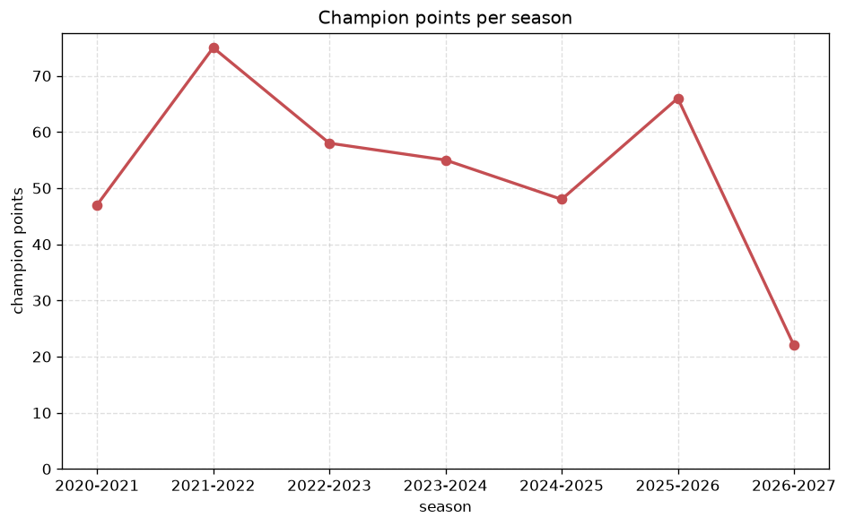
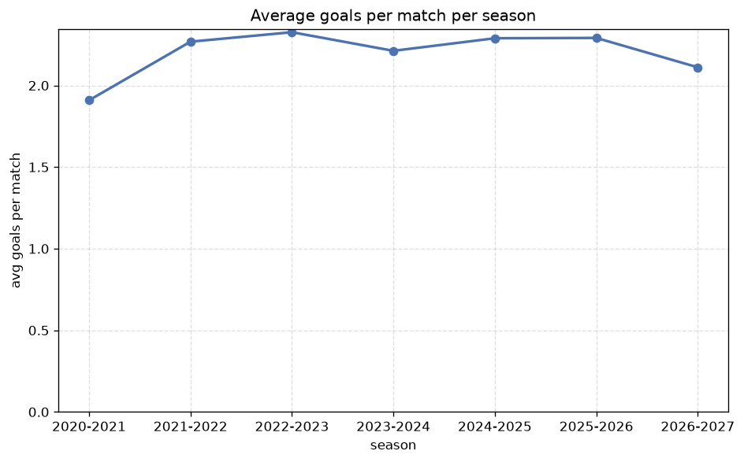

# Season Trends Analysis
- Report: `season_trends`
- Generated: 2026-10-27T01:51:01+00:00
- Script: `backend/scripts/analyze_seasons.py` v1.0.0
- League: Super League 2 (Greece)
- Scope: league `greece2`

## 1. Champions per season
| season | champion | pts | runner-up | margin |
|---|---|---|---|---|
| 2020-2021 | Ionikos | 47 | Levadiakos | 6 pts |
| 2021-2022 | Veria | 75 | Levadiakos | 3 pts |
| 2022-2023 | Panserraikos | 58 | Kifisia | 1 pts |
| 2023-2024 | Levadiakos | 55 | AEL Larissa | 6 pts |
| 2024-2025 | AEL Larissa | 48 | Kifisia | 3 pts |
| 2025-2026 | Kalamata | 66 | Iraklis 1908 | 6 pts |
| 2026-2027 | Marko | 22 | Athens Kallithea | 5 pts |

## 2. Title-race tightness
- Tight races (margin <= 3 pts): **3** of 7 seasons
- Tightest race: **2022-2023** - Panserraikos beat Kifisia by **1** pts

| season | margin | tight |
|---|---|---|
| 2020-2021 | 6 pts |  |
| 2021-2022 | 3 pts | yes |
| 2022-2023 | 1 pts | yes |
| 2023-2024 | 6 pts |  |
| 2024-2025 | 3 pts | yes |
| 2025-2026 | 6 pts |  |
| 2026-2027 | 5 pts |  |

## 3. Points thresholds
_Position-specific points per season. Key: 1 = champion, 2 = runner-up, 4 = CL line, 6 = Europa, 13 = last safe, 16 = bottom._

| season | pos 1 | pos 2 | pos 4 | pos 6 | pos 13 | pos 16 |
|---|---|---|---|---|---|---|
| 2020-2021 | 47 | 41 | 36 | 30 | - | - |
| 2021-2022 | 75 | 72 | 65 | 55 | 48 | 44 |
| 2022-2023 | 58 | 57 | 56 | 49 | 41 | 33 |
| 2023-2024 | 55 | 49 | 44 | 36 | 29 | 25 |
| 2024-2025 | 48 | 45 | 36 | 31 | 19 | 15 |
| 2025-2026 | 66 | 60 | 48 | 45 | 35 | 23 |
| 2026-2027 | 22 | 17 | 14 | 11 | 8 | 3 |

## 4. Relegation battle
| season | safe pos | safe pts | drop pos | drop pts | gap |
|---|---|---|---|---|---|
| 2020-2021 | 13 | - | 14 | - | - |
| 2021-2022 | 13 | 48 | 14 | 48 | 0 pts |
| 2022-2023 | 13 | 41 | 14 | 41 | 0 pts |
| 2023-2024 | 13 | 29 | 14 | 29 | 0 pts |
| 2024-2025 | 13 | 19 | 14 | 17 | 2 pts |
| 2025-2026 | 13 | 35 | 14 | 31 | 4 pts |
| 2026-2027 | 13 | 8 | 14 | 6 | 2 pts |

## 5. League-level trends
| season | matches | total goals | avg goals | home win | draw | away win | goalless | avg pts/team |
|---|---|---|---|---|---|---|---|---|
| 2020-2021 | 132 | 252 | 1.909 | 40.2% | 29.5% | 30.3% | 12.9% | 29.75 |
| 2021-2022 | 544 | 1234 | 2.268 | 46.9% | 27.4% | 25.7% | 12.3% | 43.62 |
| 2022-2023 | 387 | 900 | 2.326 | 40.6% | 25.6% | 33.9% | 11.9% | 35.4 |
| 2023-2024 | 264 | 584 | 2.212 | 49.2% | 23.9% | 26.9% | 9.8% | 29.16 |
| 2024-2025 | 180 | 412 | 2.289 | 42.8% | 27.8% | 29.4% | 11.1% | 24.5 |
| 2025-2026 | 265 | 607 | 2.291 | 44.2% | 23.0% | 32.8% | 7.9% | 36.7 |
| 2026-2027 | 63 | 133 | 2.111 | 50.8% | 31.7% | 17.5% | 11.1% | 10.56 |

## 6. View divergence
- Largest divergence: **2021-2022** (goals view, avg abs position diff = 13.000)

_Avg absolute position difference between classic view and alternative view per season._

| season | classic vs luck | classic vs goals |
|---|---|---|
| 2020-2021 | 2.167 | 4.000 |
| 2021-2022 | 5.059 | 13.000 |
| 2022-2023 | 4.600 | 10.800 |
| 2023-2024 | 5.840 | 9.360 |
| 2024-2025 | 2.600 | 4.500 |
| 2025-2026 | 3.700 | 7.500 |
| 2026-2027 | 3.125 | 4.250 |

---
*All statistics are computed from PostgreSQL tables (read-only). Run with `python backend/scripts/analyze_seasons.py` to regenerate.*

## Charts

