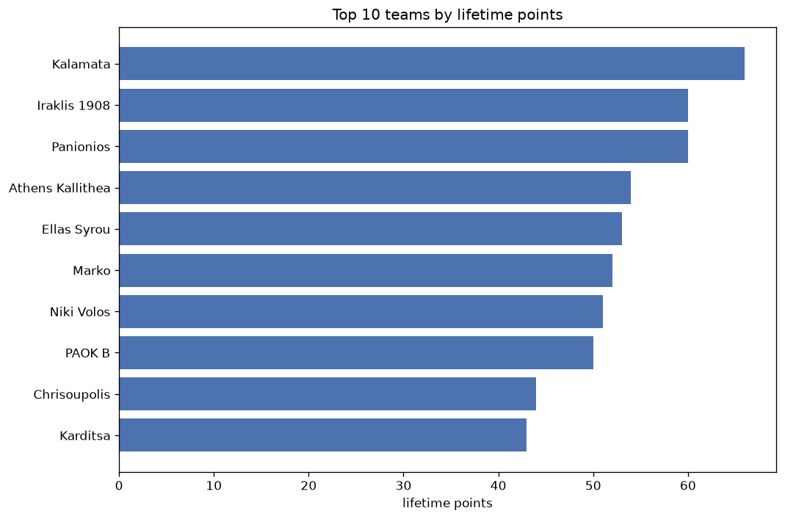
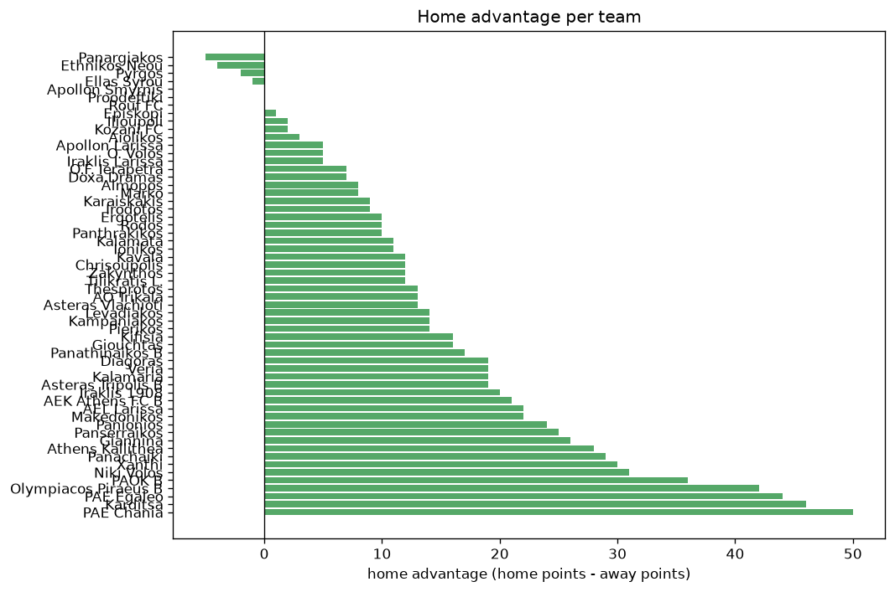

# Team Analysis
- Report: `teams_analysis`
- Generated: 2026-10-29T02:02:04+00:00
- Script: `backend/scripts/analyze_teams.py` v1.0.0
- League: Super League 2 (Greece)
- Scope: league `greece2`

- Teams: **58** | Seasons: **7** | Matches: **1836**

## 1. Team standings (lifetime)
| team | seasons | played | W | D | L | pts | GF | GA | GD | avg pts/season | best pos | worst pos | titles |
|---|---|---|---|---|---|---|---|---|---|---|---|---|---|
| Kalamata | 5 | 124 | 75 | 28 | 21 | 253 | 188 | 74 | 114 | 50.6 | 1 | 11 | 1 |
| AEL Larissa | 5 | 107 | 68 | 28 | 11 | 232 | 168 | 60 | 108 | 46.4 | 1 | 5 | 1 |
| Athens Kallithea | 5 | 115 | 67 | 29 | 19 | 230 | 164 | 81 | 83 | 46.0 | 2 | 7 | 0 |
| PAE Chania | 6 | 149 | 60 | 44 | 45 | 224 | 175 | 127 | 48 | 37.33 | 4 | 15 | 0 |
| Iraklis 1908 | 5 | 123 | 60 | 40 | 23 | 220 | 197 | 100 | 97 | 44.0 | 2 | 13 | 0 |
| Niki Volos | 6 | 131 | 58 | 39 | 34 | 213 | 185 | 105 | 80 | 35.5 | 4 | 10 | 0 |
| PAOK B | 6 | 135 | 55 | 29 | 51 | 194 | 190 | 158 | 32 | 32.33 | 5 | 16 | 0 |
| Karditsa | 5 | 113 | 50 | 26 | 37 | 176 | 134 | 104 | 30 | 35.2 | 7 | 14 | 0 |
| Levadiakos | 3 | 76 | 50 | 18 | 8 | 168 | 136 | 40 | 96 | 56.0 | 1 | 2 | 1 |
| Olympiacos Piraeus B | 5 | 111 | 44 | 30 | 37 | 162 | 143 | 136 | 7 | 32.4 | 8 | 15 | 0 |
| PAE Egaleo | 5 | 127 | 43 | 33 | 51 | 162 | 111 | 139 | -28 | 32.4 | 9 | 17 | 0 |
| Kifisia | 3 | 75 | 46 | 14 | 15 | 152 | 130 | 60 | 70 | 50.67 | 2 | 12 | 0 |
| Diagoras | 5 | 121 | 36 | 31 | 54 | 139 | 103 | 149 | -46 | 27.8 | 6 | 22 | 0 |
| AEK Athens FC B | 4 | 99 | 32 | 33 | 34 | 129 | 108 | 105 | 3 | 32.25 | 9 | 23 | 0 |
| Ilioupoli | 4 | 96 | 32 | 20 | 44 | 116 | 91 | 127 | -36 | 29.0 | 7 | 18 | 0 |
| Panserraikos | 3 | 66 | 29 | 18 | 19 | 105 | 80 | 60 | 20 | 35.0 | 1 | 27 | 1 |
| Veria | 2 | 59 | 30 | 13 | 16 | 103 | 86 | 55 | 31 | 51.5 | 1 | 22 | 1 |
| Panachaiki | 4 | 89 | 25 | 28 | 36 | 103 | 83 | 101 | -18 | 25.75 | 7 | 20 | 0 |
| Makedonikos | 4 | 95 | 25 | 27 | 43 | 102 | 92 | 135 | -43 | 25.5 | 7 | 19 | 0 |
| Panionios | 3 | 50 | 28 | 14 | 8 | 98 | 70 | 32 | 38 | 32.67 | 3 | 5 | 0 |
| O.F. Ierapetra | 3 | 81 | 25 | 20 | 36 | 95 | 96 | 106 | -10 | 31.67 | 10 | 20 | 0 |
| Xanthi | 2 | 54 | 24 | 22 | 8 | 94 | 67 | 35 | 32 | 47.0 | 3 | 7 | 0 |
| Panathinaikos B | 3 | 81 | 21 | 22 | 38 | 85 | 85 | 117 | -32 | 28.33 | 18 | 26 | 0 |
| Kalamaria | 4 | 89 | 22 | 19 | 48 | 85 | 70 | 129 | -59 | 21.25 | 12 | 24 | 0 |
| Ionikos | 2 | 44 | 24 | 11 | 9 | 83 | 69 | 42 | 27 | 41.5 | 1 | 6 | 1 |
| Kavala | 3 | 78 | 18 | 24 | 36 | 78 | 66 | 136 | -70 | 26.0 | 13 | 29 | 0 |
| Ergotelis | 2 | 54 | 22 | 10 | 22 | 76 | 52 | 47 | 5 | 38.0 | 4 | 17 | 0 |
| Almopos | 3 | 59 | 16 | 24 | 19 | 72 | 60 | 56 | 4 | 24.0 | 16 | 25 | 0 |
| Kampaniakos | 3 | 68 | 20 | 12 | 36 | 72 | 68 | 110 | -42 | 24.0 | 8 | 18 | 0 |
| Apollon Larissa | 3 | 66 | 17 | 18 | 31 | 69 | 48 | 95 | -47 | 23.0 | 9 | 28 | 0 |
| Marko | 2 | 32 | 18 | 8 | 6 | 62 | 43 | 22 | 21 | 31.0 | 1 | 9 | 1 |
| Asteras Tripolis B | 3 | 50 | 15 | 16 | 19 | 61 | 52 | 63 | -11 | 20.33 | 10 | 16 | 0 |
| Episkopi | 2 | 57 | 16 | 13 | 28 | 61 | 41 | 72 | -31 | 30.5 | 14 | 27 | 0 |
| Apollon Smyrnis | 1 | 28 | 16 | 8 | 4 | 56 | 37 | 20 | 17 | 56.0 | 4 | 4 | 0 |
| Ellas Syrou | 2 | 36 | 14 | 13 | 9 | 55 | 51 | 31 | 20 | 27.5 | 6 | 8 | 0 |
| Giannina | 2 | 46 | 13 | 13 | 20 | 52 | 47 | 62 | -15 | 26.0 | 6 | 17 | 0 |
| Thesprotos | 2 | 59 | 11 | 18 | 30 | 51 | 57 | 92 | -35 | 25.5 | 25 | 26 | 0 |
| Chrisoupolis | 2 | 36 | 13 | 9 | 14 | 48 | 37 | 36 | 1 | 24.0 | 10 | 11 | 0 |
| Karaiskakis | 2 | 54 | 10 | 15 | 29 | 45 | 38 | 82 | -44 | 22.5 | 11 | 32 | 0 |
| AO Trikala | 2 | 54 | 10 | 15 | 29 | 45 | 33 | 82 | -49 | 22.5 | 8 | 34 | 0 |
| Irodotos | 2 | 47 | 11 | 8 | 28 | 41 | 35 | 72 | -37 | 20.5 | 21 | 30 | 0 |
| Asteras Vlachioti | 1 | 32 | 9 | 8 | 15 | 35 | 32 | 38 | -6 | 35.0 | 23 | 23 | 0 |
| Pierikos | 1 | 32 | 7 | 11 | 14 | 32 | 36 | 49 | -13 | 32.0 | 28 | 28 | 0 |
| Rodos | 1 | 32 | 8 | 6 | 18 | 30 | 27 | 48 | -21 | 30.0 | 30 | 30 | 0 |
| O. Volos | 1 | 32 | 7 | 8 | 17 | 29 | 34 | 49 | -15 | 29.0 | 31 | 31 | 0 |
| Proodeftiki | 1 | 27 | 7 | 5 | 15 | 26 | 20 | 37 | -17 | 26.0 | 24 | 24 | 0 |
| Panargiakos | 2 | 46 | 5 | 10 | 31 | 25 | 28 | 78 | -50 | 12.5 | 17 | 20 | 0 |
| Kozani FC | 1 | 22 | 6 | 6 | 10 | 24 | 10 | 17 | -7 | 24.0 | 17 | 17 | 0 |
| Zakynthos | 2 | 40 | 5 | 9 | 26 | 24 | 25 | 76 | -51 | 12.0 | 16 | 33 | 0 |
| Iraklis Larissa | 1 | 27 | 6 | 5 | 16 | 23 | 14 | 42 | -28 | 23.0 | 25 | 25 | 0 |
| Giouchtas | 1 | 22 | 5 | 7 | 10 | 22 | 20 | 28 | -8 | 22.0 | 19 | 19 | 0 |
| Doxa Dramas | 1 | 22 | 6 | 3 | 13 | 21 | 17 | 37 | -20 | 21.0 | 10 | 10 | 0 |
| Aiolikos | 1 | 22 | 4 | 7 | 11 | 19 | 20 | 36 | -16 | 19.0 | 22 | 22 | 0 |
| Tilikratis L. | 1 | 22 | 5 | 3 | 14 | 18 | 17 | 37 | -20 | 18.0 | 23 | 23 | 0 |
| Panthrakikos | 1 | 8 | 2 | 4 | 2 | 10 | 9 | 8 | 1 | 10.0 | 9 | 9 | 0 |
| Pyrgos | 1 | 8 | 2 | 2 | 4 | 8 | 5 | 9 | -4 | 8.0 | 13 | 13 | 0 |
| Ethnikos Neou | 1 | 18 | 1 | 5 | 12 | 8 | 8 | 23 | -15 | 8.0 | 20 | 20 | 0 |
| Rouf FC | 1 | 26 | 1 | 3 | 22 | 6 | 19 | 60 | -41 | 6.0 | 29 | 29 | 0 |

## 2. Home vs away split
| team | home P | H-W | H-D | H-L | H-pts | away P | A-W | A-D | A-L | A-pts | adv |
|---|---|---|---|---|---|---|---|---|---|---|---|
| PAE Chania | 75 | 39 | 20 | 16 | 137 | 74 | 21 | 24 | 29 | 87 | 50 |
| Karditsa | 55 | 34 | 9 | 12 | 111 | 58 | 16 | 17 | 25 | 65 | 46 |
| PAE Egaleo | 63 | 28 | 19 | 16 | 103 | 64 | 15 | 14 | 35 | 59 | 44 |
| Olympiacos Piraeus B | 56 | 29 | 15 | 12 | 102 | 55 | 15 | 15 | 25 | 60 | 42 |
| PAOK B | 68 | 33 | 16 | 19 | 115 | 67 | 22 | 13 | 32 | 79 | 36 |
| Niki Volos | 65 | 35 | 17 | 13 | 122 | 66 | 23 | 22 | 21 | 91 | 31 |
| Xanthi | 27 | 18 | 8 | 1 | 62 | 27 | 6 | 14 | 7 | 32 | 30 |
| Panachaiki | 44 | 17 | 15 | 12 | 66 | 45 | 8 | 13 | 24 | 37 | 29 |
| Athens Kallithea | 58 | 39 | 12 | 7 | 129 | 57 | 28 | 17 | 12 | 101 | 28 |
| Giannina | 23 | 10 | 9 | 4 | 39 | 23 | 3 | 4 | 16 | 13 | 26 |
| Panserraikos | 33 | 19 | 8 | 6 | 65 | 33 | 10 | 10 | 13 | 40 | 25 |
| Panionios | 26 | 19 | 4 | 3 | 61 | 24 | 9 | 10 | 5 | 37 | 24 |
| AEL Larissa | 53 | 38 | 13 | 2 | 127 | 54 | 30 | 15 | 9 | 105 | 22 |
| Makedonikos | 47 | 16 | 14 | 17 | 62 | 48 | 9 | 13 | 26 | 40 | 22 |
| AEK Athens FC B | 49 | 20 | 15 | 14 | 75 | 50 | 12 | 18 | 20 | 54 | 21 |
| Iraklis 1908 | 61 | 33 | 21 | 7 | 120 | 62 | 27 | 19 | 16 | 100 | 20 |
| Diagoras | 61 | 20 | 19 | 22 | 79 | 60 | 16 | 12 | 32 | 60 | 19 |
| Veria | 30 | 19 | 4 | 7 | 61 | 29 | 11 | 9 | 9 | 42 | 19 |
| Kalamaria | 44 | 13 | 13 | 18 | 52 | 45 | 9 | 6 | 30 | 33 | 19 |
| Asteras Tripolis B | 24 | 11 | 7 | 6 | 40 | 26 | 4 | 9 | 13 | 21 | 19 |
| Panathinaikos B | 41 | 13 | 12 | 16 | 51 | 40 | 8 | 10 | 22 | 34 | 17 |
| Kifisia | 38 | 26 | 6 | 6 | 84 | 37 | 20 | 8 | 9 | 68 | 16 |
| Giouchtas | 11 | 5 | 4 | 2 | 19 | 11 | 0 | 3 | 8 | 3 | 16 |
| Levadiakos | 38 | 27 | 10 | 1 | 91 | 38 | 23 | 8 | 7 | 77 | 14 |
| Kampaniakos | 34 | 12 | 7 | 15 | 43 | 34 | 8 | 5 | 21 | 29 | 14 |
| Pierikos | 16 | 5 | 8 | 3 | 23 | 16 | 2 | 3 | 11 | 9 | 14 |
| Thesprotos | 30 | 7 | 11 | 12 | 32 | 29 | 4 | 7 | 18 | 19 | 13 |
| AO Trikala | 27 | 7 | 8 | 12 | 29 | 27 | 3 | 7 | 17 | 16 | 13 |
| Asteras Vlachioti | 16 | 6 | 6 | 4 | 24 | 16 | 3 | 2 | 11 | 11 | 13 |
| Kavala | 39 | 10 | 15 | 14 | 45 | 39 | 8 | 9 | 22 | 33 | 12 |
| Chrisoupolis | 18 | 9 | 3 | 6 | 30 | 18 | 4 | 6 | 8 | 18 | 12 |
| Zakynthos | 19 | 4 | 6 | 9 | 18 | 21 | 1 | 3 | 17 | 6 | 12 |
| Tilikratis L. | 11 | 4 | 3 | 4 | 15 | 11 | 1 | 0 | 10 | 3 | 12 |
| Kalamata | 62 | 40 | 12 | 10 | 132 | 62 | 35 | 16 | 11 | 121 | 11 |
| Ionikos | 22 | 14 | 5 | 3 | 47 | 22 | 10 | 6 | 6 | 36 | 11 |
| Ergotelis | 27 | 13 | 4 | 10 | 43 | 27 | 9 | 6 | 12 | 33 | 10 |
| Rodos | 16 | 6 | 2 | 8 | 20 | 16 | 2 | 4 | 10 | 10 | 10 |
| Panthrakikos | 6 | 2 | 4 | 0 | 10 | 2 | 0 | 0 | 2 | 0 | 10 |
| Karaiskakis | 27 | 7 | 6 | 14 | 27 | 27 | 3 | 9 | 15 | 18 | 9 |
| Irodotos | 25 | 7 | 4 | 14 | 25 | 22 | 4 | 4 | 14 | 16 | 9 |
| Almopos | 29 | 9 | 13 | 7 | 40 | 30 | 7 | 11 | 12 | 32 | 8 |
| Marko | 17 | 10 | 5 | 2 | 35 | 15 | 8 | 3 | 4 | 27 | 8 |
| O.F. Ierapetra | 40 | 13 | 12 | 15 | 51 | 41 | 12 | 8 | 21 | 44 | 7 |
| Doxa Dramas | 11 | 4 | 2 | 5 | 14 | 11 | 2 | 1 | 8 | 7 | 7 |
| Apollon Larissa | 33 | 9 | 10 | 14 | 37 | 33 | 8 | 8 | 17 | 32 | 5 |
| O. Volos | 16 | 5 | 2 | 9 | 17 | 16 | 2 | 6 | 8 | 12 | 5 |
| Iraklis Larissa | 13 | 4 | 2 | 7 | 14 | 14 | 2 | 3 | 9 | 9 | 5 |
| Aiolikos | 11 | 2 | 5 | 4 | 11 | 11 | 2 | 2 | 7 | 8 | 3 |
| Ilioupoli | 48 | 17 | 8 | 23 | 59 | 48 | 15 | 12 | 21 | 57 | 2 |
| Kozani FC | 11 | 4 | 1 | 6 | 13 | 11 | 2 | 5 | 4 | 11 | 2 |
| Episkopi | 28 | 8 | 7 | 13 | 31 | 29 | 8 | 6 | 15 | 30 | 1 |
| Apollon Smyrnis | 14 | 8 | 4 | 2 | 28 | 14 | 8 | 4 | 2 | 28 | 0 |
| Proodeftiki | 14 | 4 | 1 | 9 | 13 | 13 | 3 | 4 | 6 | 13 | 0 |
| Rouf FC | 13 | 0 | 3 | 10 | 3 | 13 | 1 | 0 | 12 | 3 | 0 |
| Ellas Syrou | 18 | 7 | 6 | 5 | 27 | 18 | 7 | 7 | 4 | 28 | -1 |
| Pyrgos | 3 | 1 | 0 | 2 | 3 | 5 | 1 | 2 | 2 | 5 | -2 |
| Ethnikos Neou | 9 | 0 | 2 | 7 | 2 | 9 | 1 | 3 | 5 | 6 | -4 |
| Panargiakos | 23 | 2 | 4 | 17 | 10 | 23 | 3 | 6 | 14 | 15 | -5 |

## 3. Top performers
### Best points per game (PPG)
| rank | team | PPG |
|---|---|---|
| 1 | Levadiakos | 2.21 |
| 2 | AEL Larissa | 2.17 |
| 3 | Kalamata | 2.04 |
| 4 | Kifisia | 2.03 |
| 5 | Athens Kallithea | 2.00 |

### Most goals scored
| rank | team | goals |
|---|---|---|
| 1 | Iraklis 1908 | 197 |
| 2 | PAOK B | 190 |
| 3 | Kalamata | 188 |
| 4 | Niki Volos | 185 |
| 5 | PAE Chania | 175 |

### Best goal difference
| rank | team | GD |
|---|---|---|
| 1 | Kalamata | 114 |
| 2 | AEL Larissa | 108 |
| 3 | Iraklis 1908 | 97 |
| 4 | Levadiakos | 96 |
| 5 | Athens Kallithea | 83 |

### Best defence (goals against per match, standings)
| rank | team | GA/match |
|---|---|---|
| 1 | Levadiakos | 0.526 |
| 2 | AEL Larissa | 0.561 |
| 3 | Kalamata | 0.597 |
| 4 | Panionios | 0.640 |
| 5 | Xanthi | 0.648 |

## 4. Team consistency
- Teams present in all **7** seasons: **0**

## 5. Head-to-head dominance
- Distinct fixtures: **640** (showing the 15 most frequent)

| fixture | meetings | home wins | draws | away wins | home pct | draw pct | away pct |
|---|---|---|---|---|---|---|---|
| PAE Chania vs PAE Egaleo | 12 | 7 | 4 | 1 | 58.3% | 33.3% | 8.3% |
| Iraklis 1908 vs Niki Volos | 12 | 5 | 6 | 1 | 41.7% | 50.0% | 8.3% |
| PAOK B vs Makedonikos | 10 | 7 | 1 | 2 | 70.0% | 10.0% | 20.0% |
| Niki Volos vs PAOK B | 10 | 6 | 2 | 2 | 60.0% | 20.0% | 20.0% |
| PAE Chania vs Ilioupoli | 10 | 6 | 1 | 3 | 60.0% | 10.0% | 30.0% |
| PAE Egaleo vs Ilioupoli | 10 | 5 | 1 | 4 | 50.0% | 10.0% | 40.0% |
| Athens Kallithea vs PAE Chania | 10 | 4 | 3 | 3 | 40.0% | 30.0% | 30.0% |
| Athens Kallithea vs PAE Egaleo | 10 | 4 | 5 | 1 | 40.0% | 50.0% | 10.0% |
| Iraklis 1908 vs Karditsa | 10 | 4 | 4 | 2 | 40.0% | 40.0% | 20.0% |
| Iraklis 1908 vs PAOK B | 10 | 4 | 4 | 2 | 40.0% | 40.0% | 20.0% |
| Niki Volos vs Karditsa | 10 | 4 | 4 | 2 | 40.0% | 40.0% | 20.0% |
| Kalamata vs PAE Chania | 10 | 3 | 3 | 4 | 30.0% | 30.0% | 40.0% |
| Kalamata vs PAE Egaleo | 10 | 3 | 3 | 4 | 30.0% | 30.0% | 40.0% |
| AEL Larissa vs PAOK B | 9 | 6 | 1 | 2 | 66.7% | 11.1% | 22.2% |
| Karditsa vs PAOK B | 9 | 6 | 0 | 3 | 66.7% | 0.0% | 33.3% |

## 6. Position per season (classic view)
_Cells show final position; '-' when the team was absent from that season._

| team | 2020-2021 | 2021-2022 | 2022-2023 | 2023-2024 | 2024-2025 | 2025-2026 | 2026-2027 |
|---|---|---|---|---|---|---|---|
| Kalamata | - | 5 | 11 | 5 | 3 | 1 | - |
| AEL Larissa | - | 3 | 5 | 2 | 1 | - | 5 |
| Athens Kallithea | - | 4 | 3 | 3 | - | 7 | 2 |
| PAE Chania | 5 | 6 | 7 | 4 | 14 | 15 | - |
| Iraklis 1908 | - | 13 | 8 | 13 | 4 | 2 | - |
| Niki Volos | - | 8 | 6 | 9 | 10 | 4 | 6 |
| PAOK B | - | 16 | 9 | 12 | 11 | 5 | 14 |
| Karditsa | - | 10 | 12 | 14 | - | 8 | 7 |
| Levadiakos | 2 | 2 | - | 1 | - | - | - |
| Olympiacos Piraeus B | - | 11 | 13 | 8 | - | 14 | 15 |
| PAE Egaleo | - | 15 | 17 | 16 | 9 | 12 | - |
| Kifisia | - | 12 | 2 | - | 2 | - | - |
| Diagoras | 6 | 22 | 20 | 15 | 15 | - | - |
| AEK Athens FC B | - | 9 | 23 | 10 | 13 | - | - |
| Ilioupoli | - | - | 14 | 7 | 12 | 18 | - |
| Panserraikos | - | 27 | 1 | - | - | - | 3 |
| Veria | - | 1 | 22 | - | - | - | - |
| Panachaiki | 7 | - | 15 | 20 | 18 | - | - |
| Makedonikos | - | - | 19 | 11 | 7 | 19 | - |
| Panionios | - | - | - | - | 5 | 3 | 4 |
| O.F. Ierapetra | 12 | 20 | 10 | - | - | - | - |
| Xanthi | 3 | 7 | - | - | - | - | - |
| Panathinaikos B | - | 26 | 18 | 21 | - | - | - |
| Kalamaria | - | 19 | 21 | 24 | - | - | 12 |
| Ionikos | 1 | - | - | 6 | - | - | - |
| Kavala | - | 29 | - | - | 19 | 13 | - |
| Ergotelis | 4 | 17 | - | - | - | - | - |
| Almopos | - | 18 | 16 | 25 | - | - | - |
| Kampaniakos | - | - | - | 18 | 8 | 16 | - |
| Apollon Larissa | 9 | 24 | 28 | - | - | - | - |
| Marko | - | - | - | - | - | 9 | 1 |
| Asteras Tripolis B | - | - | - | - | 16 | 11 | 10 |
| Episkopi | - | 14 | 27 | - | - | - | - |
| Apollon Smyrnis | - | - | 4 | - | - | - | - |
| Ellas Syrou | - | - | - | - | - | 6 | 8 |
| Giannina | - | - | - | - | 6 | 17 | - |
| Thesprotos | - | 25 | 26 | - | - | - | - |
| Chrisoupolis | - | - | - | - | - | 10 | 11 |
| Karaiskakis | 11 | 32 | - | - | - | - | - |
| AO Trikala | 8 | 34 | - | - | - | - | - |
| Irodotos | - | 21 | 30 | - | - | - | - |
| Asteras Vlachioti | - | 23 | - | - | - | - | - |
| Pierikos | - | 28 | - | - | - | - | - |
| Rodos | - | 30 | - | - | - | - | - |
| O. Volos | - | 31 | - | - | - | - | - |
| Proodeftiki | - | - | 24 | - | - | - | - |
| Panargiakos | - | - | - | - | 17 | 20 | - |
| Kozani FC | - | - | - | 17 | - | - | - |
| Zakynthos | - | 33 | - | - | - | - | 16 |
| Iraklis Larissa | - | - | 25 | - | - | - | - |
| Giouchtas | - | - | - | 19 | - | - | - |
| Doxa Dramas | 10 | - | - | - | - | - | - |
| Aiolikos | - | - | - | 22 | - | - | - |
| Tilikratis L. | - | - | - | 23 | - | - | - |
| Panthrakikos | - | - | - | - | - | - | 9 |
| Pyrgos | - | - | - | - | - | - | 13 |
| Ethnikos Neou | - | - | - | - | 20 | - | - |
| Rouf FC | - | - | 29 | - | - | - | - |

---
*All statistics are computed from PostgreSQL tables (read-only). Run with `python backend/scripts/analyze_teams.py` to regenerate.*

## Charts

