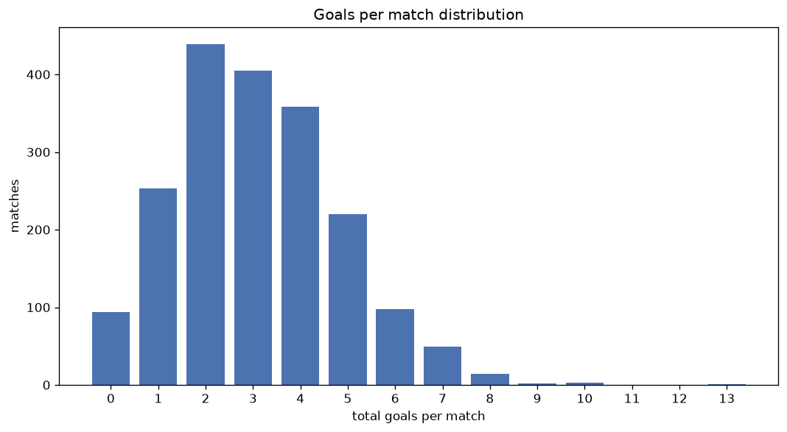
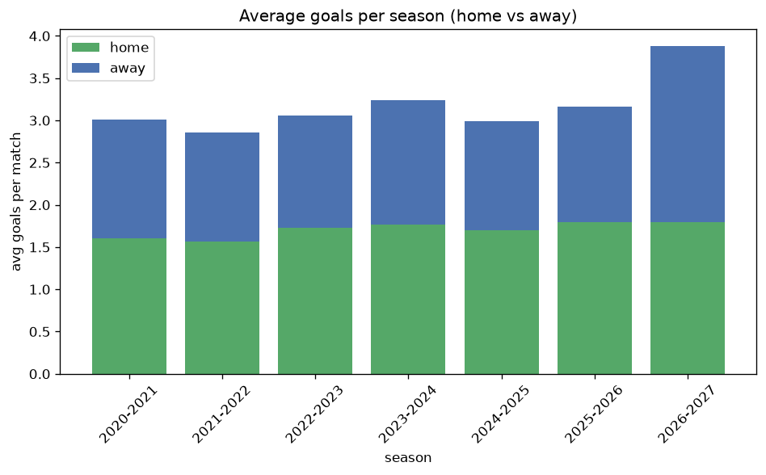

# Goal Analysis
- Report: `goals_analysis`
- Generated: 2026-10-26T01:35:08+00:00
- Script: `backend/scripts/analyze_goals.py` v1.0.0
- League: Eredivisie (Netherlands)
- Scope: league `holland1`

## 1. Goals per match distribution
| goals | matches | pct |
|---|---|---|
| 0 | 94 | 4.9% |
| 1 | 253 | 13.1% |
| 2 | 439 | 22.7% |
| 3 | 405 | 20.9% |
| 4 | 358 | 18.5% |
| 5 | 220 | 11.4% |
| 6 | 98 | 5.1% |
| 7 | 49 | 2.5% |
| 8 | 14 | 0.7% |
| 9 | 2 | 0.1% |
| 10 | 3 | 0.2% |
| 11 | 0 | 0.0% |
| 12 | 0 | 0.0% |
| 13 | 1 | 0.1% |

## 2. Goals per match per season
| season | matches | total goals | avg home | avg away | avg total |
|---|---|---|---|---|---|
| 2020-2021 | 306 | 920 | 1.608 | 1.399 | 3.007 |
| 2021-2022 | 306 | 875 | 1.569 | 1.291 | 2.859 |
| 2022-2023 | 306 | 935 | 1.729 | 1.327 | 3.056 |
| 2023-2024 | 306 | 992 | 1.768 | 1.474 | 3.242 |
| 2024-2025 | 306 | 914 | 1.696 | 1.291 | 2.987 |
| 2025-2026 | 321 | 1016 | 1.794 | 1.371 | 3.165 |
| 2026-2027 | 85 | 330 | 1.8 | 2.082 | 3.882 |

## 3. Home vs away goal share
- Home goals: **3290** (55.0%)
- Away goals: **2692** (45.0%)
- Home/away ratio: **1.222**

| season | home goals | away goals | total | home pct | away pct |
|---|---|---|---|---|---|
| 2020-2021 | 492 | 428 | 920 | 53.5% | 46.5% |
| 2021-2022 | 480 | 395 | 875 | 54.9% | 45.1% |
| 2022-2023 | 529 | 406 | 935 | 56.6% | 43.4% |
| 2023-2024 | 541 | 451 | 992 | 54.5% | 45.5% |
| 2024-2025 | 519 | 395 | 914 | 56.8% | 43.2% |
| 2025-2026 | 576 | 440 | 1016 | 56.7% | 43.3% |
| 2026-2027 | 153 | 177 | 330 | 46.4% | 53.6% |

## 4. BTTS (Both Teams To Score)
- Overall: **1108** of `1936` (57.2%)

| season | matches | BTTS | pct |
|---|---|---|---|
| 2020-2021 | 306 | 172 | 56.2% |
| 2021-2022 | 306 | 168 | 54.9% |
| 2022-2023 | 306 | 161 | 52.6% |
| 2023-2024 | 306 | 173 | 56.5% |
| 2024-2025 | 306 | 170 | 55.6% |
| 2025-2026 | 321 | 202 | 62.9% |
| 2026-2027 | 85 | 62 | 72.9% |

## 5. Clean sheets
- Home clean sheets: **535** (27.6%)
- Away clean sheets: **387** (20.0%)
- Total clean sheets recorded: **922**
- Matches with at least one clean sheet: **828** (42.8%)
- Both teams kept clean sheets (0-0): **94**

| season | matches | home CS | away CS | total CS | matches w/ CS |
|---|---|---|---|---|---|
| 2020-2021 | 306 | 85 | 65 | 150 | 134 (43.8%) |
| 2021-2022 | 306 | 83 | 70 | 153 | 138 (45.1%) |
| 2022-2023 | 306 | 96 | 74 | 170 | 145 (47.4%) |
| 2023-2024 | 306 | 85 | 63 | 148 | 133 (43.5%) |
| 2024-2025 | 306 | 97 | 51 | 148 | 136 (44.4%) |
| 2025-2026 | 321 | 77 | 52 | 129 | 119 (37.1%) |
| 2026-2027 | 85 | 12 | 12 | 24 | 23 (27.1%) |

## 6. Scoring intensity
- First-half goals: **2627** (43.9%)
- Second-half goals: **3355** (56.1%)
- Avg first-half goals per match: **1.357**
- Avg second-half goals per match: **1.733**
- Second-half-only scoring (HT 0-0, FT goals >= 1): **389** (20.1%)

| season | matches | 1st half | 2nd half | 1st half pct | 2nd half pct |
|---|---|---|---|---|---|
| 2020-2021 | 306 | 389 | 531 | 42.3% | 57.7% |
| 2021-2022 | 306 | 418 | 457 | 47.8% | 52.2% |
| 2022-2023 | 306 | 417 | 518 | 44.6% | 55.4% |
| 2023-2024 | 306 | 401 | 591 | 40.4% | 59.6% |
| 2024-2025 | 306 | 406 | 508 | 44.4% | 55.6% |
| 2025-2026 | 321 | 455 | 561 | 44.8% | 55.2% |
| 2026-2027 | 85 | 141 | 189 | 42.7% | 57.3% |

## 7. First-goal timing
- Matches with first-goal time recorded: `1842` of `1936` (95.1%)
- Goalless matches: `94`
- Min `1` | Max `96` | Mean `28.87` | Median (p50) `22.0`

| bucket | count | % of matches | % of scoring matches |
|---|---|---|---|
| 1-15 | 685 | 35.4% | 37.2% |
| 16-30 | 441 | 22.8% | 23.9% |
| 31-45 | 281 | 14.5% | 15.3% |
| 46-60 | 226 | 11.7% | 12.3% |
| 61-75 | 114 | 5.9% | 6.2% |
| 76-90 | 80 | 4.1% | 4.3% |
| 91-120 | 15 | 0.8% | 0.8% |

---
*All statistics are computed from PostgreSQL tables (read-only). Run with `python backend/scripts/analyze_goals.py` to regenerate.*

## Charts

