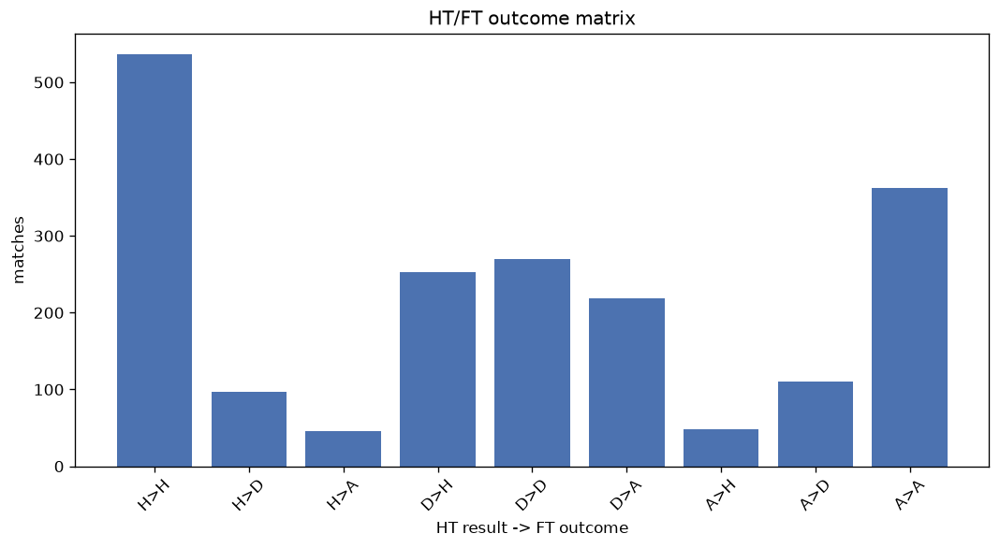
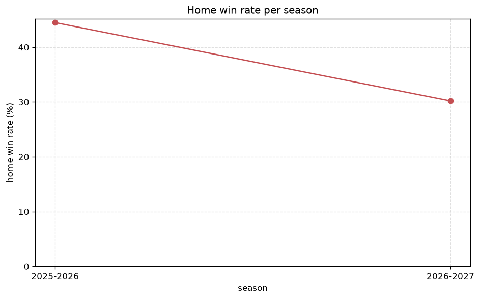

# Match Analysis
- Report: `matches_analysis`
- Generated: 2026-10-30T03:54:12+00:00
- Script: `backend/scripts/analyze_matches.py` v1.0.0
- League: Eredivisie (Netherlands)
- Scope: league `holland1`

## 1. Overall summary
| metric | value |
|---|---|
| Matches | 1941 |
| Home wins | 837 (43.1%) |
| Draws | 477 (24.6%) |
| Away wins | 627 (32.3%) |
| Total goals | 5994 |
| Average goals per match | 3.088 |
| Goalless matches | 94 (4.8%) |

## 2. Per-season breakdown
| season | matches | home wins | draws | away wins | total goals | avg goals | goalless |
|---|---|---|---|---|---|---|---|
| 2020-2021 | 306 | 126 (41.2%) | 78 (25.5%) | 102 (33.3%) | 920 | 3.007 | 16 (5.2%) |
| 2021-2022 | 306 | 132 (43.1%) | 64 (20.9%) | 110 (35.9%) | 875 | 2.859 | 15 (4.9%) |
| 2022-2023 | 306 | 137 (44.8%) | 73 (23.9%) | 96 (31.4%) | 935 | 3.056 | 25 (8.2%) |
| 2023-2024 | 306 | 132 (43.1%) | 76 (24.8%) | 98 (32.0%) | 992 | 3.242 | 15 (4.9%) |
| 2024-2025 | 306 | 139 (45.4%) | 77 (25.2%) | 90 (29.4%) | 914 | 2.987 | 12 (3.9%) |
| 2025-2026 | 321 | 143 (44.5%) | 83 (25.9%) | 95 (29.6%) | 1016 | 3.165 | 10 (3.1%) |
| 2026-2027 | 90 | 28 (31.1%) | 26 (28.9%) | 36 (40.0%) | 342 | 3.8 | 1 (1.1%) |

## 3. HT/FT outcome matrix
| HT result \ FT result | Home | Draw | Away | total |
|---|---|---|---|---|
| HT home lead | 536 (78.9%) | 97 (14.3%) | 46 (6.8%) | 679 |
| HT draw | 253 (34.1%) | 270 (36.4%) | 219 (29.5%) | 742 |
| HT away lead | 48 (9.2%) | 110 (21.2%) | 362 (69.6%) | 520 |

## 4. Comeback matches
- Home comebacks (trailing at HT, won at FT): **48** (2.5%)
- Away comebacks (trailing at HT, won at FT): **46** (2.4%)

### Home comebacks
| season | home | away | HT | FT |
|---|---|---|---|---|
| 2020-2021 | Venlo | Heracles | 0-1 | 3-2 |
| 2020-2021 | Zwolle | Vitesse | 0-1 | 2-1 |
| 2020-2021 | Venlo | Willem II | 0-1 | 2-1 |
| 2020-2021 | PSV | Vitesse | 0-1 | 3-1 |
| 2020-2021 | Zwolle | Heerenveen | 0-1 | 4-1 |
| 2021-2022 | Sittard | Twente | 0-1 | 2-1 |
| 2021-2022 | PSV | Zwolle | 0-1 | 3-1 |
| 2021-2022 | G.A. Eagles | Sittard | 0-2 | 4-3 |
| 2021-2022 | Groningen | Nijmegen | 2-3 | 4-3 |
| 2021-2022 | Ajax | Feyenoord | 1-2 | 3-2 |
| 2021-2022 | Ajax | Sparta Rotterdam | 0-1 | 2-1 |
| 2022-2023 | FC Emmen | Utrecht | 1-2 | 3-2 |
| 2022-2023 | Waalwijk | Excelsior | 1-2 | 5-2 |
| 2022-2023 | Excelsior | FC Emmen | 0-1 | 2-1 |
| 2022-2023 | Utrecht | Groningen | 0-1 | 2-1 |
| 2022-2023 | Ajax | Waalwijk | 0-1 | 3-1 |
| 2022-2023 | Feyenoord | FC Volendam | 0-1 | 2-1 |
| 2022-2023 | Twente | Ajax | 0-1 | 3-1 |
| 2023-2024 | Heracles | Nijmegen | 0-1 | 2-1 |
| 2023-2024 | Heracles | Excelsior | 0-1 | 3-1 |
| 2023-2024 | Sittard | FC Volendam | 0-1 | 3-1 |
| 2023-2024 | PSV | Ajax | 1-2 | 5-2 |
| 2023-2024 | FC Volendam | Excelsior | 0-1 | 3-1 |
| 2023-2024 | Twente | Excelsior | 1-2 | 4-2 |
| 2023-2024 | Nijmegen | Heracles | 0-1 | 3-1 |
| 2023-2024 | Heracles | Vitesse | 1-2 | 3-2 |
| 2023-2024 | Feyenoord | Utrecht | 1-2 | 4-2 |
| 2023-2024 | AZ Alkmaar | Waalwijk | 0-2 | 3-2 |
| 2023-2024 | Ajax | Twente | 0-1 | 2-1 |
| 2023-2024 | AZ Alkmaar | Twente | 0-1 | 2-1 |
| 2024-2025 | G.A. Eagles | Heracles | 0-1 | 4-1 |
| 2024-2025 | Feyenoord | AZ Alkmaar | 0-1 | 3-2 |
| 2024-2025 | Zwolle | Sittard | 0-1 | 3-1 |
| 2024-2025 | Twente | G.A. Eagles | 1-2 | 3-2 |
| 2024-2025 | G.A. Eagles | NAC Breda | 0-1 | 2-1 |
| 2024-2025 | G.A. Eagles | PSV | 1-2 | 3-2 |
| 2025-2026 | NAC Breda | Heracles | 0-1 | 2-1 |
| 2025-2026 | Heerenveen | Excelsior | 0-1 | 2-1 |
| 2025-2026 | Twente | Heracles | 0-1 | 2-1 |
| 2025-2026 | Utrecht | FC Volendam | 0-1 | 3-1 |
| 2025-2026 | FC Volendam | NAC Breda | 0-1 | 2-1 |
| 2025-2026 | Heracles | G.A. Eagles | 1-2 | 4-2 |
| 2025-2026 | Heerenveen | Zwolle | 1-2 | 4-2 |
| 2025-2026 | Feyenoord | Excelsior | 0-1 | 2-1 |
| 2025-2026 | PSV | Utrecht | 1-2 | 4-3 |
| 2026-2027 | Twente | PSV | 1-2 | 3-2 |
| 2026-2027 | Den Haag | PSV | 0-1 | 2-1 |
| 2026-2027 | Zwolle | G.A. Eagles | 0-1 | 4-1 |

### Away comebacks
| season | home | away | HT | FT |
|---|---|---|---|---|
| 2020-2021 | FC Emmen | Venlo | 1-0 | 3-5 |
| 2020-2021 | Willem II | Vitesse | 1-0 | 1-3 |
| 2020-2021 | AZ Alkmaar | Groningen | 1-0 | 1-2 |
| 2020-2021 | FC Emmen | Utrecht | 2-1 | 2-3 |
| 2020-2021 | Willem II | Zwolle | 1-0 | 1-3 |
| 2020-2021 | Twente | Utrecht | 1-0 | 1-2 |
| 2021-2022 | Vitesse | G.A. Eagles | 1-0 | 1-2 |
| 2021-2022 | Heerenveen | Vitesse | 1-0 | 1-2 |
| 2021-2022 | Nijmegen | Cambuur | 2-1 | 2-3 |
| 2021-2022 | G.A. Eagles | Twente | 1-0 | 1-2 |
| 2021-2022 | Nijmegen | PSV | 1-0 | 1-2 |
| 2021-2022 | Sparta Rotterdam | PSV | 1-0 | 1-2 |
| 2021-2022 | Zwolle | Feyenoord | 1-0 | 1-2 |
| 2021-2022 | Vitesse | Heerenveen | 1-0 | 1-2 |
| 2022-2023 | Sittard | Ajax | 1-0 | 2-3 |
| 2022-2023 | Sittard | Cambuur | 1-0 | 1-4 |
| 2022-2023 | Groningen | Sittard | 1-0 | 2-3 |
| 2022-2023 | Cambuur | Sittard | 1-0 | 1-2 |
| 2022-2023 | Heerenveen | Waalwijk | 1-0 | 1-4 |
| 2022-2023 | Ajax | Feyenoord | 2-1 | 2-3 |
| 2022-2023 | Heerenveen | FC Emmen | 1-0 | 2-3 |
| 2023-2024 | FC Volendam | Vitesse | 1-0 | 1-2 |
| 2023-2024 | Nijmegen | Excelsior | 2-1 | 3-4 |
| 2023-2024 | Vitesse | PSV | 1-0 | 1-3 |
| 2023-2024 | Waalwijk | AZ Alkmaar | 1-0 | 1-3 |
| 2023-2024 | Excelsior | Zwolle | 1-0 | 2-4 |
| 2023-2024 | Sittard | AZ Alkmaar | 1-0 | 1-2 |
| 2023-2024 | Sparta Rotterdam | Heracles | 1-0 | 1-2 |
| 2024-2025 | Heracles | PSV | 1-0 | 1-3 |
| 2024-2025 | NAC Breda | Utrecht | 1-0 | 1-2 |
| 2024-2025 | NAC Breda | AZ Alkmaar | 1-0 | 1-2 |
| 2024-2025 | Utrecht | Sittard | 1-0 | 2-5 |
| 2024-2025 | Almere City | Waalwijk | 1-0 | 1-4 |
| 2024-2025 | Willem II | Utrecht | 1-0 | 2-3 |
| 2024-2025 | Willem II | Ajax | 1-0 | 1-2 |
| 2024-2025 | Feyenoord | PSV | 2-0 | 2-3 |
| 2025-2026 | Twente | Ajax | 1-0 | 2-3 |
| 2025-2026 | Excelsior | Heracles | 1-0 | 1-2 |
| 2025-2026 | FC Volendam | Nijmegen | 1-0 | 2-3 |
| 2025-2026 | Utrecht | PSV | 1-0 | 1-2 |
| 2025-2026 | Groningen | PSV | 1-0 | 1-2 |
| 2025-2026 | Excelsior | AZ Alkmaar | 1-0 | 1-2 |
| 2025-2026 | Sittard | Twente | 1-0 | 1-2 |
| 2025-2026 | Den Bosch | Almere City | 2-0 | 2-3 |
| 2026-2027 | Heerenveen | AZ Alkmaar | 2-1 | 2-3 |
| 2026-2027 | Twente | Utrecht | 1-0 | 1-2 |

## 5. HT lead conversion
| HT state | matches | converted to win | held as draw | collapsed to loss |
|---|---|---|---|---|
| Home lead | 679 | 536 (78.9%) | 97 (14.3%) | 46 (6.8%) |
| Away lead | 520 | 362 (69.6%) | 110 (21.2%) | 48 (9.2%) |

### Matches level at half-time
| FT result | count | pct |
|---|---|---|
| Home win | 253 | 34.1% |
| Draw | 270 | 36.4% |
| Away win | 219 | 29.5% |

## 6. First-goal timing
- Matches with a first-goal time recorded: `1847` of `1941` (95.2%)

Outcome distribution by first-goal timing bucket:
| bucket | matches | % of matches | home | draw | away |
|---|---|---|---|---|---|
| 1-15 | 686 | 35.3% | 325 (47.4%) | 137 (20.0%) | 224 (32.7%) |
| 16-30 | 443 | 22.8% | 204 (46.0%) | 82 (18.5%) | 157 (35.4%) |
| 31-45 | 281 | 14.5% | 120 (42.7%) | 68 (24.2%) | 93 (33.1%) |
| 46-60 | 226 | 11.6% | 98 (43.4%) | 59 (26.1%) | 69 (30.5%) |
| 61-75 | 114 | 5.9% | 43 (37.7%) | 28 (24.6%) | 43 (37.7%) |
| 76-90 | 81 | 4.2% | 37 (45.7%) | 8 (9.9%) | 36 (44.4%) |
| 91-120 | 16 | 0.8% | 10 (62.5%) | 1 (6.2%) | 5 (31.2%) |

## 7. Goalless matches
- Overall: **94** of `1941` (4.8%)

| season | matches | goalless | pct |
|---|---|---|---|
| 2020-2021 | 306 | 16 | 5.2% |
| 2021-2022 | 306 | 15 | 4.9% |
| 2022-2023 | 306 | 25 | 8.2% |
| 2023-2024 | 306 | 15 | 4.9% |
| 2024-2025 | 306 | 12 | 3.9% |
| 2025-2026 | 321 | 10 | 3.1% |
| 2026-2027 | 90 | 1 | 1.1% |

---
*All statistics are computed from PostgreSQL tables (read-only). Run with `python backend/scripts/analyze_matches.py` to regenerate.*

## Charts

