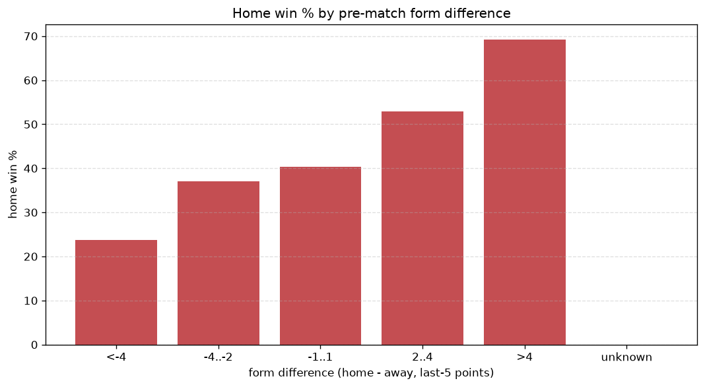
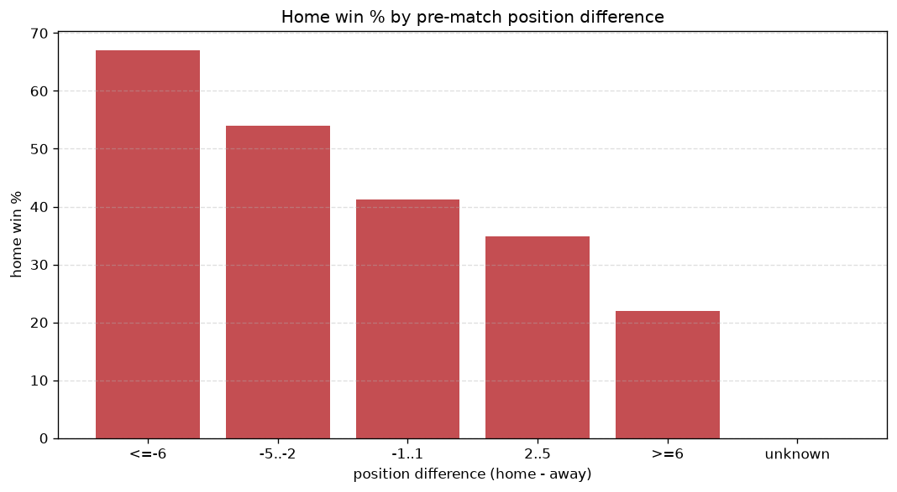

# Relationships Analysis
- Report: `relationships`
- Generated: 2026-10-26T01:35:15+00:00
- Script: `backend/scripts/analyze_relationships.py` v1.0.0
- League: Eredivisie (Netherlands)
- Scope: league `holland1`

- Matches analysed: **1851** (23 leakage-safe pre-match features).

## 1. Correlation matrix
_Pearson correlation of each pre-match feature with observed goals; sorted by |corr(total goals)|._

| feature | corr(home) | corr(away) | corr(total) |
|---|---|---|---|
| home_team_home_goals_avg | 0.221 | -0.094 | 0.111 |
| home_position_before_match | -0.250 | 0.147 | -0.096 |
| home_team_goals_scored_last_5 | 0.205 | -0.097 | 0.096 |
| home_team_wins_last_5 | 0.208 | -0.110 | 0.089 |
| home_team_points_last_5 | 0.200 | -0.109 | 0.083 |
| home_team_home_win_rate | 0.199 | -0.112 | 0.080 |
| away_team_away_goals_avg | -0.131 | 0.236 | 0.066 |
| away_position_before_match | 0.186 | -0.289 | -0.060 |
| home_team_goals_conceded_last_5 | -0.143 | 0.084 | -0.055 |
| away_team_goals_conceded_last_5 | 0.086 | -0.169 | -0.054 |
| away_rest_days | -0.065 | 0.003 | -0.051 |
| away_team_points_last_5 | -0.137 | 0.217 | 0.047 |
| home_rest_days | -0.069 | 0.012 | -0.047 |
| home_points_before_match | 0.158 | -0.111 | 0.047 |
| away_team_wins_last_5 | -0.138 | 0.216 | 0.046 |
| points_difference | 0.318 | -0.293 | 0.045 |
| away_team_goals_scored_last_5 | -0.137 | 0.206 | 0.040 |
| away_team_away_conceded_avg | 0.101 | -0.163 | -0.037 |
| home_team_home_conceded_avg | -0.153 | 0.122 | -0.035 |
| away_team_away_win_rate | -0.158 | 0.214 | 0.028 |
| position_difference | -0.318 | 0.317 | -0.027 |
| away_points_before_match | -0.114 | 0.139 | 0.009 |
| rest_days_difference | -0.009 | 0.022 | 0.009 |

## 2. Form vs outcome
_Home win/draw/away % per bucket of `home_team_points_last_5 - away_team_points_last_5`._

| bucket | matches | home | draw | away | home % | draw % | away % |
|---|---|---|---|---|---|---|---|
| <-4 | 349 | 83 | 81 | 185 | 23.8% | 23.2% | 53.0% |
| -4..-2 | 349 | 129 | 91 | 129 | 37.0% | 26.1% | 37.0% |
| -1..1 | 503 | 203 | 147 | 153 | 40.4% | 29.2% | 30.4% |
| 2..4 | 342 | 181 | 76 | 85 | 52.9% | 22.2% | 24.9% |
| >4 | 308 | 213 | 56 | 39 | 69.2% | 18.2% | 12.7% |
| unknown | 0 | 0 | 0 | 0 | - | - | - |

## 3. Position vs outcome
_Home win/draw/away % per bucket of `position_difference` (home position - away position; negative favours the home team)._

| bucket | matches | home | draw | away | home % | draw % | away % |
|---|---|---|---|---|---|---|---|
| <=-6 | 433 | 290 | 84 | 59 | 67.0% | 19.4% | 13.6% |
| -5..-2 | 337 | 182 | 82 | 73 | 54.0% | 24.3% | 21.7% |
| -1..1 | 289 | 119 | 73 | 97 | 41.2% | 25.3% | 33.6% |
| 2..5 | 344 | 120 | 109 | 115 | 34.9% | 31.7% | 33.4% |
| >=6 | 448 | 98 | 103 | 247 | 21.9% | 23.0% | 55.1% |
| unknown | 0 | 0 | 0 | 0 | - | - | - |

## 4. Rest advantage
_Home win/draw/away % per bucket of `rest_days_difference` (home rest - away rest). Matches with unknown rest are bucketed separately._

| bucket | matches | home | draw | away | home % | draw % | away % |
|---|---|---|---|---|---|---|---|
| <-1 | 139 | 68 | 40 | 31 | 48.9% | 28.8% | 22.3% |
| -1..0 | 401 | 181 | 92 | 128 | 45.1% | 22.9% | 31.9% |
| 0 | 669 | 309 | 154 | 206 | 46.2% | 23.0% | 30.8% |
| 1..2 | 502 | 196 | 134 | 172 | 39.0% | 26.7% | 34.3% |
| >2 | 81 | 30 | 20 | 31 | 37.0% | 24.7% | 38.3% |
| unknown | 59 | 25 | 11 | 23 | 42.4% | 18.6% | 39.0% |
- *59 match(es) had unknown rest difference (missing rest data on at least one side).*

## 5. Home team quality
_Home win rate by `home_team_home_win_rate` tier (split at 0.5)._

- `< 0.5` tier: **37.4%** home win (408/1091)
- `>= 0.5` tier: **52.8%** home win (401/760)
- Home-win gap (>= split minus < split): **+15.4 pp**

| tier | label | matches | home | draw | away | home % |
|---|---|---|---|---|---|---|
| low | < 0.5 | 1091 | 408 | 277 | 406 | 37.4% |
| high | >= 0.5 | 760 | 401 | 174 | 185 | 52.8% |

## 6. Feature averages by result
_Mean feature value per outcome; `range` is home-minus-away spread of the group means._

| feature | home mean | draw mean | away mean | range |
|---|---|---|---|---|
| points_difference | 5.543 | -1.333 | -6.942 | 12.485 |
| away_points_before_match | 19.853 | 23.264 | 26.384 | 6.531 |
| position_difference | -2.722 | 0.723 | 3.648 | 6.370 |
| home_points_before_match | 25.396 | 21.931 | 19.442 | 5.954 |
| away_position_before_match | 11.240 | 9.521 | 7.670 | 3.570 |
| home_position_before_match | 8.518 | 10.244 | 11.318 | 2.800 |
| away_team_goals_scored_last_5 | 6.143 | 6.967 | 8.137 | 1.994 |
| away_team_points_last_5 | 5.524 | 6.397 | 7.455 | 1.931 |
| home_team_goals_scored_last_5 | 7.586 | 6.581 | 5.939 | 1.647 |
| home_team_points_last_5 | 6.933 | 5.956 | 5.328 | 1.605 |
| away_team_goals_conceded_last_5 | 7.436 | 6.894 | 5.963 | 1.474 |
| home_team_goals_conceded_last_5 | 6.527 | 7.111 | 7.391 | 0.864 |
| home_rest_days | 7.918 | 8.764 | 8.654 | 0.846 |
| away_rest_days | 7.940 | 8.685 | 8.475 | 0.745 |
| away_team_wins_last_5 | 1.461 | 1.756 | 2.129 | 0.668 |
| home_team_wins_last_5 | 1.954 | 1.601 | 1.399 | 0.555 |
| away_team_away_goals_avg | 1.124 | 1.322 | 1.546 | 0.421 |
| home_team_home_goals_avg | 1.805 | 1.535 | 1.419 | 0.385 |
| away_team_away_conceded_avg | 1.733 | 1.621 | 1.423 | 0.309 |
| home_team_home_conceded_avg | 1.186 | 1.335 | 1.431 | 0.245 |
| rest_days_difference | -0.017 | 0.084 | 0.187 | 0.203 |
| away_team_away_win_rate | 0.252 | 0.297 | 0.384 | 0.132 |
| home_team_home_win_rate | 0.473 | 0.388 | 0.358 | 0.116 |

---
*All features are leakage-safe pre-match values built by `ml.features.build_features.build_rows` from strictly prior matches. Run with `python backend/scripts/analyze_relationships.py` to regenerate.*

## Charts

