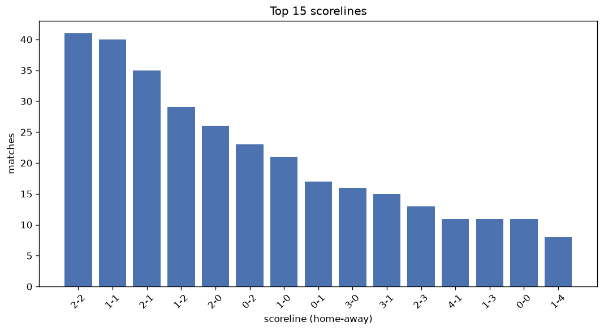
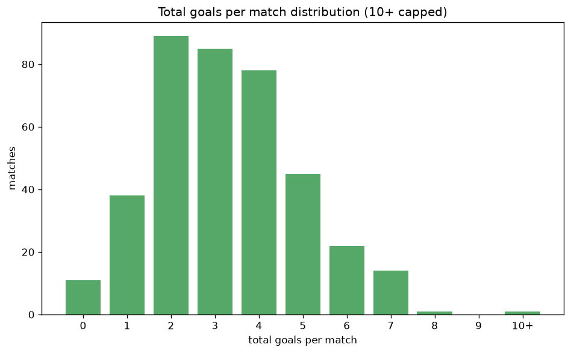

# Scoreline Analysis
- Report: `scoreline_analysis`
- Generated: 2026-10-30T03:54:20+00:00
- Script: `backend/scripts/analyze_scorelines.py` v1.0.0
- League: Eredivisie (Netherlands)
- Scope: league `holland1`

## 1. Scoreline frequency
- Matches analysed: **1941** across **7** seasons.
- Distinct scorelines seen: **49**.

| scoreline | count | pct |
|---|---|---|
| 1-1 | 221 | 11.4% |
| 1-0 | 141 | 7.3% |
| 1-2 | 136 | 7.0% |
| 2-1 | 135 | 7.0% |
| 2-0 | 130 | 6.7% |
| 2-2 | 130 | 6.7% |
| 0-1 | 113 | 5.8% |
| 3-1 | 95 | 4.9% |
| 0-0 | 94 | 4.8% |
| 0-2 | 90 | 4.6% |
| 3-0 | 83 | 4.3% |
| 1-3 | 65 | 3.3% |
| 0-3 | 52 | 2.7% |
| 4-0 | 47 | 2.4% |
| 3-2 | 47 | 2.4% |
| 2-3 | 45 | 2.3% |
| 1-4 | 43 | 2.2% |
| 4-1 | 43 | 2.2% |
| 5-0 | 31 | 1.6% |
| 3-3 | 30 | 1.5% |

## 2. Scoreline frequency per season

### 2020-2021
| scoreline | count | pct |
|---|---|---|
| 1-1 | 41 | 13.4% |
| 1-0 | 22 | 7.2% |
| 2-0 | 18 | 5.9% |
| 0-2 | 18 | 5.9% |
| 0-1 | 18 | 5.9% |

### 2021-2022
| scoreline | count | pct |
|---|---|---|
| 1-1 | 36 | 11.8% |
| 0-1 | 32 | 10.5% |
| 1-2 | 29 | 9.5% |
| 1-0 | 26 | 8.5% |
| 2-1 | 25 | 8.2% |

### 2022-2023
| scoreline | count | pct |
|---|---|---|
| 1-1 | 28 | 9.2% |
| 0-0 | 25 | 8.2% |
| 2-0 | 23 | 7.5% |
| 2-1 | 23 | 7.5% |
| 0-1 | 22 | 7.2% |

### 2023-2024
| scoreline | count | pct |
|---|---|---|
| 1-1 | 32 | 10.5% |
| 2-2 | 24 | 7.8% |
| 1-2 | 20 | 6.5% |
| 2-0 | 19 | 6.2% |
| 3-1 | 19 | 6.2% |

### 2024-2025
| scoreline | count | pct |
|---|---|---|
| 1-1 | 40 | 13.1% |
| 1-0 | 34 | 11.1% |
| 1-2 | 25 | 8.2% |
| 2-0 | 24 | 7.8% |
| 2-2 | 20 | 6.5% |

### 2025-2026
| scoreline | count | pct |
|---|---|---|
| 1-1 | 36 | 11.2% |
| 2-1 | 33 | 10.3% |
| 2-2 | 31 | 9.7% |
| 1-2 | 26 | 8.1% |
| 2-0 | 24 | 7.5% |

### 2026-2027
| scoreline | count | pct |
|---|---|---|
| 2-2 | 14 | 15.6% |
| 1-1 | 8 | 8.9% |
| 1-2 | 5 | 5.6% |
| 2-0 | 4 | 4.4% |
| 0-2 | 4 | 4.4% |

## 3. Total-goal histogram
_10+ groups all matches with 10 or more total goals._

| total goals | matches | pct |
|---|---|---|
| 0 | 94 | 4.8% |
| 1 | 254 | 13.1% |
| 2 | 441 | 22.7% |
| 3 | 406 | 20.9% |
| 4 | 359 | 18.5% |
| 5 | 220 | 11.3% |
| 6 | 98 | 5.0% |
| 7 | 49 | 2.5% |
| 8 | 14 | 0.7% |
| 9 | 2 | 0.1% |
| 10+ | 4 | 0.2% |

## 4. Extreme scorelines
- Matches with 7+ total goals: **69**

| season | date | scoreline | total goals |
|---|---|---|---|
| 2020-2021 | 2020-10-24 | 0-13 | 13 |
| 2022-2023 | 2023-01-28 | 5-5 | 10 |
| 2024-2025 | 2024-09-14 | 9-1 | 10 |
| 2025-2026 | 2025-11-02 | 8-2 | 10 |
| 2021-2022 | 2021-09-18 | 9-0 | 9 |
| 2023-2024 | 2024-05-12 | 7-2 | 9 |
| 2020-2021 | 2020-09-13 | 3-5 | 8 |
| 2020-2021 | 2020-10-04 | 4-4 | 8 |
| 2020-2021 | 2020-12-20 | 5-3 | 8 |
| 2020-2021 | 2021-01-16 | 3-5 | 8 |
| 2021-2022 | 2021-09-25 | 5-3 | 8 |
| 2022-2023 | 2022-08-31 | 7-1 | 8 |
| 2022-2023 | 2022-10-16 | 7-1 | 8 |
| 2023-2024 | 2024-02-24 | 1-7 | 8 |
| 2023-2024 | 2024-04-25 | 0-8 | 8 |
| 2024-2025 | 2024-08-24 | 1-7 | 8 |
| 2024-2025 | 2025-01-12 | 6-2 | 8 |
| 2024-2025 | 2025-03-16 | 2-6 | 8 |
| 2024-2025 | 2025-05-18 | 5-3 | 8 |
| 2025-2026 | 2025-09-13 | 3-5 | 8 |
| 2020-2021 | 2020-10-31 | 5-2 | 7 |
| 2021-2022 | 2021-08-28 | 5-2 | 7 |
| 2021-2022 | 2021-09-11 | 5-2 | 7 |
| 2021-2022 | 2021-10-30 | 5-2 | 7 |
| 2021-2022 | 2021-10-31 | 4-3 | 7 |
| 2021-2022 | 2021-12-04 | 1-6 | 7 |
| 2021-2022 | 2022-02-12 | 3-4 | 7 |
| 2021-2022 | 2022-03-12 | 4-3 | 7 |
| 2022-2023 | 2022-08-07 | 2-5 | 7 |
| 2022-2023 | 2022-08-13 | 2-5 | 7 |
| 2022-2023 | 2022-08-14 | 6-1 | 7 |
| 2022-2023 | 2022-08-28 | 1-6 | 7 |
| 2022-2023 | 2022-09-02 | 3-4 | 7 |
| 2022-2023 | 2022-09-03 | 3-4 | 7 |
| 2022-2023 | 2022-09-04 | 5-2 | 7 |
| 2022-2023 | 2022-09-18 | 4-3 | 7 |
| 2022-2023 | 2022-10-16 | 6-1 | 7 |
| 2022-2023 | 2022-11-13 | 6-1 | 7 |
| 2022-2023 | 2023-03-12 | 5-2 | 7 |
| 2023-2024 | 2023-08-13 | 3-4 | 7 |
| 2023-2024 | 2023-08-27 | 6-1 | 7 |
| 2023-2024 | 2023-09-16 | 6-1 | 7 |
| 2023-2024 | 2023-10-22 | 4-3 | 7 |
| 2023-2024 | 2023-10-29 | 5-2 | 7 |
| 2023-2024 | 2024-03-01 | 2-5 | 7 |
| 2023-2024 | 2024-03-03 | 5-2 | 7 |
| 2024-2025 | 2024-10-20 | 3-4 | 7 |
| 2024-2025 | 2024-12-01 | 2-5 | 7 |
| 2024-2025 | 2024-12-06 | 6-1 | 7 |
| 2024-2025 | 2024-12-14 | 5-2 | 7 |
| 2024-2025 | 2024-12-22 | 2-5 | 7 |
| 2024-2025 | 2025-05-03 | 6-1 | 7 |
| 2025-2026 | 2025-08-09 | 6-1 | 7 |
| 2025-2026 | 2025-10-19 | 0-7 | 7 |
| 2025-2026 | 2025-10-31 | 5-2 | 7 |
| 2025-2026 | 2025-12-06 | 6-1 | 7 |
| 2025-2026 | 2025-12-13 | 4-3 | 7 |
| 2025-2026 | 2025-12-21 | 4-3 | 7 |
| 2025-2026 | 2026-01-17 | 3-4 | 7 |
| 2025-2026 | 2026-01-18 | 3-4 | 7 |
| 2025-2026 | 2026-04-04 | 4-3 | 7 |
| 2025-2026 | 2026-04-23 | 6-1 | 7 |
| 2026-2027 | 2026-08-23 | 2-5 | 7 |
| 2026-2027 | 2026-08-29 | 5-2 | 7 |
| 2026-2027 | 2026-08-30 | 1-6 | 7 |
| 2026-2027 | 2026-09-13 | 0-7 | 7 |
| 2026-2027 | 2026-10-17 | 3-4 | 7 |
| 2026-2027 | 2026-10-18 | 2-5 | 7 |
| 2026-2027 | 2026-10-24 | 1-6 | 7 |

## 5. Margin-of-victory distribution (decided matches)
- Decided matches: **1464** (draws: **477**)
- Average winning margin: **2.05**

| margin | matches | pct |
|---|---|---|
| 1 | 632 | 43.2% |
| 2 | 417 | 28.5% |
| 3+ | 415 | 28.3% |

## 6. Margin by outcome

### Home wins
- Matches: **837** | avg margin: **2.15** | max margin: **9**
| margin | matches | pct |
|---|---|---|
| 1 | 330 | 39.4% |
| 2 | 248 | 29.6% |
| 3+ | 259 | 30.9% |
- *Full match-by-match list available in `scoreline_analysis.json`.*

### Away wins
- Matches: **627** | avg margin: **1.92** | max margin: **13**
| margin | matches | pct |
|---|---|---|
| 1 | 302 | 48.2% |
| 2 | 169 | 27.0% |
| 3+ | 156 | 24.9% |
- *Full match-by-match list available in `scoreline_analysis.json`.*

## 7. Most common exact score by outcome type
| outcome | matches | most common score | count | pct |
|---|---|---|---|---|
| home | 837 | 1-0 | 141 | 16.8% |
| draw | 477 | 1-1 | 221 | 46.3% |
| away | 627 | 1-2 | 136 | 21.7% |

---
*All statistics are computed from PostgreSQL tables (read-only). Run with `python backend/scripts/analyze_scorelines.py` to regenerate.*

## Charts

