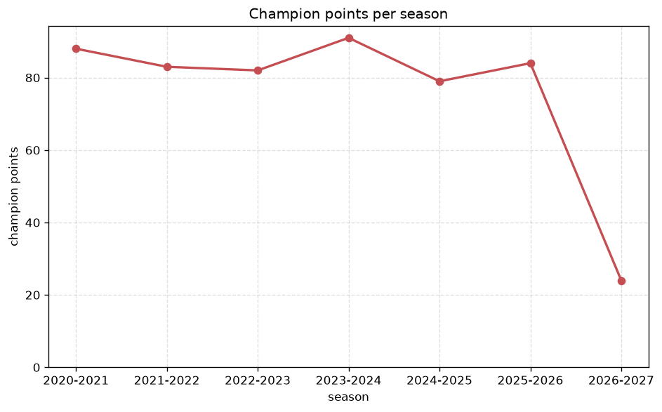
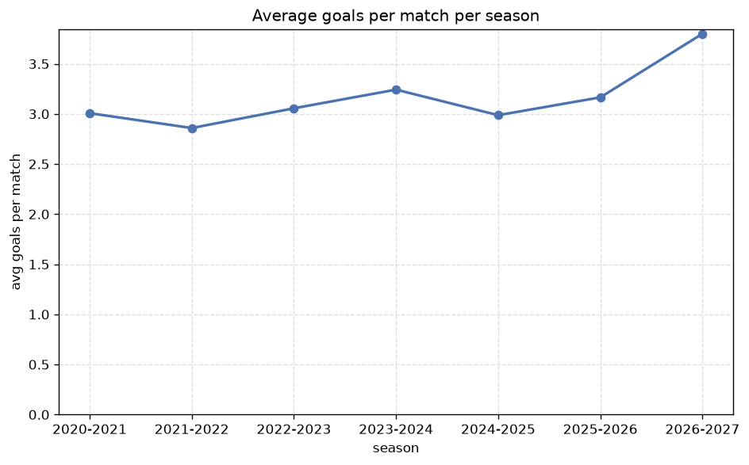

# Season Trends Analysis
- Report: `season_trends`
- Generated: 2026-10-30T03:54:18+00:00
- Script: `backend/scripts/analyze_seasons.py` v1.0.0
- League: Eredivisie (Netherlands)
- Scope: league `holland1`

## 1. Champions per season
| season | champion | pts | runner-up | margin |
|---|---|---|---|---|
| 2020-2021 | Ajax | 88 | PSV | 16 pts |
| 2021-2022 | Ajax | 83 | PSV | 2 pts |
| 2022-2023 | Feyenoord | 82 | PSV | 7 pts |
| 2023-2024 | PSV | 91 | Feyenoord | 7 pts |
| 2024-2025 | PSV | 79 | Ajax | 1 pts |
| 2025-2026 | PSV | 84 | Feyenoord | 19 pts |
| 2026-2027 | Feyenoord | 24 | Ajax | 3 pts |

## 2. Title-race tightness
- Tight races (margin <= 3 pts): **3** of 7 seasons
- Tightest race: **2024-2025** - PSV beat Ajax by **1** pts

| season | margin | tight |
|---|---|---|
| 2020-2021 | 16 pts |  |
| 2021-2022 | 2 pts | yes |
| 2022-2023 | 7 pts |  |
| 2023-2024 | 7 pts |  |
| 2024-2025 | 1 pts | yes |
| 2025-2026 | 19 pts |  |
| 2026-2027 | 3 pts | yes |

## 3. Points thresholds
_Position-specific points per season. Key: 1 = champion, 2 = runner-up, 4 = CL line, 6 = Europa, 15 = last safe, 18 = bottom._

| season | pos 1 | pos 2 | pos 4 | pos 6 | pos 15 | pos 18 |
|---|---|---|---|---|---|---|
| 2020-2021 | 88 | 72 | 61 | 53 | 30 | 22 |
| 2021-2022 | 83 | 81 | 68 | 51 | 35 | 27 |
| 2022-2023 | 82 | 75 | 67 | 59 | 32 | 18 |
| 2023-2024 | 91 | 84 | 65 | 53 | 29 | 19 |
| 2024-2025 | 79 | 78 | 64 | 54 | 33 | 22 |
| 2025-2026 | 84 | 65 | 59 | 56 | 37 | 19 |
| 2026-2027 | 24 | 21 | 20 | 18 | 8 | 2 |

## 4. Relegation battle
| season | safe pos | safe pts | drop pos | drop pts | gap |
|---|---|---|---|---|---|
| 2020-2021 | 15 | 30 | 16 | 30 | 0 pts |
| 2021-2022 | 15 | 35 | 16 | 34 | 1 pts |
| 2022-2023 | 15 | 32 | 16 | 28 | 4 pts |
| 2023-2024 | 15 | 29 | 16 | 29 | 0 pts |
| 2024-2025 | 15 | 33 | 16 | 26 | 7 pts |
| 2025-2026 | 15 | 37 | 16 | 35 | 2 pts |
| 2026-2027 | 15 | 8 | 16 | 6 | 2 pts |

## 5. League-level trends
| season | matches | total goals | avg goals | home win | draw | away win | goalless | avg pts/team |
|---|---|---|---|---|---|---|---|---|
| 2020-2021 | 306 | 920 | 3.007 | 41.2% | 25.5% | 33.3% | 5.2% | 46.67 |
| 2021-2022 | 306 | 875 | 2.859 | 43.1% | 20.9% | 35.9% | 4.9% | 47.44 |
| 2022-2023 | 306 | 935 | 3.056 | 44.8% | 23.9% | 31.4% | 8.2% | 46.94 |
| 2023-2024 | 306 | 992 | 3.242 | 43.1% | 24.8% | 32.0% | 4.9% | 46.78 |
| 2024-2025 | 306 | 914 | 2.987 | 45.4% | 25.2% | 29.4% | 3.9% | 46.72 |
| 2025-2026 | 321 | 1016 | 3.165 | 44.5% | 25.9% | 29.6% | 3.1% | 36.29 |
| 2026-2027 | 90 | 342 | 3.8 | 31.1% | 28.9% | 40.0% | 1.1% | 13.56 |

## 6. View divergence
- Largest divergence: **2025-2026** (luck view, avg abs position diff = 6.833)

_Avg absolute position difference between classic view and alternative view per season._

| season | classic vs luck | classic vs goals |
|---|---|---|
| 2020-2021 | 3.556 | 5.556 |
| 2021-2022 | 4.222 | 2.778 |
| 2022-2023 | 3.444 | 5.000 |
| 2023-2024 | 3.000 | 5.667 |
| 2024-2025 | 4.333 | 3.111 |
| 2025-2026 | 6.833 | 6.250 |
| 2026-2027 | 3.000 | 5.778 |

---
*All statistics are computed from PostgreSQL tables (read-only). Run with `python backend/scripts/analyze_seasons.py` to regenerate.*

## Charts

