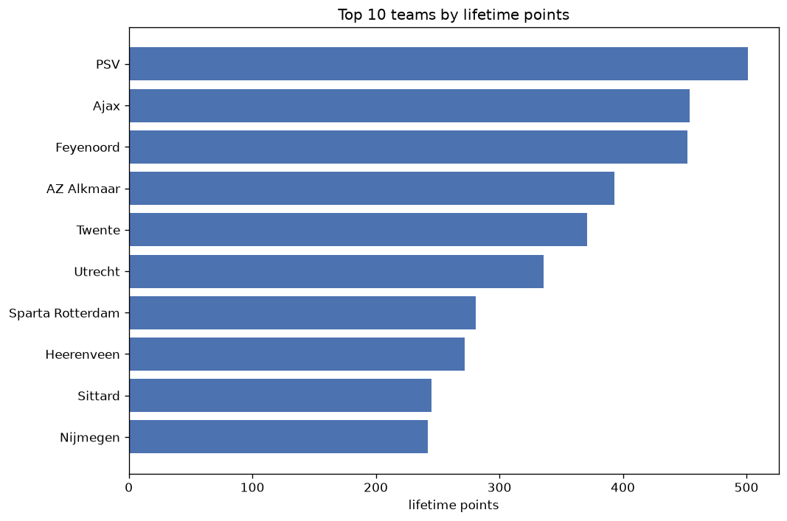
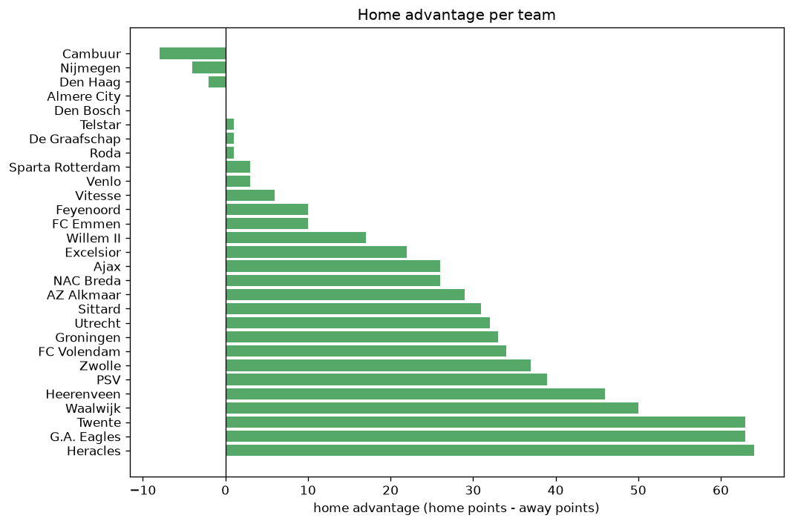

# Team Analysis
- Report: `teams_analysis`
- Generated: 2026-10-26T01:35:10+00:00
- Script: `backend/scripts/analyze_teams.py` v1.0.0
- League: Eredivisie (Netherlands)
- Scope: league `holland1`

- Teams: **29** | Seasons: **7** | Matches: **1936**

## 1. Team standings (lifetime)
| team | seasons | played | W | D | L | pts | GF | GA | GD | avg pts/season | best pos | worst pos | titles |
|---|---|---|---|---|---|---|---|---|---|---|---|---|---|
| PSV | 7 | 213 | 157 | 30 | 26 | 501 | 591 | 234 | 357 | 71.57 | 1 | 3 | 3 |
| Ajax | 7 | 215 | 134 | 52 | 29 | 454 | 520 | 227 | 293 | 64.86 | 1 | 5 | 2 |
| Feyenoord | 7 | 213 | 135 | 47 | 31 | 452 | 490 | 218 | 272 | 64.57 | 1 | 5 | 2 |
| AZ Alkmaar | 7 | 213 | 114 | 51 | 48 | 393 | 413 | 257 | 156 | 56.14 | 2 | 7 | 0 |
| Twente | 7 | 213 | 104 | 59 | 50 | 371 | 376 | 249 | 127 | 53.0 | 3 | 10 | 0 |
| Utrecht | 7 | 216 | 90 | 66 | 60 | 336 | 345 | 302 | 43 | 48.0 | 4 | 11 | 0 |
| Sparta Rotterdam | 7 | 213 | 75 | 56 | 82 | 281 | 285 | 308 | -23 | 40.14 | 6 | 14 | 0 |
| Heerenveen | 7 | 215 | 72 | 56 | 87 | 272 | 296 | 345 | -49 | 38.86 | 6 | 12 | 0 |
| Sittard | 7 | 213 | 67 | 44 | 102 | 245 | 264 | 377 | -113 | 35.0 | 7 | 15 | 0 |
| Nijmegen | 6 | 179 | 62 | 56 | 61 | 242 | 291 | 263 | 28 | 40.33 | 3 | 13 | 0 |
| G.A. Eagles | 6 | 180 | 57 | 54 | 69 | 225 | 264 | 284 | -20 | 37.5 | 7 | 13 | 0 |
| Groningen | 6 | 180 | 55 | 40 | 85 | 205 | 223 | 286 | -63 | 34.17 | 7 | 18 | 0 |
| Zwolle | 6 | 180 | 46 | 49 | 85 | 187 | 213 | 317 | -104 | 31.17 | 10 | 18 | 0 |
| Vitesse | 4 | 136 | 49 | 29 | 58 | 176 | 169 | 213 | -44 | 44.0 | 4 | 17 | 0 |
| Waalwijk | 6 | 174 | 41 | 45 | 88 | 168 | 209 | 304 | -95 | 28.0 | 9 | 21 | 0 |
| Heracles | 5 | 170 | 44 | 36 | 90 | 168 | 193 | 324 | -131 | 33.6 | 9 | 18 | 0 |
| Excelsior | 4 | 111 | 28 | 26 | 57 | 110 | 141 | 218 | -77 | 27.5 | 12 | 16 | 0 |
| Willem II | 5 | 118 | 27 | 24 | 67 | 105 | 125 | 217 | -92 | 21.0 | 14 | 20 | 0 |
| FC Volendam | 3 | 104 | 23 | 21 | 60 | 90 | 114 | 218 | -104 | 30.0 | 14 | 18 | 0 |
| Cambuur | 3 | 78 | 19 | 13 | 46 | 70 | 98 | 161 | -63 | 23.33 | 9 | 17 | 0 |
| Almere City | 3 | 74 | 14 | 24 | 36 | 66 | 67 | 131 | -64 | 22.0 | 13 | 19 | 0 |
| NAC Breda | 2 | 68 | 14 | 20 | 34 | 62 | 69 | 116 | -47 | 31.0 | 15 | 17 | 0 |
| FC Emmen | 2 | 68 | 13 | 19 | 36 | 58 | 73 | 133 | -60 | 29.0 | 16 | 16 | 0 |
| Telstar | 2 | 44 | 10 | 13 | 21 | 43 | 61 | 76 | -15 | 21.5 | 14 | 16 | 0 |
| Den Haag | 2 | 44 | 5 | 13 | 26 | 28 | 42 | 99 | -57 | 14.0 | 17 | 18 | 0 |
| Venlo | 1 | 34 | 6 | 5 | 23 | 23 | 43 | 91 | -48 | 23.0 | 17 | 17 | 0 |
| Roda | 1 | 2 | 0 | 1 | 1 | 1 | 2 | 3 | -1 | 1.0 | 22 | 22 | 0 |
| De Graafschap | 1 | 2 | 0 | 1 | 1 | 1 | 3 | 5 | -2 | 1.0 | 23 | 23 | 0 |
| Den Bosch | 1 | 2 | 0 | 0 | 2 | 0 | 2 | 6 | -4 | 0.0 | 24 | 24 | 0 |

## 2. Home vs away split
| team | home P | H-W | H-D | H-L | H-pts | away P | A-W | A-D | A-L | A-pts | adv |
|---|---|---|---|---|---|---|---|---|---|---|---|
| Heracles | 85 | 31 | 23 | 31 | 116 | 85 | 13 | 13 | 59 | 52 | 64 |
| Twente | 107 | 64 | 25 | 18 | 217 | 106 | 40 | 34 | 32 | 154 | 63 |
| G.A. Eagles | 90 | 40 | 24 | 26 | 144 | 90 | 17 | 30 | 43 | 81 | 63 |
| Waalwijk | 87 | 30 | 19 | 38 | 109 | 87 | 11 | 26 | 50 | 59 | 50 |
| Heerenveen | 107 | 44 | 27 | 36 | 159 | 108 | 28 | 29 | 51 | 113 | 46 |
| PSV | 106 | 86 | 12 | 8 | 270 | 107 | 71 | 18 | 18 | 231 | 39 |
| Zwolle | 90 | 30 | 22 | 38 | 112 | 90 | 16 | 27 | 47 | 75 | 37 |
| FC Volendam | 52 | 18 | 8 | 26 | 62 | 52 | 5 | 13 | 34 | 28 | 34 |
| Groningen | 90 | 31 | 26 | 33 | 119 | 90 | 24 | 14 | 52 | 86 | 33 |
| Utrecht | 108 | 51 | 31 | 26 | 184 | 108 | 39 | 35 | 34 | 152 | 32 |
| Sittard | 106 | 39 | 21 | 46 | 138 | 107 | 28 | 23 | 56 | 107 | 31 |
| AZ Alkmaar | 106 | 62 | 25 | 19 | 211 | 107 | 52 | 26 | 29 | 182 | 29 |
| Ajax | 109 | 72 | 24 | 13 | 240 | 106 | 62 | 28 | 16 | 214 | 26 |
| NAC Breda | 34 | 11 | 11 | 12 | 44 | 34 | 3 | 9 | 22 | 18 | 26 |
| Excelsior | 55 | 18 | 12 | 25 | 66 | 56 | 10 | 14 | 32 | 44 | 22 |
| Willem II | 59 | 17 | 10 | 32 | 61 | 59 | 10 | 14 | 35 | 44 | 17 |
| Feyenoord | 106 | 69 | 24 | 13 | 231 | 107 | 66 | 23 | 18 | 221 | 10 |
| FC Emmen | 34 | 7 | 13 | 14 | 34 | 34 | 6 | 6 | 22 | 24 | 10 |
| Vitesse | 68 | 24 | 19 | 25 | 91 | 68 | 25 | 10 | 33 | 85 | 6 |
| Sparta Rotterdam | 107 | 37 | 31 | 39 | 142 | 106 | 38 | 25 | 43 | 139 | 3 |
| Venlo | 17 | 3 | 4 | 10 | 13 | 17 | 3 | 1 | 13 | 10 | 3 |
| Telstar | 22 | 5 | 7 | 10 | 22 | 22 | 5 | 6 | 11 | 21 | 1 |
| De Graafschap | 1 | 0 | 1 | 0 | 1 | 1 | 0 | 0 | 1 | 0 | 1 |
| Roda | 1 | 0 | 1 | 0 | 1 | 1 | 0 | 0 | 1 | 0 | 1 |
| Almere City | 37 | 7 | 12 | 18 | 33 | 37 | 7 | 12 | 18 | 33 | 0 |
| Den Bosch | 1 | 0 | 0 | 1 | 0 | 1 | 0 | 0 | 1 | 0 | 0 |
| Den Haag | 22 | 2 | 7 | 13 | 13 | 22 | 3 | 6 | 13 | 15 | -2 |
| Nijmegen | 90 | 29 | 32 | 29 | 119 | 89 | 33 | 24 | 32 | 123 | -4 |
| Cambuur | 39 | 9 | 4 | 26 | 31 | 39 | 10 | 9 | 20 | 39 | -8 |

## 3. Top performers
### Best points per game (PPG)
| rank | team | PPG |
|---|---|---|
| 1 | PSV | 2.35 |
| 2 | Feyenoord | 2.12 |
| 3 | Ajax | 2.11 |
| 4 | AZ Alkmaar | 1.84 |
| 5 | Twente | 1.74 |

### Most goals scored
| rank | team | goals |
|---|---|---|
| 1 | PSV | 591 |
| 2 | Ajax | 520 |
| 3 | Feyenoord | 490 |
| 4 | AZ Alkmaar | 413 |
| 5 | Twente | 376 |

### Best goal difference
| rank | team | GD |
|---|---|---|
| 1 | PSV | 357 |
| 2 | Ajax | 293 |
| 3 | Feyenoord | 272 |
| 4 | AZ Alkmaar | 156 |
| 5 | Twente | 127 |

### Best defence (goals against per match, standings)
| rank | team | GA/match |
|---|---|---|
| 1 | Roda | 1.000 |
| 2 | Feyenoord | 1.023 |
| 3 | Ajax | 1.056 |
| 4 | PSV | 1.099 |
| 5 | Twente | 1.169 |

## 4. Team consistency
- Teams present in all **7** seasons: **9**

AZ Alkmaar, Ajax, Feyenoord, Heerenveen, PSV, Sittard, Sparta Rotterdam, Twente, Utrecht

## 5. Head-to-head dominance
- Distinct fixtures: **305** (showing the 15 most frequent)

| fixture | meetings | home wins | draws | away wins | home pct | draw pct | away pct |
|---|---|---|---|---|---|---|---|
| AZ Alkmaar vs Sittard | 13 | 8 | 1 | 4 | 61.5% | 7.7% | 30.8% |
| PSV vs Twente | 13 | 8 | 2 | 3 | 61.5% | 15.4% | 23.1% |
| AZ Alkmaar vs Feyenoord | 13 | 7 | 2 | 4 | 53.8% | 15.4% | 30.8% |
| AZ Alkmaar vs Heerenveen | 13 | 7 | 2 | 4 | 53.8% | 15.4% | 30.8% |
| Ajax vs Heerenveen | 13 | 6 | 3 | 4 | 46.2% | 23.1% | 30.8% |
| Ajax vs Utrecht | 13 | 6 | 2 | 5 | 46.2% | 15.4% | 38.5% |
| Feyenoord vs Utrecht | 13 | 6 | 2 | 5 | 46.2% | 15.4% | 38.5% |
| PSV vs Heerenveen | 13 | 6 | 4 | 3 | 46.2% | 30.8% | 23.1% |
| PSV vs Sittard | 13 | 6 | 3 | 4 | 46.2% | 23.1% | 30.8% |
| PSV vs Sparta Rotterdam | 13 | 6 | 1 | 6 | 46.2% | 7.7% | 46.2% |
| Twente vs Heerenveen | 13 | 6 | 5 | 2 | 46.2% | 38.5% | 15.4% |
| Twente vs Sittard | 13 | 6 | 2 | 5 | 46.2% | 15.4% | 38.5% |
| Utrecht vs Twente | 13 | 6 | 3 | 4 | 46.2% | 23.1% | 30.8% |
| Ajax vs Sittard | 13 | 5 | 2 | 6 | 38.5% | 15.4% | 46.2% |
| PSV vs Utrecht | 13 | 5 | 4 | 4 | 38.5% | 30.8% | 30.8% |

## 6. Position per season (classic view)
_Cells show final position; '-' when the team was absent from that season._

| team | 2020-2021 | 2021-2022 | 2022-2023 | 2023-2024 | 2024-2025 | 2025-2026 | 2026-2027 |
|---|---|---|---|---|---|---|---|
| PSV | 2 | 2 | 2 | 1 | 1 | 1 | 3 |
| Ajax | 1 | 1 | 3 | 5 | 2 | 4 | 4 |
| Feyenoord | 5 | 3 | 1 | 2 | 3 | 2 | 1 |
| AZ Alkmaar | 3 | 5 | 4 | 4 | 5 | 7 | 2 |
| Twente | 10 | 4 | 5 | 3 | 6 | 5 | 5 |
| Utrecht | 6 | 7 | 7 | 7 | 4 | 6 | 11 |
| Sparta Rotterdam | 8 | 14 | 6 | 8 | 12 | 10 | 14 |
| Heerenveen | 12 | 8 | 8 | 11 | 9 | 8 | 6 |
| Sittard | 11 | 15 | 13 | 10 | 11 | 11 | 7 |
| Nijmegen | - | 11 | 12 | 6 | 8 | 3 | 13 |
| G.A. Eagles | - | 13 | 11 | 9 | 7 | 12 | 9 |
| Groningen | 7 | 12 | 18 | - | 13 | 9 | 8 |
| Zwolle | 13 | 18 | - | 12 | 10 | 15 | 15 |
| Vitesse | 4 | 6 | 10 | 17 | - | - | - |
| Waalwijk | 15 | 10 | 9 | 15 | 17 | 21 | - |
| Heracles | 9 | 16 | - | 14 | 14 | 18 | - |
| Excelsior | - | - | 15 | 16 | - | 13 | 12 |
| Willem II | 14 | 17 | - | - | 16 | 20 | 18 |
| FC Volendam | - | - | 14 | 18 | - | 16 | - |
| Cambuur | - | 9 | 17 | - | - | - | 10 |
| Almere City | - | - | - | 13 | 18 | 19 | - |
| NAC Breda | - | - | - | - | 15 | 17 | - |
| FC Emmen | 16 | - | 16 | - | - | - | - |
| Telstar | - | - | - | - | - | 14 | 16 |
| Den Haag | 18 | - | - | - | - | - | 17 |
| Venlo | 17 | - | - | - | - | - | - |
| Roda | - | - | - | - | - | 22 | - |
| De Graafschap | - | - | - | - | - | 23 | - |
| Den Bosch | - | - | - | - | - | 24 | - |

---
*All statistics are computed from PostgreSQL tables (read-only). Run with `python backend/scripts/analyze_teams.py` to regenerate.*

## Charts

